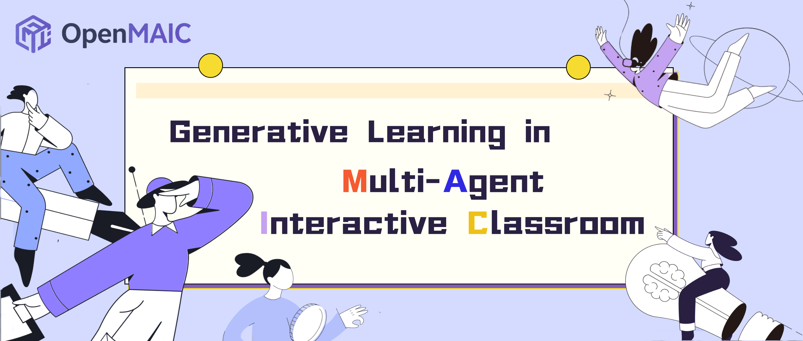

<p align="center">
  
</p>

<p align="center">
  Build interactive, multi-agent courses from a topic or source material.
</p>

<p align="center">
  <a href="README.md">English</a> · <a href="README-zh.md">简体中文</a> ·
  <a href="docs/README.md">Technical docs</a> · <a href="LICENSE">MIT License</a>
</p>

# OpenMAIC / ZHIYU

OpenMAIC is a Next.js application for generating and running interactive AI classrooms. The current repository includes the ZHIYU product shell, the classic course generator, an optional Pro agent workbench, classroom playback and editing, pluggable AI/media providers, browser or PostgreSQL persistence, and an optional background generation worker.

This README describes capabilities that exist in the current codebase. Features that require a build flag, database, worker, or external service are marked as optional.

## What is implemented

- **Course generation** from a topic, uploaded material, or web research, with editable outlines and progress reporting.
- **Multiple scene types** including slides, quizzes, interactive HTML, simulations, games, diagrams, 3D visualizations, and PBL activities.
- **Multi-agent classrooms** with narration, discussion, whiteboard actions, grading, and learner interaction.
- **Pro workbench (optional)** with durable agent sessions, materials, model/media snapshots, 23 built-in runtime skills, course tools, cancellation, resume, and steering.
- **Durable background generation (optional)** through PostgreSQL-backed jobs and an independently deployed worker.
- **Media pipelines** for TTS, ASR, image/video generation, document parsing, local `ffmpeg` extraction, and web search.
- **Editing and export** for course content, PPTX/HTML output, classroom bundles, optional PPTX import, and optional isolated MP4 rendering.
- **Pluggable storage** with browser, HTTP, PostgreSQL, and S3-capable asset backends.
- **12 locales**: `ar-SA`, `de-DE`, `en-US`, `es-MX`, `fr-FR`, `ja-JP`, `ko-KR`, `pt-BR`, `ru-RU`, `vi-VN`, `zh-CN`, and `zh-TW`.

## Quick start

### Requirements

- Node.js `>=20.9.0`
- pnpm `10.28.0` (the exact version is pinned in `package.json`)

### Install and run

```bash
corepack enable
pnpm install
cp .env.example .env.local
pnpm dev
```

On PowerShell, use `Copy-Item .env.example .env.local` instead of `cp`. Open [http://localhost:3000](http://localhost:3000).

Configure at least one usable LLM connection before generating a course. You can use `.env.local`, a private `server-providers.yml`, or the in-app settings supported by the selected flow. Never commit provider keys.

Minimal example:

```env
OPENAI_API_KEY=sk-...
DEFAULT_MODEL=openai:gpt-5.5
```

Provider adapters in the current tree include OpenAI and compatible APIs, Azure OpenAI, Anthropic, Amazon Bedrock, Google, DeepSeek, Qwen, Kimi, MiniMax, GLM, SiliconFlow, Doubao, OpenRouter, Grok, Tencent, Xiaomi, Atlas Cloud, Ollama, and Lemonade. TTS, ASR, image, video, PDF, and search providers are configured independently; see the comments in [.env.example](.env.example).

### Verify a production build

```bash
pnpm lint
pnpm check
pnpm test
pnpm build
```

Additional commands:

```bash
pnpm test:e2e       # Playwright
pnpm build:worker   # standalone generation worker bundle
pnpm test:package-tarballs
```

## Runtime and deployment modes

| Mode | Services | Storage | Intended use |
| --- | --- | --- | --- |
| Local development | Next.js | Browser | Default development and classic classroom flow |
| Standard Docker | `openmaic` | Browser + app data volume | Single-host application |
| Server persistence | `openmaic` + PostgreSQL | HTTP API + PostgreSQL | Durable documents/runtime/assets |
| Background generation | Web + PostgreSQL + `generation-worker` | PostgreSQL jobs and checkpoints | Generation that survives navigation/restarts |
| Video export | Web + `render-service` | Self-contained render jobs | Optional Chromium/FFmpeg MP4 output |

Standard Docker:

```bash
docker compose up --build
```

Optional profiles:

```bash
docker compose --profile server-persistence up --build
docker compose --profile video-export up --build
```

`docker-compose.persistence.yml` and `scripts/generation-compose.ps1` protect an existing ZHIYU deployment with pre-existing volumes; they are not a blank-environment Compose template. Read [deployment and runtime modes](docs/deployment/runtime-modes.md) before enabling PostgreSQL, the Pro workbench, background jobs, or MP4 rendering.

## Important feature gates

Public `NEXT_PUBLIC_*` values are compiled into the client bundle and require a rebuild when changed.

| Capability | Required configuration |
| --- | --- |
| Server persistence | `NEXT_PUBLIC_PERSISTENCE=1`, matching persistence tokens, `DATABASE_URL` |
| Pro workbench | Persistence prerequisites, `NEXT_PUBLIC_PRO_WORKBENCH_ENABLED=1`, `OPENMAIC_AGENT_RUNTIME_ENABLED=1`, `GENERATION_SESSION_SECRET`, 64-hex `PRO_MODEL_ENCRYPTION_KEY` |
| Background generation | Both generation flags, session secret, 64-hex `GENERATION_MODEL_ENCRYPTION_KEY` and `MEDIA_CONFIG_ENCRYPTION_KEY`, migrated database, healthy worker |
| MP4 UI | `NEXT_PUBLIC_ENABLE_VIDEO_EXPORT=1` plus a reachable render service |
| PPTX import UI | `NEXT_PUBLIC_ENABLE_PPTX_IMPORT=1` |

The authoritative flag behavior is in `lib/config/feature-flags.ts`; do not infer production readiness from a visible UI switch alone.

## Architecture at a glance

```text
Browser routes (/, /generation-preview, /workspace, /classroom/[id])
        │
        ├── Next.js route handlers (generation, agent, media, persistence)
        │        ├── provider-neutral generation and orchestration
        │        ├── browser or HTTP/PostgreSQL storage
        │        └── optional PostgreSQL job queue
        │                         │
        │                         └── generation-worker
        │
        └── optional render-service (isolated Chromium + FFmpeg)
```

Core reusable packages:

- `@openmaic/dsl` — versioned slide/course contracts and validators.
- `@openmaic/renderer` — read-only React slide renderer.
- `@openmaic/editor` — editing transactions, React surface, and UI.
- `@openmaic/importer` — browser-only PPTX importer.
- `@openmaic/generation` — provider-neutral generation contracts and prompt assets.
- `@openmaic/storage` — browser, HTTP, PostgreSQL, and asset storage primitives.

See [the system architecture](docs/architecture/system-overview.md) for route and data-flow details.

## Documentation

Start at the [technical documentation index](docs/README.md). It separates current architecture/deployment guidance from ADRs, research, and archived implementation or troubleshooting records. Package READMEs, runtime prompts, and agent skills remain next to their code because they are part of the implementation contract.

## Contributing and security

Read [CONTRIBUTING.md](CONTRIBUTING.md) before opening a pull request and [SECURITY.md](SECURITY.md) for vulnerability reporting. Do not commit `.env.local`, `server-providers.yml`, database URLs, encryption keys, or provider credentials.

## Research and license

If you use OpenMAIC in research, cite [“From MOOC to MAIC: Reimagine Online Teaching and Learning through LLM-driven Agents”](https://doi.org/10.1007/s11390-025-6000-0).

The root project is licensed under the [MIT License](LICENSE). Bundled third-party workspace packages keep their own licenses, including `packages/mathml2omml` (LGPL-3.0-or-later) and `packages/pptxgenjs` (MIT).
