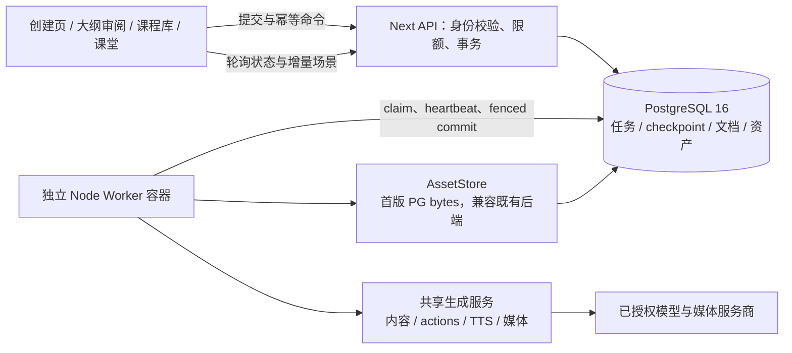
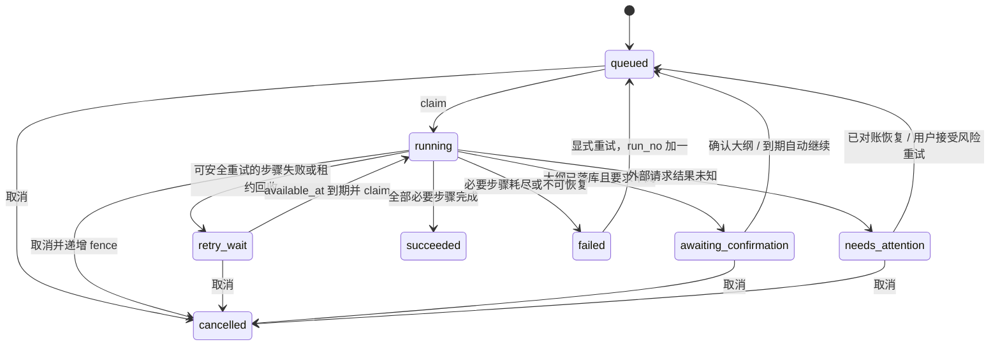

# 智育课程生成优化技术方案：有界并发、持久化部署与独立 Worker

日期：2026-09-05。状态：方案待审阅，尚未实施。

工作目录：`D:\ZZGG_Innovation_Project\OpenMAIC-main`。用户消息中的反斜杠转义路径已按实际工作目录解析。

依据：已完整阅读 `optimization_docs/handoff-2026-09-05_180840-zhiyu-generation.md`，随后重新检查运行环境及源码。本文是本次唯一新增文件；没有修改应用、环境变量或 Compose 文件，没有启动、停止、重建容器，也没有执行数据库初始化、DDL 或数据迁移。下文部署操作均为未来实施步骤，不是已经执行的操作。

## 1. 结论与实施边界

三个问题按依赖顺序处理：先保护并恢复现有 PostgreSQL 和配置来源，再以并发 2 建立基线，最后把正常课程创建接入 PostgreSQL 队列和独立 Node Worker。浏览器从“生成执行者”变为“提交、审阅、观察者”，创建第一幕也由 Worker 负责。

必须保持以下不变量：

1. 原卷 `openmaic-main_openmaic-postgres` 始终保留，挂载点仍为 `/var/lib/postgresql/data`；同时保留 `openmaic-main_openmaic-data`，其中有旧课程 JSON、媒体和旧任务文件。禁止 `docker compose down -v`、卷删除、卷 prune、原目录初始化、将空卷替换原卷，以及两个 PostgreSQL 实例同时挂载原数据目录运行。
2. 同一课程同一时刻只有一个生成所有者；服务器课程在失败、取消、Worker 离线时仍归服务器管理，不能因“未完成”自动降级为浏览器生成。
3. 业务提交可做到幂等、旧 Worker 不可提交；第三方生成调用不宣称天然 exactly-once。若服务商不支持幂等请求或结果查询，超时/崩溃后的未知结果不能承诺零重复计费，必须进入明确的人工重试决策。
4. 不依赖页面挂载、`sessionStorage`、Next `after()` 或进程内 Map 保证任务存活。数据库不可用时提交失败且不启动替代生成。
5. 本轮不升级 PostgreSQL 主版本，不更换模型，不引入 Redis/消息中间件，不迁移全部 Agent runtime，不自动接管旧的浏览器未完成课程，不扩展成公网多租户发布项目。

## 2. 本次只读核对结果与证据范围

取样时间约为主机时间 2026-09-05 18:12–18:18（Asia/Shanghai）；交接文件名不是本次测量时间来源。Docker 查询通过只读权限提升完成，原始环境变量和日志未输出。

| 检查项 | 本次实测 | 对方案的影响 |
| --- | --- | --- |
| 应用 | `zhiyu`，镜像 `zhiyu:bugfix-20260905`，运行中，3000 绑定所有 IPv4/IPv6 地址；无 Compose project/service 标签 | 当前应用为手工容器，不能假定 `compose up openmaic` 会替换它；切换需要先处理端口与双进程 |
| 应用镜像 ID | `sha256:860afecfae0f2c4222ca6bfd2538e516f95c6615fe08ae0befa52e0a7f3cfa46` | 保留作当前部署审计标识，不等于未来安全回滚基线 |
| 旧应用容器 | `zhiyu-before-bugfix-20260905` 已退出 | 不删除、不自动启动 |
| PostgreSQL | `openmaic-main-postgres-1`，`postgres:16`，`Exited (0)`；inspect 留存的健康状态为 `unhealthy` | 已停止，不把历史 health 当作在线健康检查 |
| PG 日志尾部 | 同时包含历史 ready 和 clean shutdown 标志 | 说明过去启动/正常关闭过，不能证明当前可连接或数据完整 |
| 卷 | PG 卷 `openmaic-main_openmaic-postgres`、应用卷 `openmaic-main_openmaic-data` 都存在且仍在对应容器挂载定义中 | 两卷都纳入备份与 Compose external 显式映射 |
| 网络 | 二者都登记在 `openmaic-main_default`；PG aliases 包含 `postgres` 和容器名 | Compose 运行时使用服务名 `postgres`，不依赖生成容器名 |
| 重启策略 | 应用、PG 都为 `unless-stopped` | 显式停止的 PG 不会仅凭策略自动恢复；宿主机还需 Docker Desktop/daemon 自动启动 |
| 应用数据库目标 | `openmaic-main-postgres-1:5432/openmaic`，有 DATABASE_URL | 本次没有展示或验证凭据 |
| 应用环境键 | 未见 `PERSISTENCE_DEV_TOKEN`、两个 `NEXT_PUBLIC_PERSISTENCE*`、`PARALLEL_SCENE_CONCURRENCY` | 运行时缺值已确认；NEXT_PUBLIC 在镜像中是否编译启用不能由 inspect 推断 |
| `.env.local` | 上述键及 `DATABASE_URL`、`PERSISTENCE_POSTGRES_PASSWORD` 六项均未持久化 | 现有容器配置与宿主配置来源脱节 |
| 实时能力接口 | GET `/api/server-providers` 成功，`generation.parallelSceneConcurrency = 0` | 当前仍未启用场景内容预热并发 |
| 最近 45 分钟应用日志 | `EAI_AGAIN` 匹配 5171 次，数据库容器名匹配 5171 次，`ECONNREFUSED` 匹配 0 次 | 是该时间窗的字符串统计，不是独立用户失败数；仍存在持续 DNS 故障 |
| 工作树 | 原有未跟踪 `.pnpm-store/`、`.scratch/`、`debug.log`、`optimization_docs/` | 不清理、不纳入实现修改 |

未核验项：数据库实际版本小版本、角色与权限、密码有效性、实际已部署 schema、表行数、旧课程可读性、备份恢复结果；数据库已停止，本次不为了检查而启动。`POSTGRES_USER/DB=openmaic` 是容器初始化配置，不代表现存角色已验证。源码结论针对当前工作树，不能假定运行镜像逐文件一致。交接中的 149.15 秒和 CPU 0.14% 是历史观测，本次没有再次调用模型或复现付费生成。

## 3. 现有代码边界与具体缺口

| 位置（仓库相对路径，便于实施定位） | 已核对行为 | 改造要求 |
| --- | --- | --- |
| `lib/server/provider-config.ts`、`lib/store/settings.ts` | 并发缺省为 0，服务端上限 10 | 保持兼容，运行配置显式设 2 |
| `lib/hooks/use-scene-generator.ts` | 内容有界预热，按顺序消费；actions 使用 previousSpeeches；TTS 也受现有并发参数影响；epoch/abort 防跨课写入 | 保留客户端安全栅栏，将纯生成能力提取为 Worker 可调用服务 |
| `app/generation-preview/GenerationSessionController.tsx` | 浏览器研究、大纲流、审阅、角色、首场景、持久化，再写 sessionStorage 续生成 | 后台模式从最初提交就走 job；大纲审阅也是持久状态 |
| `app/classroom/[id]/page.tsx` | 卸载 stop；未完成大纲自动 generateRemaining；这一入口缺少 hosted 页的 producer 判断 | 与 hosted 页统一所有权判断，恢复/手工重试入口一并覆盖 |
| `components/classroom/ClassroomSurface.tsx` | 已有 `outlineProducer === 'server-job'` 防重 | 扩展为统一观察协议，不能靠这一处保证正确性 |
| `lib/document-store/persistence-types.ts` | 已有 producer=`client`/`server-job` 和 producerRef；缺省 client；server-job 也用于 Agent runtime | 复用标记，但通过生产者注册表区分课程 Worker 与 Agent，不误认所有 server-job 都是新任务 |
| `app/api/generate-classroom/route.ts`、`lib/server/classroom-job-*` | 文件任务、进程内 Map、`after()`；仅 inputSummary 落盘；旧任务无完整恢复输入 | 替换执行权与存储；旧文件任务不能无条件自动恢复 |
| `lib/server/classroom-generation.ts` | 独立串行流程，最后 `persistClassroom`；输入契约比正常 UI 窄；actions 未传浏览器的 previousSpeeches | 不直接套 Worker 就上线，先补齐输入和行为一致性 |
| `lib/server/classroom-storage.ts`、`classroom-media-generation.ts` | 最终课程及媒体写 `/app/data` 文件；媒体返回服务 URL，读取后还需转换为 assetId | 新课程直接增量写 PG 文档和 AssetStore，旧文件保留读取 |
| `packages/@openmaic/storage/src/document/pg.ts` | 已有 document_stages/scenes/outlines、revision 触发器；saveDocument 会删除快照中不存在的场景 | Worker 不能反复整课替换；事务内增量 upsert |
| `lib/persistence/owner-bound-document-store.ts` | 有 owner 检查和事务内 mutationFence 注入点 | 复用事务/鉴权契约，但扩展可组合事务以原子提交 checkpoint 与场景，不能嵌套新连接 |
| `lib/persistence/stage-meta.ts` | stage_meta 有 owner、软删除、公开及完成镜像字段 | Job 创建/结束/删除必须同步；未完成课程默认私有 |
| `lib/persistence/server-provider.ts` | 取得 provider 时自动 ensureSchema | 新 Worker readiness 不触发 DDL；迁移显式单独执行，随后逐步拆开现有 bootstrap |
| `lib/server/agent-runtime/owner.ts`、`server-auth.ts` | anonymous_id cookie 作为匿名 owner；公开 bundle 的 persistence token 仅用于受信任开发部署 | 复用身份入口，但不能将公开 token 当成租户认证或 Worker 权限 |

## 4. 用户行为契约

1. 作为课程创建者，我希望提交成功后立即看到课程卡片，以便离开页面仍能找到课程。
2. 作为课程创建者，我希望关闭标签页或浏览器后已提交的生成继续，以便不必保持页面打开。
3. 作为课程创建者，我希望重新进入时看到已完成场景、当前阶段和失败原因，以便判断是否需要操作。
4. 作为课程创建者，我希望审阅并修改完整大纲后再开始正文，以便保留现有教学设计选择。
5. 作为课程创建者，我希望同一操作的双击、网络重发和双标签页确认不会生成两份课程，以便避免重复消耗。
6. 作为课程创建者，我希望取消后保留已完成内容且不再接受迟到结果，以便控制成本并复用成果。
7. 作为课程创建者，我希望只重试失败步骤，以便避免重做已完成课程；遇到费用结果未知时能够明确选择是否继续。
8. 作为学习者，我希望已完成场景可逐步查看和播放，课程 A 的迟到状态不会覆盖课程 B。
9. 作为旧课程使用者，我希望本地课程和旧服务端课程仍可读取，删除完成课的一幕不会自动重新生成它。
10. 作为部署维护者，我希望服务与 Worker 重启后任务可恢复、现有数据可校验、升级可回滚。
11. 作为课程所有者，我希望他人无法读取任务输入或替我取消、重试、生成付费资源。

## 5. 问题一：场景有界并发

### 5.1 首轮配置与调度

第一步只开启现有浏览器内容预热路径：`PARALLEL_SCENE_CONCURRENCY=2`；完成部署后检查的是 `/api/server-providers` 的 `generation.parallelSceneConcurrency`。0/1 保留串行含义，上限仍为 10，实际试运行只允许 2，压测达标后才升 3。环境变化需要重新创建应用容器；单纯 restart 不注入新环境。该步骤不会让浏览器生成变成后台任务。

后台调度采用“独立内容并行，依赖步骤顺序推进”：

- 首场景内容优先；每个 job 同时最多 2 个 content 调用。按冻结后的 outline ordinal 排序，最多向当前消费位置前瞻 2 个场景，防止慢首幕导致整课内容过度预生成。
- content 成功立即保存 checkpoint，即使轮到它的 actions 尚未开始；只能消费已持久化、校验成功的 content。
- actions 按场景顺序执行，previousSpeeches 从上一场景已提交 actions 重建并记录依赖摘要。第 N 幕未成功，不生成 N+1 幕 actions；后续已预热 content 保留。
- 首版每课一次只有一个 actions 阶段；场景内 TTS 有界，跨场景按顺序完成必需 TTS 后发布该场景。图像/视频独立队列首版串行。复用 DSL 校验及语言、PBL/vocational、模型路由规则。
- 可选媒体失败允许成功但带 warning；开启的云 TTS 默认是场景完成必要条件，与正常 UI 行为一致。`browser-native-tts` 只在播放时运行，不创建 Worker 云语音任务。

### 5.2 配额分层（新增配置均为拟定）

| 参数 | 初值 | 含义 |
| --- | --- | --- |
| `PARALLEL_SCENE_CONCURRENCY` | 2 | 内容预热数，继续提供给旧浏览器路径 |
| `GENERATION_WORKER_CONCURRENCY` | 1 | 每 Worker 同时处理课程数 |
| `GENERATION_MAX_ACTIVE_JOBS_PER_OWNER` | 1 | 用户同时运行课程数，多余排队 |
| `GENERATION_LLM_MAX_INFLIGHT` | 3 | 当前部署每个服务商凭据配额组的 LLM 总上限：content+actions+outline+agents 共用 |
| `GENERATION_TTS_CONCURRENCY` | 2 | 云 TTS 配额独立，不随 content 调大 |
| `GENERATION_MEDIA_CONCURRENCY` | 1 | 每个图像/视频凭据配额组并发上限 |

这些是保守部署初值，并非已经核验的服务商额度；上线前上限取本值与已确认配额的较小者。用 PostgreSQL slot 控制总并发，不能只靠各进程 semaphore，否则增加 Worker 会倍增负载。共享同一凭据的旧生成 API、Agent 生成调用也接入总 limiter；无法接入的入口在灰度期间禁止与后台生成共用该额度，不能声称“全局已限流”。并发和 RPM/TPM 是不同约束，429 触发 Retry-After、抖动退避及配额组冷却，不能单纯减少 Promise 数量代替速率控制。

### 5.3 测量与升级条件

固定模型、thinking、课题/素材、场景数、TTS 设置，分别运行并发 1、2 的确定性模拟测试和小规模真实请求（真实调用需进入后续已授权实施范围）。记录提交延迟、time-to-first-scene、总时长 p50/p95、每阶段时长、最大在途数、429/5xx、重试次数、token/音频字数及估算成本。

目标：模拟长 content 场景总耗时至少降低 20%，首幕不劣化超过 10%；真实请求每组至少 10 门作为试点，20 门以上再比较 p95，真实改善不足时分析服务商排队和依赖占比，不承诺固定提速。并发 3 只在连续试点无新增 429、首幕不劣化、预算未超后尝试；否则退回 2/1。

## 6. 问题二：`.env.local` 与 Compose 持久配置

### 6.1 单一部署入口与变量来源

统一以 Compose project `openmaic-main` 管理 openmaic、postgres、generation-worker。保留仓库可选的浏览器部署模式；为本安装增加一个明确的持久化部署 override，例如 `docker-compose.persistence.yml`（拟新增），在该入口设置数据库依赖和 existing external volumes。不得在通用基础服务上添加一个可能未启用 profile 的强制依赖。

本安装的所有 config/build/up 操作使用相同前缀：

```text
docker compose -p openmaic-main --env-file .env.local -f docker-compose.yml -f docker-compose.persistence.yml --profile server-persistence
```

`env_file: .env.local` 负责容器运行环境，CLI `--env-file .env.local` 负责 Compose `${...}` 插值与 build args；前者不会自动提供后者。宿主 shell 的同名值还可能优先覆盖，部署脚本只校验相关白名单并拒绝意外覆盖，不打印完整 `compose config` 展开的秘密。[Docker 插值规则](https://docs.docker.com/compose/how-tos/environment-variables/variable-interpolation/)、[环境优先级](https://docs.docker.com/compose/how-tos/environment-variables/envvars-precedence/)。

| 配置 | 持久来源与使用位置 | 约束 |
| --- | --- | --- |
| `DATABASE_URL` | `.env.local`，app/worker 运行时 | Docker 内目标为 `postgres:5432/openmaic`；密码 URI 编码；不写入 build args 或 NEXT_PUBLIC |
| `PERSISTENCE_POSTGRES_PASSWORD` | `.env.local`，Compose 插值到 PG | 与现有角色实际密码一致；取消开发默认密码的静默兜底，缺值部署失败 |
| `PERSISTENCE_DEV_TOKEN` | `.env.local`，app 运行时 | 仅受信任单用户兼容认证，不是租户隔离 |
| `NEXT_PUBLIC_PERSISTENCE` | `.env.local` 通过 build args 固化，值 1 | 变更必须重建前端 bundle |
| `NEXT_PUBLIC_PERSISTENCE_TOKEN` | 同上 | 本地兼容模式与 runtime dev token 匹配；它是公开值，不使用 DB/API 密钥作此 token |
| 并发与 Worker 参数 | `.env.local` → 明确 environment 白名单 | 缺省、范围和生效值由启动校验与脱敏 health 暴露 |
| Provider 配置 | 现有环境/YAML 只读注入 app、worker | 队列保存 provider/model/config version 引用，不保存 API key |

最终 override 应以显式 environment 白名单缩小 app/worker 获取的变量范围，数据库只拿所需 PG 参数；避免把全部 `.env.local` 无差别传给 Worker。确认 `.env*` 仍被 `.gitignore`、`.dockerignore` 排除，仅 `.env.example` 含占位说明。具有 `$`、`#`、引号的密码必须按 Compose env 语法处理，并用不输出值的连接测试验证解析，禁止随意字符串替换。

修改 `POSTGRES_PASSWORD` 不会更改旧数据目录里的角色密码；密码轮换必须是后续独立维护操作，先验证现有凭据，不因不匹配而重建数据库。[Postgres 官方镜像初始化说明](https://hub.docker.com/_/postgres)。Docker 内 URL 不能用于宿主直接运行 Next；需要宿主开发时单独明确连接通道，默认不对宿主发布 5432。

### 6.2 数据卷、服务健康与启动

override 把两个卷都固定为 external + 精确 name：

| 逻辑卷 | external name | 挂载服务 |
| --- | --- | --- |
| openmaic-postgres | `openmaic-main_openmaic-postgres` | 仅 postgres → `/var/lib/postgresql/data` |
| openmaic-data | `openmaic-main_openmaic-data` | app → `/app/data`，旧文件兼容保留；Worker 默认不需要写旧课程目录 |

external 卷缺失必须启动失败，不允许自动创建一个看似相同的新空库；这将卷生命周期与 Compose 服务分离。[Docker external volume 语义](https://docs.docker.com/reference/compose-file/volumes/)。部署脚本每次核对卷名称、mount destination、数据库集群标识，绝不执行 volume prune。

保留 PG16（初次迁移固定已验证镜像 digest，升级另行实施），保留 healthcheck `pg_isready -U openmaic -d openmaic`。app/worker 对 postgres 设置 `depends_on: condition: service_healthy`；迁移命令成功后才启用 Worker。Compose readiness 只解决启动时序，运行时仍需要连接重试、连接池重建和退出退避。[Docker 启动顺序](https://docs.docker.com/compose/how-tos/startup-order/)。

新增 `/api/health/ready` 只做 SELECT/迁移版本读取，无 ensureSchema 副作用；单独报告数据库、schema、任务接收开关与近期 Worker heartbeat。数据库正常、Worker 暂离线时可排队但 UI 明示等待；队列达到上限返回 503/Retry-After，不能无限累积。Worker 健康按进程心跳检查，而不是最后一次课程进度。容器 `unless-stopped` 不保证 Windows 登录前 Docker Desktop 已启动；宿主自启与重启验收必须实测并记录边界。

默认单机入口改为 `127.0.0.1:3000:3000`；如果部署确需局域网访问，则需明确可信网段/防火墙及 HTTPS，不能沿用公开 token 宣称安全多用户。无需安装 Windows 原生 PostgreSQL。

## 7. 问题三：PostgreSQL 队列与独立 Worker 架构



Worker 直接调用共享 TypeScript/Node 生成模块、数据库仓储与 AssetStore，不通过 HTTP 调用自己的 Next 生成路由，不依赖用户请求的 Host/forwarded-host，也不要求 app 存活。生产构建增加独立 Worker target 和编译产物入口（如 `workers/generation/main.ts` → `dist-worker/main.js`），不能假定 Next standalone 自动包含未引用 Worker 及其依赖。锁定与 app 相同依赖、schema/DSL/pipeline 版本，以非 root 用户运行；按实际 native 依赖打包并在容器内 smoke 验证。

首版不用 SSE：正常 2 秒轮询，后台页面 5–10 秒，失败指数退避至 30 秒；课程加载用 revision manifest 按 scene 增量刷新，不每次整课读写。SSE 可后续加入，events 是事实来源，LISTEN/NOTIFY 只是唤醒优化，不能当 durable queue。

## 8. 数据模型（待编写版本化迁移）

现有关系表及 DSL JSONB 继续作为课程内容唯一权威，不再建立一套 `classrooms` 业务表。保留旧表时间字段形式；新增运行表时间统一 TIMESTAMPTZ，所有 lease 时间以数据库时钟为准。JSONB 输入必须通过严格 schema 和大小限制，SQL 使用参数化。

### 8.1 表、键与索引

| 表 | 关键字段与约束 | 用途 |
| --- | --- | --- |
| `generation_jobs` | `id UUID PK`；`stage_id TEXT NOT NULL UNIQUE FK document_stages(id) ON DELETE RESTRICT`；`owner_id TEXT NOT NULL`；`idempotency_key TEXT`；`request_hash TEXT`；UNIQUE(owner_id,idempotency_key) | 一份课程对应一个持久 job；重试复用 job，不新建重复课程 |
| 同表运行字段 | `status TEXT CHECK`；`phase TEXT CHECK`；`run_no INT`；`state_version BIGINT`；`pipeline_version`、`input_schema_version`、`config_version`；`priority INT`、`available_at`；`worker_id TEXT NULL`、`lease_epoch BIGINT DEFAULT 0`、`lease_expires_at`、`heartbeat_at` | 排队、兼容性、乐观并发与 Worker 栅栏 |
| 同表快照/结果 | `input_snapshot JSONB`、`plan_revision INT`、`review_policy`、`review_hold BOOL`、`auto_continue_at`；`total_scenes`、`ready_scenes`、`warning_count`；`cancel_requested_at`；`last_error_code`、脱敏 `last_error_summary`；`created/updated/started/finished_at`；`active_elapsed_ms` | 恢复输入、审阅选择、进度；不会用轮询次数当进度 |
| `generation_ownership` | `stage_id TEXT PK FK ... RESTRICT`；`owner_id`；`producer_kind`=`course-worker`/`agent-runtime`/`client`；`producer_ref TEXT`；`ownership_epoch BIGINT`；`write_mode`=`generating`/`editable`/`deleted`；`updated_at` | 所有生成/编辑入口共用的权威所有权记录；与 outline 的 producer/ref 同事务更新 |
| `generation_scenes` | PK(job_id,outline_id)；`scene_id TEXT`；`ordinal INT`；UNIQUE(job_id,ordinal)、UNIQUE(job_id,scene_id)；冻结 `outline JSONB`；`plan_revision`、`status`、`content JSONB`、`actions JSONB`、`previous_speeches_hash`、`content_hash`、`ready_at`、脱敏错误 | 分幕 checkpoint；sceneId 创建时固定，不能每次重试 nanoid |
| `generation_steps` | `id UUID PK`；`job_id`；`step_key TEXT`；UNIQUE(job_id,step_key)；`kind`、`outline_id NULL`；`dependency_hash`；`status`；`attempt_count`、`max_attempts`；`available_at`、`started_at`、`deadline_at`；`result JSONB/asset_ref`、脱敏 error | 研究、大纲、角色、content、actions、每段 TTS、每个媒体及 finalize 的可恢复工作单元 |
| `generation_attempts` | `id UUID PK`；`step_id FK`、`attempt_no`，UNIQUE(step_id,attempt_no)；`lease_epoch`；`provider_config_ref`、`request_key`、`request_hash`、`provider_request_id NULL`；`outcome`、`started/finished_at`、usage JSONB | 记录实际外部调用与不确定窗口；只留配置引用，禁止请求头/密钥 |
| `generation_job_assets` | PK(job_id,logical_key)；`asset_id TEXT FK asset_entries(id)`；`role`=`input`/`output`；`scene_id NULL`、`lifecycle`=`staged`/`attached`/`released`；`created_at` | 固定逻辑资产映射、输入 pin、孤儿清理；相同音频步骤只能一个有效归属 |
| `generation_events` | `id BIGINT GENERATED ... PK`；`job_id`；`run_no`、`state_version`、`type`、受限 `payload JSONB`、`created_at` | 事务内追加状态和 checkpoint 事件；以 id 为恢复 cursor |
| `generation_commands` | PK(job_id,command_key)；`kind`、`request_hash`、`result_version`、安全响应摘要 | confirm/cancel/retry 网络重发幂等；不同 body 同 key 返回 409 |
| `generation_provider_slots` | PK(quota_group,slot_no)；`holder_attempt_id UUID NULL`、`lease_epoch`、`expires_at`、`quarantine_until` | 跨 Worker/API 的固定并发配额；过期未知调用先隔离再释放 |
| `generation_worker_heartbeats` | `worker_id TEXT PK`；`pipeline_versions`、`started_at`、`heartbeat_at`、`draining BOOL` | readiness 与离线告警，不作为任务锁 |
| `generation_schema_migrations` | `version PK`、`checksum`、`applied_at` | 显式增量迁移与版本兼容门禁 |

必要索引：jobs `(priority DESC,available_at,created_at,id) WHERE status IN ('queued','retry_wait')`；jobs `(lease_expires_at) WHERE status='running'`；jobs `(owner_id,created_at DESC)`；steps `(job_id,status,available_at)`；events `(job_id,id)`；assets `(asset_id)`；review 到期索引。枚举首版用 TEXT+CHECK，便于加法演进。job FK 不级联删除课程；课程先软删除并取消，物理回收由独立管理流程处理。

排队限额在提交事务内按 owner 获取 transaction advisory lock 后计数，不能“先 count 再 insert”造成并发穿透；运行限额则在 claim 时检查，二者分别计数。claim 对候选 owner 使用非阻塞 transaction advisory lock，未取得就跳过候选，取得后统计有效 running lease 并原子领取，确保双 Worker 不突破每 owner 的运行上限。stage_meta 和 document_stages 的 owner 必须与 job 相同，在统一仓储校验并以迁移测试覆盖，必要时增加兼容的复合约束。

### 8.2 输入快照与步骤标识

提交输入包含：完整 requirements（包括 interactive/taskEngine/vocational 等实际 UI 选项）、语言/教学偏好、素材 ID 与版本/摘要、PDF 文字及图片映射的持久引用、可选确认大纲、角色模式及配置、模型/provider/thinking/各阶段路由选择、web search/图像/视频/TTS 开关与非秘密参数、review_policy、并发快照和预算上限。研究结果、推断语言、最终课题、最终大纲、生成角色分别写步骤结果，恢复不重新请求。

server-side schema 只接受白名单字段，不从旧 GenerateClassroomInput 直接展开保存；`webSearchApiKey`、客户端 API keys、任意 baseUrl、浏览器 data/blob URL 和 IndexedDB 专属 ID 均不能入队。素材提交前先上传到持久 AssetStore、校验 owner、实际 bytes 可读及大小，再在 job 创建事务里 pin；只有上传成功但尚未提交的输入可按 grace 回收。只有浏览器密钥的模型返回可操作的 `BACKGROUND_PROVIDER_UNAVAILABLE`，必须先配置服务器凭据或明确选择独立的本地课程模式；禁止静默回退导致两个生产者。

稳定 step_key 示例：`plan:v1`、`agents:plan-1`、`scene:<outlineId>:content:plan-1`、`scene:<outlineId>:actions:<dependencyHash>`、`tts:<actionId>:<textVoiceHash>`。provider request key 由 job、step 和输入摘要派生；自动重试同一次逻辑操作保持稳定键。改变大纲仅在审阅状态允许；确认后冻结计划，重新规划生成新课程，不对已完成依赖链原地重排。

## 9. 状态机、租约与事务协议

### 9.1 Job 与场景状态



`phase` 与 status 分开：preparing、researching、outlines、agents、scene_content、scene_actions、tts、media、finalizing；并发时返回多个 active steps，而非用单一“当前场景”掩盖并行。进度以 ready/total、各阶段数及实际持续时间呈现，不制造线性百分比。等待审阅、需要注意、失败均不是 completed。

scene 状态：pending → content_running → content_ready → actions_running → actions_ready → tts_running（可跳过未启用）→ ready；失败映射 retry_wait/failed，未知外部结果映射 needs_attention。steps 状态：pending/running/retry_wait/succeeded/skipped/failed/uncertain/cancelled。可选媒体失败终态为 failed + warning；所有必要步骤满足后 job=succeeded，warning_count 可以大于 0，两个完成镜像字段才设 true。

取消在一笔事务中将 job=cancelled、递增 lease_epoch、清空 lease，并追加事件；API 返回的是“已禁止后续提交”，外部请求的物理停止由 Worker best effort abort，不保证服务商停止计费。若成功先提交，取消返回终态不再改变；若取消先提交，完成事务必须拒绝。已取消 job 不直接复活，用户若需要继续，以显式“复制已有内容为新课程”流程处理，避免取消语义反复。

### 9.2 Claim / heartbeat / fencing

1. Worker 开始前验证 DB/schema/pipeline 兼容；每次短事务选取可运行 job，使用 `SELECT ... FOR UPDATE SKIP LOCKED`，按可用时间/优先级稳定排序，随后设置 running、worker_id、lease_epoch+1、lease_expires_at 并返回已领取行。多消费者队列表适合这种行锁跳过模式。[PostgreSQL 16 SELECT 文档](https://www.postgresql.org/docs/16/sql-select.html)。
2. 初值 heartbeat=10 秒、lease TTL=90 秒、reaper 扫描=15 秒。heartbeat 使用独立轻量连接，并仅在 job/worker/epoch/status 匹配且旧 lease 未过期时续租；失效后不得“复活”。长模型请求不占着 claim 事务。
3. 每次外部调用前先落 step/attempt 意图，取得 provider slot，确认 job 未取消且 lease 有效，再发送请求。租约丢失或 DB 连接失效立刻停止新调度并 abort 本地请求，不在内存无限跑完。
4. 每个 checkpoint/文档/资产归属提交在同一个数据库事务内检查 owner、生产者、ownership_epoch、worker_id、lease_epoch、running、lease 未过期、stage 未删除、预期 plan/version；获取 job 行锁后再写。任何检查失败就 rollback，不能先读验证、事务外生成结果再无条件写。
5. reaper 锁定过期 job；对没有未决外部副作用的步骤放入 retry_wait，对 running attempt 标记 uncertain 并进入 needs_attention 或服务商结果查询；增加 fence，旧 Worker 即使恢复网络也不能提交。自动恢复目标为 lease 到期后 30 秒内启动可安全步骤（健康单机空队列）。
6. 锁顺序统一：job → generation_ownership → stage_meta → document_stages/stage revision → scene/scene revision → job assets/步骤/事件；provider slot 独立短事务领取，不跨网络持锁。按现有 revision 触发器规则保持 stage revision 先于 scene revision，避免反向死锁。
7. SIGTERM 后停止 claim、设置 draining，给 30 秒提交已完成 checkpoint 并取消在途请求；stop_grace_period 初值 45 秒。强杀由 lease 接管。未知外部调用不直接释放配额继续重试：slot 隔离至请求 deadline+grace 或 provider 查询确认结束，避免故障期间越过真实额度。

### 9.3 幂等提交与外部调用边界

- 创建：客户端在用户明确发起一次创建时生成并持久保存 idempotency key，网络重发沿用。服务器以 owner+key 唯一，规范化输入 hash 相同返回原 job/stage，不同返回 409。显式“再建一份”生成新 key；同样主题不按文字全局去重。
- job、占位 stage、stage_meta、空 document_outlines（producer=server-job、producerRef=jobId）、generation_ownership、输入资产 pin、queued event 一笔事务提交。HTTP 202 只在提交后返回；响应丢失仍能用同 key 查回。
- content/actions 分别 checkpoint；scene ready 时事务内固定 sceneId upsert + checkpoint + ready 数 + revision/event。崩溃后重读已成功步骤，不重新生成已提交阶段。不能对持久状态做“先写 PG 后写文件”的双权威操作。
- 外部请求尚未发送即可安全重试；拿到明确 429 或可证未执行的错误按策略重试。5xx/网络超时不一概安全：根据 provider 契约判断。有幂等/查询能力先查再恢复；无此能力且结果未知进入 needs_attention。用户确认重试后创建新的显式 attempt，说明可能重复计费；已完成场景绝不重做。
- 初值每步骤最多 3 次安全尝试（含首次）、退避 2 秒指数增长上限 60 秒并加抖动，优先尊重 Retry-After。只有一个持久层负责重试，SDK/route/package 内层 maxRetries 设 0 或统一计入总数，防止嵌套 3×3 放大。
- 初值 content/actions 单次 300 秒，TTS 120 秒，图像/视频 600 秒（异步供应商保存 taskId 后轮询，不占长事务）；单场景必要步骤累计执行预算 15 分钟、单 job 累计执行预算 60 分钟，重试不重置预算，审阅/排队不计入。所有限时透传 AbortSignal，并在 schema/启动校验中设范围。

结果对账由 Worker 的独立 reconciliation 循环执行：只针对已有 request key/provider taskId 查询状态，不新建生成请求。对 needs_attention job 以独立短 reconciliation lease 串行处理；查询到成功后，先以 CAS 将 job 转 queued，下一次正常 claim 取得新 fence，再导入已查询结果并走相同 checkpoint 提交流程。没有查询能力时保留需要用户操作状态。查询/用户重试/取消竞争都锁同一 job；已取消任务不再导入结果。不能让旧 Worker 绕过正常 fence 直接把“补回的结果”写入课程。

## 10. 防浏览器、服务器和 Agent 重复生成

防重是上线硬门槛，按三层同时实施：

1. **统一浏览器入口**：创建页检测 server capability 后只提交；独立 classroom 和 hosted ClassroomSurface 使用同一 `canGenerateLocally` 规则。producer 未加载时禁止启动，server-job 无论 status 如何都只观察。覆盖 auto-resume、手动 retry、首场景、失败面板、TTS/media 补生成等调用。sessionStorage 仅缓存 UI 草稿/幂等 key，不作为后台续跑命令。保留 epoch 和组件卸载 abort，只取消页面订阅与本地请求，不发送 job cancel。
2. **服务端所有权与调用门禁**：所有 `/api/generate/*` 对目标 stage 做 owner+generation_ownership 检查，服务器课程的客户端 content/actions/TTS/media 调用返回 409 `SERVER_OWNED_GENERATION`；不能依靠客户端提交 producer 字段。新创建协议要求 generation intent/owner，缺 stage/intent 的旧客户端请求在后台部署入口拒绝，防止遗漏 stageId 绕过。Agent tools、Pi 编辑、导入、整课 PUT、stage/scene PATCH/PUT/DELETE 也读取同一所有权；生成中禁止结构编辑，允许播放/聊天运行态独立存储。
3. **事务内写入门禁**：Job 的内部 mutationFence 与普通写入口的保护位于同一事务。所有权判定不只在 route 之前。内部 producer 凭据由服务器调用上下文提供，浏览器不能靠 body/header 冒充；允许的低层入口必须全部走 owner-bound 仓储。生成结束、失败或取消后切换 write_mode=editable 时仍保持 producer_kind=course-worker：用户可正常编辑，浏览器不得自动续生成；显式 retry 先锁课、校验依赖和编辑 revision，再切回 generating。

重试时若用户已编辑完成场景/动作，dependency hash 或 scene revision 不匹配返回 409，不自动覆盖编辑或假装续接；提供复制课程后重新生成的明确操作。删除课程事务同时 tombstone 和撤销 lease，后续 worker commit 全部失败；复用现有删除栅栏。

既有 `server-job` 可能属于 Agent runtime，迁移前扫描 producerRef 并识别来源；新 ownership 表登记原生产者，不能把它们统统附到 generation_jobs。Agent runtime 当前已有 heartbeat 和 mutationFence 可复用概念/通用工具，但本次不把它的会话状态机强行改成课程队列。

仅前端隐藏按钮不够防止旧缓存 bundle 写入。切换部署前必须先上线兼容版本 R0（含所有服务端门禁、两个课堂入口 guard 与新元数据识别），R0 是安全回滚下限。旧手工镜像不具备这些保证，不能直接连接已有新后台课程提供写服务。

## 11. 前端、API 与 Worker 改造清单

### 11.1 前端与大纲审阅

新增 `lib/hooks/use-generation-job.ts`（拟定）：负责 create/restore/poll/cancel/retry 命令及请求 epoch，按 owner、stageId、jobId、run_no、state_version 拒绝过期更新；不持有生成算法。课程库从 PG 列出占位课程及 job 状态，开课时优先读 PG，历史文件和 IndexedDB 走明确的兼容来源，不触发重复导入。

GenerationSessionController 的 normal create 从研究前就入队；展示步骤事件和 ready scenes。大纲预览流改为服务端分批持久事件，完整校验成功才成为可确认 plan。大纲编辑 PATCH 只在 awaiting_confirmation 且 expectedVersion/planRevision 匹配时接受。

review_policy 两种：manual 在大纲完成后停在 awaiting_confirmation，用户关闭浏览器仍保持等待；auto 在大纲完成后设置服务器 `auto_continue_at`（沿用当前约 2.5 秒节奏），由队列扫描在到期后原子转 queued。用户展开编辑发送 review-hold 命令，立即取消服务器自动截止；收起且明确继续可重新设置期限。hold 与自动继续竞争时，以 DB CAS 为准，冲突 UI 提示计划已确认并刷新，不能继续显示可编辑大纲。自动继续不依赖浏览器 setTimeout；等待人工确认是产品行为，不算 Worker 中断。

接收状态仅 hydration，不触发 `saveToStorage` 或 autosave；新增 observer mode 阻断把缓存整课保存回 PG。增量场景保留 currentSceneId、播放位置、聊天及用户选择；仅必要元数据同步。现有首次读取文件课程的 URL→assetId 转换路径继续兼容，但新任务无需浏览器完成持久化收尾。

### 11.2 API 契约（拟定，复用 `/api/generate-classroom` 路径）

| 方法与路径 | 请求要点 | 响应/行为 |
| --- | --- | --- |
| POST `/api/generate-classroom` | owner session；Idempotency-Key；versioned input | 202 `{jobId,stageId,status,phase,stateVersion,pollUrl,courseUrl,pollIntervalMs}`，Location 指向任务；重复返回原对象 |
| GET `/api/generate-classroom/:jobId` | owner；可带 events cursor | 200 job 安全摘要、scene 状态、warnings、active steps、最新 cursor；支持 ETag/304、私有 no-store/cache revalidation 策略，不经共享 CDN 缓存 |
| GET `/api/generate-classroom?active=1` | owner；分页 cursor | owner 的运行及待处理任务，用于响应丢失或重入恢复 |
| PATCH `/:jobId/outline`（同路径前缀） | command key、expectedVersion、planRevision、完整大纲或 review-hold | 200 更新版本；状态/version 不匹配 409 |
| POST `/:jobId/confirm` | command key、expectedVersion、planRevision | 原子冻结大纲并排队，202；双击幂等 |
| POST `/:jobId/cancel` | command key | 200 当前终态或取消状态；不删除已完成数据 |
| POST `/:jobId/retry` | command key、expectedVersion、失败步骤范围；未知计费结果需显式 acknowledged | 202 原 job 新 run_no；只续失败依赖，已完成可复用；取消/成功任务不接受 |
| GET `/api/server-providers` | 现有能力响应新增 generation mode/capability/version | 服务器决定后台是否可用；不由 NEXT_PUBLIC flag 单独授权 |

错误：400 schema/大小；401 未认证；404 非 owner job（避免枚举）；409 幂等 body 冲突、版本冲突、所有权冲突；422 provider/素材不支持后台；429 owner/额度限制；503 数据库/schema/队列不可用。创建不等待长模型，不持有到课程结束的 HTTP。

旧 POST 协议需要版本过渡和调用方清单；切换后不能同时保留旧 `after()` 执行分支与新入队分支。旧 file job 的 GET 只读适配到 legacy 标识，输入不完整的 running job 标记“不可自动恢复”，不伪造新的任务输入。无 owner 的旧任务不能直接通过新列表公开；在可信本地维护流程确认归属后才能迁移或查看。

### 11.3 Worker 与模块拆分

- 新增 `lib/server/generation-jobs/{repository,contracts,ownership,limiter}.ts`、`lib/server/generation-pipeline/`、`workers/generation/`（建议路径，实施前遵循仓库实际约定）。
- 将现有 `generateClassroom` 分解成无 React/sessionStorage/Next after 依赖的研究、计划、角色、内容、actions、媒体/TTS 服务；复用 `@openmaic/generation`、resolveModel、PBL 路由和 validators。补齐 previousSpeeches、源图片映射、教师角色和语言规则，不只搬移旧批处理函数。
- repository 暴露 createJob、claim、heartbeat、commitCheckpoint、publishScene、confirm/cancel/retry 等窄接口；使用 caller transaction 的内部 writer，明确禁止在现有事务中再调用会开新连接的 PgDocumentStore API。
- Worker 重启按 steps 的 succeeded/result 恢复；首次 stageId/sceneId/actionId 已持久化。准备/计划/角色也需 checkpoint，不能只支持中后期 scene 恢复。
- 资产先写内容，再在 fenced transaction 内注册/关联到 checkpoint。PG bytes 复用 transaction-pinned writer；若部署已有 S3 后端则保留，不因本计划切换字节后端，使用 staged→attached 协议处理非事务对象存储。取消/失败只能释放本 job 尚未附着的引用；不得删除输入素材、旧课程或其他任务共享 bytes。
- Collector 必须考虑 job 的 input/staged 引用与有效 lease pin，首版 grace 不小于现有 collector 配置且至少 24 小时；结束任务的无引用临时输出延迟清理。重复完成 callback 只复用逻辑 asset 映射，不能分配第二份有效归属。
- 不把 source prompt、完整模型响应、PDF 内容写普通日志；结构化记录 jobId/sceneId/step/attempt/epoch、耗时、结果码、usage。健康和队列状态可观测，死循环重试有上限和告警。

## 12. 安全与成本约束

当前 anonymous_id 是未签名 UUID cookie，当前 persistence dev token 又会公开编译到浏览器，因此不能把现有两者当作完备多租户认证。首版限定 localhost/可信单用户，所有 job 操作使用同一 server-resolved owner；至少对新 job 会话使用签名或服务端 session 验证，并保留原 owner 映射。签名密钥跨重建持久保管，不能每次启动随机改变导致课程丢失归属。公网开放前统一升级文档、资产、运行态及 job 的真实认证授权，不只保护 job 路由。

具体上线门槛：

- 校验 state-changing 请求 Origin/Host allowlist 与 CSRF，cookie HttpOnly/SameSite，HTTPS 下 Secure；验证生产 Docker 的本地 HTTP 与 Secure cookie 组合是否能正确保留 owner，不能让每次重试变成新 owner。
- owner 来自受控会话，body 的 ownerId/learner key/jobId 不能授予权限。任务 status/events/input/素材归属均独立检查；现有文档按 ID 可读规则不能直接复制到私有任务接口。
- 服务端 provider 配置版本和允许模型列表固定；凭据仅从环境/secret mount 运行时解析。非支持配置失败返回明确错误，不静默换 provider 或高价模型。禁用的 provider 立即停止新调用。
- 限制每 owner 排队数量（初值 5）、请求 JSON（初值 1 MiB，素材走上传）、大纲数（初值 30）、PDF/图片字节、音频/视频时长和单 job 预算。下载检查真实流累计字节，不能只信 Content-Length；阻止任意 URL、私网/metadata SSRF、重定向绕过、路径穿越和压缩炸弹。
- Worker 不接受浏览器传来的数据库地址、回调地址、shell 命令或 API baseUrl。不给 Worker Docker socket；生产运行角色无 DDL，迁移角色单独使用。现有 openmaic 角色的权限需启动后核验，不能假定已是最小权限。
- 未知外部请求不自动重放付费调用。成功请求但数据库提交失败时进入结果对账流程；日志/attempt 记录 provider request ID（若可获得），不把错误堆栈原样返给浏览器。
- 输入与模型结果属于用户内容，checkpoint 与事件设置保留期；初值终态 job 详细输入/中间结果 30 天、精简审计与幂等墓碑 90 天，课程/已引用资产按用户删除策略保留。清理明细后仍保留创建 key 的摘要映射，避免旧请求重发新建课程。现有数据不因此策略立即清理。

## 13. 迁移、部署切换与回滚

### 13.1 实施前恢复与备份关卡（本次未执行）

1. 再次只读记录容器、镜像 ID、network、两卷、脱敏环境来源；准备停止写入窗口。原始凭据仅在受控环境读取/校验，不放进文档、日志或命令历史。
2. 保持 PG16 与原 PG 卷挂载不变，在后续授权实施窗口仅启动现有 `openmaic-main-postgres-1`，执行 pg_isready，然后通过应用所在网络使用现有凭据做只读 SELECT 验证。记录 current_database/current_user、版本、集群标识、schema/表行数、owner 分布和关键课程/资产样本摘要。不能仅凭 pg_isready 判断认证成功。
3. 自动 ensureSchema 可能在 app 重新连库时写库，因此严谨备份窗口要先停写应用/Agent/collector，或在 PG 启动前隔离自动初始化连接；记录这一短暂停服。备份原库逻辑 dump（custom format）和角色定义，角色备份可含敏感验证材料，必须加密/限制 ACL；同时一致备份应用数据卷与仍在浏览器的本地课程导出。
4. 校验备份大小、校验和并在独立临时卷/隔离数据库恢复演练，核对表行数、代表课程和资产 bytes；不能在原卷上做恢复演练。任何密码不匹配、未知卷、读数异常均停止后续切换，不以重建空库“修复”。

### 13.2 加法迁移与部署顺序

1. 编写且验证 R0 兼容版本：识别生产者、普通写门禁、两个课堂 guard、observer 禁 autosave、旧课程兼容；尚不启用新 job 创建。保留该镜像与对应配置作最低安全回滚点。
2. 准备 `.env.local` 与 override，所有秘密留本机安全存储。以固定 Compose project、两个 external 卷和现有 PG 服务完成 config 静态校验（只输出校验结果）。先构建 R0，不用构建新应用时顺便重建 PG。
3. 停止手工 zhiyu 后再启动 Compose openmaic，防止抢占 3000 或两进程/collector 同时写入；保留原容器停止态。PG 原容器能直接复用时使用 `--no-recreate`，应用切换只针对 openmaic `--no-deps`，不得全栈 force-recreate。若 PostgreSQL 服务定义将来确需更新，安排独立维护窗口，只改容器且挂原卷，仍不变更 PG 主版本。
4. 显式 migration runner 使用 advisory lock + version/checksum，执行新增表/索引/必要加法列。大规模索引使用可恢复的独立阶段，不能把 `CREATE INDEX CONCURRENTLY` 塞进普通事务。避免 app 与多个 Worker 启动时同时 ensure 新 schema。业务门禁检查最低 schema，未达版本 refuse readiness。
5. 创建所有权记录仅针对已确认归属的现有 producer 元数据，保留没有 producer 的历史课为 client，默认不把它们排队；存在冲突时输出脱敏清单并停止该批次，不强行覆盖。
6. 部署支持队列的 app 和 worker，先关闭提交开关，通过隔离测试库完成故障测试；灰度 owner 开启后监测，再切换正常创建入口。server generation 请求从此只入队，移除 after runner 激活点。
7. 既有 `data/classrooms` 与 `classroom-jobs` 首轮保留；可选迁移工具以后按 stable legacy ID + 内容 hash 幂等导入 stage/scene/asset，并有 source→target manifest。旧任务只有 summary，无完整输入，不自动恢复。IndexedDB 课程必须用户选择上传且校验完整资产，不能后台偷偷接管仍在生成的标签页。

R0 必须同时支持迁移前后读取：新 ownership schema 尚未安装时，利用已存在的 outline producer 元数据保护 server-job 课程，禁用新任务；安装后启用事务内新门禁。schema 缺失或读取失败不能解释成“允许 client”。P1 只做配置部署且还没有新后台任务；上述 R0→迁移→Worker→开启入口的功能切换在 P3–P6 完成，不在 P1 提前开放后台创建。

### 13.3 回滚矩阵

| 情况 | 操作 | 保留内容/限制 |
| --- | --- | --- |
| 并发导致限流 | 恢复 1/2 配置并重新创建需要改环境的 app/worker，运行任务在 checkpoint 后按新上限处理 | 不动 PG/卷/课程；下调先停止新增调度，不杀已提交结果 |
| 新提交/API 有问题 | 关闭新 job 接收开关，返回明确维护状态；保留只读观察和已有 Worker | 不自动切到旧浏览器链路继续同一课 |
| Worker 有问题 | 停止领取并 drain；回滚到兼容 pipeline/schema 的 Worker；过期 lease 按安全步骤恢复 | 不回退 checkpoint/取消状态，不删除 job |
| 前端问题 | 回滚 R0 或更新的兼容前端/服务端版本，任务继续或按维护策略暂停领取 | server-owned 课仍只能观察，不回滚到不含 guard 的手工镜像提供写服务 |
| 数据库迁移后代码回滚 | 保留新增表/列，关闭功能，向前修复 | 常规回滚不 DROP/TRUNCATE、不用旧全库 dump 覆盖新数据 |
| 真实数据损坏灾难恢复 | 停所有写者、保留受损原卷，恢复到新隔离卷并校验，再独立批准切换连接 | 这是灾难恢复而非发布回滚；RPO 取最后已验证备份/归档，不能承诺零损失 |

RTO 目标：常规应用/Worker 回滚 15 分钟内完成；数据库恢复耗时由实际 restore 演练记录，不预先虚构。发布回滚必须保留已完成课程及 job checkpoint，数据卷身份与行数/摘要核验纳入每次切换清单。新任务和 R0 共享 schema 兼容窗口，pipeline_version 不支持时不领取并提示需要兼容 Worker。

## 14. 实施阶段与交付门槛

以下各阶段有依赖顺序，本文不派发实现或执行命令；获准实施后按阶段落地。

| 阶段 | 工作与产物 | 依赖 / 完成门槛 |
| --- | --- | --- |
| P0 环境基线 | 恢复前检查、备份恢复演练、表/身份/资产清单、运行镜像与源码对应核验 | 先确认原卷与可读备份；任何异常停止 |
| P1 配置持久化 | env/Compose override、external 卷、启动/健康校验、单一部署入口 | 冷启动和 app recreate 后 PG 数据不变、连接错误消失 |
| P2 有界并发 | 初值 2、可观测时序与配额、TTS 参数解耦、现有链路回归 | 最大在途受控、顺序/跨课保护通过；不宣称后台已完成 |
| P3 所有权与存储 | R0 guard、ownership、事务组合、版本化 migrations、Job/Step/Attempt 仓储 | 双标签页及旧客户端写入/生成绕过测试通过，迁移可重跑 |
| P4 独立 Worker | 共享 pipeline、每阶段 checkpoint、lease/reaper、limiter、资产生命周期、容器构建 | 无浏览器/无 app 的生成与 Worker 强杀恢复通过 |
| P5 API 与 UI | 幂等创建、持久大纲审阅、库状态/观察、取消重试、私有 owner 校验 | 正常入口首幕到末幕仅 Worker 生成，预览/角色/语言保持一致 |
| P6 切换演练 | 完整 E2E、真实 provider 小流量、冷重启、数据验证、R0 回滚演练 | 全部阻断级验收通过后才扩大开放；仅此时关闭旧执行路径 |

工程触点：`docker-compose.yml`/新 override、Dockerfile/Worker target、`.env.example`/部署 README、provider-config/settings、GenerationSessionController、两个 classroom owner、stage/document store、生成 API 与服务、persistence owner/fence/asset collector、migrations、Worker 入口及 package scripts。`.env.local` 为部署私密文件，不进版本库。

## 15. 验收测试矩阵

测试采用现有 Vitest/Playwright 入口、真实 PostgreSQL 16 临时实例和可控制服务商模拟器。模拟器能记录 request key、并发、延迟、usage 和故障时点，以外部 API/课程存储行为验证，不以 mock 内部实现替代数据库锁和网络失败验证。所有迁移/强杀测试先在隔离环境进行，原库仅在维护窗口跑已审核 smoke。

| ID / 级别 | 场景与断言 | 可测通过标准 |
| --- | --- | --- |
| A01 阻断 | 原卷与数据保护 | 部署前后 PG volume name、集群标识相同，旧课程/会话/资产摘要匹配；app 数据卷仍在 |
| A02 阻断 | env 持久、Compose 插值与 build flags | 新 app runtime 脱敏键校验通过；浏览器实际持久化功能可用；冷启动后仍一致；没有新空卷 |
| A03 阻断 | PG 健康与连接 | pg_isready + app/worker 凭据 SELECT + 持久化读写通过；稳定运行 10 分钟无重复 PG DNS/连接错误 |
| A04 阻断 | 并发上限与顺序 | ≥6 幕模拟课 content 有重叠且每课≤2，全 provider LLM≤配置；actions 顺序与 previousSpeeches 一致，TTS≤2、媒体≤1 |
| A05 性能 | 串行/并发 2 基线 | 固定模拟 workload 总时间改善≥20%，首幕恶化≤10%；真实结果记录样本、p50/p95与费用，不捏造收益 |
| A06 阻断 | 回首页/关闭浏览器 | 202 后立即导航/关浏览器，Worker 完成；重新开启从 PG 恢复，无 sessionStorage 仍可读进度 |
| A07 阻断 | app 中途停止/重启 | app 停止至少 60 秒，Worker 仍推进并持久化；app 恢复读取正确，不靠自身 API 执行 |
| A08 阻断 | Worker 强杀 | 在 content 前/响应后提交前/checkpoint 后/资产写后分别杀进程；已提交步骤不再请求；安全步骤 lease 到期后 30 秒内恢复；未知费用结果 needs_attention |
| A09 阻断 | 双 Worker / stale lease | 两 Worker 竞争一 job 仅一份有效 lease；模拟旧 Worker 断网后复活，其所有写被拒绝，scene/asset 无重复 |
| A10 阻断 | 双击/响应丢失/两标签页 | 相同 owner+key 只一 job/stage；同 key 不同 body=409；重复 confirm/retry/cancel 只有一次状态迁移 |
| A11 阻断 | 双生产者所有入口 | standalone/hosted/旧缓存 bundle/手动 retry/Agent tools/整课 PUT 均不能在 server-owned 课生成或覆盖场景；观测付费调用数只来自唯一执行者 |
| A12 阻断 | 取消与删除竞态 | 在网络返回、DB commit 前后取消/删除；取消生效后无新 scene/资产归属提交，已完成内容保留；迟到 callback 被 fence 拒绝 |
| A13 阻断 | 429/5xx/超时 | 安全错误按 Retry-After+上限退避，无嵌套重试倍增；未知执行进入对账/人工重试，provider idempotency 可用时同 key 只一次有效操作 |
| A14 阻断 | checkpoint 与资产原子性 | scene ready 与步骤/event/asset 归属事务一致；孤儿最终回收；输入和共享资产不被误删 |
| A15 阻断 | 大纲审阅与离线 | manual 重入仍等待；auto 关闭页面仍按服务器期限继续；hold/confirm 多页版本冲突=409，角色和首幕不早于确认 |
| A16 阻断 | 浏览器观察与跨课 | A/B 快速切换、晚到 poll 不覆盖 B；进度 hydration 不触发写回；播放/聊天位置不被轮询重置 |
| A17 阻断 | 完成/失败/编辑兼容 | 完成课删一幕不重生；必要步骤失败不标 completed；编辑后 retry dependency 冲突不覆盖用户修改 |
| A18 阻断 | 旧课与 legacy job | IndexedDB、文件 JSON、旧 PG 完成课均可读；旧 server-job Agent 归属正确；summary-only job 不自动恢复付费调用 |
| A19 阻断 | 鉴权和秘密 | 非 owner list/read/cancel/retry/material 拒绝；伪 owner/producer/Host/CSRF 无效；使用人工假密钥 canary 扫描 job JSON/events/log/bundle 不出现秘密 |
| A20 阻断 | DB 故障和资源上限 | DB 断开无新外部调用、重连 lease 正确；队列/输入/下载/预算上限返回明确错误，任务不无限重试 |
| A21 阻断 | 迁移与版本兼容 | 新库/现有数据副本都成功；迁移重跑无重复；不支持 pipeline/schema 的 Worker 不领取；R0 可安全只读或编辑允许对象 |
| A22 阻断 | 冷启动/宿主重启/回滚 | 两卷与旧记录保留，worker 恢复安全任务，unknown task 不盲重放；按 R0 演练回滚仍无浏览器补生成 |

回归复用位置：`tests/hooks/use-scene-generator-retry.test.ts`、`tests/server/classroom-generation-retry.test.ts`、`tests/server/classroom-media-generation.test.ts`、`tests/generation-preview/`、`tests/store/stage-generation-complete.test.ts`、`packages/@openmaic/storage/test/pg-schema-contract.test.ts`、`pg-scene-revision.pg.test.ts` 及 `e2e/tests/generation-flow.spec.ts`、`home-to-generation.spec.ts`。新增面向 Job API + PG + Worker 的集成测试；迁移锁/lease 测试必须使用真实 PG，不仅 PGlite。

交付时附：测试报告、脱敏 Docker/卷核对表、并发时序与费用样本、备份恢复记录、R0 镜像标识和回滚演练结果。任何 A01/A08/A10/A11/A12/A19 失败均禁止上线；其余阻断项同样须修复，不以“演示可用”替代验收。

## 16. 当前待验证事项与下一步

架构已明确，实施前仍需用恢复后的实际环境核验：现有密码/角色权限和表结构、前端 build-time persistence 是否启用、现有匿名 owner 与旧课程归属、资产字节后端、真实 provider 配额与幂等/结果查询能力、Docker Desktop 自启条件。这些不妨碍审阅本方案，但在对应阶段未验证前不能跨过发布门槛。

建议审阅重点是三个产品决策：后台课全程服务器所有权；大纲 manual/auto 的持久审阅行为；服务商结果未知时暂停并由用户决定是否重试。批准实施后从 P0 开始，本文件中的恢复、配置、构建、迁移和部署步骤才进入执行范围。
