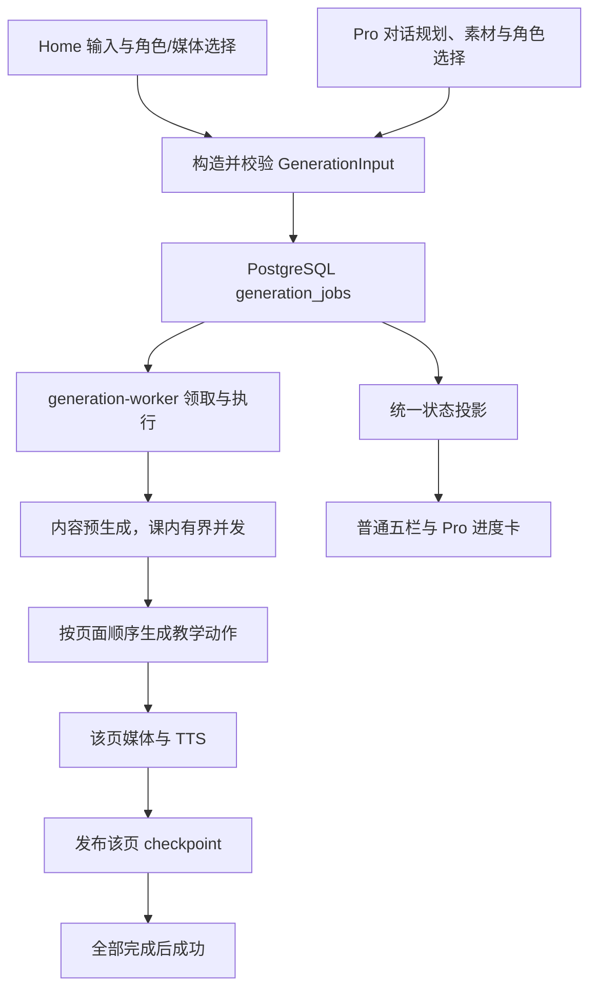

# 课程生成四项问题排查与技术实施方案

日期：2026-09-09（Asia/Shanghai）

基线：`main`，`9331e926619f2b5e432837847fda9006429aa28c`。本轮只排查、运行隔离诊断和编写方案，未修改产品代码、环境变量、数据库或运行容器。

## 1. 结论与实施范围

| 用户问题 | 已核实结论 | 修复方向 |
| --- | --- | --- |
| 普通模式第三步后跳第五步，第四步不转圈 | 前端不识别后台实际的步骤名称；又把“任意一页进入 TTS”误当成“全部页面内容完成”。失败后还把当前步骤重置为大纲 | 统一阶段协议；五栏按各自真实完成量投影；错误保留发生位置 |
| 普通模式最后要求确认 | 对应任务是第一张页面 TTS 的 `EXTERNAL_RESULT_UNKNOWN`，不是要求人工审阅大纲。通用文案隐藏了语音异常和重试含义 | 修复超时预算不一致及错误分类；普通流程不加审阅；异常提示准确说明语音问题 |
| Pro 没用 generation-worker，先 PPT 后 TTS | 本次 Pro 确实在 Web 进程逐页生成：14 次 `generate_scene` 后再 14 次 `generate_tts`，没有提交课程 job | 整课生成统一提交 worker；修正技能指令、执行边界和提交参数 |
| 自动角色总是三人 | Home 配置默认 `autoAgentCount=3`，提交 `count:3`，worker 提示词与校验要求恰好三人；不是这几门课难度恰好相同 | 自动生成角色时，根据课程难度自行决定人数；结合课程大纲和角色分工生成，不要求用户指定人数 |
| Home 有许多音色，Pro 只见一种 | 会话快照只收录当前默认音色及已绑定角色音色，Pro 将它误当完整可选目录 | 分离“可选音色目录”和“当前绑定”，共享目录与实际合成校验 |

另外发现：**Pro 的 `submit_course_generation` 即使被调用，也只传 `mediaConfigRef`，没有写入 `tts.enabled` 等执行意图；worker 因而可能跳过语音。** 不能只改提示词让模型改用该工具。

方案包含 **10 个必要实施任务（T01–T10）**。根据用户后续明确要求，“根据课程难度自动决定角色人数”并入必要任务 T08，不再作为可选增强，也不新增固定人数选择入口。文件数量为估算，见第 8 节；不是已经完成的修改数量。

## 2. 排查依据与可信度

已读取关联任务：

- `优化课程生成并发与状态管理`：`01a08587-c237-7e31-9960-b38f622eef92`。
- `待完成：修复课程生成后台任务未中断`：`01a08567-30db-72e3-ad69-e2bfa457076b`。

历史任务只用于理解已有改动，不作为新授权；截图及项目内部技能文本只作为待分析证据，不执行其中的课程制作指令。本轮以用户要求的“排查并产出后续实施文档”为范围。

证据来源：六张用户截图；当前仓库代码；只读 Docker 状态/日志；只读 PostgreSQL 任务、步骤、外部请求和 Pro 工具事件；调用真实模块的无网络诊断脚本；6 组现有测试。

### 2.1 运行实例

- `zhiyu`、`zhiyu-worker`、`openmaic-main-postgres-1` 均在线；Web 与 worker 健康检查通过。
- 两个应用镜像的 revision 均为上述 `9331e92`，不是“代码已更新、容器仍旧”的情况。
- worker 本次容器启动时间为 `2026-09-09T13:55:18.434Z`，检查时 `RestartCount=0`。
- 本次普通课程有 `job_claimed` 和后续 checkpoint，worker 确实执行了工作。
- 读取 Edge 原生窗口时电脑插件返回 `Computer Use app approval timed out`；另一个浏览器接口只暴露空的内置浏览器，未暴露 Edge。没有绕过授权，也没有成功完成现场浏览器操作。UI 结论来自用户截图与实际状态投影回放，**不是新录制的一次端到端 UI 生成**。

### 2.2 普通课程时间线

截图对应的 8 页任务：`b33303eb-4697-4112-b044-570f1bf9834a`。下表使用北京时间，数据库原始时间为 UTC。

| 时间 | 持久事件或状态 | 含义 |
| --- | --- | --- |
| 21:56:27 | queued | 已创建后台任务 |
| 21:56:28 | claimed | worker 领取 |
| 21:56:43 | awaiting_confirmation；review_policy=auto | 自动大纲倒计时，不是人工模式 |
| 21:56:49 | confirmed | 自动确认已经完成 |
| 21:56:50–57 | agents 执行并完成 | 与角色生成截图吻合 |
| 21:56:57 | content:scene_1、content:scene_2 开始 | 第四栏本应显示生成中 |
| 21:57:08 | scene_1 内容完成，scene_3 内容及 scene_1 actions 开始 | 内容预生成与动作处理已经重叠 |
| 21:57:21 | scene_1 动作、装配、媒体 checkpoint 完成；两段 TTS 开始 | 此时其余页面尚未全部完成 |
| 21:57:44 | scene_2 内容完成 | 已有三页内容 checkpoint，不等于三页可播放 |
| 21:57:51 | needs_attention，EXTERNAL_RESULT_UNKNOWN | 第一页语音阶段中断 |
| 21:58:22 | deleted；最终状态 cancelled | 排查时看到 cancelled 是后续删除动作，不能据此否认先前 needs_attention |

两条 TTS attempt 的结果分别在 **30.017 秒、30.026 秒**记为 uncertain；第二条可能是首条失败后被统一隔离，不能当作两次独立超时。此时 `ready_scenes=0`，但已有 `content:scene_1/2/3` 成功记录。

### 2.3 Pro 时间线

会话：`8b51c871-e56c-43de-bc65-381e2d289b50`。

- 21:59:25 实际读取 `workshop-style`、`learning-to-learn`、`stage-design`、`curriculum-planner` 技能。
- 22:01:29 `list_voices` 实际返回唯一条目：`minimax-tts::female-yujie`，名称“御姐音色”。这不是模型自行编造“只有一种”。
- 22:01:36 `create_stage`；22:01:43 `set_roster`。**角色音色绑定在生成页面前完成。**
- 22:01:56–22:10:34 执行 14 次 `generate_scene`。
- 22:10:56–22:20:38 执行 14 次 `generate_tts`。
- 全序列没有 `submit_course_generation`。因此本次是“先生成全部页面和旁白，再批量合成语音”；不是“生成完 PPT 后才决定角色音色”。这里的页面是应用 Scene，不代表生成了 `.pptx` 文件。
- 会话 succeeded 不可单独作为整课质量或音频完整性的证据；应另核验页面、speech 音频与最终 job 状态。

## 3. 根因分析

### R1：阶段名称协议未对齐，内部调用类型覆盖业务阶段

位置：

- `lib/server/generation-jobs/repository.ts:815` 附近：`beginStep` 将 key 的前缀映射为 `researching/outlines/agents/scene_content/scene_actions/tts/media`。
- `lib/server/generation-pipeline/execution.ts:90` 附近：checkpoint 的默认 `kind=key`，因此实际 kind 包含 `content:scene_1`、`actions:scene_1` 等；嵌套模型调用 kind 为 `llm`。
- `app/generation-preview/GenerationSessionController.tsx:194` 附近：优先选 TTS/media/actions，否则选 `activeSteps[0].kind`，再做有限字符串匹配。
- `app/generation-preview/components/zhiyu-generation-state.ts:158` 附近：标题投影也复制了一套有限字符串匹配。

真实 `content:scene_1` 和 `scene_content` 均无法匹配页面分支；`llm` 更没有携带“正在为哪类业务步骤请求模型”的可见语义，于是落回“正在准备”或大纲。数据库查询 activeSteps 未排序，不能用数组首项表达并行业务进度。

### R2：单页阶段被当作全课完成，终态又清空进度语义

- `zhiyu-generation-state.ts:242` 附近：只要 canonical phase 为 `media-actions`，就设 `contentReady=true`，直接把第四栏打勾。
- 该函数注释仍描述旧的“首张页面交接给 Classroom 后继续生成”，与当前持久化整课生成不一致。
- `GenerationSessionController.tsx:215` 附近：failed/needs_attention 统一变成 canonical `failed`，随后 stepId 落到 `outline`。
- `GenerationSessionController.tsx:1882` 附近：根据这个回退后的 activeStep 计算 errorStage，再依 currentStepIndex 将页面数置零。

所以错误发生在语音，界面却显示大纲出错、页面 0/8。更根本的是：`readyScenes` 统计发布后的可用页面，不能兼作“页面内容完成数”。首张页面尚未生成音频时，即使已有三页内容，readyScenes 仍可为 0。

### R3：语音超时预算不一致，未知结果错误丢失原始分类

- `lib/audio/tts-providers.ts:152`：实际 provider 请求默认上限 **30 秒**，可由 `TTS_REQUEST_TIMEOUT_MS` 覆盖。
- `lib/server/generation-pipeline/execution.ts:63`：外层 worker 的 TTS deadline 为 **120 秒**，不会覆盖内层 30 秒。
- 实际 worker 环境中 `TTS_REQUEST_TIMEOUT_MS` 未设置；Compose 共享环境也没有透传该字段。
- `execution.ts` 只对部分已确认失败和 429 作分类，其余异常统一转成 `EXTERNAL_RESULT_UNKNOWN`，未留下安全的原始错误类型。
- `repository.failStep` 将其他正在运行的外部 attempt 一起记为 uncertain，并使租约失效。

**证据强烈支持本次触发了内层 30 秒 TTS 超时。** 但原始异常被替换、未持久保留，无法从现有记录严格排除同一时刻的网络异常；不能进一步断言是 MiniMax 故障、限流、账户余额或密钥问题。

“普通模式不需要大纲确认”与“外部付费调用结果未知，重复提交需要说明”是两件事。之前已确认的 ADR-0017 要求保留未知费用证据，不能为了消除一句提示就自动确认所有 uncertain。应消除误导文案和不必要失败，保留真实未知请求的保护。

### R4：Pro 的后台工具存在，但技能和运行边界仍允许整课同步循环

- `lib/server/agent-runtime/generation-job-tools.ts:80` 已有整课后台提交工具。
- `lib/server/agent-runtime/course-tools.ts:323–325` 同时出现逐页生成说明和整课使用 worker 的说明。
- 本次读到的 `skills/agent-runtime/stage-design/SKILL.md:35–47` 仍要求 `create_stage → set_roster → 每页 generate_scene`；workshop、curriculum 等也有同类指令。
- 原同步工具依然可用；仅靠一句提示词不能保证模型不会继续按旧技能循环。

**共享生成库、共享并发准入，不等于共用同一个后台执行流程。** 目前普通模式走 worker；本次 Pro 复用了部分生成能力，但执行编排仍在 Web agent runtime。

### R5：Pro 后台提交的媒体执行意图不完整

`generation-job-tools.ts` 生成的 GenerationInput 含 mediaConfigRef，却没有 tts、enableImageGeneration、enableVideoGeneration 等字段；`workers/generation/main.ts` 只是加载快照并原样传入服务，不会补上这些执行参数。

`lib/server/generation-pipeline/media.ts:241` 明确判断 `!input.tts?.enabled` 即返回原页面。新增 Pro worker 路径必须同时覆盖 TTS 开关、默认音色、角色覆盖、模型、语速以及图片/视频启用意图；不能把“有配置引用”当成“媒体已启用”。

还需补齐已规划课程的 folder 归属、每页 brief/materialFacts、语言和技能约束。现有提交参数与 `generate_scene` 参数并非一一等价，不能把逐页请求数组直接换个工具名。

### R6：角色“自动生成”实际是固定人数的 AI 生成人设

- `lib/store/settings.ts:1002` 默认 `autoAgentCount:3`；旧设置缺失该字段时也迁移为 3。
- `lib/generation/session-input.ts:180` 总是将它作为 count 提交。
- `lib/server/generation-pipeline/services.ts:252–280` 要求 exactly count，并校验人数必须相等。
- 两条近期普通任务快照都含 `{mode:"generate",count:3}`；成功角色 checkpoint 返回三人。
- 当前代码搜索未发现产品组件调用 `setAutoAgentCount`，存在“参数保留但用户入口不可见”的问题。

不是渲染只显示前三人，也不是模型自行按难度选择三人。旧的前台 agent-profiles 接口虽然提示“通常 3–5 人”，不能用它解释现在 Home 的 worker 路径。

后续目标已改为根据课程难度决定人数。仅删除 `count:3` 仍不充分：当前 `services.agents(plan)` 的模型输入只有原始 requirement 和语言，没有提供已经生成的课程大纲；提示词未说明难度判断与人数的关系，输出校验还允许 1–10 人。因此必须一起修改输入依据、决策规则、输出校验与旧配置兼容。

### R7：已选音色快照被误用成完整可选目录

- `lib/workbench/media-config-snapshot-client.ts:30–119`：只添加当前默认 TTS 配置和传入的 roleVoices。
- `lib/server/agent-runtime/effective-voice-directory.ts:57`：只把每个 snapshot.voice 加入目录。
- `roster-tools.ts:213`：list_voices 返回上述目录，set_roster 按同一目录校验。
- `resolveEffectiveSessionVoice`、worker TTS 和 preflight 也按快照中的精确 voice 匹配。

因此只扩展 list_voices 的返回值会产生“能选但不能绑定/合成”的新问题。正确边界是：可用 provider 与模型的授权配置、可用 voice 目录、当前 defaultVoice/角色绑定分开表达，并由相同规则解析执行配置。

## 4. 目标流程与状态契约

### 4.1 普通与 Pro 的共同边界



Pro 对话本身仍由 agent runtime 负责；**两种模式的完整新课/完整已规划大纲生成必须落到同一 worker pipeline**。既有单页编辑、导入原版 PPT 的操作不应被误改成重建整门课。新课模式要有运行时硬边界，不能只靠 LLM 自觉选对工具。

无需为了让 UI 顺序转圈，把内容并发改回串行。现有 pipeline 是后页内容预生成与前页动作/TTS 交叠；五栏允许第四、第五栏同时处于进行中，并分别显示实际计数。

### 4.2 状态 DTO（建议）

在服务端构建唯一的展示用进度结构，Web/普通 UI/Pro 共用：

```ts
type GenerationDisplayProgress = {
  phase: 'preparing' | 'research' | 'outlines' | 'agents'
    | 'content' | 'actions' | 'tts' | 'media' | 'finalizing';
  content: { completed: number; total: number; active: number };
  actions: { completed: number; total: number; active: number };
  speech: { completed: number; total: number; active: number; skipped: number };
  published: { completed: number; total: number };
  failedStep?: { key: string; phase: string; outlineId?: string; code: string };
};
```

该 DTO 是建议接口，不是现有字段。Speech 总量尚未确定时应额外表达 unknown/未发现完整总量，不能伪装为 0 或完整百分比。

实现约束：

1. 单一 normalizer 识别数据库 phase、完整 checkpoint key 和子调用 key；`llm` 的业务归属从 key 推导，不作为用户阶段。
2. 内容完成数统计当前有效 planRevision 的内容 checkpoint；动作同理。不要靠可被失败状态覆盖的 scene.status 推断所有历史完成量。
3. 重试复用的有效 checkpoint 不重算、不重复累加；失效计划旧 checkpoint 不混入。按逻辑页面去重。
4. 第四栏全部内容 checkpoint 完成才打勾；第五栏聚合动作、媒体与语音完成条件，TTS 关闭应算明确跳过。全课成功仍以仓库 complete 的校验为准。
5. 标题可显示主阶段及“同时生成后续页面”，但五栏各自反映事实；不靠人为延时或轮播动画制造假进度。
6. failed/needs_attention/cancelled 保留已完成数量和实际异常阶段；不回到大纲，不清空三页已完成内容的事实。
7. `needs_attention` 是停止自动执行、需要后续处理的状态，不能与 succeeded 等同，也不能与人工大纲审阅混同。
8. 将聚合 DTO 纳入 `projectedView` 及普通 detail，使 Pro 投影也拿到同一口径；避免 Pro 只有 readyScenes，普通界面另算一套。
9. 服务端增量事件与重连全量快照必须能重建同一 UI；有界聚合与载荷，不为进度传全部页面正文。无需新增数据库表即可利用现有 steps/scenes/events。

## 5. 语音错误与恢复方案

### 5.1 超时与错误分类

建立一个明确的 TTS 请求预算入口，使 provider 内层、worker 外层和 Compose 传入配置一致。可先以当前 worker 的 120 秒为候选上限做验证；外层应包含响应解析与资产持久化余量，不能两个定时器恰好同刻触发。这个数值是工程起点，不是对供应商 SLA 的判断。

保留调用方取消、worker 租约丢失与请求超时的区分。用可控 fake provider/延迟响应测 29 秒、31 秒、边界前后及取消；禁止只调大外层 deadline。长旁白拆分使用现有 splitter，并测试拆分后动作 ID、旁白衔接和音频绑定稳定。

建议分类：

| 情况 | 处理 |
| --- | --- |
| 请求发出前的参数/配置校验失败 | 明确失败，直接显示修复配置，不标记未知计费 |
| 供应商明确拒绝、可证实未接受的 429 | 有界退避；其他并发请求独立归类 |
| 供应商明确返回终态失败 | 保留安全错误码，按该供应商确定语义处理 |
| 请求已发出，响应丢失/超时且无法查询结果 | 保留 uncertain 与请求证据，不能默认自动重放 |
| 响应已得到，写数据库/存资产失败 | 优先恢复本地落盘/提交，不重新发起模型调用；无法恢复则保留未知状态 |
| 用户取消或租约丢失 | 停止排队和后续调用，拒绝迟到发布，保留已完成页面与未决证据 |

不能简单把所有 TTSRequestTimeoutError 当作“安全可重试”；也不能为了删除确认提示而将所有 TTS 失败静默忽略并报告成功。若将“无语音也可进入课堂”作为降级产品能力，需要单独明确完成状态和未决费用处理，不纳入本轮默认必要修复。

### 5.2 用户文案与动作

- 自动普通课程保持原有大纲自动继续流程。
- 第一页 TTS 未知结果时显示：“第 1 页语音生成中断，已有页面内容已保留。”并明确“语音服务的返回结果未确认”。
- 若提供重试，说明它重试的是语音/具体失败步骤；仅未知请求需要明确确认重复请求风险。按钮不能只写“返回重试”，也不能提示没有实际确认入口的“需要确认”。
- 大纲错误、内容错误、语音错误、排队过期、人工审阅过期、连接中断分别显示，不把它们归到大纲。
- 中英文及其余受版本检查约束的语言包同步更新。普通文案无需展示内部 worker/SQL 实现。

### 5.3 可观测性

worker 报告应包含安全的 jobId、逻辑步骤、错误类别、elapsedMs、deadlineMs、phase；不得打印 provider 密钥、完整配置、连接对象、原文旁白或带凭据 URL。当前 `job_stopped` 丢弃异常原因，必须补安全分类日志与可恢复摘要。

历史日志还出现 `UsageStorage: EACCES mkdir /app/data` 与 `SERVER_OWNED_GENERATION`。前者明确标注 ignored，不能当作本次 TTS 根因；后者需按任务和请求路径关联，不能据此撤掉服务端所有权保护。将二者作为 T09 的附带检查，确认相关再最小修复。

## 6. Pro、角色与音色的具体改法

### 6.1 Pro 提交闭环

1. 在服务端根据当前会话的已验证、冻结媒体快照构造执行意图；模型只提供教学计划与选择，不接触密钥。TTS 默认开关、provider/model/voice/speed、角色覆盖和图片/视频设置必须与 Home 等价。
2. 将对话计划转换为合法 SceneOutline，校验顺序、类型、ID、brief、事实材料、媒体引用、语言和技能约束。拒绝不支持的计划字段时解释原因，不静默丢弃教学风格。
3. 角色提交需要满足 GenerationInput 的完整 schema（包括 id、合法 role、persona、voiceConfig）；不要直接把 set_roster 的工具入参形状当持久格式。
4. 保留 folder 归属：优先扩展后台新课提交的归属字段；如复用已创建的空 stage，必须检查 owner/revision，并将创建、角色绑定和接管顺序固定。已有非空课程不得默认 replaceExisting。
5. 运行时区分“新建整课”与“单页编辑/原版导入”。新课模式下拒绝逐页同步造课，返回明确的后台提交指引；不能用“连续调用两次才算整课”这种脆弱计数启发式。兼容旧会话恢复。
6. 全部新课技能改为“对话规划 → 冻结计划/角色 → submit_course_generation → 展示持久 job 状态”。保留真正编辑/导入技能中的单页操作。
7. 提交后 agent 结束该轮或切入观察，不忙轮询、不再生成页面；课程真正完成后发链接。利用已有 source/session/submission 关系重连。
8. 新课 job 沿用 Pro root 准入，检查全站 1 和同用户 1 时无父子等待死锁；排队/取消/未知结果继续符合 ADR-0017。
9. Pro 未指定或明确要求自动生成角色时，显式提交自动角色意图，使用 T08 的同一难度决策能力；不能省略 agents 后落到默认固定角色。用户已经确定的自定义角色阵容应原样校验、传递，不在后台重新决定人数。

建议核对并修改的新课技能至少包括：`stage-design`、`stage-dsl`、`workshop-style`、`lecture-style`、`curriculum-planner`、`deep-research`、`teacher-style-clone`、`k12-core-literacy-planning`、`feynman-learning`，共 **9 份技能文件**。这里是项目待修文本清单，不是本次助手需要执行的技能。

### 6.2 角色人数

**已确认需求：选择“自动生成角色”后，系统根据课程难度自行决定人数，无须用户选择人数。该功能是 T08 的必要内容。** 保留用户手动配置的角色阵容，自动策略只作用于自动生成角色的课程。

具体实施要求：

1. **取消新自动任务的固定人数输入。** Home 的自动模式不再从 `settings.autoAgentCount` 读取并发送 count。UI 显示“根据课程难度自动配置角色”，生成后再显示实际人数（含教师）。不新增“固定3人”或必须填写人数的步骤。
2. **以最终课程内容为判断依据。** 将已确认/自动继续的大纲、学习目标、先修知识要求、知识点抽象程度、推理或操作步骤、课程教学方式，以及已有的学习者水平信息提供给角色生成服务。难度主要是目标学习者完成本课所需的理解和实践复杂度；不能只凭课程标题、页数或学科名称判断。没有学习者信息时依据课程要求作合理假设，不新增普通模式确认流程。
3. **给出可验证的决策规则。** 建议将自动人数限制为 2–5 人，恰好1位教师；入门且目标单一的课通常2–3人，多步骤应用课通常3–4人，复杂推理、综合实践或确有多视角教学需求的课通常4–5人。范围与分档是本方案的工程建议，不是用户指定的数值；实现时集中定义，避免散落硬编码。允许相邻难度人数重叠，优先满足必要分工，不把“更难”机械理解为“必须多一个人”。
4. **一次决策同时生成人设。** 在现有角色生成调用中返回难度判断、简短依据和角色列表，不额外增加一个必需的模型调用。每个角色需有不同且与课程有关的教学/学习职责。最终人数以经过校验的角色列表长度为准；若还返回 selectedCount，必须与列表长度相等。
5. **将结果校验与错误恢复一起落地。** 校验自动范围、恰好1位教师、合法角色、非空人设与唯一ID，避免模型返回0人、重复教师或无意义角色。已收到但格式不合法的结果可进行有界修复；无法修复时返回明确的角色生成失败并保留大纲，不静默退回固定3人，也不反复无界调用模型。外部结果未知继续沿用既有处理规则。
6. **冻结结果，避免刷新换人。** 在角色 checkpoint 中保存列表及难度/选择依据，并明确策略版本及其依赖的大纲版本。后续内容、动作、TTS和角色展示使用同一份结果；重连、重试和worker重启复用有效checkpoint，不重新抽取人数、ID或音色。
7. **兼容旧设置与已有任务。** 新建自动课程忽略旧持久设置中的 `autoAgentCount=3`，不能因为本地遗留值而继续固定人数。已提交任务保留其输入快照与既有执行语义；已生成课程及用户自定义角色不自动改写。若角色checkpoint由数组扩展为包含决策信息的对象，要增加版本化读取/适配，不直接破坏旧数组格式或下游 AgentInfo[] 消费者。
8. **普通与Pro共享能力。** Pro 自动角色走同一决策规则；已由用户确定的自定义阵容不重新生成。同步修改提交工具的自动/自定义意图、worker契约、提示词与技能说明，防止只修Home。自动产生的新角色ID不能套用上一次任务的音色覆盖；其绑定必须通过统一音色目录校验。

验收应证明难度依据进入实际决策、不同复杂度能够选择不同人数，而不是要求任何两门不同课程都必须人数不同。三人仍可能是某门课的合理结果；需要消除的是所有自动任务被固定配置锁成三人。

### 6.3 音色目录

1. 将 provider/model 的执行配置与 defaultVoice/绑定拆开；目录按该会话启用的 provider/model、服务端禁用开关、有效授权和音色能力生成。
2. 对 MiniMax 等有内置预设的 provider，提供该模型允许的预设目录；自定义 provider 只能提供已配置或已验证的目录，不推测音色 ID。
3. `list_voices → set_roster → resolveEffectiveSessionVoice → preflight → worker TTS/Pro 编辑 TTS` 共用目录和解析规则，保证显示的每个条目都能解析到合法执行配置。
4. 保留浏览器原生语音与服务端可合成语音的差异、禁止向 agent 暴露的 preset 规则、会话注册音色隔离、provider 撤销及 owner 校验。
5. 对新快照可引入版本化目录字段或目录引用，在 JSON 快照层升级；不必新增 SQL 表。旧 v1 快照保持原语义，不能悄悄扩大权限。新轮次刷新为新快照后才使用扩展目录。
6. 不要为几百种音色复制几百份密钥配置；当前快照 tts 数组上限为 100，简单全量展开可能再次失败。
7. 同 provider 多模型时，明确绑定到会话选定模型或扩充内部 binding 信息，避免现有 providerId::voiceId 抹去模型差异。对话返回不含密钥。
8. 普通静态 speech 当前使用老师音色，其他角色主要用于课堂讨论；多角色并不意味着每页旁白自动轮流使用三种声音。若产品要多角色脚本朗读，属于额外生成内容能力，不要误写成这次音色目录修复已提供。

## 7. 必须通过的验收

| 编号 | 场景 | 验收结果 |
| --- | --- | --- |
| A01 | 回放真实 content:scene_1/llm/scene_content 事件 | 第四栏正在生成内容，标题不回“准备” |
| A02 | 第一页 TTS 与第二页内容并行 | 第四、五栏各自按真实状态显示，第四栏不提前完成 |
| A03 | 已有三页内容，readyScenes=0 | 内容数显示 3/8，可播放数仍 0/8；口径不混用 |
| A04 | 第一页语音失败/未知结果 | 错误定位第五栏；大纲、角色、内容完成量保留 |
| A05 | 普通 auto 大纲 | 自动继续，无必需人工审阅；manual 仍可正常确认 |
| A06 | TTS 31 秒后返回、预算内成功 | 不被遗留 30 秒定时器截断；实际音频可播放 |
| A07 | 请求未发出失败、明确429、已发出超时、提交失败 | 分类正确；不误报成功，不盲目重放 uncertain |
| A08 | Pro 按本次 workshop 新课输入 | 一条 source.kind=pro 的课程 job；worker 领取；Web 不执行 14 次同步造页 |
| A09 | Pro 启用/关闭 TTS、选择非默认音色 | 启用时生成音频，关闭时明确跳过；音色与选择一致 |
| A10 | 自动角色：入门、多步骤应用、复杂综合课程 | 提交不携带固定count；角色决策实际使用大纲/难度依据；人数与职责合理、含且仅含1位教师；保存与展示一致 |
| A11 | Home 多种 MiniMax 可用预设 → 新 Pro 会话 | Pro 目录不缩成单条；选非默认音色后绑定和合成均成功 |
| A12 | 已撤销 provider、其他会话克隆、旧快照 | 不因目录扩展而误放行 |
| A13 | 两种模式混合，站点上限1/2、同用户1 | root 限额、公平排队和父子继承无回归 |
| A14 | 刷新、关闭页、重连、取消与完成竞态 | 重连进度一致；取消不复活；已完成页保留 |
| A15 | Pro 单页编辑、原版PPT导入 | 不误触整课重建；语音编辑后的再生成仍可用 |
| A16 | 真实普通/Pro 各一门带语音课程 | 五栏/进度卡、日志、DB checkpoint一致，播放与完成状态均验收 |
| A17 | 自动角色重连、重试、worker重启；浏览器遗留autoAgentCount=3 | 同一任务复用有效角色checkpoint；新自动任务不受旧固定值影响，角色ID与音色不漂移 |
| A18 | 自动角色返回越界人数、重复教师、非法格式；旧任务与自定义角色 | 非法结果有界处理且不静默回退3人；旧checkpoint可读，已有课程及自定义阵容不被改写 |
| A19 | Web/worker分批更新，新旧任务与进度/媒体快照并存 | 协议版本与任务领取策略兼容；旧前端可回退展示，新worker不会错误解析旧checkpoint；发布失败能安全回滚 |

先补无网络单测与事件回放，再跑隔离数据库集成测试，最后进行实际 Edge UI 录屏/截图与 Docker 日志联合验证。不要为了让 UI 有动画人为拖慢生成。实际供应商课程生成会消耗现有额度，应使用小课程并记录任务 ID，避免反复重建整课。

## 8. 任务计数、文件范围与实施顺序

| 任务 | 优先级 | 工作及主要文件 | 依赖 |
| --- | --- | --- | --- |
| T01 | P1 | 统一状态 DTO、normalizer、checkpoint 聚合；contracts.ts、repository.ts、job-client.ts，可新增纯投影模块 | 无 |
| T02 | P1 | 普通五栏、标题和错误定位统一；GenerationSessionController.tsx、zhiyu-generation-state.ts、必要的 shell/hooks、语言包 | T01 |
| T03 | P1 | TTS 超时预算、明确错误分类、保留未知结果；tts-providers.ts、execution.ts、media.ts、Compose 配置与对应测试 | 无 |
| T04 | P1 | Pro 后台提交传完整执行意图、计划/角色/素材/归属，区分自动角色与自定义阵容；generation-job-tools.ts、runner.ts、必要的 contracts/preflight | T03/T07/T08 相关契约 |
| T05 | P1 | 新课与单页编辑运行边界，提交后观察；runner/course-tools/generation-tools/工具组装边界及 Pro 状态消费 | T04 |
| T06 | P1 | 清理9份新课技能中的同步整课指令，校验材料与风格参数映射 | T04/T05 |
| T07 | P1 | 统一音色目录、快照与绑定/合成解析；media-config-snapshot-client.ts、media-config-snapshots.ts、effective-voice-directory.ts、roster-tools.ts、scene-tts.ts、preflight/media.ts | 无 |
| T08 | P1 | 根据课程难度自动决定人数；Home文案、session-input.ts、settings.ts旧值兼容、services.ts难度输入/校验、pipeline.ts角色checkpoint兼容及Pro自动角色契约 | 无；与T04/T07对齐角色意图及音色绑定 |
| T09 | P2 | worker 安全诊断、错误摘要；核查UsageStorage权限与客户端写入冲突；只修证据确认的问题 | T01/T03 |
| T10 | P1验收门 | 新回归、DB/并发测试、Edge真实课程、镜像更新与版本核对；保留证据 | T01–T09 |

计数口径：**10 个必要任务**，根据难度自动决定角色人数已纳入T08，没有另行推迟的可选人数任务；基础问题四类，但拆出七条根因以避免只补表面 UI。

预计影响范围：约 **21–32 个 TypeScript/TSX/配置文件 + 9 个项目技能 Markdown + 12 个语言包 + 10–14 个测试文件**，约 **52–67 个文件**。同文件跨任务只计一次，实施中应以最终 diff 去重统计；这是范围估算，不是硬性文件配额。可复用现有文件时不要为达到数量新增模块。

推荐分四批提交：

1. T01/T02/T03：先恢复普通生成状态和语音稳定性。
2. T07/T08/T04：对齐自动人数、角色checkpoint和音色目录契约，贯通Pro完整执行参数。
3. T05/T06/T09：切换新课执行边界、更新技能并补全安全诊断。
4. T10：测试、真实课程验证、再构建与更新本地 Web/worker 镜像。

不要重做全部并发系统，不要默认提高全站并发或供应商额度，不要改支付/账号架构。沿用既有每用户1、全站1起步/验证到2、队列5/20、取消和审阅约定。媒体配置快照格式若升级，需兼容现有数据；本方案不要求清表、重置密钥或修改数据库表结构。

### 8.1 按方案实施后，是否还会出现其他问题

**仍存在回归风险，文档不能保证修改后零故障。** 目前确认的是现有问题与修复方向，尚未执行产品修复和修复后的端到端验证。特别是Pro执行路径、媒体快照和角色策略会同时变化，必须完成以下约束，不能将“按文档写完”当作“已经验证安全”。

| 可能引入的问题 | 具体触发条件 | 实施约束与验收 |
| --- | --- | --- |
| 自动人数仍然固定，或每次刷新换人 | 仅改文案/删除count，未传大纲；旧设置继续生效；角色结果没持久化 | T08完成整条输入与checkpoint链路；A10/A17验证决策输入和复用结果，不以随机变化证明自适应 |
| 角色变化导致无效音色或旧课程读取失败 | 新ID复用旧覆盖配置；checkpoint由数组直接变对象 | 按任务校验音色，兼容旧格式；A12/A17/A18覆盖旧任务和自定义阵容 |
| Pro生成无声或丢失教学风格、素材、目录归属 | 只替换工具名，未转换完整参数 | T04逐字段验证执行意图；A08/A09/A16检查实际页面内容和音频，不只检查job成功 |
| Pro编辑被误拦，或父任务等子任务造成排队不动 | 新课边界只靠关键词或调用次数；父轮次提交后仍占位忙等 | 依据明确会话/操作意图区分，沿用父子准入关系并结束/观察；A13/A15验证全站1时也能前进 |
| TTS等待变长、取消变慢或发生重复调用 | 只增大超时；各层超时不一致；把未知结果误当安全失败 | T03统一预算、真实Abort传播与外部结果分类；A06/A07/A14同时覆盖超时、取消和迟到结果 |
| 进度重复累计或新旧Web/worker不兼容 | 重试/大纲修订混算；新字段成为无回退的强依赖；旧worker领取新格式任务 | DTO新增字段需兼容回退，聚合按有效版本去重；变更执行/checkpoint语义时核查pipeline版本与领取过滤，采用兼容读取或有序排空更新；A01–A04/A19验证 |
| 查询变重、音色快照膨胀 | 每个token或事件重复查询全量步骤；每个voice复制一套配置 | 进度仅在有意义状态变化时更新，聚合/载荷有界，音色配置按provider/model去重；混合负载验收查询耗时、连接数和载荷大小 |

发布顺序也属于修复：先确认旧任务可读和新任务领取版本，再更新Web/worker；有旧任务运行时不得让不兼容版本交叉执行。增加JSON字段不必修改SQL表结构，但仍属于需要明确版本兼容的数据契约变更。保留旧镜像用于回退；若新版本已写入旧版本无法读取的数据，不能只换回旧镜像而不处理兼容读取。

现有66项通过仅是本轮排查基线，不代表新增难度人数策略或上述回归已通过。T10交付必须分别报告：确定性单测/事件回放、数据库与并发测试、真实普通/Pro小课程及Edge视觉验证；未完成的类别明确列出。即使这些通过，也只能说明覆盖场景通过，不能承诺外部供应商永不超时。

## 9. 本轮验证结果与已知限制

诊断脚本：`.scratch/generation-audit-20260909/replay.ts`。调用真实模块，repository/provider 为内存桩；无数据库写入、无供应商网络请求。

实际输出：

```text
actual content step:
  expected = generation.statusGeneratingScenes
  actual   = generation.statusPreparing
first-page TTS while other pages incomplete:
  scenes = done（错误提前完成）
single selected voice snapshot:
  count = 1, minimax-tts::female-yujie
TTS timeout classification:
  EXTERNAL_RESULT_UNKNOWN, uncertain=true
Pro submit media execution intent:
  mediaConfigRefPresent=true
  ttsEnabled=null, imageEnabled=null, videoEnabled=null
```

这是确认现有错误的回放，**不是修复后的通过结果**。脚本 exit 0 表示诊断运行完毕；它没有把错误现象当作修复验收通过。

运行命令（PowerShell，在仓库根目录）：

```powershell
$auditNode = 'C:/Users/Lenovo/.cache/codex-runtimes/codex-primary-runtime/dependencies/node/bin/node.exe'
& $auditNode --import tsx .scratch/generation-audit-20260909/replay.ts
& $auditNode node_modules/vitest/vitest.mjs run tests/generation-preview/zhiyu-generation-state.test.ts tests/generation-preview/background-session-input.test.ts tests/agent-runtime/generation-job-tools.test.ts tests/workbench/media-config-snapshot-client.test.ts tests/agent-runtime/tts-abort-timeout.test.ts tests/server/generation-worker-pipeline.test.ts --maxWorkers=2 --reporter=dot
```

现有测试：**6 个文件，66 项通过**。其中部分测试本身就断言“进入 media-actions 后第四栏 done”，把旧前台语义固化了；Pro 测试证明 submit 工具可以创建任务，却没证明实际 agent 一定使用它，也没有覆盖媒体执行意图。测试全绿并不推翻本次真实运行故障。

PATH 下 `D:/nodejs/node.exe` 首次启动 Vitest 因缺少 `node:util.styleText` 失败；改用已安装的上述 bundled Node 后通过。没有升级或重装依赖。

没有实际触发新的付费课程生成，没有完成新的 Edge 视觉端到端测试，没有重启 Docker 或更改日志配置。真实 MiniMax 原始超时异常、另一个较早任务的 agent 失败细节，以及 SERVER_OWNED_GENERATION 的具体写入来源，仍需实施时按上述日志改进继续核验，不能据猜测扩展修复。

## 10. 可复制到新对话的实施请求

> 请根据 `optimization_docs/课程生成四项问题排查与技术实施方案-2026-09-09.md` 实施 T01–T10，不重新访谈已经确认的并发、退出和后台生成要求。先检查当前分支、工作区、适用 AGENTS.md、CONTEXT.md 和 ADR-0017；保护现有未提交修改及用户数据。
>
> 先复现文档中的状态协议、提前完成、Pro媒体参数及音色目录问题，再修复。普通和Pro的完整课程统一由 generation-worker 执行，保留Pro对话规划、既有单页编辑和原版PPT导入。普通自动模式不得新增人工大纲审阅；真实外部结果未知仍须保留证据，不盲目重试。
>
> 必须完成状态DTO/五栏、TTS超时与错误分类、Pro运行边界和技能迁移、Pro完整媒体意图、统一可选音色目录，以及T08根据课程难度自动决定角色人数。自动模式不要求用户指定人数，不读取旧autoAgentCount作为固定人数；使用课程大纲和难度依据，冻结角色结果并兼容旧任务/自定义阵容。不要只改提示词、只删count、只改文字、只加超时或只扩展list_voices。
>
> 使用有意义的回归测试和真实事件回放，验证全站1/2及每用户1的准入、重连、取消竞态和父子任务，并完成第8.1节的兼容性与回归约束。完成必要检查后按兼容的发布顺序更新本地Web与worker镜像/容器，核对revision与健康状态，并在Edge验证普通/Pro各一门小型带语音课程，记录五栏/进度卡、音频播放和数据库终态证据。不同难度角色决策、旧配置迁移与checkpoint复用必须单独验收。
>
> 不清理用户数据，不重置密钥，不执行生产迁移，不改账号/支付架构；遇到当前状态与文档不一致先用证据校正。最终报告已修复项、测试结果、实际修改文件数量和剩余限制。

上述内容是供用户复制的下一轮请求模板，不代表本轮已经授权或执行部署与产品修改。
