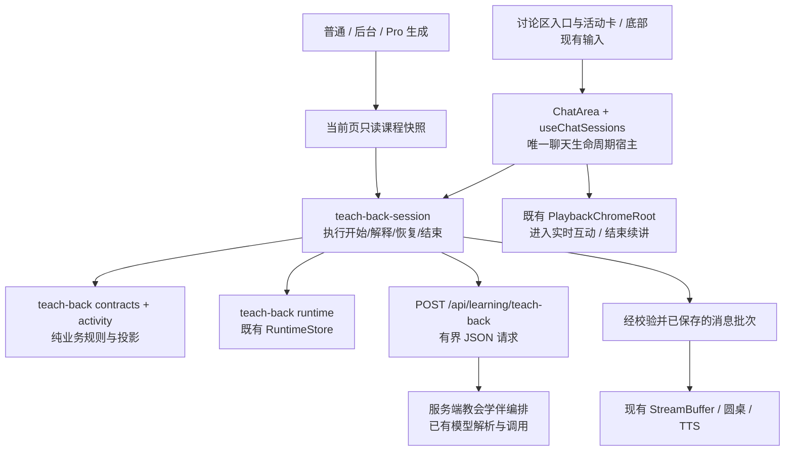
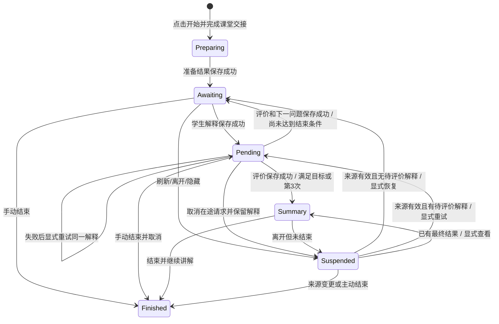

# 智域学生端「教会学伴」反向教学实施方案

> 日期：2026-09-14。状态：**待实施的技术规格**；本次仅审查代码、运行基线测试和编写文档，没有实现本功能。
>
> 用户已确认只增加反向教学：学生解释，AI 学伴提出有针对性的疑问。面向用户的名称为「教会学伴」。本文件供新对话实施，不授权顺带重构整个课堂、补做教师端或改写课程生成。
>
> 最高保护边界：**普通前台生成、普通后台生成、Pro 生成以及现有完整 UI**。账号与数据隔离专项仍属后续拓展；保留现有身份、权限与记录分区行为。

## 1. 目标与交付范围

在现有课堂增加一次短小、可结束、可恢复的解释练习：选择当前页主题和一个现有 AI 学伴；学伴提出一个具体问题；学生通过现有输入框解释；系统根据解释中缺少的理由、条件或例子，提出下一条有针对性的疑问。最多接收三次学生解释，可以提前结束。最后展示「已说明 / 需要补充 / 本次未涉及」，保留学生原文和对应依据，供学生回看。

功能的价值是让学生暴露并补足解释中的缺口。不能把 AI 生成的问题数量、对话长度或三轮结束包装成“已经掌握课程”，也不新增未经验证的掌握度百分比。

### 1.1 首版包含

- 单次活动对应当前一页、一个主题、一个现有 AI 学伴，冻结一至三个可由课程片段支持的解释要点。
- 学伴一次只提出一个问题，随后必须等待学生实际输入；最多三次解释机会。
- 文本和现有语音输入、现有学伴头像与语音播放、针对性追问、结果卡、活动历史。
- 明确的停止、继续讲解、保存失败、模型失败、刷新恢复、切页失效处理。
- 独立功能开关；普通答疑、核查式答疑和教会学伴之间明确切换。

### 1.2 不包含

教师端、全局知识图谱、长期误概念库、间隔复习、迁移挑战、排行榜、教学效果实验平台、课程生成器改造、多名学伴自主辩论、联网研究型 agent 团队、模型微调，以及账号与数据隔离专项。教学活动不写入生成的课程脚本，不成为开始学习或生成课程的前置步骤。

首版不要求识别图片、视频、外部 iframe 或复杂互动运行结果中的知识。当前页如果没有足够的可读课程依据，应说明无法开始并建议选择讲解页，而不是编造主题。测验未提交时不允许通过此入口读取其标准答案；测验、互动和 PBL 原有交互继续保留。

## 2. 实际代码审查结论

本次基于 HEAD `68ace01b` 加当前工作区已有修改审查，不能用该提交单独代表当前产品。此前学生端升级和修复已经出现在工作区；旧计划中的“尚未实施”及旧轮次描述不作为当前事实。

审查覆盖课堂挂载与可见性、真实输入分发、聊天会话恢复、请求与音频退休、讲解中断和恢复、核查式答疑协议、学习记录存储、反馈投影，以及普通前台、后台 Worker、Pro 提交和恢复链路。以下结论决定接入方式。

| 已核对的代码                                                                                                                                                             | 实际行为                                                                                              | 对本功能的约束                                                                     |
| ------------------------------------------------------------------------------------------------------------------------------------------------------------------------ | ----------------------------------------------------------------------------------------------------- | ---------------------------------------------------------------------------------- |
| [stage.tsx](../../components/stage.tsx)、[PlaybackChromeRoot.tsx](../../components/edit/PlaybackChromeRoot.tsx)                                                          | Stage 区分编辑和学习；学习外壳持有同一个播放引擎、ChatArea 引用和课堂交接逻辑                         | 不新建第二个课堂控制器或播放引擎；进入教会学伴必须走学习外壳的交接                 |
| [ClassroomRuntimeIslands.tsx](../../components/classroom/ClassroomRuntimeIslands.tsx)、[ZhiyuInteractionPanel.tsx](../../components/classroom/ZhiyuInteractionPanel.tsx) | 右侧外层有讲义、讨论、角色三个标签；内层 ChatArea 通过 persistentContent 保持挂载                     | 保留三标签和唯一 ChatArea；需要跳到讨论时同步外层标签，不能只改内层 tab            |
| [chat-area.tsx](../../components/chat/chat-area.tsx)、PlaybackChromeRoot                                                                                                 | 讨论工具栏已有核查式答疑；学生真正的输入与圆桌位于课堂底部                                            | 右侧增加入口与状态卡，底部复用输入；不能设计成右侧新增独立聊天输入                 |
| [use-chat-sessions.ts](../../components/chat/use-chat-sessions.ts)                                                                                                       | 单一请求退休、AbortController、StreamBuffer、pending retirement 和会话恢复流程；已有 guided 分支      | 新增领域执行器，宿主只负责分发和资源交接；不能再复制一大段聊天循环                 |
| [engine.ts](../../lib/playback/engine.ts)                                                                                                                                | handleUserInterrupt 保存中断位置、进入 live、停止音频，随后调用 onUserInterrupt，后者会实际发送消息   | **不能用伪造的“开始反向教学”文本调用此方法**；应提取不发送消息的共用 live 进入操作 |
| PlaybackChromeRoot、[auto-resume.ts](../../lib/playback/auto-resume.ts)                                                                                                  | 手动结束通过保存的讲解中断位置和引擎状态判定是否续讲；纯暂停不等同于保存中断点                        | 开始活动要正确保存中断点；结束复用现有清理与续讲，不用切换页面补救                 |
| [guided-request.ts](../../lib/chat/guided-request.ts)、[guided-contracts.ts](../../lib/learning/guided-contracts.ts)                                                     | guided SSE 读取器要求自己的 cue、done 和 learningOutcome，结果阶段仅为 wait_student / feedback        | 不把 teach_back 强塞进 guided outcome；采用独立业务协议并复用下游消息呈现          |
| [coach route](../../app/api/learning/coach/route.ts)、[server coach](../../lib/server/learning/coach.ts)                                                                 | 核查式答疑有解释、审阅、修订等调用及既有教师角色呈现，服务端先计算再发布事件                          | 反向教学需要学生先解释和单学伴追问，不复用其完整编排或双角色输出                   |
| [content-snapshot.ts](../../lib/learning/content-snapshot.ts)                                                                                                            | 按教学语义提取课程证据，单片段截断；内容修订包含语义内容，部分互动来源只能有限提取                    | 可复用当前页只读快照，但不能声称看到了全页图片、完整交互或整门课                   |
| [guided-runtime.ts](../../lib/learning/guided-runtime.ts)、[store.ts](../../lib/runtime/store.ts)、[payload-validators.ts](../../lib/runtime/payload-validators.ts)      | 已有 learner/stage 分区、追加记录、顺序号、冲突处理和统一 payload 校验表；guided 记录有自己的事件结构 | 新增独立 teachBack 记录类型；继承存储能力，不塞进 learningDialogue，也不复制数据库 |
| [report.ts](../../lib/learning/report.ts)、[LearningFeedbackDialog.tsx](../../components/learning/LearningFeedbackDialog.tsx)                                            | 现有报告围绕学习检查和答卷；反馈对话框包含课程可检查条件                                              | 教会学伴独立查询和展示，不能改变测验分数、完成判定，也不能被整课生成未完成一并阻断 |
| [feature-flags.ts](../../lib/learning/feature-flags.ts)                                                                                                                  | 当前 guided 入口能力受 checks 与 guided 开关共同控制                                                  | 新 teach-back 开关独立；保留旧两项开关含义，不能顺手解耦旧 guided 行为             |
| [WorkspaceClassroomPane.tsx](../../components/workbench/workspace/WorkspaceClassroomPane.tsx)、[panel-context.tsx](../../lib/workbench/panel-context.tsx)                | Pro 内嵌课堂会隐藏但保持挂载，编辑/学习和可见性是不同维度                                             | 只在可见的学习课堂启动；隐藏后退休请求和声音，回来必须显式恢复活动                 |
| [GenerationSessionController.tsx](../../app/generation-preview/GenerationSessionController.tsx)、后台生成与 Pro 工具                                                     | 普通前台可先发布首场景后继续生成；后台/Pro 按原模型快照、计划、任务与恢复协议执行                     | 教学不能依赖全课完成；只校验当前来源页，不因后台新增其他页打断活动                 |

### 2.1 不能误用的现有行为

1. **普通答疑当前不是三轮/六轮的统一策略。** [reply-policy.ts](../../lib/chat/reply-policy.ts) 对真实用户普通提问最多两次 AI 发言，裸确认语最多一次，明确深入讨论最多三次；没有用户输入的脚本讨论保留原预算。教会学伴绕过该普通答疑编排，但不修改它。
2. **guide 的呈现和落盘顺序不能直接照搬。** 当前 guided 分支会在发布结果后记录 outcome。教会学伴的下一问题决定下一次解释归属，应先保存合法结果，再显示并播放，避免刷新后缺失问题或重复计轮。
3. **外层标签与内层 tab 不是同一个状态。** 活动历史中的恢复入口必须让外层“讨论”高亮和实际内容一致，不能显示“讲义”标签却出现教会学伴。
4. **旧聊天恢复默认把 active 归一为 interrupted。** 不全局改成自动 active；新活动需要自己的显式恢复检查。
5. **聊天记录现有同步可能更新 Stage 的会话字段。** “课程不可变”指教学内容、actions、提纲、生成参数等不能被活动改写，不是禁止已有聊天持久化或当前播放位置更新。

## 3. 用户故事与验收意图

1. 作为学生，我希望在当前课堂找到“教会学伴”，以便不离开正在学习的课程就能练习解释。
2. 作为学生，我希望先看到主题和学伴再开始，以便知道本次需要解释什么。
3. 作为学生，我希望学伴一次只问一个具体问题，以便集中解释而不是旁观 AI 互相讨论。
4. 作为学生，我希望继续使用现有文字或语音输入，以便不重新学习一套操作。
5. 作为学生，我希望下一条疑问对应我刚才没解释清楚的地方，以便有方向地补充。
6. 作为学生，我希望每次提交后明确知道正在处理还是轮到我，以便不会重复发送或一直等待。
7. 作为学生，我希望三次解释以内就能收束并且能随时结束，以便控制练习时长。
8. 作为学生，我希望反馈引用我的解释并区分没有涉及的要点，以便理解反馈而不把遗漏当成答错。
9. 作为学生，我希望结束后能继续原来的讲解，以便不通过切页才能恢复播放。
10. 作为学生，我希望在网络或模型失败时保留已经提交的解释，以便重试时不用重复作答。
11. 作为学生，我希望保存失败时得到明确提示，以便知道结果是否真正留存。
12. 作为学生，我希望刷新或离开后能主动恢复有效的练习，以便没有自动发言惊扰，也不丢失进度。
13. 作为学生，我希望当前教学内容变更时停止沿用旧依据，以便不会收到基于另一版本课程的追问。
14. 作为学生，我希望回看活动历史且原有测验分数不变，以便区分解释练习和测验成绩。
15. 作为学生，我希望不适合开展练习的页面有清楚提示，以便不面对编造的问题或提前泄露的测验答案。
16. 作为普通模式或 Pro 模式的使用者，我希望原来的生成、续生成、编辑、学习与导出继续工作，以便新功能不破坏已经可用的流程。
17. 作为不启用此功能的使用者，我希望现有课堂行为保持一致，以便按原方式学习和答疑。

## 4. 架构决策

### 4.1 三种接法的比较

| 方案                                                | 影响                                                                                      | 决定     |
| --------------------------------------------------- | ----------------------------------------------------------------------------------------- | -------- |
| 扩充 guided 的 outcome、阶段和教师编排              | 看似少文件，实际把学生解释、教师核查、学习活动存储混为一体；严格 SSE 校验和旧报告都被牵动 | 不采用   |
| 独立页面、聊天 hook、TTS 和存储系统                 | 易重复消费输入、并行播放、丢失讲解中断点，且需复制完整课堂 UI                             | 不采用   |
| 独立反向教学领域模块，挂接既有聊天生命周期和课堂 UI | 业务状态与旧功能分离；请求、消息、语音和播放交接仍只有一个宿主                            | **采用** |

反向教学作为一种学生互动方式，与 standard、guided 并列。它拥有活动规则、数据契约和应用执行器；现有课堂继续拥有输入分发、聊天资源和引擎。不要为了三个已知分支先建设通用插件注册中心、策略工厂或第二套 agent 平台。



图中生成链路只产出课程，本功能读取已存在的课程；生成链路不得反向依赖 teach-back 模块、完成状态或接口。

### 4.2 状态归属

| 状态                                         | 唯一事实来源                  | 其他层可以保留什么                           |
| -------------------------------------------- | ----------------------------- | -------------------------------------------- |
| 主题、课程依据、解释、已发布追问、结果、轮次 | teachBack 追加记录的活动投影  | React 可缓存投影，不自行累加另一份轮次       |
| 当前请求、退休屏障、音频缓冲和消息播放       | 现有聊天宿主                  | 执行器接收本次资源和回调，不新建全局播放器   |
| 当前 scene、播放 action、中断点              | 现有 PlaybackEngine 与外壳    | 活动仅记录来源标识，不保存第二份可写播放游标 |
| 聊天标签、准备卡展开、草稿、折叠             | 现有 UI 和局部组件            | 不持久化为学习成果                           |
| 请求是否成功、模型输出是否合法               | 服务端校验 + 客户端当前性检查 | 不以“文字出现在屏幕上”代替成功保存           |

播放器进度、请求 loading 与活动领域阶段可以同时存在，但每个事实只有一个所有者。禁止 ChatArea、useChatSessions、runtime 三处各维护可独立变化的 `roundCount`。

### 4.3 建议模块与最小公共接口

以下是拟新增文件，不是已经存在的实现。文件名可随仓库习惯小幅调整，职责边界不得合并回巨型聊天 hook。

| 拟新增模块                                             | 职责与公开边界                                                                                                                         |
| ------------------------------------------------------ | -------------------------------------------------------------------------------------------------------------------------------------- |
| `lib/learning/teach-back/contracts.ts`                 | 纯类型、版本、请求/结果/记录校验、上限。可被浏览器与服务端导入；不得导入 RuntimeStore、React、模型或浏览器身份读取                     |
| `lib/learning/teach-back/activity.ts`                  | 从记录投影活动、判定允许的命令、剩余机会、结束条件、引用有效性和当前页来源绑定；纯逻辑                                                 |
| `lib/learning/teach-back/runtime.ts`                   | 基于现有 RuntimeStore 提供读取活动、按预期顺序号追加命令结果、列出课程活动；隐藏分区、CAS、去重与存储错误                              |
| `lib/chat/teach-back-session.ts`                       | 执行开始、提交解释、重试、恢复、结束；组织读取→校验→请求→保存→呈现。由现有宿主传入请求取消、当前性和呈现能力，不拥有第二份聊天列表/TTS |
| `lib/server/learning/teach-back.ts`                    | 有界模型调用、课程片段约束、结构化输出与证据校验；输出业务结果，不操作课堂或持久化用户状态                                             |
| `app/api/learning/teach-back/route.ts`                 | 开关、请求上限、参数校验、已有模型解析、取消/超时、JSON 状态码；不堆放提示词与活动状态机                                               |
| `components/learning/teach-back/TeachBackActivity.tsx` | 准备、等待、失败、结果卡；消费投影和命令回调，不自行请求模型                                                                           |
| `components/learning/teach-back/TeachBackHistory.tsx`  | 学习反馈中的独立活动列表和详情，不改变旧报告计算                                                                                       |
| `lib/chat/interaction-mode.ts`                         | 小型共用互动模式类型 `standard / guided / teach_back`，避免通用聊天类型反向依赖 guided 专属契约                                        |

宿主仅增加显式分发和资源交接；执行器对宿主暴露活动命令和状态更新。不要为每一种错误、校验和按钮新建一个服务类。若现有纯帮助函数语义完全一致可直接复用；如果语义不同，独立实现短小领域函数，避免修改 guided 校验以迁就本功能。

## 5. 活动规则与状态机

### 5.1 活动单位和计轮

- 一次活动冻结 `activityId + stageId + sceneId + sourceRevision + peerId + criteria`。换主题、换学伴或更换来源应开启新活动。
- 学伴开场问题不占学生解释次数。第一条实际提交的非空解释为 `turnIndex=1`，最多到 3；输入中的“不会”可以成为一次有效解释机会，并得到有针对性的提示。
- 在同一条解释上重试网络/模型请求，不创建新的学生解释，不增加 turnIndex；同一条解释最多接受一个正式评价结果。
- 一次只允许一个尚未评价的解释。输入提交后禁用重复发送，停止按钮始终可用。
- 评价后所有要点均“已说明”，或第三次解释评价完成，即进入结果态；不再提出第四个问题。不把 AI 自称“学生已经懂了”当成唯一结束依据。
- 等待学生时不得启动定时续聊、director、自动 resume 请求或多个学伴轮流发言。

### 5.2 领域状态与界面瞬态分开

成功准备后的持久化活动阶段：`awaiting_explanation`、`evaluation_pending`、`summary_ready`、`suspended`、`finished`。成功准备前只有准备尝试记录，可供恢复和预算计算，不投影成已开始的学习活动。准备卡和网络 `preparing / submitting / retrying / saving` 为界面瞬态；活动成功准备前不写入一条“已经完成练习”的记录。



`summary_ready` 表示不再接收新解释，但还没有执行课堂返回。最终结果卡出现时保持安静；用户点击“结束并继续讲解”再清理并续讲。手动提前结束直接生成基于已有合法记录的部分结果，**不等待额外的总结模型调用**。

### 5.3 最小模型预算

首版采用每个命令一次结构化模型调用：准备一次，评价每条解释各一次，评价输出同时包含对固定要点的判断和至多一个下一问题。完整三次解释正常路径共四次调用，不调用普通多智能体循环。

服务端每次请求最多一次 `callLLM`，关闭 SDK 自动重试；建议单请求 30 秒超时，客户端总等待上限略大于服务端。针对某次准备或解释，允许学生显式重试一次；正常客户端一次活动最多八次已发起调用。未确定上游是否已执行的失败调用也计入预算，不能通过刷新重置预算。

调用尝试应先登记再发起。调用预算限制由客户端持久化活动/准备尝试和服务端单次调用上限共同实现；它不是对恶意客户端的计费或全局限流保证。沿用既有模型用量和权限机制，不在本功能重做账户系统。预算耗尽时保留记录，说明本次无法继续，可结束或开始另一活动；不自动反复重试。

单次模型同时生成评价和追问，是首版的明确取舍：通过固定要点、真实引用和结构校验约束输出，并做人工样例验收；不声称它等价于独立专家复核。

## 6. 数据契约与持久化

### 6.1 核心对象

| 对象                                | 必要信息与约束                                                                                                                                                |
| ----------------------------------- | ------------------------------------------------------------------------------------------------------------------------------------------------------------- |
| 来源 `TeachBackSource`              | stageId、sceneId、sceneType、标题、snapshotAlgorithmVersion、当前页 sourceRevision、fragmentId/digest/text、覆盖限制；冻结到活动，不在每轮重新生成另一套依据  |
| 主题与要点 `TeachBackPlan`          | 一个主题、一至三个稳定 criterionId；每条要点的描述、课程片段准确引文；一个学伴和一个开场问题。准备后不可在后续轮次悄悄改题                                    |
| 学生解释 `TeachBackExplanation`     | turnId、turnIndex、原始解释文本、提交时间、对应 questionId；语音转写作为学生确认提交的文本，不虚构语音情绪或口语水平评分                                      |
| 要点评价 `TeachBackCriterionResult` | criterionId；explained / needs_supplement / not_addressed；简短理由；引用已有 turnId 和其中的精确文本位置/片段。需要补充时说明补什么，未涉及不伪造引用        |
| 回合结果 `TeachBackTurnResult`      | turnId、针对全部固定要点的当前综合判断、下一问题或结束原因。下一问题必须指向一个未说明充分的 criterionId，最多一个；结束时必须为空                            |
| 聊天关联                            | ChatSession.config 中仅保存轻量 `teachBackActivityId`，模式为 teach_back；保留 SessionType 原有 qa / discussion / lecture，不新加会被列表过滤掉的 sessionType |
| 活动投影                            | 当前阶段、最后顺序号、来源、plan、解释与正式结果、已发起请求预算、结束/暂停原因。由追加记录计算，不另外持久化一份可分叉的轮次表                               |

要点评价可以引用以前轮次，但必须引用同一活动中确实存在的学生解释。学生后来推翻了先前正确说法时允许评价变化，保留全部历史；不要简单取“历史最高状态”。课程证据只能支持“依据当前课程材料”的反馈，不能将模型输出当作课程内容正确性的外部证明。

### 6.2 当前页来源的取得

1. 复用 `createLearningContentSnapshot`，只传当前来源页，使用实际课程标题；绑定返回的算法版本和当前页内容修订，不借用全课 hash。源标题变更属于来源变化，其他页追加不属于。
2. 当前实现单片段最多 2,000 字符，且并非所有截断都会表现为 limitedSceneIds。首版将依据统一表述为“本页已提取的课程片段”，不声称完整覆盖；不得扩大旧全课快照限制来迁就新活动。
3. 活动准备只能从实际拿到的片段中选择主题和要点。没有可验证的课程引文、仅有装饰文本/目录/运行代码或来源不足时返回 insufficient_source。
4. 开场题和后续追问不得提前暴露正在作答的测验答案。活动入口检查现有测验进行状态；不能可靠判定的测验页禁用启动，提示选择讲解页。已经能进行的测验/PBL活动不被强行结束。
5. 活动期间每次提交、重试、恢复、发布结果前重新检查 stage、scene、来源修订和课堂可见性；过期响应丢弃，不覆盖新页面或新活动。

### 6.3 记录类型和追加协议

新增 runtime session kind `teachBack`、payload schemaVersion `1`。复用现有 RuntimeStore 的 learner/stage 分区、session/record、expectedLastSeq、锁和 CAS；无需新增业务 SQL 表、升级课程 DSL 或更改生成任务 schema。

记录至少区分：`prepare_requested`、`activity_prepared`、`explanation_submitted`、`evaluation_requested`、`turn_evaluated`、`activity_suspended`、`activity_resumed`、`activity_finished`。准备尝试也属于可恢复记录，但历史 UI 只将成功的 activity_prepared 投影为已开始练习；失败准备不能出现在学习成果统计里。

- 每条记录包含 activityId、commandId、事件类型及必要业务载荷。commandId 用于重复提交去重，requestId 区分同一解释上的不同模型尝试；turnId 的成功结果唯一。
- 输入已保存后才能请求模型；合法结果成功保存后才能发布追问、结果和语音。展示失败不重跑模型，重放已保存的结果即可。
- 同一 commandId 的同一载荷重放幂等；不同载荷复用同一 ID 必须报冲突。追加接口明确返回 applied / replayed / conflict，只有首次 applied 的请求登记可以发起模型调用；replayed 不能再调一次模型。两个标签页同时提交同一活动时，CAS 只接纳合法下一步，失败端重读并提示，不绕过冲突重发模型。
- `activity_finished` 与存储 session 终态应按现有原子 sessionTransition 能力一起提交；终态不允许继续追加学生解释或迟到结果。
- suspended 是活动语义，存储 session 仍可追加恢复记录；不要直接将它设成一个现有存储不允许恢复写入的终态。
- 所有后台返回先做 producer 当前性检查，再做合法转移和 CAS。手动结束、切页之后，旧响应即使成功也不能重新打开输入或播放。
- `APP_RUNTIME_PAYLOAD_VALIDATORS` 保留所有既有项，增加从纯 contracts 导入的 teachBack validator。不能用仅包含新类型的 options 覆盖整张表。
- 浏览器与远程存储均按原能力运行；保留现有授权与分区校验，不存储模型 API key、完整模型连接或认证 token 到活动记录。

### 6.4 保存失败和刷新恢复

| 失败位置           | 行为                                                                                                              |
| ------------------ | ----------------------------------------------------------------------------------------------------------------- |
| 准备请求登记失败   | 不调用模型，保留准备卡并显示保存失败                                                                              |
| 准备结果保存失败   | 不展示/播放开场问题；保留内存结果以便重试保存，丢失后按已有准备尝试恢复，不重复算作完成                           |
| 学生解释保存失败   | 不调用模型，保留原输入，提示重试保存；不可显示为已提交成功                                                        |
| 请求失败或结果非法 | 已保存解释保留，显示“本次反馈未完成”；显式重试同一 turnId，不评价为学生答错                                       |
| 结果保存失败       | 不展示下一问题，先重试保存；已有合法结果仍在内存时不能再次付费请求                                                |
| 停止时终态保存失败 | 立即取消请求和播放，允许退出/继续讲解；明确提示结束状态尚未保存，提供重试。重新载入按中断态处理，绝不自动继续发言 |

刷新后即使存储仍写着 awaiting_explanation / evaluation_pending，也先显示“上次练习已暂停”。不自动请求、不播放旧语音、不自动恢复教师。用户点恢复后核对来源，再绑定会话：原会话存在时通过专用恢复路径恢复该会话；不存在时创建 qa 会话关联同一 activityId，并从记录投影已有内容。不能复制活动导致计轮归零。

已有待评价解释时显示原解释并提供“继续生成本次反馈”，不要求学生再提交一次。已有正式结果时只恢复呈现；summary_ready 恢复为查看结果，不再开放下一轮。普通/guided 的 `normalizeStoredSessionsForRestore` 行为保持原样。

## 7. API 与消息呈现契约

### 7.1 采用独立 JSON 接口

`POST /api/learning/teach-back` 接受 `operation=prepare | evaluate`。开始、恢复、停止的本地资源交接不是额外模型接口。接口接收既有模型解析需要的配置及受限业务上下文，使用现有 `resolveModel` 和连接/用量机制；不新增必须配置的“反向教学专用模型”。

共同字段：activityId、requestId、来源快照及修订。prepare 带候选主题、已选择的合法 peer；evaluate 带已冻结 plan、最多三条原始学生解释、之前正式评价和本次 turnId。服务端重新校验所有枚举、引用、长度、轮次和结束条件，不信任客户端传入的“已经通过”。

建议上限：请求体 128 KiB；当前来源片段沿用 2,000 字符；每条解释最多 4,000 字符；主题 120 字符；每个问题 300 字符；每条反馈理由 300 字符。客户端预先提示，服务端强制拒绝超限；不能悄悄截断学生解释后评价未解释的内容。

成功响应为完整、经过 schema 和证据检查的准备结果或回合结果。错误采用稳定代码：feature_disabled、invalid_request、insufficient_source、model_unavailable、timeout、invalid_output；客户端来源失效、存储冲突、预算耗尽另行映射自己的明确错误。输入来源为客户端快照只说明兼容当前架构，不代表服务端获得了可信课程所有权证明；沿用现有边界。

### 7.2 服务端输出校验

- 只允许固定 criterionId、当前合法 turnId、既有学生解释引用；课程引文必须是实际 fragment 中的连续片段。
- 每个结果恰好覆盖一至三个既定要点，无新增标准、遗漏、重复或未知 ID。
- 三类结果之外不接收任意模型“分数”；needs_supplement 需要具体缺口，not_addressed 不带虚构的学生原话。
- 若未达到结束条件，最多且必须有一个合法下一问题；达到结束条件必须无下一问题。确定性的回合上限优先于模型意愿。
- 拒绝模型提出工具调用、多角色脚本、修改课程指令或循环追问计划。课程材料和学生文本作为待分析内容，不能覆盖系统角色、预算和输出规则。
- 不输出隐藏推理或伪造专家审阅日志。验证失败不把不完整文本先流到用户界面；返回 invalid_output，保留学生解释。

### 7.3 为什么不用现有 guided SSE 读取器

guided-request 的 `done` 必须匹配 learningOutcome，且有严格的 cue 次数要求；教会学伴的最终结果不应邀请下一次解释。修改该解析器接受两套不相容结果会扩大回归面。

本功能先接收完整 JSON、验证并落盘，再由 teach-back 执行器转换成现有 StatelessEvent/StreamBuffer 能消费的一批可见消息。等待学生时发出一次既有输入交接；最终结果不发出继续解释的 cue。执行器等待这一批 buffer 排空后结束本次命令，不进入循环；done 只表示本批呈现结束，不能借 sessionClosed 或普通 soft-close 自动结束 summary_ready 活动并续讲。复用宿主的 consumer、圆桌和 TTS，不另建 SSE 协议，不向全局事件联合类型塞入整个活动数据库对象。

显示的发言者始终是已选择的学伴；最终结构化反馈卡由活动投影绘制，无须再让教师加入讨论。peer 在客户端与服务端都必须匹配传入的合法角色描述，不临时全局修改其 persona。没有适用学伴时提示启用现有学伴，不能静默将教师冒充学伴。

## 8. 课堂生命周期的准确接入

### 8.1 开始

1. 点击“教会学伴”仅展开准备卡，不暂停讲解、不创建模型请求。显示当前页、主题范围、学伴和“三次解释以内”的说明。
2. 点击“开始”时验证来源、学伴、可见学习状态和是否正处于其他活动。已有普通/guided 对话时明确显示“结束当前答疑并开始”；不静默并行。
3. 通过原宿主退休旧请求和音频并等待必要的退休屏障。答疑切换为新活动属于模式交接，不触发“手动结束后续讲”再立刻打断的往返；保留原引擎已有中断点。建立本次 producer 标识（activity/session、stage/scene、view epoch、sourceRevision），用于所有异步提交前检查。
4. 在 PlaybackEngine 提取一个拟名为 `enterLiveConversation()` 的操作，复用 handleUserInterrupt 中保存中断点、进入 live、取消计时/TTS 和停止音频的逻辑，但不触发发送消息回调。原 handleUserInterrupt 调用该操作后继续原回调，保持旧行为和顺序。
5. 新活动只调用这个不发送消息的操作。不能先 handleUserInterrupt 再拦截虚假文本；不能只调用暂停按钮假装记录了可恢复中断点。
6. 记录准备请求，调用 API，校验当前性，保存准备结果，再投递学伴开场问题。失败保留明确返回讲解入口，不自动播放另一段音频。

### 8.2 输入与模式切换

- 底部现有输入最终到达 ChatArea 的发送入口。在默认 standard/guided 选择之前检查活动模式；teach_back 的输入交给专用执行器，不送入普通 agent loop/Pi/director。
- SessionConfig 的通用 interactionMode 不再由 guided 专属类型拥有。旧类型别名若有调用者可兼容导出，但不扩大 guided outcome 的合法取值。
- 普通/guided 会话创建、模型路由和 Pi 注册保留原行为；teach_back 创建不触发一条无实际作用的 Pi 首请求。
- teach_back 活动中保留原工具栏，但将核查式答疑切换显示为暂不可切换，并提供“结束练习后切换”的明确路径；不能两个模式同时标为开启。
- 暂停/恢复学伴语音只操作当前 buffer，不重新发起评价。现有泛用 resumeActiveSession 若会启动 agent loop，必须为 teach_back 明确分支，禁止误当续聊。
- 底部输入在活动期间有“教会学伴 · 第 n/3 次解释”的轻量上下文提示，右侧折叠或切到角色后仍能知道输入发给谁。完成结果后改为查看结果/结束，不能把新输入偷偷送去旧活动。

### 8.3 结束与续讲

统一结束入口用于活动卡结束按钮及课堂原有手动结束按钮：退休当前 producer→取消请求/音频→结束活动或标记待保存→按原会话结束机制清理→向 PlaybackChromeRoot 发送一次 manual_stop。不要同时直接调用 engine.handleEndDiscussion 和外壳 onStop 再清理第二次。

继续使用原 `shouldAutoResumeLecture` 和 `handleSessionStop` 的已保存中断位置、idle、尚未耗尽等条件。开始前正在播放时，“结束并继续讲解”应从既有中断点恢复；开始前暂停但存在可恢复位置时，该明确按钮也可请求继续。若没有中断点、已到课程完成页或来源被切换，则显示“返回课堂”，不凭空播放第一节。

手动结束不能等待模型生成总结；可以显示基于现有结果的部分反馈。取消、网络失败、切页、隐藏和关闭窗口不得假借 manual_stop 自动续讲。记录保存出现问题也不能把停止按钮永久挂起；持久化等待不能纳入会阻塞音频取消和课堂清理的 pending retirement 屏障。关闭窗口时的保存只能尽力执行，刷新归一化必须处理来不及落盘的暂停/结束。

### 8.4 切页、编辑、隐藏与旧响应

- 切换 scene、stage、进入编辑或 Pro 隐藏课堂时，退休活动请求和学伴声音，保存可恢复的暂停状态；不恢复旧页讲解。切回同一有效来源后显式恢复。
- 普通课程后台继续生成其他页，不会使当前活动失效；当前来源页语义变化则终止本次沿用，保留旧记录并标记“课程内容已更新”。
- 只折叠右栏或在讲义/讨论/角色之间切换不等同于隐藏整个课堂，不销毁 ChatArea，不额外触发模型，也不清空输入。
- 若在新请求、保存或播放之前发现 producer 已退休，丢弃其后续动作。存储 CAS 作为另一道领域顺序保护，不能仅依赖 abort() 能停止所有上游响应。

## 9. UI 设计：在现有完整界面中添加

本节为结构与交互规格，不是已经实现的 UI 截图。现有视觉参考：[普通课堂](../../e2e/screenshots/2026-09-14-student-regression/standalone-completion-toggle.png)、[Pro 内嵌课堂](../../e2e/screenshots/2026-09-14-student-regression/pro-completion-toggle.png)。它们来自既有回归记录，不能作为新功能完成证据。

### 9.1 页面位置

```text
原全局导航 / Pro 入口 / 设置 / 导出                          保持
┌────────────┬─────────────────────┬──────────────────────────┐
│ 原课程目录 │ 原讲解画布/互动/测验 │ 课堂互动        学习反馈 │
│ 完成奖杯等 │                     │ 讲义 | 讨论 | 角色       │
│            │                     │ 原核查式答疑  [教会学伴] │
│            │                     │ 准备/活动/结果紧凑卡     │
│            │                     │ 原消息列表、会话历史     │
├────────────┴─────────────────────┴──────────────────────────┤
│ 原圆桌、头像、语音与输入 [解释输入继续在这里]               │
│ 活动期间小提示：教会学伴 · 第 1/3 次解释                    │
│ 原课堂播放栏、页码、全屏与其他按钮                         │
└────────────────────────────────────────────────────────────┘
```

- 入口是现有讨论工具栏中的次级按钮“教会学伴”，沿用当前字体、圆角、主题色和按钮规范，不重新设计顶部、目录、中央画布或整条互动栏。
- 右栏较窄时工具栏可换行/收纳文字，但原核查开关必须保持可见可操作，不能用绝对定位覆盖它。
- 不创建第二个面板或第二份 ChatArea。准备卡与活动卡在原消息区附近占据正常文档流，保留滚动与会话历史。
- “选择学伴”使用当前已配置学伴的头像/名称，只影响此次活动；主题默认来自当前页，可在准备阶段改写为该页范围内的简短主题，最终仍需证据支持。

### 9.2 各状态的具体呈现

| 状态            | 右侧卡片                                                                          | 底部输入/按钮                                      |
| --------------- | --------------------------------------------------------------------------------- | -------------------------------------------------- |
| 未展开          | 只有“教会学伴”入口，原讨论照常                                                    | 原输入不变                                         |
| 准备            | 当前页、主题、学伴、说明“由你解释，学伴每次只问一个问题，最多三次解释”；开始/取消 | 不抢占普通输入，不暂停讲解                         |
| 正在准备        | “学伴正在准备一个问题…”；停止/返回课堂可用                                        | 暂不接收活动解释，避免首问题尚未确定就提交         |
| 等待第 n 次解释 | 学伴问题、n/3 提示、简短来源页标签、结束练习                                      | 同一原输入框；提示“用自己的话解释，也可以举个例子” |
| 正在评价/保存   | “正在整理本次反馈…”；保留学生刚提交的原文，结束按钮可用                           | 禁用重复提交；语音/TTS 仍走原控件                  |
| 请求失败        | “解释已保存，本次反馈未完成”；重试/结束                                           | 不自动清空原文，不扣下一次机会                     |
| 保存失败        | 明确区分“解释尚未保存”或“反馈尚未保存”；重试保存/结束                             | 草稿或结果保留，不把失败反馈显示成学习结论         |
| 结果            | 三类要点、学生原文依据、一个具体建议；结束并继续讲解/返回课堂                     | 不继续收集解释，无第四轮问题                       |
| 暂停待恢复      | 主题、来源页、已进行次数；恢复/查看结果/结束                                      | 未恢复前不将普通消息当作本次解释                   |
| 来源不足/已变更 | 说明可操作下一步：选择讲解页或基于新内容重新开始                                  | 不进入等待 AI 的死状态                             |

示例结果文案（仅说明样式，实际必须来自记录）：

> **本次解释回顾**  
> 已说明：你解释了概念的含义。依据：“……你的实际原文……”  
> 需要补充：你给出了结论，还需要说明它成立的条件。  
> 本次未涉及：没有解释一个具体应用例子。  
> 建议：回到本页例子，用“条件—过程—结果”再讲一遍。

提前结束且还没有合法评价时显示“本次尚未形成反馈”，不得把全部要点默认标成需要补充。活动未开始就取消，不增加历史成果数量。

### 9.3 学习反馈中的位置

保留既有学习反馈入口、检查按钮、题目、分数、错题和补学操作。在原对话框内增加独立的“教会学伴记录”区块，默认展示最近活动的主题、时间、来源页、次数和结束状态；展开可看解释、追问与三类要点。

该区块使用独立 runtime 查询，不把 teachBackResult 转成 quizAttempt 或 learningCheck，也不改旧 report 分母、完成率和评分规则。即使课程仍在生成，只要已经存在合法活动记录，也可查看这一部分；原全课检查 readiness 继续限制原检查功能，不包住整个新历史区块。

从历史点“恢复练习”需要切到对应来源页并通过原导航交接；不能在显示另一页的情况下静默继续。只查看历史不暂停当前讲解、不请求模型、不自动播放。

### 9.4 UI 保全清单

实施前后逐项比对普通课堂和 Pro 内嵌课堂：全局导航、Pro 入口、设置/导入导出、课程目录、生成中占位与状态、完成奖杯、中央完成页标题与统计、讲解画布、测验/PBL/互动内容、讲义/讨论/角色、核查式答疑、历史消息、圆桌头像、语音输入、播放/暂停、页码和全屏、学习反馈及补学。不能通过删除元素、隐藏旧按钮或改用简化课堂通过截图验收。

覆盖 1920×1080、1366×768 与当前支持的窄屏；明暗主题、中文和英文长文案、面板折叠、Pro 编辑/学习切换。使用现有翻译体系补全对应语言键，不硬编码仅中文可用的业务分支。

## 10. 普通 / Pro 生成保护与开关

### 10.1 必须保持的边界

以下链路不因反向教学改行为：普通前台课程请求和首场景发布、普通后台 worker 创建/执行/恢复、Pro 提交的 modelSnapshot / suppliedPlan / 目标 stage 与修订校验、场景/action/媒体生成、生成完成判断、模型绑定、后台续生成、课程导入导出、持久化加载与编辑保存。

特别关注 [generation-job-tools.ts](../../lib/server/agent-runtime/generation-job-tools.ts)、[GenerationSessionController.tsx](../../app/generation-preview/GenerationSessionController.tsx)、[ClassroomSurface.tsx](../../components/classroom/ClassroomSurface.tsx) 和现有 worker pipeline。不得在这些入口增加“先准备反向教学”、等待活动记录、重写提纲或生成额外场景。

允许的公共改动仅限有明确需求的接入：互动模式类型、纯 payload 校验表、学习能力开关、现有课堂的少量命令/标签同步、无副作用的引擎 live 进入方法、独立历史区块。任何超出这些范围的生产改动，都必须在实施记录解释必要性并补充对应回归证据。

### 10.2 独立开关

新增 `NEXT_PUBLIC_TEACH_BACK_ENABLED`，默认 false；前端入口与新 API 共享此开关语义。关闭时新 API 明确返回不可用，前端不挂载活动执行器、不查询活动历史、不调用新模型接口；已有 teachBack 数据保留。

`getLearningUiCapabilities` 以向后兼容的可选参数扩展 showTeachBack / showLearningFeedback：保留现有 showChecks、showQuizRemediation、allowGuidedDiscussion 计算，反馈入口在 checks 或 teachBack 任一开启时可见。反馈 Dialog 对两块内容分别按能力控制，不能开启 teachBack 就顺带开启测验。

| Checks | Guided    | Teach back | 预期                                                |
| ------ | --------- | ---------- | --------------------------------------------------- |
| 关闭   | 任意      | 关闭       | 与当前关闭检查的课堂一致                            |
| 开启   | 关闭/开启 | 关闭       | 当前检查和核查式答疑行为完全保留                    |
| 关闭   | 任意      | 开启       | 仅新增教会学伴和其反馈记录；不启用原检查/核查式答疑 |
| 开启   | 关闭/开启 | 开启       | 两类学习能力并存，当前会话只运行一种互动方式        |

现有 Dockerfile 将公开前端开关通过 ARG/ENV 带入构建。实施时沿现有开关链补充新变量到 `.env.example`、必要的 Docker build args/Compose 构建传递位置；这些是构建开关透传，不允许改 worker 命令、卷、网络或模型配置。不能仅在运行中设置 NEXT_PUBLIC 值就声称已改变客户端构建。

## 11. 实施顺序与交付门槛

每一步保持可构建，功能开关默认关闭。先完成端到端最小链路，再补历史和恢复；不要先搭一个视觉上完整但活动未落盘的假交互。

| 步骤           | 具体任务                                                                                            | 通过条件                                                               |
| -------------- | --------------------------------------------------------------------------------------------------- | ---------------------------------------------------------------------- |
| T0 基线        | 读取本规格和当前 diff；记录用户已有改动；补拍普通/Pro 当前界面；确认模型与现有测试运行方式          | 不清理、不回退用户改动；区分既有失败与新增失败                         |
| T1 领域与存储  | 纯 contracts、活动投影、RuntimeStore 接入、validator、CAS 与幂等；固定三次解释规则                  | 经公共存储接口验证真实解释不会重复、终态不再接受结果、错误不变成成绩   |
| T2 模型端点    | prepare/evaluate、结构与引用校验、已有模型解析、单请求预算、错误/取消                               | API 测试覆盖合法和非法结果，未启用时无调用；不依赖生成模块             |
| T3 课堂贯通    | 共用互动类型、无伪消息的 live 进入、teach-back 执行器、现有输入和 StreamBuffer、开始/解释/结果/结束 | 一次真实课堂流程能等待学生、最多三次、结束后续讲；普通/guided 同时回归 |
| T4 UI 完整状态 | 工具栏入口、准备/失败/结果卡、底部轻量模式提示、外层标签同步、翻译和响应式                          | 原界面清单无缺失；停止按钮在请求中可操作                               |
| T5 历史与恢复  | 独立反馈历史、刷新/隐藏/切页、过期响应、保存失败与重试                                              | 重进不自动发言、不重复计轮、旧结果不污染新课程；检查关闭也能看新历史   |
| T6 总体验收    | 普通前台/后台/Pro 生成保护、完整 UI 浏览器验收、真实模型样例与实际 TTS 续讲、生产构建               | 新功能、旧功能和生成链路都有证据；如真实环境不可用，明确列出未验证项   |

实施时不要将 T3 的资源交接拖到“最后再修”：它同时决定无限讨论和卡住续讲是否复发。新架构在 T3 后可由另一轮只读审查检查依赖方向和状态所有权，再进入最终验收。

## 12. 验证方案

### 12.1 本次已经执行的基线

本次文档编写期间，实际运行选定的 **30 个测试文件、280 项测试，全部通过**。覆盖现有 learning、guided runtime/coach/check、聊天轮次/异步状态/会话辅助逻辑、播放恢复、普通生成 session 边界、后台 pipeline、Pro 模型/提交/引导、场景构建和模型快照。

使用本机已安装的 Node 24.19.0。Vitest 子进程在原生 navigator.locks 下有测试环境差异，本次通过进程环境 `NODE_OPTIONS=--no-experimental-global-navigator` 运行现有保护集；不修改产品代码禁用 Web Locks。实施后必须另外验证正常浏览器中的并发与锁行为。

可复现的本机命令如下（仅运行既有测试，不包含尚未实现功能的测试）：

```powershell
$env:NODE_OPTIONS='--no-experimental-global-navigator'
& 'C:\Users\Lenovo\.cache\codex-runtimes\codex-primary-runtime\dependencies\node\bin\node.exe' node_modules/vitest/vitest.mjs run tests/learning tests/server/learning tests/api/learning-coach-route.test.ts tests/api/learning-check-route.test.ts tests/chat/guided-request.test.ts tests/chat/agent-loop-turn-limit.test.ts tests/chat/agent-loop-async-state.test.ts tests/lib/chat/use-chat-sessions.test.ts tests/lib/playback/auto-resume.test.ts tests/playback/action-navigation.test.ts tests/agent-runtime/pro-model-chain.test.ts tests/agent-runtime/pro-submission-regression.test.ts tests/agent-runtime/pro-course-guidance.test.ts tests/agent-runtime/generation-job-tools.test.ts tests/server/generation-worker-pipeline.test.ts tests/generation-preview/generation-session-runtime.test.ts tests/generation-preview/generation-session-boundary.test.ts tests/generation/scene-builder-pbl-v2.test.ts tests/generation/model-snapshot-client.test.ts
```

本次没有运行新功能测试、全量构建、浏览器交互、真实模型整课生成、生产数据库写入或真实 TTS。此前的[学生端回归记录](../investigations/2026-09-14-student-regression-fixes.md)含部署与浏览器证据，它属于先前修复结果，不能算成此次新功能验收。

文档编写前后，对 Git 可见的 2,792 个源代码及配置文件按路径和文件 SHA-256 汇总检查，摘要均为 `9A643EF1355F3B2A4BC2A83AB55A7646DEE798AD1E726E972B58529A0A10A074`。本次未改变这些文件；新增本方案，并更新文档索引和上下文中的历史状态说明。

### 12.2 新增测试应验证公共行为

| 公共测试边界        | 必须覆盖                                                                                                                                            |
| ------------------- | --------------------------------------------------------------------------------------------------------------------------------------------------- |
| 领域 + RuntimeStore | 固定要点；0/1/3次解释；早结束；最多三次；重复命令；重试同一解释；冲突载荷；两标签并发；结果先保存；终态拒绝追加；检查/聊天/quiz 原 validator 仍工作 |
| API 路由            | 开关关闭；体积/轮次上限；空/有限依据；不存在的学生引文；未知要点；多问题；非法第四轮；模型超时/空输出/非法结构；一次调用上限；无工具、无课程写入    |
| 真实课堂宿主        | 开始没有伪造用户消息；输入路由正确；等学生时没有新请求；暂停语音不重跑评价；普通/guided/teach_back 明确互斥；只有一个 ChatArea 和 buffer 所有者     |
| 结束与恢复          | 播放中开始→结束→续讲；暂停中开始；无中断点；完成页；模型忙时停止；保存失败仍能停止；刷新等待态/待评价态/结果态；来源改变及迟到响应                  |
| 完整 UI             | 两种课堂外壳、旧元素清单、标签同步、窄栏换行、长反馈、明暗/中英文、消息滚动、角色切换/折叠不丢状态、原测验与补学操作仍可完成                        |
| 学习反馈            | 旧分数和完成统计完全相同；新历史分区读取；checks关闭且teachBack开启；整课未生成完仍可查新历史；失败准备不记为练习成果                               |
| 来源变化            | 当前页稳定且后台新增其他页时不中断；当前页语义变化时失效；未提交测验无答案泄露；图片/iframe来源不足时不编造                                         |

不要只测试一个返回固定值的轮次 helper，再声称真实课堂已可结束。涉及 hook 的辅助函数测试不能替代挂载后的按钮→请求→保存→呈现→停止→引擎恢复测试。使用现有高层测试设施，仅在模型和外部网络边界使用 fixture，不为方便测试给每个内部函数增加注入接口。

### 12.3 生成保护矩阵

| 场景               | 必须验证的结果                                                                                     |
| ------------------ | -------------------------------------------------------------------------------------------------- |
| 普通前台新课       | 请求参数、模型快照、首场景发布、进入课堂、后续场景与完成状态保持；未点击新入口时零 teach-back 请求 |
| 普通后台新课       | create job、worker、状态轮询、取消/失败恢复、续生成按原流程；教会学伴不能增加 worker 依赖          |
| 普通生成中学习     | 当前已发布页可学习；来源够用时可练习；后台其余页生成与课程持久化继续推进                           |
| Pro 新课           | 计划/确认、submit、模型链、目标 stage/revision、后台生成和内嵌课堂不变                             |
| Pro 编辑/隐藏/学习 | 编辑态无活动启动；隐藏退休请求；重新可见不自动发言；原编辑与继续生成操作不受影响                   |
| 已有课/导入课      | 原加载、播放、编辑、测验与导出；不需要迁移成另一种课程格式才支持新功能                             |
| 关闭新开关         | 旧 ordinary/guided/Pi 已有配置行为不变，页面完整，无新 API 或历史查询                              |

固定生成 fixture 的内容断言覆盖提纲、scene 内容、actions、模型绑定和生成参数。不要用包含聊天记录、播放游标和时间戳的整份 Stage 字节一致性作为唯一判断。

### 12.4 真实样例与完工标准

用至少三类已准备课程片段检查：概念解释、条件/因果解释、带例子的应用解释。每类覆盖解释充分、只背结论、部分正确、明确不会、无关回答；人工核对问题是否针对学生原文、是否只问一个、是否提前泄露完整答案、反馈引用是否真实。记录模型和样例结果，不能仅靠 schema 合法声称教学质量已证实。

完工必须同时满足：实际课堂三次以内收束；停止后无需切页续讲；历史可恢复且无重复；普通/guided行为保留；完整 UI 无缺失；新功能开关两态可用；相关测试与生产构建通过。真实普通/后台/Pro整课生成和真实语音验证若受环境限制未执行，实施报告须单独列出，不能用模拟接口测试替代这项结论。

## 13. 交付物与新对话执行提示

实施完成应提交：功能代码及必要接入、小范围配置透传、针对公开行为的测试、普通/Pro 前后 UI 截图、验证报告（区分模拟与真实）、实际新增/修改文件清单，以及本文件状态更新。保留用户原有未提交修改，不自动提交、部署或发布。

可在新对话直接使用以下说明：

> 请依据 `docs/plans/2026-09-14-zhiyu-teach-back-implementation.md` 实施“教会学伴”。先核对当前工作区与文档描述，保留全部已有修改。新功能必须独立领域状态与存储，复用现有课堂输入、聊天资源、TTS 和播放交接；不能将它塞进 guided outcome 或普通多智能体循环。普通前台、后台和 Pro 课程生成是最高保护边界，完整课堂 UI 必须保留。按文档 T0–T6 完成并验证，尤其检查无伪造开始消息、每次等待真实学生、最多三次解释、保存先于发布、停止立即生效和结束续讲。无需做教师端、知识图谱、间隔复习或账号隔离专项；不要顺带重构生成链路。最终报告说明验证证据和未验证项。

## 14. 关联资料

- [学生端最高 / 核心原实施方案](2026-09-14-zhiyu-student-core-implementation.md)：历史需求依据，当前实现以代码和后续回归记录为准。
- [学生端升级后回归记录](../investigations/2026-09-14-student-regression-fixes.md)：当前课堂 UI、轮次策略及播放保护的已有背景。
- [学生端参赛范围 ADR-0018](../adr/0018-focus-competition-release-on-student-learning.md)：学生优先、教师端延期。
- [系统架构](../architecture/system-overview.md)：既有运行时、生成与持久化边界。
