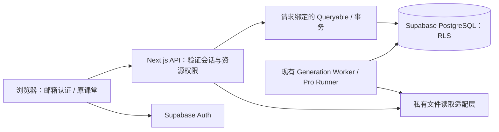

# 智域：Supabase 邮箱账号、用户数据隔离与测试管理员实施方案

> 状态：代码审查与外部调研已完成；本文是下一次对话的实施规格，账号功能尚未实施。
>
> 编写日期：2026-09-19。代码基线：`a82648410eeef2d1435f6cc4249394fa59eb5d0f` **加当前工作区未提交改动**，包括已完成的「教会学伴」。不能仅检出该提交就认为获得了本次审查的完整代码。
>
> 本次仅新增方案文档及文档索引；没有创建 Supabase 项目、修改线上数据库、创建账号或部署。使用 Supabase MCP 查询了官方文档，未读取用户的线上业务数据。

## 1. 决策摘要与不可突破的边界

采用 **Supabase Auth 邮箱密码认证 + Supabase PostgreSQL + 原有 Next.js API / PostgreSQL Store / Worker**。从官方开源示例提取认证模块，不用模板替换现有项目，不把课程生成迁入 Edge Functions，不重写课堂。

本期交付：邮箱注册、验证邮箱、登录、退出、忘记密码、重设密码、最小账号资料、跨设备读取自己的课程/聊天/学习记录、全链路用户隔离、一个预置测试 admin 的创建和清理工具。不引入手机、微信、OAuth、匿名注册、收费订阅、教师管理产品或组织/团队多租户。

最高保护边界如下，验收时不能通过关闭旧功能让测试通过：

| 必须保留 | 允许修改的位置 | 不允许的实现 |
| --- | --- | --- |
| 普通前台课程生成 | API 入口认证、所有者传递、保存适配层 | 改写提示词、提纲/场景生成顺序、模型选择、取消/重试语义 |
| 普通后台课程生成 | 提交/轮询/命令认证，任务持久化的账号字段与权限 | 改写租约、fencing、幂等键、检查点、任务状态机；因浏览器退出而自动取消后台任务 |
| Pro 课程生成 | 现有 owner 入口、会话/素材/密钥仓储 | 重建 agent、改工具协议、移除 Pro、把 Pro 权限等同管理员权限 |
| 完整课堂 UI | 页面外层认证、账号菜单、失效提示、存储身份接入 | 替换为简化播放器；删除编辑、白板、PBL、测验、圆桌、语音、设置、导出或学习反馈 |
| 已完成的教会学伴 | 请求鉴权和 RuntimeStore 身份 | 重做活动状态机、计轮、评价、恢复、TTS 或课堂交接 |

**“不同用户的数据不共享”的本期解释：所有用户业务数据默认且强制私有；知道课程/任务/素材 ID 也不能访问他人的数据。** 旧 ADR-0011 的“发布后可通过链接访问”在本次上线范围内被这一要求覆盖。保留发布相关代码与 UI 结构，但共享入口显示明确的不可用说明，服务端禁止开启共享；复制链接只用于本人跨设备打开。不能继续把 `is_public=true` 当作读取放行条件，也不能静默显示“发布成功”却实际不共享。

**admin 的明确语义：预先创建、无需走注册和邮箱验证流程、直接用预置邮箱与密码登录。** 它必须是真实 Supabase Auth 用户，同样经过认证；不增加任何人可用的免密 admin 入口。显示名称为 `admin`，实际邮箱在实施时使用用户指定地址。保留会话期间可直接进入平台，失效后重新登录。管理员不默认拥有读取所有私人课程和聊天的权限。

## 2. GitHub 调研结论：可以复用什么

以下链接已在本次调研中打开核查。`canary` / `master` 是浮动分支；实施时记录采用的 commit SHA、复制文件和许可证，不能在原项目根目录执行脚手架覆盖命令。

| 候选 | 核查结果 | 与本项目匹配度 / 采用方式 |
| --- | --- | --- |
| [vercel/next.js：with-supabase](https://github.com/vercel/next.js/tree/canary/examples/with-supabase) | 官方示例包含 App Router、SSR Cookie、邮箱密码 UI、Tailwind/shadcn 和 Proxy | **首选认证参考**。提取客户端/服务端 client、刷新 Cookie、邮箱确认、登录注册找回表单逻辑；适配智域现有组件和中文文案 |
| [supabase/supabase：nextjs-user-management](https://github.com/supabase/supabase/tree/master/examples/user-management/nextjs-user-management) | 官方用户管理示例，包含个人资料、认证和 SQL 策略示例 | **补充资料参考**。不能照抄示例中公开 profiles、头像可公开访问等规则；本项目资料默认私有 |
| [supabase/ssr](https://github.com/supabase/ssr) | 官方 SSR 客户端，取代旧的 auth-helpers 系列 | 直接安装 `@supabase/ssr`，同时安装 `@supabase/supabase-js`；实施时核查兼容版本并精确锁版 |
| [supabase-community/auth-ui](https://github.com/supabase-community/auth-ui) | README 明确写明自 2024-02-07 起 Supabase 团队不再维护 | 不作为新上线系统的基础组件；本项目已有 UI 体系，认证表单不值得引入停维护依赖 |
| [supabase/auth-helpers](https://github.com/supabase/auth-helpers) | 官方明确标记弃用，建议使用 SSR 包 | 不引入 `@supabase/auth-helpers-nextjs` / `auth-helpers-react` |
| [vercel/nextjs-subscription-payments](https://github.com/vercel/nextjs-subscription-payments) | 仓库已于 2025-01-23 归档，且引入订阅支付领域 | 不采用；邮箱账号不需要 Stripe、账单表和另一套应用框架 |

建议提取的具体参考文件：

- [SSR Proxy](https://github.com/vercel/next.js/blob/canary/examples/with-supabase/lib/supabase/proxy.ts)：刷新请求和响应 Cookie 的处理。
- [邮箱确认 Route Handler](https://github.com/vercel/next.js/blob/canary/examples/with-supabase/app/auth/confirm/route.ts)：`token_hash` 校验流程；本项目必须另外限制跳转地址。
- [注册表单](https://github.com/vercel/next.js/blob/canary/examples/with-supabase/components/sign-up-form.tsx)：表单和 SDK 调用参考，不带入示例的页面布局。

这些工程解决的是“如何接 Supabase 认证”，**不包含 OpenMAIC 的课程、学习 Runtime、素材、Pro Agent、后台任务和本地缓存隔离**。因此不存在拷贝一个登录组件即可安全上线的直接集成方案。

## 3. 当前代码的真实情况

### 3.1 技术栈与已有能力

- [package.json](../../package.json)：Next.js `16.1.2`、React `19.2.3`、TypeScript、pnpm、Zustand、Dexie、`pg`。尚未安装 Supabase SDK。
- [middleware.ts](../../middleware.ts)：现有访问码保护和部分 Pro 功能门禁，没有真实账号会话。
- [app/layout.tsx](../../app/layout.tsx)：根布局挂载 `ServerProvidersInit`、`ProSwapWatcher`、`AccessCodeGuard` 等。认证页面不能被旧访问码弹窗或私有业务初始化挡住。
- [server-provider.ts](../../lib/persistence/server-provider.ts)：已有 PgDocumentStore、PgRuntimeStore、PgAssetStore，读取 `DATABASE_URL`。可以连接 Supabase PostgreSQL，没必要改用一套新 ORM。
- [bootstrap.ts](../../lib/persistence/bootstrap.ts)：服务端持久化开关已接入 document/runtime/asset 的 HTTP 存储；配置为模块级单次初始化。
- [generation-jobs](../../lib/server/generation-jobs/) 和 [workers/generation/migrate.ts](../../workers/generation/migrate.ts)：后台任务已有持久化、显式迁移、租约和恢复能力。
- [agent-runtime](../../lib/server/agent-runtime/)：Pro 已有按 owner 过滤的会话、素材、技能和加密模型连接，是可复用的接入点。

本次枚举到 `app/api` 下 **82 个 `route.ts`**。深入阅读了身份入口、存储实现、代表性业务路由和迁移代码；这不是对每个模型适配器的逐行审计，也没有执行真实账号隔离或线上数据库测试。实施时必须把这 82 个入口重新生成可核查清单。

### 3.2 身份和持久化的关键缺口

| 位置 | 已核实的行为 | 实施要求 |
| --- | --- | --- |
| [persistence/server-auth.ts](../../lib/persistence/server-auth.ts) | 使用 `PERSISTENCE_DEV_TOKEN`；`x-learner-key` 来自浏览器；部分素材 principal 是 `shared`。文件本身明确说明不提供用户隔离 | 替换为异步真实会话认证，principal 全部由服务端派生；生产不得接受开发令牌 |
| [generation-jobs/auth.ts](../../lib/server/generation-jobs/auth.ts) | `generation_owner` 签名 Cookie 映射为 `anon:<uuid>`，与 Supabase 用户无关 | 生产改为账号 owner；保留原 Origin/CSRF 校验能力，禁用匿名回退 |
| [agent-runtime/owner.ts](../../lib/server/agent-runtime/owner.ts) / [with-owner.ts](../../lib/server/agent-runtime/with-owner.ts) | 有 `authenticatedOwnerId` 接口，但常规 wrapper 并未注入真实账号，仍创建匿名身份 | 统一接入 `requirePrincipal()`；全量追踪同步调用变异步后的调用点 |
| [generation-jobs/http.ts](../../lib/server/generation-jobs/http.ts) | 直接调用另一路 `resolveGenerationOwner()` | 不能只改 Pro wrapper，后台任务入口也必须统一 |
| [heavy-task-admission/independent-request.ts](../../lib/server/heavy-task-admission/independent-request.ts) | 独立重任务同样使用匿名 owner | 普通解析、媒体、Pro 和后台任务使用相同账号进行限流/排队 |
| [runtime/learner-key.ts](../../lib/runtime/learner-key.ts) | 默认设备匿名 learnerKey，存在模块级 Promise 缓存 | 登录用户改用账号 learnerKey；切换账号不能复用第一次解析的值 |
| [persistence handler](../../app/api/persistence/[...path]/handler.ts) | 文档和 runtime/asset 使用不同身份入口；merge/admin 默认禁止 | 同一请求只解析一次 principal；继续禁止客户端迁移/全局管理接口 |
| [server storage handler](../../packages/@openmaic/storage/src/server/index.ts) | 已有 session 与 learnerKey 一致性检查 | 保留并复用，同时补“此 learner 是否有权访问对应 stage”的检查 |

### 3.3 “有 owner 字段”不代表所有读取都隔离

以下是本次方案最重要的代码结论：

1. [document-access.ts](../../lib/persistence/document-access.ts) 的 `read` 分支目前主要判断存在和未删除，没有比较 owner。
2. [owner-bound-document-store.ts](../../lib/persistence/owner-bound-document-store.ts) 对普通读取允许跨 owner；仅对部分 `course-worker` 所有权增加限制。写入保护不能替代读取保护。
3. [document/pg.ts](../../packages/@openmaic/storage/src/document/pg.ts) 的 `loadStage()` 当前按 `id` 读取；`forOwner()` 并不会自动给所有方法加 owner 条件。`readFreshnessManifest()` 则已有 owner 谓词，必须保留这一有效保护。不能因名称或注释称“owner-scoped”就认为整个仓储安全。
4. [stage-meta route](../../app/api/stage-meta/[stageId]/route.ts) 可返回他人的发布、生成状态等信息，需要与课程读取一起改为私有。
5. [classroom route](../../app/api/classroom/route.ts) 保存/读取本地课堂快照没有账号归属；`POST` 接受 stage ID，必须防止覆盖别人的同 ID 快照。
6. [classroom-media route](../../app/api/classroom-media/[classroomId]/[...path]/route.ts) 只有路径/文件校验，没有账号归属检查，而且返回 `public, max-age=86400, immutable`。需要在 `200/206/HEAD/304` 等路径统一做权限与缓存处理，保留 Range 播放能力。
7. [legacy-readable-assets.ts](../../lib/persistence/legacy-readable-assets.ts) 和 [server-asset-store-with-legacy-fallback.ts](../../lib/persistence/server-asset-store-with-legacy-fallback.ts) 存在共享素材/旧浏览器素材回退。认证模式下不能在私有资源 404 后读取无账号归属的旧库。
8. [resolve-server-asset.ts](../../lib/persistence/resolve-server-asset.ts) 仍使用开发认证；图片送入模型、文档提取、导出等内部读取也要使用同一个真实 principal。
9. [usage route](../../app/api/usage/route.ts) 返回部署级用量；[usage-storage.ts](../../lib/server/usage-storage.ts) 的 JSONL 记录没有 owner 字段。不能向每个登录用户返回整站统计。
10. [MP4 下载 route](../../app/api/export-video/render/[jobId]/download/route.ts) 按 job ID 转发下载，没有用户归属映射。若部署启用现有 MP4 能力，提交、轮询、下载必须一起加隔离。

### 3.4 浏览器与学习功能

- [kv/browser.ts](../../packages/@openmaic/storage/src/kv/browser.ts) 默认前缀是 `maic:<scope>:`；`account` 只是逻辑 scope，不包含用户 ID。
- [kv-persist.ts](../../lib/store/kv-persist.ts)、[settings.ts](../../lib/store/settings.ts)、[user-profile.ts](../../lib/store/user-profile.ts) 仍通过默认 BrowserKVStore 保存账号资料/设置。模型配置可能含用户 API Key，不能整块明文同步进通用 JSON KV。
- `workspace-session-memory.ts`、`workspace-course-tabs.ts`、`pro-model-connection-client.ts`、`media-config-snapshot-client.ts` 等保留会话、课程标签、连接引用与待撤销操作，必须一起审查。
- [utils/database.ts](../../lib/utils/database.ts) 和 [image-storage.ts](../../lib/utils/image-storage.ts) 仍有固定 Dexie 数据库和本地文件缓存。仅修改新 storage 包会漏掉这些路径。
- [current-scene.ts](../../lib/document-store/current-scene.ts) 把位置作为 device 数据；它仍包含具体课程信息，应该至少按账号命名空间隔离。
- [teach-back/runtime.ts](../../lib/learning/teach-back/runtime.ts) 已通过 `getLearnerKey()` / RuntimeStore 保存活动；无需新增一套反向教学数据库。
- [teach-back route](../../app/api/learning/teach-back/route.ts) 当前校验功能开关、参数与模型，但没有真实账号鉴权。check/coach、聊天、语音、测验、PBL 等都要在模型调用前鉴权。
- [use-chat-sessions.ts](../../components/chat/use-chat-sessions.ts) 仍会把聊天投影同步到 stage store。既然本期课程完全私有，可保留现有写法；不要以账号功能为由重做聊天存储模型。

### 3.5 不能误判为已经实现的部署能力

[ADR-0016](../adr/0016-free-supabase-with-local-files-for-small-trial.md) 已规划 Supabase 托管 Auth/数据库、本机持久盘保存文件。本次沿用该方向，不把历史部署计划当已完成事实：

- [asset-byte-store.ts](../../lib/persistence/asset-byte-store.ts) 当前“未设 S3 bucket”的实际结果是 PostgreSQL BYTEA，**不是本地文件后端**。
- [materials/bytes.ts](../../lib/server/materials/bytes.ts) 已有本地素材文件，但这不代表 AssetByteStore 已实现本地后端。
- `DATABASE_URL` 当前同时影响普通查询、Worker 和 LISTEN 连接。不能直接换成 Supabase transaction pooler 后认为全部兼容。
- Web/Pro 的部分初始化仍会执行 `ensure*Schema()`；收紧运行时数据库权限前，必须把这些 DDL 迁到正式迁移步骤。
- 未发现现成应用级 `/admin` 账号管理后台。这里的“后台生成”与“管理员后台”不是一个概念，不能把前者限定为 admin 才能用。

## 4. 目标身份与权限模型

### 4.1 唯一身份

Supabase `auth.users.id` 是账号唯一来源。应用既有 owner/learner/principal 字段仍为 TEXT，统一编码：

```ts
type Principal = {
  userId: string;       // 经认证的 Supabase UUID
  ownerId: string;      // `user:${userId}`
  learnerKey: string;   // 与 ownerId 完全相同
  assetPrincipal: string; // 与 ownerId 完全相同
  role: 'user' | 'admin';
  sessionId: string;
};
```

编码函数只存在一个，浏览器拿到的 user ID 仅供 UI/缓存分区；所有数据库授权使用服务端重新校验后的 principal。任何 body/header/query 中的 `ownerId`、`learnerKey`、`role`、`x-user-id` 都不能提升权限。协议中不得不保留的 learnerKey 必须与 principal 一致，否则拒绝。

服务端入口建议新增 `lib/auth/principal.ts`，公开 `requirePrincipal(request)` 与 `requireAdmin(principal)`。请求级缓存认证结果，禁止模块级缓存“当前用户”。业务无会话返回 401，访问他人资源返回统一 404，真正的角色不足返回 403，身份服务不可用返回可识别的 503，不能回退为匿名或 shared。

### 4.2 会话确认与撤销

- 按官方 SSR 接法校验 JWT：`getClaims()` 验签，不信任未验证的 `getSession().user`。对账号状态使用数据库记录，不依赖可能陈旧的 JWT role。
- `app_accounts` 保存角色、启用状态、`session_valid_after`。每个业务请求检查启用状态，并用 JWT `iat` 与失效界限比较；admin 删除、停用、强制退出由此及时阻断旧 token。
- 对本期要求严格撤销的业务请求，结合验证过的 `session_id` 查询 `auth.sessions` 是否仍存在且属于此用户，并确认 Auth 用户存在。该查询只允许内部受限身份适配层执行，不开放到 Data API；使用最小列/视图或窄函数，不给业务 SQL 任意修改 Auth 表的能力。不能宣称 `getClaims()` 自动检查服务端撤销。
- 若使用窄权限数据库函数实现上述内部查询，放在非暴露 schema，固定 `search_path`、显式对象名、撤销 `PUBLIC/anon/authenticated` EXECUTE，仅授予身份适配角色，避免泄露邮箱/token；这是必要权限边界，不是通用提权工具。
- 长时间 SSE 不能只在建立时检查一次：绑定 owner/session，定期验证状态，失效后关闭；客户端收到退出事件立即停止订阅。SSE 验证间隔设定并在验收中测量，例如不超过 30 秒。
- 正常退出默认结束当前会话；“删除/停用测试 admin”撤销全部会话。已被接纳的后台生成独立于浏览器会话，普通退出不取消它；账号停用/删除则禁止新外部调用，并按既有取消协议排空。

官方说明：JWT 校验、用户查询与会话撤销是不同动作，删除用户也不等于所有未到期 token 自动失效。见 [SSR 方法选择](https://supabase.com/docs/guides/auth/server-side/creating-a-client)、[Sessions](https://supabase.com/docs/guides/auth/sessions)、[用户管理](https://supabase.com/docs/guides/auth/managing-user-data)。

### 4.3 权限矩阵

| 操作 | 未登录 | 普通账号 | 测试 admin |
| --- | --- | --- | --- |
| 注册/登录/找回页面 | 可用 | 可退出后切换 | 可退出后切换 |
| 本人的课程、聊天、素材、测验、教会学伴 | 不可用 | 可用 | 可用 |
| 普通/后台/Pro 生成 | 不可用 | 按原功能开关可用 | 按原功能开关可用 |
| 他人课程/素材/任务/凭据 | 不可用 | 不可用 | 默认也不可用 |
| 自己的用量 | 不可用 | 可用 | 可用 |
| 系统运行状态、用户数量等最小管理信息 | 不可用 | 不可用 | 可用，不返回私人内容和密钥 |
| 任意用户 merge、全局删除 Runtime、公开发布 | 不可用 | 不可用 | 普通 Web 接口仍不可用；必要运维使用受控脚本 |

平台内置字体、图标、固定角色头像和静态模板可作为公共资源；这不是用户业务数据共享。

## 5. 邮箱注册和页面接入

### 5.1 新增流程

| 页面/接口（建议路径） | 行为 |
| --- | --- |
| `/auth/sign-up` | 邮箱、密码、重复密码；默认角色固定为 user；提交后进入查收邮件状态 |
| `/auth/check-email` | 提示确认邮箱，受限重发；不伪造已登录态 |
| `/auth/confirm` | 校验 `token_hash`，明确允许 `email` / `recovery` 等需要的类型；成功写 Cookie 并跳转 |
| `/auth/login` | 邮箱+密码登录；admin 使用同一页面 |
| `/auth/forgot-password` | `resetPasswordForEmail`；统一反馈避免枚举邮箱 |
| `/auth/update-password` | 有效恢复会话下更新密码，成功后按确定的会话失效策略处理 |
| `/auth/error` | 链接无效/过期/使用过，提供重新发信入口 |
| `POST /api/auth/sign-out` | 校验来源、撤销当前会话、清 Cookie，再完成客户端退出清理 |
| `GET /api/auth/me` | 返回经过验证的最小账号信息；私有、禁止缓存 |
| `/account` | 邮箱只读、昵称、头像、密码管理和退出；复用已有资料样式 |

主流程选择 **邮箱 + 密码 + 确认邮件**。不同时引入 Magic Link 与 OTP 登录，减少入口状态。使用 `token_hash + verifyOtp` 的服务端确认路径时，同时配置匹配的 Supabase 邮件模板；不要混用 hash fragment、PKCE code、token_hash 三套回调。

注册默认开启邮箱确认，未确认不能访问业务。重复注册、弱密码、错误密码、网络失败、频率限制、重复提交、过期链接都需有清楚状态。密码要求与 Supabase 项目配置一致，可暂定最少 12 字符，允许密码管理器与粘贴；前端不能仅提供自己的一套规则。

`next` 只允许规范化的站内业务路径（含需要的 query），拒绝外域、`//`、反斜线及编码绕过；对 auth 循环跳转也做限制。邮箱链接校验完成后清理 URL 中的 token，不进入日志、分析工具或 Referer。

### 5.2 保留原页面与根布局

1. 根布局保留字体、主题、i18n、Toaster；业务初始化组件挂在已认证的业务边界下，不在注册页执行课程列表和 Pro SSE 初始化。
2. 以外层认证边界保护 `/`、`/workspace`、`/generation-preview`、`/classroom/[id]`、`/workbench/new`。保持现有 URL、Suspense、错误态、独立课堂和 hosted classroom 的渲染关系。
3. 认证稳定后再挂载现有业务 UI；不能先显示上一账号内容再覆盖登录弹窗。
4. `middleware.ts` 合并为符合当前 Next.js 16 的单一 `proxy.ts` 入口，原功能门禁和 Origin 规则保持等价；禁止同时保留两个生效入口或直接覆盖原 middleware 逻辑。
5. Proxy 做会话刷新与页面导航；Route Handler 仍独立鉴权，不能把 Proxy 当唯一安全层。错误响应、redirect 和 SSE 返回前都正确保留刷新 Cookie / 缓存头。
6. 公开白名单只包含认证流程、必要静态文件和最小健康检查。不要照搬示例的全局图片扩展名排除规则，否则私有 `/api/classroom-media/...png` 可能被漏掉。
7. `ACCESS_CODE` 不再代替账号。托管账号模式关闭旧全屏访问码 Guard；若未来再要邀请码，应单独设计注册准入，不能使它成为第二身份。
8. `/api/stages` / folders 当前存在与 Pro runtime 的功能开关耦合。普通账号云端课程库必须在 **Pro 关闭** 时仍然可用；提取持久化可用条件，不能靠打开 Pro 解决普通用户列表读取。

Supabase SSR 使用的 Cookie 需要与 browser client 协同刷新；不能未经验证就强行把全部 SSR Cookie 改为 HttpOnly 导致客户端会话失效。HTTPS/Secure/SameSite、CSRF 与 XSS 防护按实际架构测试。参见 [官方 SSR 接入](https://supabase.com/docs/guides/auth/server-side/creating-a-client)。

## 6. 数据库设计与隔离策略

### 6.1 继续使用既有 PostgreSQL 模型

保留现有 Stage/Scene JSON、Runtime 事件和后台任务 schema。新增以下应用表即可，不另建第二套 courses/chat/teach_back 数据模型：

| 建议表 | 字段和规则 |
| --- | --- |
| `app_accounts` | `user_id uuid primary key references auth.users(id)`；`owner_id text unique`，约束其等于 `'user:' || user_id::text`；`role`、`status`、`session_valid_after`、时间戳。默认 user/active，角色状态只由内部管理路径写入 |
| `app_profiles` | `user_id` 外键；昵称、现有头像标识、简介、时间戳。无 password/role；与 `useUserProfileStore` 通过适配层连接 |
| `account_kv` | `(owner_id, key)` 主键；非敏感设置 JSON、version、updated_at；严格 key 白名单与大小上限 |
| `classroom_snapshots` | `classroom_id` 主键、owner_id、stage_id/存储引用、版本、时间戳；约束同 ID 不得换 owner；仅在继续支持旧文件快照链路时新增 |
| `render_job_owners` | 渲染 job ID、owner_id、stage_id 可选、状态/输出引用/时间戳；启用现有 MP4 时必做 |
| `usage_events` | owner_id、生成来源、job/session/request 关联、模型和用量、时间戳；按 owner/time 索引，不记录 API Key；只做用量，不扩成收费账本 |
| `admin_audit_events` | 管理员操作人、目标内部 ID、动作、结果、时间戳；不存密码或 token |

账号/资料初始化优先使用最小、原子的 Auth 创建触发器：角色常量为 user，只复制校验过的展示字段。触发器函数放非暴露 schema、固定 search_path，限制执行权限并测试失败回滚。**不能从用户可修改的 `user_metadata.role` 赋予 admin。** 若采用服务端首次登录幂等补建，也必须限定已存在且已验证的 Auth 用户，不能在旧 JWT 被撤销/账号删除后重新创建账号。

### 6.2 所有权表清单

| 数据族 | 现有归属字段 / 父关系 | 隔离要求 |
| --- | --- | --- |
| `document_stages`、`stage_meta` | owner_id（两处） | 新建、读取、修改、删除均相同 owner；两处字段一致，不能存在一个私有另一个可认领 |
| `document_folders` | owner_id，复合主键 | 名称查重、数量限制、移动/解散/删除按 owner |
| `document_scenes`、`document_outlines`、revision 表 | stage_id | 通过父课程归属读取和写入；freshness/缩略图也是私有数据 |
| `runtime_sessions` / `runtime_records` | learner_key / session_id | learner_key = 当前 owner；session 的 stage 同属该用户；对记录追加、tail、status、CAS 都检查 |
| `asset_entries` / `asset_blobs` | principal / content_hash | 逻辑入口按 principal；内容哈希去重只是物理优化，不能允许凭 hash 绕过入口鉴权 |
| `owner_material` | owner_id | 上传、解析、派生结果、下载、删除及引用校验全部按 owner |
| `agent_sessions` / events / entries / urls / `agent_session_materials` | owner_id / session_id | 子表权限继承会话；所有 SSE 游标与重放都绑定 owner |
| `agent_owner_session_events` / counters | owner_id | 不因全局 NOTIFY 收到事件就向当前浏览器转发；必须按 owner 查表 |
| `agent_user_skill` | owner_id | 列表、内容、导入导出、编辑均私有；内置静态技能与用户技能分开 |
| `pro_model_connections` / revisions | owner_id / connection_id | 后端校验 owner；前端只见不含密钥的引用与摘要 |
| generation model/search/media snapshots | owner_id | 创建、引用、恢复、撤销均绑定 owner；保留加密版本格式 |
| `generation_jobs` / `generation_ownership` | owner_id | job/stage/素材/snapshot 的 owner 一致；幂等键仍按 owner 隔离 |
| scenes/steps/attempts/assets/events/commands（generation 子表） | job_id 或 step_id | 经父任务归属，包含状态、错误诊断、重试、cancel、confirm 与 outline |
| provider slots、worker heartbeat、迁移版本、全局调度记录 | 系统级 | 仅内部服务使用，不向普通用户暴露全表；保持原有全局限流算法 |

所有 ID 由服务端或已有安全创建协议生成；即使客户端给出 ID，UPDATE/UPSERT 也必须包含 owner 条件，不能通过 `ON CONFLICT(id)` 覆盖他人行。子资源 ID 与父资源 ID 要同时验证，防止“自己的 session + 他人的 asset”拼接。

### 6.3 采用的数据库访问路径

**推荐并纳入本期：业务 API 保留 `pg`，增加受限的 Web 数据库角色和请求绑定的 RLS；Worker 使用独立服务角色。** 不把所有业务 SQL 改写为 `supabase.from(...)`，也不假设普通 `pg` 连接自动携带 Supabase JWT。



落地规则：

1. `app_web`：非表所有者、非 superuser、`NOBYPASSRLS`，只获必要 DML。每次短数据库事务使用独立连接，通过参数化 `set_config('app.owner_id', principal.ownerId, true)` 设置事务级 owner；RLS 读取该值。未设置上下文时拒绝读取/写入。
2. 构造 request-bound Queryable：单次 `query()` 自行开启短事务并注入 owner；`withTransaction()` 在同一连接内复用注入的 owner。不能把 `SET` 放在 pool 上再到另一连接执行 SQL；不能跨请求复用带身份的全局 store。
3. 不围住整个 HTTP / 模型 / SSE 生命周期开启事务。网络生成保持原有“短查询—外部调用—短写入”模式，避免耗尽连接与改变租约语义。
4. 现有共享 pool 可以共享连接池，**绑定了 principal 的 store/上下文不能共享**。把 `getServerPersistenceProvider` 拆出可共享基础设施与请求级实例；Worker 显式使用系统实例，不借用请求的 Cookie。
5. `app_worker`：独立受控凭据，按表授予队列、会话、素材、快照、事件等所需权限。全局认领/公平调度确实需要跨 owner；使用明确的服务角色 policy/窄内部操作，不授予浏览器角色，不给 Web 随意切换到 Worker 的能力。应用内 Pro Runner 所需系统连接通过 server-only 模块持有，只有调度器调用。
6. 所有消费用户 ID 的 Web 路径仍保留显式 owner 条件/仓储检查，RLS 是第二层保护；不能以“开了 RLS”为由删除原有 ownership/fencing 校验。
7. 当前 `public` 业务表先不搬 schema，避免触发器/未限定表名大范围变化；对其全部开启 RLS，撤销 `anon` / `authenticated` 的业务表、序列、函数权限，浏览器不直接用 Data API 查询它们。默认权限也要覆盖迁移角色未来创建的对象。
8. `auth` / `storage` / Supabase 系统表不包含在批量迁移范围；不得对整个数据库执行通配 grant/revoke。只对明确列出的应用对象操作。

官方 RLS 说明指出高权限角色和表所有者存在绕过行为；`service_role`/secret key 也不能作为用户隔离手段。参见 [RLS](https://supabase.com/docs/guides/database/postgres/row-level-security) 和 [Securing your API](https://supabase.com/docs/guides/api/securing-your-api)。

下面是 **策略形状示例，不是直接可运行的完整迁移**：

```sql
-- app_web 必须先创建为非 owner / 非 BYPASSRLS 的受限角色。
alter table public.document_stages enable row level security;

create policy stage_web_select on public.document_stages
for select to app_web
using (owner_id = nullif(current_setting('app.owner_id', true), ''));

create policy stage_web_insert on public.document_stages
for insert to app_web
with check (owner_id = nullif(current_setting('app.owner_id', true), ''));

create policy stage_web_update on public.document_stages
for update to app_web
using (owner_id = nullif(current_setting('app.owner_id', true), ''))
with check (owner_id = nullif(current_setting('app.owner_id', true), ''));

-- DELETE、软删除、stage_meta、子表与 Worker 策略按实际操作补全。
-- anon/authenticated 对业务表没有 GRANT，也没有放行 policy。
```

需要专门解决的 RLS 接缝：

- child SELECT/写入通过父表 `EXISTS` 判断 owner，避免双向 policy 相互递归。runtime 还要校验父 stage，防止向外来课程写自己的运行记录。
- `app_accounts` 的自有资料查询与角色变更分开；Web 不得获得 role/status 列的任意 UPDATE 权限。
- `asset_blobs` 是全局去重字节表，不能照搬 owner policy。Web 只允许通过其有权访问的 `asset_entries` 取字节；首次 put/去重注册/GC 必须设计为原子的受限内部操作，不能为解决第一次插入困难开放整张 blob 表。新增 LocalAssetByteStore 不应把该问题退回 BYTEA。
- 全局队列准入、provider slot、心跳、统计属于系统服务权限；Web 的用户提交只能调用经过校验的窄操作，不能因 RLS 看不到其他用户而把全站并发错误地算成“只有自己”。
- 场景/课程 revision trigger 必须在受限角色下继续更新，不通过随意加 `SECURITY DEFINER` 修复权限错误。
- SQL 集成测试必须使用实际 `app_web` 角色，不能只在 postgres/MCP 管理员连接下验证；PGlite 用于仓储行为，托管 PostgreSQL 用于最终角色/RLS验证。

这部分确实增加实施量，但能防止一个漏写 owner 条件的读取再次造成跨用户泄露。**如果没有完成全部适配，不允许混用“部分请求受 RLS 保护、其余继续使用高权限公共 pool”的上线状态。**

## 7. 按现有模块实施接入

### 7.1 所有 HTTP 入口统一分类

维护一份 `docs/security/auth-route-matrix.md`，逐个记录现有 82 个路由及新增路由的方法、认证类型、所有者对象、返回码和测试位置。脚本检查新增路由不能没有分类。推荐分类如下：

| 路由族 | 必须做的事 |
| --- | --- |
| `/api/auth/*`、确认邮件 | 按动作验证 session 或一次性 token；限制频率/跳转/来源 |
| `/api/health`、`/api/health/ready` | 公开仅最小健康结果；详细数据库/worker 信息只给内部或 admin |
| `/api/stages/**`、folders、stage-meta、persistence documents | 读写同样检查课程 owner，普通模式不依赖 Pro 开关 |
| persistence runtime | learnerKey 绑定账号；session/record/对应课程同时验证；关闭客户端 merge/admin |
| persistence assets、materials、classroom-media | owner → 逻辑资源 → 字节，不接受凭 hash/path 直接访问 |
| `/api/generate-classroom/**` | 提交、查询、snapshot、outline、confirm、cancel、retry 全部接同一 principal |
| `/api/agent/**`、`/api/skills/**` | 会话、消息、技能、模型连接、素材、SSE 全部绑定 owner；沿用现有 gate |
| `/api/generate/**`、chat/pi、learning、quiz-grade、PBL、transcription、web-search、parse/extract | 在外部调用和付费资源消耗前鉴权；存在 stage/session/material 引用时验证其归属 |
| provider probe / verify / server-providers / comfyui / azure-voices | 已登录后返回必要能力信息；禁止返回平台密钥或其他用户连接 |
| `/api/classroom` | 文件快照与 owner 映射绑定；禁止同 ID 跨用户覆盖 |
| `/api/export-video/**` | 原功能启用时，job owner 映射贯穿提交、状态与下载；渲染服务不得公开暴露 |
| `/api/proxy-media` | 限定已认证请求并保留 SSRF 防护；对于本平台私有 URL 走 owner 解析，不能用服务端代理绕过媒体鉴权 |
| `/api/usage` | 只返回当前 owner；全站统计另设 admin-only 最小接口 |
| `/api/access-code/*` | 账号模式中不承担身份授权，不得借此生成匿名所有者 |

不能只搜索文件名中带 `auth` 的模块：`lib/media/probe-auth.ts` 是外部模型供应商探测，不是用户登录。

### 7.2 普通前台生成

复用原 HTTP 流程和 `guardClientGeneration`；增加真实认证，保留后台部署下 `BACKGROUND_GENERATION_REQUIRED` 的原行为。生成开始时冻结 owner，后续所有草稿、资料、课程与媒体保存使用该 owner。

前台生成未完成时退出账号，应停止本地流/请求并在退出前处理保存状态；不得在 B 登录后用 B 的 Cookie 把 A 的迟到结果另存成 B 的课程。相同账号重新登录可以恢复已保存草稿，不能跨账号自动恢复。

### 7.3 后台与 Pro

- job/session 一创建就写服务端 owner；后续任何轮询、SSE、命令都从数据库父记录确认归属。
- Worker 从已保存的 owner 继续执行，不从“当前浏览器用户”或 Cookie 推断身份；认证 token 不落入 job payload。
- 原 `owner_id + idempotency_key` 唯一语义保留；A、B 用同一个幂等键互不影响。
- 任务与模型连接、媒体/search snapshot、素材的 owner 必须一致，否则调用模型前拒绝。
- 暂停/删除账号由单独账号状态门禁阻止后续外部调用；保留原租约心跳、取消与恢复协议。
- 保留原 `LISTEN/NOTIFY + polling` 机制，不改 Supabase Realtime。服务端收到 NOTIFY 只是唤醒，返回数据仍按 owner 查表。

### 7.4 课堂、学习与教会学伴

课程加载前验证访问权，未授权返回不泄露细节的不可访问态。完整 `ClassroomSurface`、`PlaybackChromeRoot`、ChatArea、Workspace hosted classroom 保留。

learning/check、coach、teach-back 以及聊天/PBL/测验接口必须验证请求中的课程/场景是否属于当前用户；不信任“前端已经打开课堂”。沿用现有课程快照与活动修订校验，不改评分或生成依据。所有 `quizAttempt`、guided、teachBack、playback、whiteboard、chat/PBL Runtime 记录的 learnerKey 都来自账号。

新设备登录读取同一账号的服务器事实；本地布局、编辑当前位置可继续按账号+设备保存，但不能把“本地设备游标”谎报为全部跨设备学习进度。

## 8. 浏览器账号切换与缓存：必须单独完成

### 8.1 初始化顺序

现有存储 configure 是模块级、单次且会封存。不能登录后在组件 effect 中再次 configure，也不能调用 `resetRuntimeStorageForTests()` 当生产切换方案。

建议使用稳定的账号环境提供器：启动时完成 Supabase 会话解析和 `/api/auth/me`；`getLearnerKey` 的配置函数等待该提供器，未经认证时拒绝返回 owner。Http stores 仍提前配置，但用户相关读取/rehydrate 等待账号就绪。登录、退出和换账号使用一次受控整页跳转，重新创建单例，降低对现有课堂运行时的改动。

### 8.2 存储分类

| 分类 | 保存位置 / 规则 |
| --- | --- |
| 课程、聊天、学习活动、测验、进度事实 | 现有服务器 Document / Runtime Store；Supabase PG 是权威来源 |
| 昵称、简介、头像标识 | app_profiles，现有 UI store 作为投影 |
| 非敏感偏好 | account_kv，通过现有 HttpKVStore 协议适配；需要补服务端 `/kv` handler，不能认为包里有 client 就已有服务端 |
| 用户 API Key、搜索/媒体密钥 | 保留既有加密连接/snapshot；新的需要跨设备的秘密配置走专门加密接口，不进入通用 KV |
| 不要求跨设备的 BYOK 临时输入 | 默认只在当前账号会话内存；若保留“本机记住”，必须单独按账号隔离且退出清除；不得向 B 自动回填 |
| 工作区标签、草稿、引用、待撤销队列、当前课程位置 | 账号命名空间，例如 `zhiyu:<project>:<userId>:...`；禁止继续读取公共旧键 |
| 系统主题、语言、纯布局宽度 | 可按 device 保存；若字段含课程标题、内容或会话 ID，就按账号隔离 |
| 旧 Dexie / asset / document/runtime IndexedDB | 在托管模式停止无归属自动读取；必要临时缓存使用按账号库名或 owner 索引 |

`namespace` 只是防止程序误读，不是同浏览器离线数据的加密保护。退出后不保留可直接展示的私人内容或明文密钥；以服务器重新拉取为主。对尚未上传的草稿明确提示保存状态，不默默丢弃。

### 8.3 退出/切换顺序

1. 进入切换屏障，禁止新提交；冻结当前 auth epoch。
2. 正常退出前尽可能完成已经承诺的短保存，无法保存时提示；被动过期时停止写入，保留当前账号待恢复状态，不能改写到新账号。
3. 停止前台生成流、聊天、教会学伴请求、语音录制、TTS、播放器、EventSource、轮询和重试定时器；后台生成继续自己的任务。
4. 迟到结果与异步队列在写入/呈现前检查 owner + epoch，不匹配即丢弃；不能在请求真正发送时动态套用新账号身份。
5. 清除 stage、chat、learning projection、workspace、provider 引用、撤销队列、对象 URL、iframe pool、缩略图/媒体内存缓存和当前账号敏感本地缓存。
6. 撤销会话、清 Cookie，广播退出事件给其他标签页；整页进入登录页。
7. 新账号验证完成后重新 hydrate；`pageshow` / 后退缓存恢复、窗口重新聚焦时也重新检查身份，不展示旧屏幕。

需增加“发起时用户与当前会话不一致则拒绝”的客户端请求屏障；服务端可核对期望 user/session 标记是否与验证后的 principal 一致，但该标记只用于拒绝串号，不能作为授权凭据。

## 9. 媒体、文件与缓存

第一期沿用已有 ADR 的本地持久盘方案：Supabase 管结构化数据，Web 和 Worker 共用挂载文件目录。若用户随后明确选择 Supabase Storage，再替换 byte adapter，不在此方案里同时实现两套上线存储。

必做事项：

- 新增 `LocalAssetByteStore`（实现既有 `AssetByteStore` 接口），与已有 LocalMaterialByteStore 区分；配置显式的 `ASSET_BYTE_BACKEND=local` 与目录，缺挂载/写入失败时拒绝运行，不能默默写 BYTEA。
- owner 和逻辑 asset ID 在数据库；物理字节可以内容哈希去重。文件路径不会因为可猜或存在而获得读取权限。
- 上传、替换、读取、Range、缩略图、解析、PPTX/ZIP/MP4 导出、删除、垃圾回收都经过相应归属检查。GC 必须保留其他账号仍引用的物理字节。
- 私有文件初期使用同源鉴权流式接口，`Cache-Control: private, no-store`，保留 Content-Type、Range/206/416、取消读取；不使用 `public` 缓存或长效公开 URL。
- 启用私有缓存策略不会使已缓存的旧公开 URL 自动消失。切换时给私有媒体增加新的 URL 命名空间/版本，旧公开路径下线且清理 CDN 缓存；迁移已有文档引用，避免沿用旧 public cache。
- 为模型供应商必须拉取的私有媒体建立仅限具体资源、具体用途、短期到期的临时授权或直接上传字节；不能把 Supabase session token 或管理员凭据给供应商，也不能为此把整个桶公开。
- 平台反向代理、`next/image` 优化缓存、内部 render-service 网络路径不能绕过鉴权。私有图片优先直接使用受保护资源或已授权 blob，避免优化器丢失 Cookie 后改为公开资源。
- 若后续使用 Supabase Storage：桶设 private，用户路径/Storage RLS 严格匹配 owner；S3 secret 访问会绕过浏览器 RLS，应用资源校验仍需保留。这个选项不是当前已经实现的能力。

## 10. 预留 admin 的创建、使用与删除

### 10.1 创建

新增幂等的受控脚本，例如 `scripts/provision-test-admin.ts`，只手动执行，不在启动、迁移、登录失败或每次部署时自动运行。

1. 从安全运行环境读取 `TEST_ADMIN_EMAIL` 与随机高强度密码；密码不写在代码、README、迁移 SQL、日志、截图或前端构建变量中。邮箱由用户指定，不能把示例地址当可收信账号。
2. 使用服务端 Supabase Auth Admin API `createUser({ email, password, email_confirm: true })` 预建用户。它不需要管理员先走前台注册，也不需要关闭所有普通用户的确认邮件。
3. 默认账号触发器先建立 user；受控 provisioning 路径把该 UUID 对应的 `app_accounts.role` 改为 admin，写审计记录。`user_metadata` 或昵称写成 admin 都不能获得权限。
4. 若账号已存在，核对 UUID 和已记录的创建来源；不得因为邮箱恰好相同就把未知普通账号提升为 admin。中途失败时要能安全重试，不覆盖现有密码。
5. 向操作者安全交付登录信息；脚本默认仅输出用户 UUID、邮箱、状态，不打印密码。前端仍只有邮箱登录，不新增通用用户名认证。

官方 API 依据：[Admin createUser](https://supabase.com/docs/reference/javascript/auth-admin-createuser)。不直接 INSERT `auth.users` / `auth.identities`，不手写密码哈希，不伪造用户 Cookie。

### 10.2 测试

admin 先走完整生成/课堂/教会学伴链路；但只测 admin 不能证明隔离。必须另建 A、B 两个普通测试账号验证负向访问，至少一个走真实注册邮件流程。admin 必须同样遵守 owner 隔离，不能通过无条件放行来让测试通过。

如果要提供 `/admin`，仅做账号身份确认、服务状态和安全汇总信息，不把用户课程/聊天浏览器或通用 SQL 编辑器纳入本期。角色删除后此页面立即拒绝进入。

### 10.3 测试完成后的停用和删除

新增 `scripts/remove-test-admin.ts`，先 dry-run 展示准确 UUID、邮箱、属于它的数据类别与数量；删除由用户明确启动，不在本次文档任务中执行。

顺序必须是：

1. 标记账号 deleting/disabled、更新 session_valid_after，停止接受该账号新任务。
2. 撤销全部登录会话；关闭其 SSE，验证旧 access token 已被应用拒绝。
3. 对运行中的普通后台与 Pro 任务发出原有取消/排空命令，等待租约/写入退出，不能直接删正在工作的父行。
4. 需要保留的测试课程先显式导出；不自动转成公开或转给第一个普通用户。
5. 按 FK 依赖清理命令/事件/attempt/step/job 引用、会话材料、Runtime、快照、逻辑素材、文件和课程；物理去重字节仅在无引用时回收。实际顺序依据数据库 dry-run 生成，不能仅靠笼统 `ON DELETE CASCADE`。
6. 撤销并清理 Pro 模型连接和媒体/模型/search 加密快照；删除应用账号行及 Auth 用户按约束顺序执行。账号外键可用 RESTRICT 强制显式清理，不让删除 Auth 用户静默遗留任务。
7. 验证登录失败、旧 JWT/API/下载/SSE 不可用；重启应用也不能重建该账号。
8. 移除预置脚本所需临时 secret/密码配置，保留可审计的非敏感删除结果。若还需要永久管理员，另行显式预建，不能自动把某个普通账号升权。

## 11. 旧数据迁移与回滚

### 11.1 默认不自动认领

所有 `anon:*`、`shared`、owner 为空的记录以及无归属浏览器库，都不能在任意用户第一次登录时认领。尤其不能用客户端传来的 anonymous_id / x-learner-key 证明“这是我的旧数据”。

默认新注册账号从干净私有空间开始；历史数据保持隔离且不删除。若需要将已开发的演示课程给测试 admin，使用一次性清单迁移：课程 ID、旧 owner、目标用户 UUID、相关 runtime/素材/任务/快照数量，先 dry-run、备份、确认目标，再按依赖执行。

本机离线课程可以由操作者导出 `.maic` 后在 admin 登录态显式导入；不能开放“任意 owner 合并”接口。Runtime 的 `mergeLearner()` 是底层能力，不是向用户开放的迁移授权。

### 11.2 加密数据不能直接改 owner

[pro_model_connections](../../lib/server/agent-runtime/model-connections.ts)、[media_config_snapshots](../../lib/server/media-config-snapshots.ts)、[generation_model_snapshots](../../lib/server/generation-model-snapshots.ts)、[generation_search_snapshots](../../lib/server/generation-search-snapshots.ts) 都将 owner 纳入 AES-GCM AAD 或摘要。只 UPDATE owner_id 会导致解密失败。

默认要求用户重新配置凭据，旧 snapshot 继续封存；如必须保留，受控迁移先以旧 owner 解密、以新 owner 重加密，并同步引用和摘要。不能迁移一半后让 Worker 读取旧 ciphertext。执行前排空相关任务，保存可恢复备份。

### 11.3 迁移发布原则

- 新增结构先迁移，再部署严格认证版本，再启用注册；切换窗口停止接单并排空旧匿名任务。所有权字段、材料引用、文件路径和 runtime key 一起核对。
- 历史不明 owner 数据保持不可访问，不在迁移中自动公开，也不批量删除。
- 数据库、文件、Auth 用户 ID、加密密钥和配置必须能够配套恢复。备份文件不等于数据库备份，数据库备份也不包含本机文件。
- 回滚到前一个**已具备账号隔离**的应用版本；绝不能在公开站点切回开发令牌/匿名共享模式。没有安全旧版本时进入维护页，保留数据后修复。
- schema 尽量增量兼容，不通过删除业务表或重建项目解决迁移失败。

## 12. Supabase MCP 与部署操作约定

### 12.1 新对话先读再写

用户会在新对话启用 Supabase MCP。按以下顺序操作：

1. 发现当前实际提供的 Supabase tools；先 `list_projects` 定位目标，与用户指定的 project ref/URL 对齐。多个候选且无法确定时才询问，不能默认选择列表第一个。
2. 只读检查项目状态/版本、`list_tables`、`list_migrations`、数据库角色、GRANT/RLS、相关触发器、已有数据数量；不把原始用户数据或密钥打印到任务输出。
3. 区分开发/测试和生产。已有测试项目优先，不自行付费开分支、升级套餐或新建生产项目。本文不假设项目为空。
4. 当前 MCP 清单包含 schema/SQL/诊断工具，但不代表具备 Auth 创建用户或 SMTP 配置的专用工具。若未提供这类工具，使用官方 Auth Admin API / Dashboard / 已授权管理接口；**不能通过 SQL 直接插入 Auth 内部表来模拟注册**。
5. 数据库改动保留版本化 SQL、执行前后检查、回滚步骤；托管数据库 DDL 按 MCP 工具说明使用 `apply_migration`，`execute_sql` 用于查询和适当 DML。本地试验可用临时数据库迭代，不能把本地“不记录迁移”的流程照搬生产。
6. 使用 Supabase CLI 生成迁移时先读当前 `--help`，用 `supabase migration new <name>` 生成文件，不手编迁移版本。将审批/复核后的相同 SQL 纳入仓库并核对远端迁移历史。
7. 现有 `generation_schema_migrations` 及 checksum 保留，不修改已经应用的 migration 内容。本项目应有单一发布编排：先现有基础 schema/生成迁移，再账号/RLS迁移；不要让 Supabase migration 与旧 migration 同时重复管理同一条 DDL。
8. 执行 `get_advisors`（security/performance），生成/更新类型并实际测试。MCP 管理角色查询能成功只代表管理连接可用，不能当作用户权限测试通过。

本次只查询了 Supabase 官方文档。目标 project ref、SMTP、线上域名和实际数据库状态需在下一对话核对，不应在此虚构。

### 12.2 环境变量和运行角色

以下新增名是建议，实施时统一命名并同步 `.env.example`、Dockerfile、Compose、部署文档：

| 配置 | 可暴露给浏览器 | 用途 |
| --- | --- | --- |
| `NEXT_PUBLIC_SUPABASE_URL` | 是 | 项目 Auth URL |
| `NEXT_PUBLIC_SUPABASE_PUBLISHABLE_KEY` | 是 | 公开 SDK key；不具有管理权限 |
| `NEXT_PUBLIC_AUTH_MODE=supabase` / `AUTH_MODE=supabase` | 前者是 | 明确构建/服务端运行模式；托管环境不允许不一致 |
| `APP_ORIGIN` | 无需 | 可信站点来源和邮件跳转依据，拒绝任意 Host 拼接 |
| `DATABASE_URL` | 否 | Web 受限数据库角色连接 |
| `WORKER_DATABASE_URL` | 否 | 系统任务角色，Worker/内部 runner 使用 |
| `DATABASE_LISTEN_URL` | 否 | 专用 direct/session LISTEN 连接，显式接线 |
| `GENERATION_MIGRATION_DATABASE_URL` | 否 | 沿用现有迁移角色，只在迁移进程使用 |
| `SUPABASE_SECRET_KEY` | 否 | 仅账号 provisioning / 清理工具需要时注入；不必常驻 Web 容器 |
| `TEST_ADMIN_EMAIL` / `TEST_ADMIN_PASSWORD` | 否 | 仅预置操作需要；不要启动时自动创建 |
| `ASSET_BYTE_BACKEND=local` / `ASSET_LOCAL_ROOT` | 否 | 本机私有文件后端与挂载 |

生产模式下移除 `NEXT_PUBLIC_PERSISTENCE_TOKEN` 与 `PERSISTENCE_DEV_TOKEN` 的认证用途；保留 `NEXT_PUBLIC_PERSISTENCE=1` 作为云端存储选择。禁止 `GENERATION_TRUST_LEGACY_OWNER=1`。`GENERATION_SESSION_SECRET` 的旧匿名用途不能作为 Supabase 不可用时的生产降级。

**不能新增 `AUTH_BYPASS=true` 或 `ADMIN_AUTO_LOGIN=true`。** 原普通/后台/Pro/学习/教会学伴开关全部保留各自原义，认证开关不能隐式关闭它们。Docker 中 `NEXT_PUBLIC_*` 必须在 build 时进入，不能只改运行时 env。

连接初期优先 direct 或 session pooler：现有长连接 Worker、LISTEN 需要会话语义；只有明确拆分后的短查询才考虑 transaction pooler。设置 TLS 校验和适当 pool 上限，统计 Web persistence、generation、Pro、collector、LISTEN 各连接池总预算。[Supabase 连接指南](https://supabase.com/docs/guides/database/connecting-to-postgres)

### 12.3 2026 年文档核查后的注意项

- 官方变更说明：Supabase JS 客户端已在 2026-06-30 后停止支持 Node 20。仓库 Docker 已用 Node 22，但 `package.json.engines` 仍为 `>=20.9.0`；实施时把开发/CI/Worker 的最低支持版本对齐并验证依赖。不能只升级 SDK 而忽略本机运行时。[Node 20 支持调整](https://supabase.com/changelog/45715-deprecation-notice-dropping-support-for-node-js-20)
- 新 Free 项目使用默认 SMTP 时邮件模板定制受限，使用自定义 SMTP 可解决本方案邮箱确认模板需求。[模板调整](https://supabase.com/changelog/46599-changes-to-email-template-customisation-on-free-tier)
- Data API 对新表的默认授权规则正在调整；无论新项目默认如何，都要明确配置 GRANT 与 RLS，不依赖默认自动暴露或默认安全。[Data API 调整](https://supabase.com/changelog/45329-breaking-change-tables-not-exposed-to-data-and-graphql-api-automatically)

### 12.4 邮件是上线门槛

必须配置自定义 SMTP、发件域名与 SPF/DKIM/DMARC，配置正式 Site URL 和精确允许的回调地址。默认 Supabase SMTP 只适合有限测试，官方当前说明对收件地址与发送量有限制，不能用“admin 能登录”证明注册邮件可用。[官方 SMTP 说明](https://supabase.com/docs/guides/auth/auth-smtp)

用非 Supabase 项目团队成员的邮箱测试注册、重发、找回；覆盖实际用户常用邮箱和移动端打开链接。关闭会破坏链接的邮件追踪，处理链接过期/重复点击/安全扫描提前访问。密钥通过受限环境配置，不写进文档。为注册/登录/重发/找回设置服务端限频，公开注册前配置适合目标网络的反滥用措施。

## 13. 分阶段实施任务与完成条件

下列阶段是依赖顺序，不承诺仅几个小时完成。每阶段先验证接缝再进入下一阶段；不能在仅完成登录表单时宣布可上线。

### P0：冻结保护边界、盘点和基线

- 保留全部未提交教会学伴改动，记录现有 diff；不执行 reset/clean。
- 记录功能开关组合、普通/后台/Pro 正常链路及完整课堂证据。
- 输出 route matrix、表/文件/缓存所有权清单，确认实际 Supabase 项目与 Node 版本。
- 记录选择的 GitHub 参考 commit 与文件，不复制模板工程。

完成条件：三条生成链路与课堂的回归基线可复现；现有失败明确登记，不能归因给尚未实现的认证。

### P1：认证基础和邮箱流程

- 增加 SDK、SSR clients、统一 principal、账号/资料结构、登录注册确认/找回/退出。
- 合并 Proxy 与原门禁，分离 auth 页面和业务初始化；配置 build/runtime env。
- 真实 SMTP 与回调验证；没有身份时关闭业务读取与模型调用。

完成条件：真实邮箱完成全流程；伪造 Cookie、角色 metadata、恶意 next 均失败；未登录 API 返回正确 JSON 401。

### P2：数据库角色与课程/Runtime 隔离

- 建立 Web/Worker/迁移角色，显式 schema 迁移，移除生产初始化 DDL。
- request-bound Queryable / 事务和 RLS 接线；补 document 读取 owner 检查、stage_meta、folders、runtime 父权限。
- 同步适配 generation pool、Pro store、素材与系统调度窄操作，防止漏用全局高权限连接。

完成条件：A/B 两个实际会话、受限数据库角色下读写均隔离；Pro 关闭时普通云课程库正常；没有 owner 上下文的查询失败。

### P3：后台/Pro、模型与学习 API

- 替换全部匿名 owner 接入；异步改造所有调用点；保留任务协议/幂等/CAS/租约。
- 凭据引用、快照、materials、skills、SSE、重任务限流绑定账号。
- chat/learning/teach-back/quiz/PBL/media/parse/probe 等所有外部调用前认证。

完成条件：后台刷新恢复、Pro 继续生成/编辑正常；他人 job/session/modelRef/asset ID 全部拒绝；退出不取消后台任务。

### P4：文件、用量、旧通路闭环

- 实现 LocalAssetByteStore，挂载验证、文件授权、缓存 URL 切换、GC 引用安全。
- 保护 `/api/classroom`、classroom-media、export-video，关闭共享回退。
- 用量记录增加 owner，旧无归属记录只供受控历史运维，不显示在普通个人用量里。

完成条件：跨账号文件/Range/下载/渲染负向测试通过；私有资源无 public cache；多账号同 hash 不会互删；已开启导出保持可用。

### P5：客户端跨账号与跨设备

- 账号环境提供器、认证完成前 hydration 屏障、KV/IndexedDB 命名空间与资料适配。
- 退出屏障、owner epoch、跨标签页同步、旧结果隔离；保留服务器端学习事实。
- 现有课堂 UI 仅接边界，不重构业务状态机。

完成条件：同浏览器 A→B、两个标签页、后退缓存、处理中换号均不显示/保存他人数据；同账号新设备能恢复课程/聊天/学习记录。

### P6：admin、迁移演练与上线验收

- provision/delete 脚本 dry-run 与真实测试；admin + A/B 全链路验证。
- 如需历史数据，按显式清单迁移并演练加密处理；无此需求保持旧数据封存。
- 完成 build/必要测试/RLS advisors、邮件、备份恢复与维护回滚；最后才开放注册与流量。

完成条件：下节全部上线门槛通过，交付迁移记录、环境说明、测试报告、admin 生命周期说明。

## 14. 验收矩阵与执行建议

### 14.1 必须新增的测试

| 组别 | 核心用例 |
| --- | --- |
| 邮箱 | 注册、确认、错误/过期/重复链接、重发限频、重复邮箱、未确认登录、密码找回、恢复链接失效 |
| principal | 缺失/伪造/过期/撤销 Cookie；伪造 owner/learner/role header；Auth 服务故障 fail closed |
| 数据隔离 | A/B 枚举列表、猜 ID、读写、删除、跨 owner UPSERT、manifest、stage-meta、子资源混搭 |
| RLS | app_web 无上下文拒绝；A 上下文不能读 B；UPDATE owner 失败；Data API anon/user 均不能绕过；连接复用不残留身份 |
| Runtime | chat/quiz/guided/teachBack/PBL/playback/whiteboard 的 session 与 record/tail/CAS；他人 stage 上创建自己的 session 被拒 |
| 任务 | A/B 同幂等键独立；后台确认/取消/重试/轮询隔离；Pro SSE 重连与事件游标隔离；账号停用后不再新调用模型 |
| 凭据 | 不能读/用/撤销别人的 modelRef/snapshot；前端 bundle、响应和日志无 secret；owner 迁移需重加密 |
| 文件 | HEAD/GET/Range/206/下载授权；同 hash 多 owner；GC 不互删；旧 shared/browser fallback 不复活数据 |
| 客户端 | A→B、被动过期、多标签页、BFCache、迟到流结果、离线缓存、旧重试队列；B 不见 A 私有内容 |
| 跨设备 | A 在另一设备读取自己的课程、聊天、已保存学习进度/测验/教会学伴结果；B 无这些数据 |
| admin | 预建账号无需注册可登录；不能被昵称/metadata 冒充；停用/删除后旧 JWT、SSE、文件访问失败且不会自动重建 |

测试断言必须包含“拒绝后没有产生新的模型调用、文件读写、job 或记录”，不能只检查前端按钮被隐藏。

### 14.2 既有回归重点

优先复用、更新认证 fixture，保留原业务断言：

- `tests/persistence/route.test.ts`、`server-auth.test.ts`、`generation-ownership-http.test.ts`、`stage-access-fidelity.test.ts`。
- `tests/server/generation-jobs*.test.ts`、相关 `.pg.test.ts`，以及模型连接/素材/agent-runtime 既有集成测试。
- `tests/workbench/workspace-owner-runtime.test.ts`、`owner-session-client-lifecycle.test.ts`、`pro-model-connection-client.test.ts` 等。
- `tests/api/learning-teach-back-route.test.ts`、`tests/chat/teach-back-session.test.ts`、`tests/learning/teach-back-*.test.ts` 和播放交接测试。
- `e2e/tests/home-to-generation.spec.ts`、`generation-flow.spec.ts`、`background-search-submission.spec.ts`。
- `e2e/tests/zhiyu-workspace-ui.spec.ts`、`zhiyu-classroom-ui.spec.ts`、`zhiyu-classroom-complete-adaptive.spec.ts`、`zhiyu-responsive-matrix.spec.ts`、`playback-resume-cutover.spec.ts`。
- `tests/api/classroom-media-range.test.ts`，确保增加认证后 Range 和 seek 不退化。

实际命令按阶段筛选并在报告中记录，例如：

```text
pnpm exec tsc --noEmit
pnpm exec vitest run tests/persistence tests/server/generation-jobs-auth.test.ts
pnpm exec vitest run tests/api/learning-teach-back-route.test.ts tests/chat/teach-back-session.test.ts
pnpm build:worker
pnpm build
pnpm exec playwright test e2e/tests/zhiyu-classroom-complete-adaptive.spec.ts
```

完整受影响测试范围由实际 diff 确定；真实托管 PG / Supabase Auth / 邮件集成另外执行，不能用 mock auth 或 postgres 管理员角色替代。没有 SMTP 凭据时可先完成独立编码和本地测试，但真实邮箱验收必须标为未完成，不得报可上线。

### 14.3 最终发布清单

- [ ] 普通前台、普通后台、Pro 三条生成链路各有成功证据，功能开关组合经过验证。
- [ ] 独立课堂与 Workspace 内嵌课堂完整 UI、编辑/播放/语音/导出/白板/PBL/测验均未被简化。
- [ ] 教会学伴开始、解释、恢复、结束、反馈保存和回到讲解可用，换号不会遗留活动。
- [ ] 82 个原 API 与所有新增 API 已分类，所有模型消耗与私有资源访问均认证。
- [ ] A/B/管理员实际账号隔离、受限 PG 角色与 Data API 负向测试通过。
- [ ] 不接受开发令牌、匿名 owner、shared 素材回退；公开发布入口与后端均受禁用策略约束。
- [ ] 真邮箱确认、找回、重发与域名配置已验证；admin 可绕过的是注册流程而不是认证。
- [ ] admin 停用/删除、旧 token/SSE 失效、后台排空与重启不重建已验证。
- [ ] 本机媒体挂载、字节适配、Range、缓存、备份与恢复演练通过。
- [ ] 迁移文件、远端记录、advisors、构建结果、回滚/维护方案已交付，无密码或 secret 提交。

## 15. 新对话启动提示词

将本文件加入新对话，并启用 Supabase MCP，可直接使用：

```text
请实施 docs/plans/2026-09-19-zhiyu-supabase-accounts-implementation.md。

先读当前工作区和已有未提交改动，再按 P0–P6 推进。Supabase MCP 已启用，
请先定位目标项目并只读核对数据库结构与迁移，避免猜测目标项目或覆盖现有数据。
我要求邮箱注册/确认/登录/找回，用户之间的全部业务数据隔离，同账号跨设备可用。
普通前台、普通后台、Pro 课程生成是最高保护边界，完整课堂 UI 和已完成的
教会学伴必须保留。只复用官方认证模块，不替换工程、不重写生成与课堂。

预留真实的 admin 测试账号，预先确认邮箱，免注册后直接用邮箱密码登录；
不做免鉴权后门，不硬编码密码，不启动时自动重建。实现其 dry-run 创建/清理
工具，测试时再加 A/B 普通账号证明隔离。测试完成后由我启动删除 admin。

遇到项目 ref、真实 SMTP、正式域名、admin 邮箱/安全凭据等外部信息缺失时，
先完成不依赖这些信息的工作，再集中说明阻塞；不要把未做真实集成测试说成通过。
发布前交付测试报告、迁移记录、环境配置和回滚方案。不要自动付费创建资源。
```

新对话需要的外部信息清单：目标 Supabase project ref（可通过 MCP 定位）、开发/正式环境区分、站点域名、SMTP 发件域名与受限凭据、预置 admin 邮箱、是否迁移既有演示数据。其余实现选择按本文执行，不重新开启账号方式或课堂重设计讨论。
