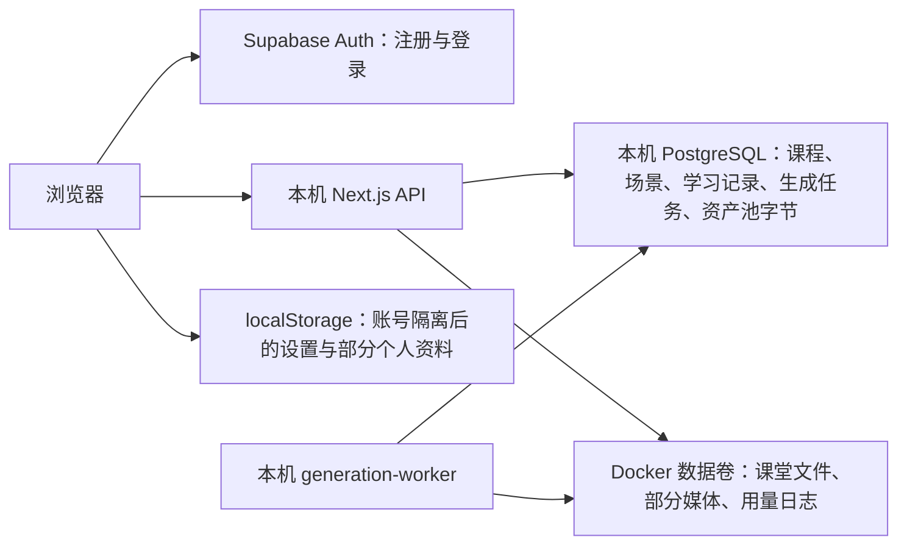
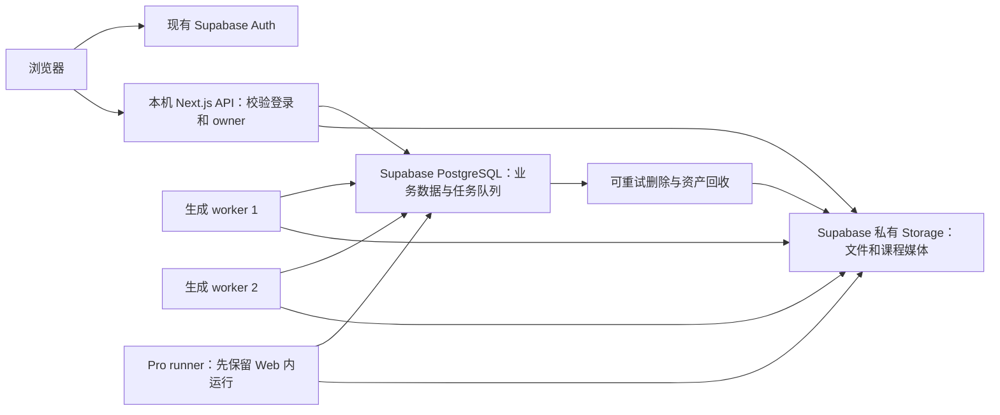
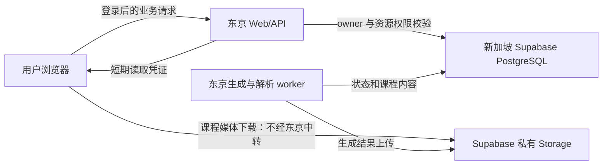

# 用户数据与课程迁入 Supabase、生成并发扩至 16 的实施方案

调查日期：2026-09-20；文档完成：2026-09-21（北京时间跨日）。状态：**完成调查与方案设计，尚未实施**。

本次只读取源码、运行中的 Docker 配置和数据库统计，新增本文档；没有修改应用、部署配置、数据库或 Supabase Storage。统计是调查时的快照，执行迁移前必须重新生成清单。

## 0. 最高保护边界：迁移后仍能生成、上课和使用教会学伴

**用户于 2026-09-21 明确要求：普通前台生成、普通后台生成、Pro 课程生成是最高保护边界；完整课堂 UI 和已完成的教会学伴必须保留。不能出现“数据迁到 Supabase 了，课程生成却不能用了”的交付。** 本节约束全文所有任务、配置草案和部署建议；不得以迁移、权限收紧、16/2 并发或服务器资源为理由单方面削减这些能力。

### 0.1 保护范围

| 受保护能力 | 必须保留的行为 |
| --- | --- |
| 普通前台课程生成 | 保留现有入口及前台生成流程、进度/流式反馈、已有取消与错误处理，生成结果能保存并进入课堂；不能强制改为后台生成来替代验收 |
| 普通后台课程生成 | 保留提交、排队、worker 执行、进度、现有取消/恢复机制、完成后打开课程；关闭页面后任务按原有契约继续 |
| Pro 课程生成 | 保留 Pro 工作台、会话与消息、材料/模型配置、任务执行及已有确认/取消/恢复流程；生成课程和媒体可保存、加载、进入课堂 |
| 完整课堂 UI | 保留当前课堂布局、入口、控件和交互；逐项盘点并验证课件切换、讲授/播放、音视频、聊天/白板、练习/反馈及已启用编辑/导出等实际功能，不能以简化展示页替代课堂 |
| 已完成的教会学伴 | 保留入口、主题/学伴选择、准备、用户讲解、追问与反馈、引用、总结、暂停/恢复、结束返回课堂及历史查看；保留已有会话/事件及其关联关系，不能只保留 UI 而丢失 API 或持久化链路 |

这里的基线是 **T0 时当前工作树（包含未提交修改和未跟踪文件）中的已完成实现与已验证行为**，不是仅以 Git HEAD 或旧方案为准。先记录各模式适用配置、功能开关、操作流程和现有缺陷；既有缺陷如实单列，不能借此删减功能，也不能把迁移引入的新故障归为既有问题。

### 0.2 实施限制与完成条件

1. 允许为 Supabase 接入修改存储适配、认证/owner 传递、权限策略、媒体 URL、任务调度和必要的调用接口，但必须保持上述产品行为与数据语义。不得删除、隐藏、降级、占位替换上述功能，或通过关闭功能开关、删除测试/弱化断言来规避失败。
2. 前台与后台若由互斥配置选择，分别以其受支持配置接入 Supabase 验证，记录 build-time 与 runtime 配置。不能只验证默认后台模式便宣称前台可用，也不能因为启用 hosted 认证就永久封死前台生成入口。
3. Supabase 保存持久数据，Web/worker 继续承担原有生成与课堂服务职责；迁移不得让模型调用、材料读取、生成过程写入、课程发布、课堂加载中的任何一环失联。遇到 RLS、角色、密钥或资源问题，应修复链路，不能把失败功能直接禁用。
4. **T8 必须逐项通过第 9.1 节五类回归验收，T9 扩容后必须复验。任意一类失败或因外部条件无法验证，均不得标记整个迁移完成或进入正式上线。** 数据复制成功、首页能打开、构建/单测通过都不能单独代替验收。
5. 16/2 是必须实施和验证的容量目标，同时必须满足功能保护边界。资源不足时提供实测瓶颈及优化/升级方案，明确未达成项；不得用砍掉功能换取并发数字。若确实必须改变既有产品行为，先说明具体冲突并征求用户决定。
6. 切换失败时按第 5.4 节恢复到已验证可用的版本和数据路径；切换后的新增数据必须先保护。不得用清空用户数据、回退其他已完成工作或恢复到缺少教会学伴的旧提交来“修复”。

本节是实施及交付的硬约束，**不是已完成测试的证明**；下一对话必须提交实际回归证据。

## 1. 已确认的目标

用户已在本次对话确认：

1. 先让本机 WebApp 全面使用现有 Supabase，验证后再部署线上；本次不部署域名或购买服务器。
2. 保留并迁移已登录用户的数据，保持原账号归属；全部旧匿名课程也迁移到 Supabase，统一归属于管理员账号。
3. 以后删除该管理员账号时，一并删除其课程及关联数据、回收不再被使用的素材。**本次迁移不删除管理员。**
4. 最终支持全站 **16 个**、每用户 **2 个**课程生成根任务同时运行。验收必须涵盖普通前台、普通后台和 Pro 生成，并遵守第 0 节完整课堂 UI 与教会学伴保护边界。

实施解释：旧课程中已有的删除标记继续保留，不能因为迁移把删除过的课程重新展示。调查时只有一个 active 管理员；迁移工具在执行前通过现有账号登记解析该管理员 UUID，并将其写入迁移清单。如果执行时已有多个管理员，先确认归属账号。不得按昵称或浏览器提交的 ownerId 决定归属。

## 2. 当前到底存在哪里

### 2.1 实际运行环境，不只是示例配置

当前运行的是 `zhiyu`、`zhiyu-worker` 和 `openmaic-main-postgres-1`：

| 项目 | 实测结果 |
| --- | --- |
| Web 地址 | `http://localhost:3000`，Docker 绑定 `127.0.0.1:3000` |
| Web / worker 数据库 | `postgres:5432/openmaic`，本机 Docker PostgreSQL |
| Auth 模式 | `AUTH_MODE`、`NEXT_PUBLIC_AUTH_MODE` 为空；允许 Supabase 登录的双模式 |
| 全站重任务限制 | `APP_HEAVY_TASK_LIMIT=1` |
| 普通生成 worker | 1 个容器，`GENERATION_WORKER_CONCURRENCY=1` |
| 素材后端 | `ASSET_S3_BUCKET` 为空，未选择 local 后端，因此资产池字节落 PostgreSQL |
| 素材回收 | `ASSET_COLLECTION_ENABLED=false` |
| 本机数据库卷 | `openmaic-main_openmaic-postgres` |
| 应用文件卷 | `openmaic-main_openmaic-data`，挂载 `/app/data` |
| Docker 可用资源 | 20 个逻辑 CPU，约 7.65 GiB 内存；这是 Docker 总资源，不是独占容量 |

Supabase 插件只读检查确认：项目 **zhiyu**，ref `lzomhnjyymalupgvcato`，地区 `ap-southeast-1`，组织套餐 **Pro**，PostgreSQL 17，状态健康。

| 数据统计 | 本机数据库 | Supabase |
| --- | --- | --- |
| `document_stages` 课程记录 | 115，全为 `anon:` owner，`user:` 为 0 | 0 |
| `stage_meta` 删除状态 | 未删除 51，已标记删除 64 | 课程数据尚未迁入 |
| `document_scenes` 场景 | 459 | 0（表清单统计） |
| `asset_entries` / `asset_blobs` | 各 1484 | 各 0 |
| `asset_blobs.bytes` | 1484 条非空，共 511,178,031 字节，约 487.5 MiB | 无课程资产 |
| `generation_jobs` | 56：成功 42、取消 13、需处理 1 | 0 |
| 整个数据库占用 | 约 552 MB，包含索引等 | 约 14 MB |
| Supabase Auth 用户 | 不在本机 Auth 系统 | 3 |
| Storage buckets / objects | 不适用 | 均为 0 |

115 是课程表记录数，不等于首页显示 115 门可用课程。现存浏览器私有数据也不能通过服务器 SQL 统计。文件卷中 `/app/data/classrooms` 当前约 4 KiB、`/app/data/usage` 约 232 KiB；下面的文件写入路径仍是新任务会走到的代码路径，需要改造。

### 2.2 数据流与存储清单



| 数据 | 当前实现与位置 | 目标位置 |
| --- | --- | --- |
| 邮箱、密码验证、Auth 会话 | Supabase Auth；不应再自建密码库 | 保持现有 Supabase Auth 和用户 UUID |
| 账号角色、状态 | Hosted `app_accounts`，登录时还会同步本机账号登记；`lib/auth/session.ts` | Supabase `app_accounts`，作为单一权威 |
| `/api/auth/profile` 显示名 | 写当前 `DATABASE_URL` 的 `app_profiles`，现运行环境是本机库 | Supabase `app_profiles` |
| 头像、简介、UI 偏好 | `user-profile.ts`、`settings.ts` 通过 `BrowserKVStore` 保存；按用户命名空间隔离但仍在本浏览器 | 资料写 `app_profiles`，允许同步的偏好写 `account_kv` |
| 课程、场景、大纲、文件夹、版本 | `document_*`、`stage_meta`，经 `/api/persistence` 和课程 API 写本机库 | 同构表迁入 Supabase PostgreSQL |
| 课堂会话、对话、练习、学习记录 | `runtime_sessions`、`runtime_records` | Supabase PostgreSQL |
| Pro 会话、消息事件、素材记录、自定义技能 | `agent_sessions`、`agent_session_*`、`agent_user_skill`、`owner_material` | Supabase PostgreSQL |
| 模型连接和生成配置快照 | `pro_model_*`、`*_snapshots`；凭据使用服务器加密 | Supabase PostgreSQL；加密密钥继续只放服务器密钥环境 |
| 普通生成任务、步骤、租约、事件、额度槽位 | `generation_*` | Supabase PostgreSQL；保留现有任务系统 |
| 图片、音频、视频等资产池 | `asset_entries` 是逻辑归属，`asset_blobs` 是 hash 元数据；当前 bytes 在本机库 | 元数据在 PostgreSQL，字节在 Supabase 私有 Storage |
| 独立素材库的上传原件与会话原始素材 | `getMaterialByteStore()` 默认 `LocalMaterialByteStore`，写服务器 `data`；这条链路不经过资产池 S3 配置 | 单独接入私有 Storage，保留 `owner_material` / session material 的对象引用、配额和回收流程 |
| 课堂快照 | `lib/server/classroom-storage.ts` 写 `/app/data/classrooms/<id>.json` | `classroom_snapshots` 登记 + 私有 Storage 中的不可变 JSON 快照 |
| 部分生成媒体 | `classroom-media-*.ts`、Pro `generate-image.ts` / `generate-video.ts` 直接写课堂目录 | 统一资产存储，并保留稳定的应用层读取地址 |
| 用量日志 | `lib/server/usage-storage.ts` 写 `/app/data/usage/YYYY-MM.jsonl` | `usage_events`；补全现有表与 UsageRecord 的字段映射 |
| 视频导出归属与长期输出 | `render-job-owners.ts` 为本地 JSON；渲染临时文件在渲染服务 | 归属写 `render_job_owners`；需长期保留的输出写 Storage，临时文件可留本机 |

结论：**注册登录已经使用 Supabase，但课程尚未迁入 Supabase；登录成功不会自动改变 DATABASE_URL、磁盘写入或浏览器存储后端。**

### 2.3 已存在但不能当成“全部完成”的基础

- 已有 `@supabase/ssr`、`@supabase/supabase-js`、账号注册登录、owner 编码 `user:<uuid>`、请求事务内 `app.owner_id` 与 RLS。
- Supabase 已有 44 张 public 表；此次列表中均启用 RLS。迁移记录为 accounts `1,2,3,4,8,9,10`，不是需要从零重跑的空项目；其中部分编号属于不同部署分支。
- `classroom_snapshots`、`usage_events`、`render_job_owners` 已建表，但现有业务写入仍在文件系统，不能以“表存在”作为验收。
- `/api/kv` 已有少数白名单 key，但默认前端 KV 仍是 BrowserKVStore；storage 包 HttpKVStore 的 `/kv/entries/...` 契约也与目前 `/api/kv?key=...` 不同，不能直接替换构造函数。
- `docker-compose.hosted.yml` 是隔离验证环境：固定 `:3001`、`GENERATION_ACCEPTING_JOBS=0`、`ASSET_BYTE_BACKEND=local`。不能直接拿它作为全面云存储的正式配置。
- `scripts/generation-compose.ps1` 强制数据库为 `postgres:5432/openmaic`，并拒绝 S3 bucket；现有入口不支持本次目标。
- 工作区已有大量未提交代码；调查基准 HEAD 为 `3e8714f653ad11acd3f57510899900384572294d`，**当前工作树包含额外账号功能，不能只从这个 HEAD 实施**。

## 3. 推荐的目标架构



保留现有 PostgreSQL 数据模型、HTTP Store 接口、普通生成 worker 和 Pro runner，不同时改成全套 Supabase Data API、Realtime、Edge Functions 或另一套队列。课程 JSON/索引/学习进度放数据库，较大的二进制放 Storage。Supabase Pro 不提供本机生成 worker 的算力，也不会自动解除 LLM 服务商限制。

Pro 当前套餐公开列出的数据库磁盘额度和文件存储额度分别为 8 GB/项目、100 GB，二者不同，带宽也单独计量。具体余额及 compute 规格应以项目 Dashboard 为准；本次只核实了套餐和 `max_connections=60`，未将套餐推断成某个 compute 型号。[官方定价](https://supabase.com/pricing)

### 3.1 数据库连接与权限

1. Web 业务请求使用现有 `zhiyu_app_web` LOGIN；worker、后台任务使用 `zhiyu_app_worker` LOGIN。两者目前均无 BYPASSRLS。继续复用 `app_web` / `app_worker` 的职责边界。
2. `DATABASE_URL` 指向 Supabase Web LOGIN；`WORKER_DATABASE_URL` 指向同项目 worker LOGIN。`DATABASE_LISTEN_URL` 使用 session/direct 连接，供 Pro 事件 LISTEN 使用。
3. 首次本机验证优先使用已有 Session pooler 路径；主机、端口、用户名从 Dashboard Connect/已有私密配置读取，不拼接猜测。后续普通查询如切 transaction pooler，需单独验证事务内 owner 设置；LISTEN 保持 session/direct。[连接官方说明](https://supabase.com/docs/guides/database/connecting-to-postgres)
4. 所有请求绑定 owner 后在同一短事务内查询；不得把有 owner 的 queryable 缓存在全局给另一个用户用。直接 SQL LOGIN 不会自动获得 `auth.uid()`，不能把现有策略机械改成 `auth.uid()=owner_id`。
5. 业务表继续服务端访问；只有确有 Data API 需求的表才显式授权。`app_accounts` 已有 JWT 自查链路，需保持可用。新 public 表显式记录 GRANT 与 RLS，不能依赖自动暴露。[相关变更](https://supabase.com/changelog/45329-breaking-change-tables-not-exposed-to-data-and-graphql-api-automatically)
6. 迁移用管理连接与 Auth 管理密钥不传入普通 Web/生成 worker。已有服务器配置加密密钥保持稳定，不在文档、日志或浏览器暴露。

### 3.2 文件存储：复用 S3 适配层

建议创建私有 bucket `zhiyu-assets`，用于现有 content hash 命名的资产。另建私有 `zhiyu-classrooms`，存放 owner/classroom/version 对应的不可变课堂快照；快照资产引用也必须纳入回收关系。

现有 `S3AssetByteStore` 已有 put/read/delete/sign，对象 key 就是 `sha256-...`。优先复用该层，保留 asset ID、content hash、principal 和现有引用协议，不把课程里的引用替换为临时签名 URL。

**必须补齐的实现：**

- `loadS3AssetByteStore()` 目前只构造 `new S3Client({})`。在应用配置层明确注入 endpoint、region、credentials、`forcePathStyle: true`，并扩展包的参数类型或使用已有可注入 client 的构造接口。不能假定填 bucket 就能正确连 Supabase。
- 推荐新增应用专用变量 `ASSET_S3_ENDPOINT`、`ASSET_S3_REGION`、`ASSET_S3_ACCESS_KEY_ID`、`ASSET_S3_SECRET_ACCESS_KEY`、`ASSET_S3_FORCE_PATH_STYLE`，避免覆盖项目同时用于 Bedrock 的通用 AWS 凭据。保留旧 AWS 配置兼容分支。以上是**待实现变量**。
- endpoint 以 Supabase S3 设置页为准，形如 `https://<ref>.storage.supabase.co/storage/v1/s3`；区域采用该项目配置。
- S3 专用 access keys 会绕过 Storage RLS，只能留服务器。读取仍必须先校验 `asset_entries.principal` 或课堂 owner，成功后才代理字节或签短时 URL。hash 不是授权凭证，不能为任意 hash 签名。[S3 认证说明](https://supabase.com/docs/guides/storage/s3/authentication)
- `ASSET_BYTE_BACKEND=local` 优先级高于 bucket；新部署须明确选 S3，并将 backend 选择改成可校验配置，防止残留 hosted overlay 把字节继续落盘。
- 先使用同源授权代理验证全部类型；再验证 `ASSET_BYTE_EGRESS=redirect`。必须测试签名 URL、Content-Type/Disposition、Cache-Control、CORS、导出端读取、Range/206 和 URL 过期行为。Supabase 支持主要 S3 操作和 Range，但不是完整 AWS S3。[兼容性表](https://supabase.com/docs/guides/storage/s3/compatibility)
- 现有 byte store 读操作会取完整 Uint8Array；大视频若走同源代理，应补流式/Range 读取，不要用 16 路请求同时把大文件全部读入内存。
- 现有资产写入可能在 DB 事务持锁期间执行对象上传。先保留其一致性语义，测量长事务与 pool 等待；若成为 16 并发瓶颈，再引入“先上传临时对象、后事务登记、孤儿清理”的显式协议，不可直接把 await 移出事务破坏并发回收保证。

### 3.3 消除业务数据的磁盘单点

**2026-09-21 补充调查：独立素材原件存储必须同时改造。** `lib/server/materials/bytes.ts` 的 `getMaterialByteStore()` 固定返回 `LocalMaterialByteStore`，默认根目录是 `process.cwd()/data`。`app/api/materials/route.ts` 的上传链路写入 `materials/<ownerId>/<materialId>`；`lib/server/agent-runtime/session-materials.ts` 也使用这层读写会话原始素材。因此只改 `ASSET_S3_BUCKET` 并不能迁走全部用户上传原件。

为 `MaterialByteStore` 实现并注入 Supabase S3 后端，建议使用独立私有 bucket `zhiyu-materials`，沿用现有 object key 和数据库归属。保持上传占额、finalize、失败回收、过期上传清理、会话素材读取/删除的契约；不把 bucket 地址当作访问授权。原始上传文件、派生后仍被业务引用的音视频切片要持久保存；FFmpeg 等内部处理中间文件可删除。迁移工具额外遍历这些对象引用和实际本地文件，并验证 hash/长度；账号删除清单也必须包含它们。这项工作纳入 T2/T3/T5/T7/T9 验收，不属于可省略的后续优化。

统一新增服务端媒体持久化入口，要求传入已验证的 owner/stage 上下文。改造：

- `lib/server/classroom-media-bytes.ts`
- `lib/server/classroom-media-generation.ts`
- `lib/server/agent-runtime/generate-image.ts`
- `lib/server/agent-runtime/generate-video.ts`
- 语音、声音克隆、课堂导出等调用上述入口的链路。

保留 `/api/classroom-media/<classroomId>/...` 作为兼容读取地址，新增映射表将 `(owner_id, classroom_id, legacy_path)` 指向 asset ID，并建立相应 RLS/唯一约束。新数据走统一资产引用；旧 URL 查映射后读取云资产。读取时从关联课程/课堂核实权限，不能仅相信 URL 中的 classroomId。

`classroom-storage.ts` 改成：上传不可变 JSON 快照 → 事务更新 `classroom_snapshots.storage_ref/version`；读取按 owner 校验。版本冲突不能覆盖别人更新；失败对象由清单回收。`classroom-job-store.ts` 的持久任务状态同样迁为数据库记录或复用现有任务系统，不能继续只依靠磁盘 JSON 恢复。

`usage-storage.ts` 切换到数据库，保留 `owner_id`、job/session/request 归属，并新增唯一事件标识以幂等写入；补全 provider/model、各种 token、quantity/unit 等映射，不能只保留表中目前已有的部分字段。没有可靠 owner 的历史日志在受限归档中保留，不猜测为某个普通用户的数据。

`render-job-owners.ts` 接入已有表。渲染临时目录、下载缓存允许留本机；已被用户保存的输出必须有云端记录。验收标准是丢弃新部署的本地缓存卷、重建应用后仍能读取全部长期数据。

### 3.4 用户偏好与个人资料同步

资料统一以 `app_profiles` 为权威，扩展 profile API 支持受控 avatar/bio。`account_kv` 只收白名单偏好，明确版本、删除接口、大小限制和冲突策略。可使用针对当前路由的 AccountKV 适配器，或统一为包 HTTP 契约，不能让客户端和路由协议不匹配。

`settings-storage` 混有模型供应商配置/API key，**不允许将整个 Zustand 状态 JSON 直接云同步**。UI/语言/非敏感偏好同步；设备专属状态留本机；需跨设备的凭据使用已有服务器加密连接/快照机制。浏览器已隔离到 `zhiyu:openmaic:<uuid>` 的可同步字段可在用户登录后一次性上传并标记完成，不能从匿名 namespace 自动认领资料。保留切换账号时的缓存清空与请求隔离。

## 4. 全站 16、每用户 2：限制与改造

### 4.1 现有不同层级的限制

| 层级 | 代码位置 | 当前值/约束 | 本次处理 |
| --- | --- | --- | --- |
| 全站活跃根任务 | `lib/server/heavy-task-admission/index.ts` | 环境实值 1；解析与运行时验证只接受 1 或 2 | 支持 1–32 的整数，目标 16 |
| 每 owner 活跃根任务 | 同上 | `activeOwnerRoots >= 1`，固定 1 | 新增 `APP_HEAVY_TASK_PER_OWNER_LIMIT`，目标 2 |
| 普通队列候选筛选 | `generation-jobs/repository.ts` 的 `claim()` | 同 owner 存在另一个 running job 就排除 | 与新的 owner 限额及 root 去重一致 |
| 跨队列公平性 | `isHeavyTaskFairTurn()` | eligible 排除已有其他活跃根任务的 owner | 改成 active root 数量小于 owner 上限 |
| 独立解析/媒体同步任务 | `independent-request.ts` | 每 owner 固定 `slot_no=0`，续租/释放也写死 0 | 槽位动态分配，lease 携带 slot，仍与总根任务合计 |
| 普通 worker 同时执行数 | `generation-jobs/config.ts`、`workers/generation/runner.ts` | 每进程默认 1，可配置 1–8 | 两个独立 worker，每个 8；全站 admission 仍只允许 16 |
| Pro runner | `agent-runtime/config.ts`、`runner.ts` | 每 Web 实例默认 2 | 目标可配置 16，先分档；与普通任务共享全站 16 |
| 每课程内容并行 | `PARALLEL_SCENE_CONCURRENCY` | 当前 2；后台有效 1–10 | 初始改为 1，避免 16 门课各自继续放大请求 |
| LLM 全局调用槽位 | `GENERATION_LLM_MAX_INFLIGHT` | 当前 3，允许 1–30 | 分档 4/8/16，最终候选 16，受上游额度验证约束 |
| TTS / media 槽位 | 对应 `GENERATION_*_CONCURRENCY` | 当前 2 / 1 | 初始保持 2 / 1，按供应商额度和测量再调 |
| 纯排队数量 | generation config + admission | 每用户最多 5，全站最多 20；有重复硬编码 | 统一配置；建议仍每用户 5、全站 100 |
| 待确认/需人工处理 | admission + reservation | 每用户 5、全站 20；预留槽 `generate_series(0,19)` | 独立于排队；建议每用户 5、全站 100，全部相关判断统一 |

这里的 16 指全站不同根任务；Pro 的 session 与它派生的 generation job 必须只算一个。PDF 解析、媒体等独立重任务也沿用同一安全额度。16 个已运行课程并不表示 16 个视频任务同时调用外部服务。

同一用户最多 2 个，因此验证全站 16 需要至少 8 个不同 owner；只有一个管理员连点 16 次，正确结果应是 2 个运行，其余排队或被队列容量拒绝。

### 4.2 调度改造必须成套完成

1. 增加统一容量配置解析模块；启动时验证 site、owner、queue、attention 的合法范围，owner 不大于 site。兼容现有默认值，新部署显式设置目标值。
2. admission 保持数据库事务级 advisory lock 和“计数 → claim 写回”原子性，不能改成进程内计数。继承同一个根任务的子任务继续不重复占位。
3. 同步修改 `claim()` 候选过滤和 fair-turn SQL。只改 `activeOwnerRoots >= 2` 会被其余旧规则继续卡成 1。
4. 独立同步任务分配 `[0, ownerLimit)` 的空闲槽，更新获取、heartbeat、release、过期和取消的完整 lease。不得给两个任务共用 slot 0。
5. queue/attention 配置贯穿普通生成、Pro 会话、素材解析、HTTP 状态、错误文案和 UI，不保留另一套 5/20 常量。attention 预留槽也动态配置；缩容时不回收仍被占用的槽。
6. 多进程使用同一容量配置，记录非敏感配置指纹。滚动升级期间先停接单/排空，不允许新旧准入算法同时 claim。
7. worker 并发上限已有 8，首选两进程各 8，不必先放宽到单进程 16。新增部署配置去掉固定 `container_name` 以支持 `--scale generation-worker=2`，使用唯一 workerId；Web 内 Pro runner 可先调 16，但不得在普通 worker 中误启动第二套 Pro runner。
8. 不改变租约 fencing、idempotency、任务取消、重试隔离和同一课程写锁。每用户 2 是两门独立课程，不是同一课程允许两个生成器同时写。

### 4.3 16 并发的额外性能工作

**数据库连接池：**实测 Supabase `max_connections=60`，调查时已有 13 条连接。`getGenerationPool()` 每进程 max 8，另有 persistence、账号、Pro model/skill/session、collector 和专用 LISTEN 连接。直接扩副本会累计连接，不能把“每个 pool 小”当作总体安全。

实现按进程、连接角色复用的 pool registry，统一 TLS 验证和 timeout；owner 只绑定事务，不绑定共享 pool。尤其清理直接 `new Pool()` 绕过 `createAppPool()` 的入口，以及 persistence provider 按不同 URL 切换 singleton 的生命周期。LISTEN 单独管理连接。

建议首次测量预算：Web 的 app_web 查询池 5、系统池 6，两个 worker 各 6，额外 LISTEN 1，合计约 24 条上界；必须让模块真正复用这些池才成立，collector 复用系统池。预算加上 Supabase 服务与维护连接后仍需留余量。一个任务等待模型响应时通常不需要占有数据库连接；严禁长时间持有事务等待 LLM。

**配额获取开销：**`limiter.ts` 每次 acquire 在同一 quota lock 下循环执行 `limit` 次 INSERT，即使槽位已存在；16 槽时会放大跨地域网络往返。改为一次 `INSERT ... SELECT generate_series ... ON CONFLICT DO NOTHING`，或一致的预初始化路径，并保留原有 fencing/cooldown/quarantine。无槽时目前每 250–500ms 重试，增加有界退避/唤醒机制，避免 16 个任务同时高频抢锁。

**模型额度：**`model-quota.ts` 包装实际 SDK 调用/流生命周期；Pro stream 也经 `lib/ai/llm.ts`。LLM 当前共享 `deployment` group，其他模态还可能按凭据 group。调大之前逐一确认实际 group 和上游并发/RPM/TPM，不能把局部 group 数量相加误认为全局只有一个限制。16 是 root 容量目标，不保证当前模型 key 能支撑 16 个同时推理请求。

**内存与心跳：**Docker 总内存约 7.65 GiB，空闲时占用低不能证明 16 个课程可运行。图片/视频下载、PDF 解析和导出可能引起突发内存。限制每次大文件处理，避免 16 路无界 Buffer；监测事件循环延迟。Pro lease TTL 当前 10 秒、heartbeat 2 秒，跨地域 DB 或同步解析阻塞可能导致误判失联；压测时验证，若调整 TTL 必须同步所有根任务统计与过期判定。

### 4.4 分档部署与验收

| 档位 | 全站/用户 | 普通 worker | Pro 上限 | LLM 初始候选 | 用途 |
| --- | --- | --- | --- | --- | --- |
| A | 4 / 2 | 1 × 4 | 4 | 4 | 先验证所有权、调度、存储与停止恢复 |
| B | 8 / 2 | 1 × 8 | 8 | 8 | 验证内存、连接和延迟 |
| C | **16 / 2** | **2 × 8** | **16** | **16** | 用户目标；真实额度不足时明确报告瓶颈 |

所有档位 scene concurrency 初始 1，TTS 2、media 1；这限制单课的资源占用，不降低 root 上限。B、C 只在前一档通过后启用；不能把最终 16 的目标默默改成 4。

建议上线门槛：模拟 provider 先验证 16/2 准入绝不超限、无饿死和重复提交；真实 provider 使用相同规模课程，至少完成一轮 16 任务及混合负载，记录失败率、P95 排队/完成时长、429、连接池等待、CPU/RSS、租约丢失。建议 Docker 总内存峰值小于分配内存 75%，无 OOM，业务侧池等待 P95 小于 1 秒，无 SQL 连接耗尽/任务重复收费；阈值是本次验收目标，不是已测结果。重试压力测试优先用可控 mock provider。

如果实际 API key 额度不足，代码和调度仍完成 16/2，交付报告明确“调度已通过、真实吞吐受哪个供应商额度限制”；需用户提供配额信息或调整资源后才能宣布真实 16 并发验收完成。

## 5. 数据迁移：不丢失归属与引用

### 5.1 先建立可复跑迁移清单

新增只读 dry-run 工具，输出源/目标项目指纹、表版本、课程/owner 分类、每个 hash 的字节来源与校验结果、磁盘媒体引用、浏览器同步待处理项、ID 冲突和孤儿记录。源码已有 migrations 与 hosted proofs 应复用，但不要把本机 accounts v6/v7 机械应用到 hosted，或重写已执行 migration 的 checksum。

本次目标可用现有项目，不需要新建付费项目。所有新 schema 变更以增量 migration 表达，先在隔离测试数据库验证再应用到目标；Supabase CLI 创建迁移文件时使用 `supabase migration new` 生成名称。执行前比对现有 accounts/generation migration 历史，明确项目自有版本表与 Supabase migration 历史各自用途，不能重复执行两套迁移入口。

备份本机 PostgreSQL 和整个应用数据卷；验证可恢复。迁移按清单复制，保留源数据与卷，不 `down -v`，不直接全库 restore 覆盖 Supabase 的 auth/storage schema、角色或现有 accounts 表。

### 5.2 所有权映射规则

| 源数据归属 | 目标归属 |
| --- | --- |
| 已验证 `user:<uuid>` | 原 `user:<uuid>`，对应现有 Auth 账号 |
| 历史 `anon:*` 课程 | 确认的管理员 `user:<admin_uuid>` |
| 旧课程关联的资产/文件/学习数据 | 依据课程及会话关系迁到相应 owner；不能只替换一张表 |
| 无法建立关联的遗留文件或日志 | 清单列为受限归档；不授予普通用户访问权 |

必须覆盖 `document_stages`、folders、stage_meta、generation_ownership/jobs、agent sessions/materials、runtime learner_key、asset principal、快照、模型连接及用户技能等实际存在的 owner 字段。场景等没有 owner 的子表通过父记录保证一致性。

多个匿名 owner 合并到管理员时，处理文件夹 `(owner_id, normalized_name)`、素材/技能名、幂等键等唯一约束冲突：保留来源映射，必要时稳定重命名，而不是覆盖。保留 stage/scene/asset ID；若发生真实 ID 冲突，按迁移映射重写全部引用并校验。

**加密数据特殊处理：**模型/媒体/搜索快照使用 ownerId 作为 AES-GCM AAD。将 `anon:` 改成管理员后，原密文不能原样解密。保持 user owner 的密文需原密钥；重归属的快照必须在内存中用原 owner 解密、用新 owner/目标密钥重新加密，并更新 digest/ref 相关映射，日志不得输出明文。旧配置密钥不可用时，课程内容与文件仍可迁移，相关继续生成能力必须明确标记为待重新配置，不能写假成功。

### 5.3 复制与切换顺序

1. 完成新后端、数据库迁移和新 compose，在隔离本机端口验证。
2. 对历史数据形成快照；`ASSET_COLLECTION_ENABLED=false` 贯穿迁移窗口。
3. 按 hash 从本机 `asset_blobs.bytes` 或实际文件复制至私有 Storage，逐个比对 SHA-256 与长度；写入迁移账本，失败可重试。
4. 复制业务行与资产元数据，保留引用；目标 `asset_blobs.bytes` 留空，避免数据库重复承载大文件。已有账号不重新注册、不覆盖密码。
5. 磁盘媒体建立旧地址映射，课堂快照上传并登记；检查课堂 JSON/场景/任务快照里的相对路径、localhost 绝对路径、asset ID 和 data URL，保留或转换为稳定引用。
6. 迁移全部课程记录，包括删除标记。当前 64 个 tombstone 保持不展示；不能调用一个会忽略 deleted_at 的普通新建接口来导入。
7. 切换窗口阻止全部业务写入并排空任务：`GENERATION_ACCEPTING_JOBS=0` 只管部分普通生成接单，**不能替代全站维护模式**；Pro 新消息/素材、课程编辑、课堂保存、偏好写入都需受控冻结。
8. 现有 1 条 needs_attention 保留状态与诊断，迁移后不能自动重试外部结果不确定的操作。未完成任务保留检查点；不复制 worker heartbeat/provider lease 当作活跃租约，不在新实例自动恢复匿名历史任务。
9. 重跑增量清单，复制冻结前后的差额；校验 counts/hash/owner/ref 完整性。
10. 重建 Web 的 `NEXT_PUBLIC_*` 配置并启动所有连接到 Supabase 的进程。验收后再将本机 `localhost:3000` 切至新部署，原栈停止写入，备份保留。
11. 确认新增数据只写 Supabase，不出现本地课程新记录。全部引用校验通过后开启云端 asset collector，设置合适 grace 并观察删除日志。

### 5.4 回滚

新系统开放写入前：回到原镜像、原配置、原卷即可。开放写入后：必须先冻结新系统并导出云端新增/修改数据与对象，完成反向同步或决定保留云端修复；不能直接改回旧 DATABASE_URL 导致新增课程“消失”。并发扩容可单独降回 8/4，不必回滚数据存储。

源备份不是在线查询回退后端。账号删除后，在线系统必须不可访问其历史数据；离线备份按明确保留期过期，恢复备份时重放删除账本，避免被删除课程复活。Supabase 数据库备份不包含 Storage 文件字节，必须另做对象备份/恢复方案。[备份说明](https://supabase.com/docs/guides/platform/backups)

## 6. 删除管理员时连同课程删除

### 6.1 当前缺口

`scripts/remove-test-admin.ts` 只是标记 deleting、尝试登出、调用 Auth deleteUser，没有完整删除课程/资产。实际 Supabase 外键为 `app_accounts.user_id → auth.users.id ON DELETE RESTRICT`，直接删除 Auth 用户会被关联账号阻止。脚本把 user UUID 传给 `auth.admin.signOut` 的调用也应修正：该 API 接收用户 access token/JWT，不能把调用被 catch 忽略当作完成会话撤销。

此外许多业务 owner 是 text，没有对账号的级联 FK；S3 对象也不会因一条数据库 DELETE 自动消失。本次必须补显式清理流程，不能只把 RESTRICT 改成 CASCADE 就宣布完成。

### 6.2 建议的可重试删除流程

新增 `account_deletion_jobs` / 清理账本，按 userId 幂等；可以由管理命令提交并由后台清理执行。初版不强制新增完整管理后台，但现有 remove-test-admin 命令必须改为调用这套流程。

1. 记录删除任务及待清理资源清单，设置账号 `deleting` 和 session_valid_after；所有鉴权入口、生成 claim、worker 写回检查此状态。敏感操作在账号/会话校验不可用时应拒绝继续，不能沿用容错逻辑放行正在删除的账号。
2. 停止新生成，取消该 owner 所有普通/Pro/解析任务，并使旧 worker 的 lease/ownership epoch 失效；等待或确认它们不能在删除后重新写课程。未知外部请求结果记录在删除任务中，不自动重提收费请求。
3. 撤销对应会话/refresh token，并以账号状态作为旧 access token 的即时业务阻断；采用当前 SDK 正确支持的撤销方式。不能假定删除 Auth 用户立即使已签 JWT 失效。[用户管理说明](https://supabase.com/docs/guides/auth/managing-user-data)
4. 分批删除该 owner 的课程/场景/大纲/版本/元数据、文件夹、runtime 数据、Pro 会话事件与消息、素材记录、自定义技能、模型连接与加密快照、生成任务及其子表、偏好、用量、课堂快照和渲染归属，按真实 FK 依赖顺序执行。审计仅保留最小删除事件，不保留课程正文、凭据或不必要个人信息。
5. 删除该 owner 的 `asset_entries` 和媒体映射，待引用归零后回收对象；共享 hash 若仍被其他用户使用，保留字节而撤销原用户访问。不要按某个用户“用过的 hash”直接批量删除共享文件。
6. 清理课堂快照 bucket/长期导出输出；通过 Storage/S3 API 删除对象，不直接删除 `storage.objects` 行冒充文件已删除。失败加入可重试清单。
7. 先完成关系清理，再删除 app_profiles/account_kv/app_accounts 等依赖，最后调用 Auth Admin deleteUser。保留独立的删除阻断记录，避免中途失败后账号登记函数又把用户重新建立为 active。FK 顺序及阻断记录须有集成测试。
8. 只有数据库残留检查、私有对象回收、Auth 用户不存在都满足时标为完成；网络故障保持可重试状态。UI/命令区分“访问已撤销、清理中”与“物理清理完成”。

管理员与普通用户走同样的 owner 清理规则。只有一个管理员时，允许操作者使用受控管理命令删除最后管理员，以满足用户要求；不因保护最后管理员而永远无法删除，也不在应用启动时自动重建已删除账号。真实管理员删除属于未来单独操作；验收用临时账号模拟，不删除本次迁入旧课程的管理员。

## 7. 部署配置草案

以下仅用于指导实施，**不能现在直接复制运行**：新增变量尚未接入、两 worker 配置和所有权调度尚未完成。

```dotenv
AUTH_MODE=supabase
NEXT_PUBLIC_AUTH_MODE=supabase
NEXT_PUBLIC_PERSISTENCE=1
NEXT_PUBLIC_SUPABASE_URL=https://lzomhnjyymalupgvcato.supabase.co
NEXT_PUBLIC_SUPABASE_PUBLISHABLE_KEY=<现有 publishable key>
APP_ORIGIN=http://localhost:3000

DATABASE_URL=<同项目 zhiyu_app_web LOGIN 的 TLS 连接>
WORKER_DATABASE_URL=<同项目 zhiyu_app_worker LOGIN 的 TLS 连接>
DATABASE_LISTEN_URL=<worker LOGIN 的 session/direct 连接>
GENERATION_TRUST_LEGACY_OWNER=0
GENERATION_BACKGROUND_ENABLED=1
GENERATION_ACCEPTING_JOBS=0

# 待实现：明确枚举后端与应用专用 S3 参数
ASSET_BYTE_BACKEND=s3
ASSET_S3_BUCKET=zhiyu-assets
ASSET_S3_ENDPOINT=<Dashboard S3 endpoint>
ASSET_S3_REGION=ap-southeast-1
ASSET_S3_FORCE_PATH_STYLE=true
ASSET_S3_ACCESS_KEY_ID=<服务器专用>
ASSET_S3_SECRET_ACCESS_KEY=<服务器专用>
ASSET_BYTE_EGRESS=direct
ASSET_COLLECTION_ENABLED=false

# 改造完成、分档验收后启用的目标容量
APP_HEAVY_TASK_LIMIT=16
APP_HEAVY_TASK_PER_OWNER_LIMIT=2
GENERATION_WORKER_CONCURRENCY=8
OPENMAIC_AGENT_RUNTIME_ENABLED=true
OPENMAIC_AGENT_RUNTIME_MAX_CONCURRENT=16
PARALLEL_SCENE_CONCURRENCY=1
GENERATION_LLM_MAX_INFLIGHT=16
GENERATION_TTS_CONCURRENCY=2
GENERATION_MEDIA_CONCURRENCY=1
GENERATION_MAX_QUEUED_JOBS_PER_OWNER=5
GENERATION_MAX_QUEUED_JOBS=100
GENERATION_MAX_REVIEW_ATTENTION_JOBS_PER_OWNER=5
GENERATION_MAX_REVIEW_ATTENTION_JOBS=100
```

新增独立的 Supabase 部署 compose/脚本，或明确升级现有 hosted overlay；不要简单删掉旧部署脚本的数据库/卷保护。新配置需要：

- Web 与两个 worker 使用同一目标项目、S3 bucket、模型配置和容量配置；模型快照加密密钥一致。
- Web 保留 Pro 模型连接加密密钥，普通 worker 只收其确实需要的密钥。
- 显式传递所有环境变量；当前 persistence compose 未完整传递 Pro MAX_CONCURRENT，hosted overlay 也缺完整模型配置，单改 `.env` 不代表容器生效。
- `NEXT_PUBLIC_*` 改动必须重建浏览器 bundle。验证镜像 build 参数与容器 runtime 一致。
- 新 readiness 检查数据库、schema、自己 worker 心跳和资产后端可用性，不能只有首页返回 200。
- `GENERATION_ACCEPTING_JOBS` 在迁移和验收准备时关闭，通过后再打开；配套维护模式控制所有写入口。
- 本机继续使用 localhost 的现有认证回调；隔离端口若测试邮件确认/重置，必须将实际回调加入 Supabase allow-list，不能把仅密码登录验证当作邮件链路已验证。

## 8. 可按顺序实施的任务单

| 任务 | 具体工作 | 依赖 | 完成证据 |
| --- | --- | --- | --- |
| T0 基线清单 | 保护当前工作树；记录三种生成模式、完整课堂 UI、教会学伴的功能/配置/测试基线；只读盘点与备份；确定管理员 UUID；检查 migration/schema/roles | 无 | 五类功能基线及已有缺陷清单、无密钥配置清单、备份恢复验证、owner 映射 |
| T1 连接与部署基础 | 统一 pool registry/TLS；新增 Supabase compose；显式传 env；保留 LISTEN | T0 | 各模块实际连接同目标库，池上界可计算 |
| T2 Storage 适配 | 私有 bucket、明确 S3 client 配置、读写删/授权/签名/Range | T1 | 两用户隔离及真实对象 round-trip，无 bucket 公开读 |
| T3 去除业务文件依赖 | 课堂快照、普通/Pro 媒体、旧 URL 映射、用量、导出归属接云端 | T2 | 重建空缓存容器后课程与媒体仍可读 |
| T4 用户资料同步 | profile 与安全 account KV；协议/白名单/切换账号隔离 | T1 | 两浏览器同账号同步，不同账号不串数据 |
| T5 删除生命周期 | 幂等删除任务、取消/fencing、关系清理、共享对象引用、Auth 删除 | T2–T4 | 临时 admin 课程全清、其他用户不受影响、失败恢复 |
| T6 容量改造 | 统一 16/2、候选 SQL、公平性、同步槽、queue/attention、limiter 批量获取 | T1 | 多进程模拟验证总数/用户数，不突破上限 |
| T7 历史迁移 | hash 复制、数据转换、AAD 重加密、tombstone、增量账本与冻结 | T2–T5 | 115 等基线按实际快照对账，引用/字节/owner 全通过 |
| T8 本机切换 | 新栈接管 localhost:3000；按第 9.1 节独立验收普通前台、普通后台、Pro、完整课堂 UI、教会学伴 | T6–T7 | 五类全部通过的真实回归证据；数据只落 Supabase，旧源库无新增写 |
| T9 达到 16 并发 | 4→8→16、两 worker、模型额度与连接/内存测量；扩容后复验五类保护能力 | T8 | 16 根任务真实负载报告及功能回归报告，清晰记录剩余外部瓶颈 |

T5、T6 是本次目标组成部分，不能在“课程已经进库”时省略。线上部署留到本机验收之后的新阶段。

## 9. 必须通过的测试和验收

优先扩展已有 `tests/auth`、`tests/db`、`tests/persistence`、`tests/server/heavy-task-admission.test.ts`、`tests/server/independent-heavy-task-request.test.ts`、`tests/api/classroom-media-range.test.ts`、`tests/media/classroom-media-bytes.test.ts`、`tests/store/kv-persist.test.ts`、`tests/export` 和 storage 包的契约测试；新 PostgreSQL 锁/租约行为用真实 PG 集成测试，不能只靠 mock SQL 字符串断言。

- **存储完整性：**源/目标清单逐项比对，所有课件、音频、图片、视频、上传材料有真实对象；hash/长度一致，刷新/重启/换浏览器仍可读。Supabase 课程数增长，本机课程库不再增长。
- **迁移归属：**所有历史匿名课程归确认管理员，原 user 数据不改 owner；tombstone 不复活，文件夹冲突有清单；加密配置成功解密或明确标记待配置。
- **隔离：**用户 A 不能通过猜 stageId/assetId/classroomId/签名接口读 B；匿名访问私有数据失败；旧页面/异步响应不能跨账号写入。
- **三种生成模式及课堂：**普通前台、普通后台、Pro 分别生成带内容/图片/语音课程，验证保存、课堂加载、交互、学习记录、导出及教会学伴；按第 9.1 节分别验收，单测通过不替代真实 hosted API 写入验证。
- **并发：**至少 8 个 owner，各提交足量普通/Pro 混合任务；运行根任务最高为 16、单 owner 最高为 2，第 17 个等待。验证重复 root、Pro 派生 job、解析任务不会多算或少算；无空闲槽却永远不 claim 的假并发。
- **公平与故障：**某用户大量排队时其他用户仍能运行；worker 被杀、Web 重启、DB 短断、取消、租约过期、供应商 429/未知结果恢复均不超限、不重复发布/收费重试。
- **队列与手动确认：**全站/个人 queue 和 attention 各自正确；超过 20 的待确认任务不再被旧 reservation 上限卡住；缩容不抢占现有租约。
- **删除：**临时管理员持有导入课程和共享素材，删除后课程不可读且最终对象回收；仍被 B 引用的相同 hash 不删除；故意制造 Storage/Auth 失败可重试；旧 worker 不能重新创建已删除课程。
- **连接与资源：**记录所有 pool 上限、LISTEN 数量、pg_stat_activity、长事务、等待时间；16 并发时无超 60 导致的失败，留有 Supabase 服务余量；无 OOM/心跳误抢。
- **回滚与恢复：**切换前回旧栈可用；切换后新增数据有反向导出方案；从备份恢复后应用删除账本，不复活已删账号数据。

本次调查没有运行写入测试、真实课程生成压测、删除测试或数据库迁移；以上是下一对话的验收要求，不能当作已通过报告。

### 9.1 最高保护边界的独立回归矩阵（T8、T9 交付门槛）

先在 T0 保存脱敏基线，实施后使用真实登录账号、真实 Supabase 数据库与私有 Storage 跑通下表。各生成模式使用各自适用配置，不能拿同一次后台任务同时充当前台与 Pro 的证据。

| 验收项 | 必须执行的回归 | 完成证据 |
| --- | --- | --- |
| 普通前台生成 | 从现有入口实际生成课程，检查进度、已有取消/失败处理、内容和媒体保存；完成后进入课堂、刷新重开 | 前台模式配置、脱敏请求结果、课程 ID、目标数据/对象记录、课堂实测结果 |
| 普通后台生成 | 提交任务、观察排队/执行、关闭页面再返回查看、完成后进入课堂；验证取消及已有故障恢复 | 后台模式配置、任务/课程 ID、状态流转、worker 日志、刷新后课堂实测结果 |
| Pro 生成 | 经现有 Pro 工作台使用材料/模型配置完成生成，验证会话事件、已有确认/取消/恢复、课程及媒体落库并打开 | Pro 会话/任务/课程 ID、事件及媒体记录、工作台和课堂实测结果 |
| 完整课堂 UI | 对三类新课程及代表性迁移旧课程逐项对照 T0 功能清单；验证布局、课件、播放、媒体、聊天/白板、练习/反馈和已启用编辑/导出；刷新及容器重建后再打开 | 对照清单、关键截图/操作记录、失败项为零或明确既有问题；不得用页面 HTTP 200 代替 |
| 教会学伴 | 从课堂入口完成选择、准备、讲解、追问/反馈、引用/总结、结束返回课堂；验证暂停/恢复、失败重试、历史查看、刷新重开及账号隔离；抽检迁移前已有记录 | API 实测、`teach-back:*` RuntimeStore 会话/事件及 learner/课程关联对账、历史/恢复界面操作记录 |

教会学伴需要同时保护 `components/learning/teach-back/`、`lib/chat/teach-back-session.ts`、`lib/learning/teach-back/`、`lib/server/learning/teach-back.ts`、`app/api/learning/teach-back/route.ts` 及其课堂集成。迁移 RuntimeStore 时应包含其事件与会话，遵守 owner/learner 映射；不能仅迁课程文档而遗漏学习活动。涉及浏览器恢复状态时按既有契约验证，不凭空宣称已经支持所有瞬时状态跨设备恢复。

复用并运行相关现有测试，包括 `tests/chat/teach-back-session.test.ts`、`tests/api/learning-teach-back-route.test.ts`、`tests/learning/teach-back-runtime.test.ts`、`tests/learning/teach-back-activity.test.ts`、`tests/learning/teach-back-turn-result.test.ts`、`tests/classroom/classroom-runtime.test.ts`、`tests/classroom/zhiyu-classroom-layout.test.ts`，并补足实际变更涉及的回归覆盖。记录命令、结果、环境和未验证事项，不能把“未测”写成“通过”。

16/2 压测除混合后台/Pro 任务外，还需验证普通前台所走的同步准入路径与其他根任务共享正确额度；适用配置下不能绕过全局/个人限制。负载期间验证课堂及教会学伴仍可操作，记录延迟、失败率与资源指标，排查生成负载耗尽连接/模型额度导致课堂服务不可用的问题。

## 10. 下一对话可直接使用的实施提示词

> 最高保护边界：普通前台、普通后台、Pro 课程生成必须全部保留并在迁移后真实跑通；完整课堂 UI 和已完成的教会学伴（含 API、会话事件、历史与恢复）必须保留。基线是当前工作树全部已完成实现，包含未提交与未跟踪文件。先阅读第 0 节，严格执行第 9.1 节五类独立验收，T9 扩容后复验；不得删除/隐藏/简化功能、关闭功能开关或弱化测试来换取存储迁移或并发达标。不能出现“数据迁到了 Supabase，课程却不能生成/不能上课”的交付。任何保护项失败或未验证都不得宣布整体完成；需要改变既有产品行为时先说明冲突并询问用户。

> 请基于当前工作树实施 `docs/plans/2026-09-20-supabase-storage-and-generation-capacity.md`。目标已经确认：先让本机 WebApp 全面使用现有 Supabase 项目 zhiyu（lzomhnjyymalupgvcato），保留已登录用户数据，将全部旧匿名课程迁到现有管理员名下并保留原删除状态；实现未来删除管理员时课程、关联业务数据与无引用素材一并清理；达到全站 16、每用户 2 个生成根任务并发。先做 T0 的无破坏基线/备份和实施前核对，保留当前未提交更改。按 T1–T9 完成代码、增量迁移、存储、所有权、删除生命周期、普通与 Pro 并发调度、多进程测试与本机验收。不要只修改 DATABASE_URL 或 worker 数量；不要重复注册账号、公开私有 bucket、把整个 settings 含 API key 上传，或删除真实管理员。密钥只从私密配置读取，不输出。分档 4→8→16 验证，最终报告实际达成情况及外部配额瓶颈；本阶段不部署线上域名。

## 11. 主要代码与资料入口

代码路径均相对于仓库根目录：

- `lib/auth/mode.ts`、`lib/auth/session.ts`、`lib/auth/principal.ts`：双模式认证、会话与 owner。
- `lib/persistence/bootstrap.ts`、`server-provider.ts`、`asset-byte-store.ts`：浏览器 HTTP Store 和服务器存储后端。
- `lib/db/database-urls.ts`、`app-pool.ts`、`request-queryable.ts`：连接角色、TLS、owner 事务。
- `packages/@openmaic/storage/src/document/pg.ts`、`runtime/pg.ts`、`asset/pg.ts`、`asset/s3-bytes.ts`：现有表与资产契约。
- `lib/server/heavy-task-admission/index.ts`、`independent-request.ts`：全局/个人/队列/公平性限制。
- `lib/server/generation-jobs/config.ts`、`repository.ts`、`limiter.ts`、`runtime.ts`：worker、领取、provider 槽位和 pool。
- `lib/server/agent-runtime/config.ts`、`runner.ts`、`store.ts`、`session-materials.ts`：Pro 与解析准入。
- `lib/server/accounts/migrations.ts`、`sql-accounts.ts`、`sql-rls.ts`、`scripts/remove-test-admin.ts`：账号关系与删除缺口。
- `docker-compose.persistence.yml`、`docker-compose.hosted.yml`、`scripts/generation-compose.ps1`：需要区分旧运行栈与新 Supabase 栈。
- [前期账号方案](2026-09-19-zhiyu-supabase-accounts-implementation.md)、[已执行迁移记录](../reports/2026-09-19-zhiyu-supabase-accounts-migration-record.md)：历史参考；与实时检查不同时以代码、实际数据库和本方案已确认目标为准。

官方资料已在 2026-09-20 核查，并扫描 [Supabase changelog](https://supabase.com/changelog) 的近期 breaking changes。实施当天重新检查涉及的 SDK、Storage、数据库连接和权限文档。

## 12. 上线时的存储边界与准备清单（2026-09-21 补充）

用户进一步提出正在为上线准备，需要区分 Supabase 和部署服务器的职责。本节补充上线设计；不表示已授权本次直接购买资源或发布网站。原定先完成本机 Supabase 验证的顺序保持不变。

### 12.1 四类存储，不把所有文件搬进数据库

| 位置 | 应保留的内容 | 持久化要求 |
| --- | --- | --- |
| Supabase Auth | 注册身份、认证与登录会话 | 继续复用当前账号体系 |
| Supabase PostgreSQL | 课程内容与版本、所有权、用户资料、安全偏好、对话/练习/学习成果、普通/Pro/解析任务、素材元数据、用量、删除账本、审计 | 用户已保存数据的权威来源；不可依赖 Web 容器磁盘恢复 |
| Supabase 私有 Storage | 上传原件、课程图片/音视频、被引用的派生素材、课堂快照、用户选择长期保留的导出文件 | 数据库中有可验证的 owner/引用；对象具备备份与回收方案 |
| 部署服务器 | 应用与 worker 进程、构建产物、系统内置字体/头像/模板/技能、非敏感部署配置、临时文件、缓存、短期运行日志 | 代码和静态资源从版本/镜像可重建；临时数据有限额与过期清理 |

Supabase 承担数据保存；Next.js Web/API、普通 worker、Pro runner，以及启用时的 FFmpeg/Chromium 渲染服务仍运行在部署服务器。迁移存储不会自动把这些计算任务移到 Supabase。

迁移后无需再以本机 PostgreSQL 作为用户业务主库；也不因为要支持 16 个生成任务就必须另外引入 Redis。当前队列与租约已有 PostgreSQL 实现，应先完成其容量与连接池改造。

### 12.2 可以留在服务器，但有明确边界

- **临时处理目录：**`lib/document/extractors/local-media.ts` 的 `openmaic-media-*`、声音克隆 `voice-clip-*`、render-service 的 `/tmp/openmaic-renders`，可以本地读写。成功、失败、取消都应清理；补定时清理崩溃遗留目录、磁盘水位和最大保留时间。正在运行的目录不能被过期任务误删。
- **缓存：**缩略图缓存、临时下载、Next.js 缓存等可以留本机。缓存丢失只影响速度，不应导致已保存课程打不开。
- **渲染文件：**用于一次性下载的临时导出可按有效期回收；界面若提供“导出历史/稍后下载”，其完成结果和对象就必须持久保存在数据库/Storage，不能让重启把用户已获知完成的输出清空。
- **运行日志：**stdout/stderr、HTTP 访问日志、崩溃堆栈可使用有轮转和保留期的服务器日志或外部日志服务；不用逐行写 Supabase。用户用量/账单依据、任务状态与管理审计是业务数据，必须单独持久化。
- **系统资源：**`public` 内置图片、字体，版本管理下的 prompts、模板、`skills/agent-runtime` 留代码/镜像；用户上传头像、自定义技能、课程生成图片分别属于用户数据，不能混进镜像目录保存。
- **部署密钥：**数据库密码、Storage S3 凭据、平台模型 API key、服务器加密主密钥放受控环境变量/secret 文件或密钥管理服务。它们不属于普通用户可访问的 `account_kv`。加密主密钥须另有安全备份，否则数据库备份恢复后也无法解密已保存连接。用户自带的 API key 若支持跨设备，使用前文的服务器加密数据路径。

### 12.3 可以留在浏览器的数据

不要把“还有 localStorage”直接判断为未完成云迁移，要区分用户业务记录与设备状态：

- `lib/document-store/current-scene.ts` 的编辑器当前位置、`lib/playback/cursor.ts` 的精确播放游标、工作区面板开合、当前标签、主题等可以保留设备级状态。现有播放游标不是云端学习成果记录；若产品要宣传“跨设备接着学到同一页/秒”，另需 owner/course 维度的云端检查点与多设备冲突策略。
- `lib/pbl/v2/runtime/drain.ts` 的本地 watermark 只负责事件同步进度；PBL 正式事件/成果仍应通过 RuntimeStore 写云端，不应把设备 watermark 当作唯一学习记录。
- `lib/quiz/persistence.ts` 的 localStorage 草稿是异步持久化完成前的恢复日志，正式状态来自 RuntimeStore。保持恢复能力，但上线前验证它的 key、账号切换和遗留迁移只恢复到正确用户，不把场景 ID 相同视为有权认领草稿。
- 草稿/缓存与课程标签等包含用户内容或标识时，必须按账号隔离并在登出/删除时失效；浏览器本地状态不得绕过服务器权限。
- 用户已经保存/提交的课件、材料、测验结果、对话、学习记录不能只留 IndexedDB/localStorage。旧浏览器独有内容需要显式发现和上传流程；服务端备份无法读取用户浏览器中的独有数据。

### 12.4 从“接入 Supabase”到“可以上线”的必要步骤

1. **先通过本文 T0–T9。** 尤其包括独立 MaterialByteStore、账号删除、16/2 准入与真实资源测试。上线可以分阶段开放用户量，但不得把未测试容量宣传为已达成。
2. **确定服务器与部署方式。** 用户已确认雨云东京 4 vCPU / 8 GB / 40 GB、上传 20 Mbps / 下载 30 Mbps，可升级；系统为宝塔 10.0（Debian 12/LNMP），域名 `zhiyulearn.online`，具体部署判断见第 13 节。现有 Supabase 在新加坡，先测目标服务器到 Auth、数据库、Storage 及模型端点的可达性和延迟，再定池参数。不能按当前开发电脑的 20 逻辑 CPU 推断线上能力。
3. **正式域名与 HTTPS。** 反向代理、Web、Auth 的 `APP_ORIGIN`、`GENERATION_ALLOWED_ORIGINS`、Site URL/确认与重置密码 redirect allow-list、cookie 行为统一为线上实际地址；重新构建对应的 `NEXT_PUBLIC_*`。只保留需要的公开入口，不直接暴露数据库、worker 或渲染服务。
4. **正式登录链路。** 测试注册邮件、确认、登录、登出、重置密码、账号禁用与删除、会话过期；不把 localhost 上的密码登录测试当作全部通过。
5. **代理与限流。** `lib/auth/rate-limit.ts` 的 limiter 当前在进程 Map 中；未经信任代理时 IP 统一为 `untrusted-client`。上线须让受控反向代理覆盖转发头并阻止客户端绕过代理，再启用信任。多 Web 副本若要求站点级统一限流，需要共享限流状态或网关限流，不能误认为多个进程 Map 已是全站额度。生成准入继续由 PostgreSQL 控制。
6. **故障行为。** Supabase 不可用时显示可重试错误/未同步状态，不静默把“保存成功”写到服务器或匿名浏览器库。已确认持久化的数据不能依赖本机缓存；仅缓存成功不能算保存成功。
7. **备份和恢复。** 同时覆盖数据库、Storage 对象、密钥与删除账本；测试新服务器能从镜像和受控配置重建。普通服务器磁盘快照不能替代 Supabase 对象备份，也不能单靠 Supabase DB 备份恢复文件。
8. **运行维护。** 配置自动重启、健康检查、优雅退出、磁盘清理与日志轮转；监测用户请求错误、队列等待、worker 心跳、连接等待、模型 429、Storage 失败与用量。部署升级保留回滚镜像，不删除用户数据库卷作为更新手段。

最终上线验收场景：用户在设备 A 注册、上传原件、生成带媒体课程、提交测验并保存；设备 B 登录同账号读取相同内容。停止并以空缓存卷重建 Web/worker，已确认保存的内容仍完整；未完成任务按租约/检查点恢复或明确报错，外部结果不确定的请求不自动重复计费。再用另一账号验证隔离，并用临时账号验证删除与共享素材回收。满足这些条件，才说明用户数据已经与应用服务器生命周期分离。

## 13. 雨云东京 4 核 / 8 GB / 40 GB 的上线部署建议

### 13.1 用户确认的资源与结论

2026-09-21 用户提供：雨云日本东京服务器，4 vCPU、8 GB 内存、40 GB 磁盘，上传 20 Mbps、下载 30 Mbps，配置可升级；系统为 **宝塔面板 10.0（Debian 12/LNMP）**，正式域名为 **zhiyulearn.online**。这些是用户提供的信息，尚未通过 SSH/运行指标验证；DNS 和 HTTPS 是否已配置未核实。

建议先用这台机器完成部署和压测，不仅根据“16 个任务”立即购买升级。目标负载以外部模型 API 等待为主时，16 个根任务不等于 16 个 CPU 密集进程；反过来，16 路 PDF/视频/大文件同时处理也不能因为模型外包就认为本机足够。是否达到真实 16 并发仍由第 4 节压测决定。

本次用户确认取代旧方案中“Supabase Free、媒体保存在雨云磁盘、全站 1–2 并发、初始云数据为空”的规划。当前目标是现有 Supabase Pro、新加坡实际项目、历史数据迁入和 16/2 并发；不要按旧 ADR 自动新建东京 Supabase 项目或重新采用本地素材主存储。

### 13.2 此带宽下，媒体直达 Storage 应是上线优化重点

按用户给定速率，服务器向外发送上限理论为 `20 / 8 = 2.5 MB/s`，接收为 `30 / 8 = 3.75 MB/s`（十进制 MB，未计协议开销、共享带宽和网络波动）。单个 100 MB 文件占满出站链路也约需 40 秒。16 路平均分享出站带宽时，每路理论仅约 0.156 MB/s；这只是算术上界，不是已测吞吐。

服务器向用户发送课程媒体、向 Supabase 上传生成文件都会消耗同一出站额度。因此采用以下数据路径：



- **下载/播放：**本机验证阶段可先同源代理；东京正式上线前优先完成已有资产 redirect/descriptor 机制的兼容验证，让大媒体由浏览器直接读取私有 Storage。仍由 Web 做权限判断，不改成 public bucket。Supabase 支持私有对象的限时签名访问。[文件访问说明](https://supabase.com/docs/guides/storage/serving/downloads)
- **上传：**初版可保留服务器转传以复用现有配额与 finalize；大量 PDF/视频上传时，增加“服务端预留配额及分配唯一对象 key → 浏览器受限直传 → 服务端核实大小/类型/hash 并 finalize”的协议。采用受限签名上传或用户 JWT + 正确 Storage RLS，不把 S3 管理凭据交给浏览器。未完成上传应过期回收；重复 finalize 幂等，已完成对象不能由原上传凭证任意覆盖。大文件可采用官方 TUS 断点续传。[断点上传说明](https://supabase.com/docs/guides/storage/uploads/resumable-uploads)
- **处理仍有流量：**worker 为解析而下载原件、将生成媒体上传 Storage 仍经过东京带宽；直传仅去除不必要中转，不能把处理流量算成零。维持独立的重解析/媒体处理并发限制。
- **网络实测：**分别测用户到东京、东京到新加坡 DB/Storage、用户到 Supabase Auth/Storage、东京到模型供应商。浏览器直读的收益取决于目标用户网络可达性；主用户网络直读失败时再设计受控代理回退，不宣称自动解决所有跨境访问问题。
- **删除与签名窗口：**账号删除立即禁止新 API 访问/新签名，但已经发出的短期 URL 通常仍可用至到期；不能宣称签名下载在登出瞬间被撤销。采用短有效期并在删除验收中验证失效窗口；若某类资源要求每次请求立即撤权，保留鉴权代理。Supabase 原生 Storage 签名 URL 不因 Auth key 更改自动失效；S3 预签名路径也需单独验证凭据与撤销行为。[签名 URL 说明](https://supabase.com/docs/guides/storage/serving/downloads)

### 13.3 4 核 / 8 GB 上的进程安排

- 一套反向代理 + 一个 Web/API 容器，Pro runner 暂保留在 Web 进程。
- 普通生成从一个 worker 4 并发逐档验证，最终两个 worker 各 8；两者与 Pro 共用数据库中的全站 16 / owner 2 限额，不是分别获得 16 个额度。
- 不部署第二套 PostgreSQL、自托管 Supabase或本地对象存储服务。
- 同机 MP4 渲染需要单独容量验证。现有 compose 的 standard render profile 给渲染服务设置了 8 GiB 内存上限，代码注释也要求该资源档位；一台总内存 8 GB 的机器不能把整个标准渲染负载与 Web/16 路生成当作已验证可共存。优先另做渲染资源测试、独立 worker/服务器或升级后隔离；外部 API 生成视频与本机 MP4 导出是两类负载。**这是部署资源约束，不是删除导出 UI 或禁用已可用功能的授权。** 如 T0 基线已启用导出，应保留并提供可用执行路径；无法兼顾时先报告资源冲突并询问用户，不得单方面降级。
- 先限制重 PDF/音视频解析的并行数，记录事件循环延迟、峰值 RSS 和租约丢失。用容器限额保护 Web，同时合理限制后台任务；不能只把 Node heap 上限按 8 GB 配给每个容器。
- 本机/CI 构建完整镜像后传到服务器，尽量不在承载用户流量时运行依赖安装/全量 Next.js 构建；目标 CPU 架构和原生依赖需匹配服务器。

### 13.4 40 GB 磁盘与升级依据

40 GB 在用户文件全部云存储、禁用重渲染、镜像/日志/临时文件受控时可以作为初始盘，但须检查实际可用空间、Docker 镜像大小与一次部署的双版本空间。保留当前版本及可用回滚版本，清理明确未使用的镜像/构建缓存；不能用删除业务卷来释放空间。监控临时目录、日志轮转和崩溃遗留文件，建议将 70% 使用率设为预警点、85% 设为需要处理的高水位，实施时结合最大上传和部署所需空间细化。

升级按实测瓶颈选择，而不是固定购买顺序：

| 观察到的瓶颈 | 优先行动 |
| --- | --- |
| 出站带宽长期接近上限、媒体加载拖慢 API | 先完成 Storage 直读/减少中转，再考虑带宽升级；单加 CPU 无效 |
| PDF/媒体处理时 CPU 饱和、Web 响应或心跳恶化 | 限制本地重处理并发，必要时升级 CPU 或拆解析服务 |
| RSS 峰值逼近总内存、OOM 或频繁 GC | 流式处理/限制大文件缓冲，再考虑 16 GB 内存或拆 worker |
| 磁盘水位高、发布不能保留回滚镜像 | 日志/缓存清理和镜像构建外移；仍不足再扩盘 |
| DB 池等待或跨地域短 SQL 往返明显 | 合并查询、复用连接、减少轮询；检查 Supabase compute/池限制和网络，不只升级雨云 CPU |
| 模型供应商 429、TPM/RPM 不足 | 调整供应商额度与调用调度，升级服务器本身不能解除 |

下一阶段上线前核查域名 DNS、登录服务器的受控方式以及模型额度信息；无需在聊天中粘贴密码、SSH 私钥或 API key。本节是部署建议，尚未连接雨云主机，也未修改服务器配置或购买升级。

### 13.5 Debian 12 + 宝塔 10.0 + zhiyulearn.online 的部署边界

采用如下拓扑：

```text
用户 → https://zhiyulearn.online:443
     → 宝塔现有 Nginx（TLS、反向代理）
     → 127.0.0.1:3000（Docker 内的 Next.js Web/API 与 Pro runner）

Docker generation-worker × 2 → 同一个 Supabase PostgreSQL / 私有 Storage
```

1. **Debian 只安装或复用一套 Docker Engine + Compose。** 先检查宝塔是否已装 Docker，避免重复安装或替换正在使用的服务。按 [Docker 官方 Debian 文档](https://docs.docker.com/engine/install/debian/)核对受支持版本、仓库和安装方式；正式执行前先检查现有容器与网络。
2. **复用宝塔 Nginx。** 新建/配置域名反向代理站点，不把此项目当作 PHP 网站，也不另起第二个代理占用 80/443。已有 PHP/MySQL/其他站点先盘点，不因本项目不用它们就擅自卸载或停服务；它们的内存占用需要计入 8 GB 总预算。
3. **Web 仅绑定回环地址。** Compose 使用 `127.0.0.1:3000:3000`，由 Nginx 转发。worker 不发布端口；宝塔面板与 SSH 管理入口按现有受控方式使用。不要公开 Next.js 3000 或渲染服务 9000 作为绕过代理的入口。
4. **DNS/TLS。** 核对 `zhiyulearn.online` 的 A/AAAA 是否指向实际服务器及 IPv6 是否可用，再配置证书、自动续期和 HTTP → HTTPS 跳转。`www` 是否使用不是本次已确认范围，不擅自新增另一套登录 origin；若需要则统一跳转到主域名。
5. **线上应用地址。** 正式配置使用 `APP_ORIGIN=https://zhiyulearn.online`，`GENERATION_ALLOWED_ORIGINS` 包含该准确 origin；Supabase Site URL 设为同地址，redirect allow-list 依据项目真实确认/重置密码路由配置，生产不使用宽泛通配符。迁移窗口如需本机验证，保留必要 localhost 条目并在收尾审查。
6. **转发头。** Nginx 明确设置 Host 和 `X-Forwarded-Proto`；对直接面向互联网的单层代理，由代理覆盖客户端提供的转发 IP 头。确认客户端无法绕过代理后再启用 `TRUST_PROXY_HEADERS=1`。若后来增加 CDN/多层代理，必须重新配置可信代理链，不能原样信任任意 X-Forwarded-For。
7. **AI 流式响应。** 对 SSE/流式聊天与任务事件路由关闭 `proxy_buffering`、禁用代理缓存，设置符合实际 heartbeat 的读取超时，并测试首段数据能及时到达。`proxy_read_timeout` 是两次读取之间的间隔，不是任务总时长；后台生成任务不应靠一条几十分钟 HTTP 请求维持。宝塔编辑后的最终 Nginx 配置以 `nginx -t` 和真实流式测试验收。[Nginx 代理文档](https://nginx.org/en/docs/http/ngx_http_proxy_module.html#proxy_buffering)
8. **上传限制与代理配置一致。** 应用当前普通素材默认 50 MiB/文件；代理请求体上限需考虑 multipart 开销并与产品限制一致，不设置无限上传。大型视频优先走前文直传流程；同时检查超时、磁盘缓冲和上传失败提示。
9. **发布流程。** 在本机/CI 构建并标记镜像版本，将生产私密配置放服务器受限目录，通过 Compose 发布；先测内部 readiness，再开放域名。Web/worker 同版本、同容量与存储配置；保留上一版本镜像供回滚。不要把已有 PowerShell 本机脚本原样当作 Debian 部署入口，应提供对应的 Linux 部署步骤或脚本。
10. **上线验证。** 使用真实域名验证注册确认/重置链接、跨设备读取、SSE、上传下载、私有媒体签名与 Range、生成/取消/恢复、删除清理；再执行 4→8→16 的真实环境容量验证。宝塔站点显示“运行中”或 Nginx 返回 200 不代表这些链路已通过。
