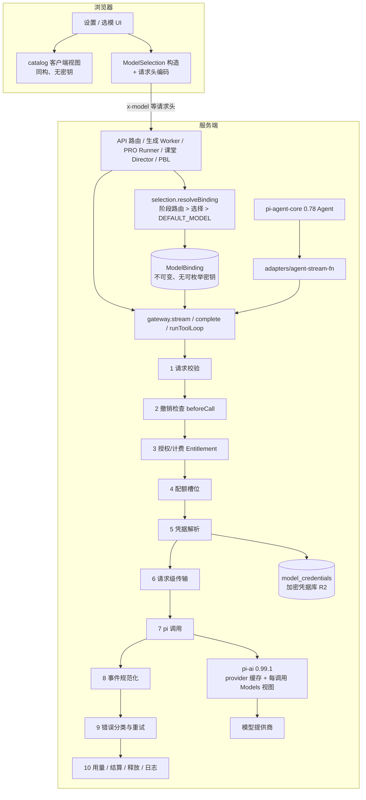

# 智域模型接入层重构：基于 pi-ai 的统一模型网关（可执行方案）

> **状态**：待执行的设计与实施计划。本文所有新模块、接口、表、开关均为"拟实施"，不是已完成事实。
>
> **与旧方案的关系**：本文取代 [2026-09-30-pi-ai-model-access-migration.md](./2026-09-30-pi-ai-model-access-migration.md) 作为执行依据。旧文档把 pi 放在 AI SDK 下面当 provider、长期保留 legacy transport 与按提供商灰度，属于补丁式迁移；它的调研结论（上游版本、OAuth 流程差异、错误语义风险）仍可作参考，但**不要按旧文档实施**。
>
> - 编写日期：2026-09-30
> - 审查基线：`eba5c5075cdaa65d4fee1809297cc7c2a4eca265`（main）
> - 上游版本：`@earendil-works/pi-ai@0.99.1`（npm `latest`，gitHead `d86654abb8862e201933517d6f1fce9f88dd117f`，要求 Node `>=22.19.0`）
> - 本文编写时只读代码、下载并检查了 pi-ai / pi-agent-core 0.99.1 发布包，没有修改业务代码、依赖或数据库，没有发起真实模型请求。

---

## 0. 执行约定（执行对话必须遵守）

1. **分支**：从 `main` 新建 `refactor/model-gateway`，所有阶段在该分支提交；R1 验收通过前不合并、不部署。
2. **不要触碰**：工作区里已有的未跟踪文件（`docs/competition/*`、`docs/plans/2026-09-27-*`、旧方案文档）不删除、不修改、不混入提交。
3. **Node**：系统默认 Node 是 18，不能跑 vitest / pnpm 脚本。每个新 PowerShell 会话先执行：
   ```powershell
   $env:Path = "C:\Users\Lenovo\.cache\codex-runtimes\codex-primary-runtime\dependencies\node\bin;" + $env:Path
   node -v   # 必须 >= 22.19.0
   ```
4. **提交粒度**：每个阶段内按"任务编号"提交；提交信息前缀 `refactor(model-gateway): Pn-x ...`。每次提交前至少跑该任务相关测试 + `pnpm exec tsc --noEmit -p tsconfig.build.json`。
5. **进度记录**：每完成一个阶段，更新第 10 节进度表并随该阶段最后一次提交一起提交。新对话从进度表继续。
6. **禁止的捷径**：大面积 `as unknown as`；为通过测试删除断言；`--no-verify`；手改 `node_modules`；用 `pnpm.overrides` 强改 pi-agent-core 的依赖；在网关之外直接调用 pi-ai 运行时。唯一允许的类型强转点在第 3.11 节列明。
7. **遇到阻断**：先定位并修正；只有"需要真实账号授权 / 真实 API Key / 产品取舍"才停下问用户，并说明具体需要什么。
8. **真实凭据**：测试一律用 fake HTTP/SSE 服务器或 pi 的 `fauxProvider`；`tests/setup-env.ts` 默认隔离本地密钥，不要为测试加载 `.env.local`。

---

## 1. 结论

### 1.1 推荐方案

**以 pi-ai 0.99.1 作为唯一的文本模型运行时，新建"模型网关（Model Gateway）"作为业务代码与模型之间的唯一边界；把所有文本 LLM 调用一次性迁移到网关，然后删除旧的 AI SDK 文本调用层。**

- 业务代码只认识三样东西：`ModelSelection`（选了什么）、`ModelBinding`（服务端解析后的不可变绑定）、`gateway.stream / complete / runToolLoop`（怎么调）。
- 提供商、认证、协议、思考参数、错误分类、重试、配额、用量、计费钩子全部在网关内部，按固定顺序执行。
- 厂商差异从代码（fetch 包装器、SSE 改写、中间件）变为**目录数据**（pi 的 `compat` / `thinkingFormat` / 少量 payload patch）。
- 智域默认模型 `zhiyu-default-text` 作为 `source: 'platform'` 的一等绑定保留；管线内置 `FundingSource` + `EntitlementPolicy` 钩子 + 用量计费字段，后续收费只需实现策略，不改调用链。
- pi-agent-core 保持 `0.78.0`（0.99 的 Session/存储契约已变，属于另一项迁移），通过网关提供的 `StreamFn` 适配器接入，去掉现在"pi → AI SDK → pi"的双重转换。
- 分两次发布：**R1** = 网关切换 + 大量新增 API Key / Token Plan / Coding Plan 提供商；**R2** = 订阅登录（OAuth）与凭据库。

### 1.2 与旧方案对比

| 维度 | 旧方案（pi 作为 AI SDK 下层 provider） | 本方案（统一模型网关） |
| --- | --- | --- |
| 普通调用链 | 业务 → AI SDK → LanguageModelV3 适配器 → pi → HTTP | 业务 → 网关 → pi → HTTP |
| PRO Agent 调用链 | pi Agent → AI SDK → 适配器 → pi → HTTP | pi Agent → 网关 StreamFn → pi → HTTP |
| 消息模型 | AI SDK、pi 0.78、pi 0.99 三套并存互转 | pi 消息模型一套；Agent 内核 0.78 只做结构兼容映射 |
| 旧实现去留 | legacy transport 长期保留，按 provider 灰度 | 切换后删除（见 3.15） |
| pi 版本 | npm 别名并存两份 pi-ai | 根依赖直接 0.99.1；Agent 内核自带嵌套 0.78 |
| 厂商差异 | 继续散落在 fetch 包装器 | 收敛为目录数据 |
| 订阅 | 另加 executionBinding / rollout 状态 | 凭据库 + pi `CredentialStore` 一条路径 |
| 代价 | 切换风险低、长期维护成本高 | 一次性迁移量大，用特征测试和阶段门槛控制 |

### 1.3 关键决策

| # | 决策 | 理由 |
| --- | --- | --- |
| D1 | 文本 LLM 只有一个运行时：pi-ai 0.99.1 | 消除三套消息模型互转和双栈维护 |
| D2 | `lib/model-gateway` 是唯一边界；ESLint 禁止业务直接 import pi-ai 运行时、`ai` 的 `generateText/streamText`、`@ai-sdk/*`（白名单见 3.2） | 耦合由工具强制，而非靠约定 |
| D3 | 规范消息格式采用 pi 的 `Message`/`AssistantMessage`/事件协议，但只通过 `lib/model-gateway/types.ts` 再导出 | 不再发明第四套格式；将来升级 pi 只改一处 |
| D4 | 应用 provider ID 稳定不改（`glm`、`kimi`、`grok`…），由目录映射到 pi provider 或自定义 descriptor | 设置、快照、路由、用量历史全部兼容 |
| D5 | 厂商差异 = 数据（descriptor + pi compat + 声明式 payload patch） | 删除 2000+ 行 fetch/SSE 补丁 |
| D6 | 进程级缓存 provider 实例；每次调用创建轻量 `Models` 视图，注入**密封 AuthContext**（pi 永远读不到 `process.env`） | 性能 + 防止平台密钥泄漏到用户请求 |
| D7 | 错误分类以请求级 `fetch` 侧通道（状态码、`retry-after`、网络错误码、是否已发送、是否已有输出）为准 | pi 会把 HTTP 错误折叠成 `errorMessage` 字符串 |
| D8 | 撤销检查、授权/计费、配额、凭据、传输、重试、用量、结算在网关管线内按固定顺序执行 | 取代 `llm.ts` + Proxy + AsyncLocalStorage 的隐式组合 |
| D9 | 智域默认模型是 `source:'platform'` 绑定；每次调用带 `FundingSource` | 满足 ADR-0011 按资金来源计量，为收费留接缝 |
| D10 | 凭据句柄不出现在 `ModelBinding` 的可枚举字段、日志、快照 | 当前 `ResolvedModel.apiKey` 暴露面过大 |
| D11 | 生成快照、PRO 连接的加密内容升级为 `ModelSelection`（读旧写新，纯函数升级器） | 三套历史 schema 收敛为一套 |
| D12 | pi-agent-core 保持 0.78.0，不在本轮升级 | 其 Session/存储契约变化会波及 PRO Runner，独立立项 |
| D13 | Claude 联网搜索（`lib/web-search/claude.ts`）和 ASR 不属于文本网关，保留各自的 AI SDK 调用 | 它们依赖 provider 内置工具 / 转写 API，pi 不覆盖 |
| D14 | **只有"订阅登录（OAuth）"这种认证方式**默认关闭、由运营白名单逐个开启；所有提供商的 API Key 方式始终内置可用，不受白名单影响（只能 OAuth 登录的 `github-copilot`、`openai-codex` 在未开启时不显示） | 各家订阅条款不同，是否允许在托管网站使用由产品负责人判断；API Key 是正规按量计费接口，无此问题 |
| D15 | 一次切换发布，不做按提供商双栈灰度；靠特征测试 + 发布前排空任务 + 镜像回滚 | 双栈正是"补丁式"的根源 |
| D16 | 本轮 API Key 存储方式不变（设置 KV + 请求头）；凭据库表结构支持 `api_key`，但 UI 仅用于 OAuth | 不在同一次发布里迁移线上用户密钥 |

---

## 2. 现状审查：耦合点清单

行号对应审查基线，仅用于定位。

| # | 耦合 | 证据 | 问题 | 重构去向 |
| --- | --- | --- | --- | --- |
| C1 | `providers.ts` 四合一 | [providers.ts](../../lib/ai/providers.ts)（2431 行）：静态目录 75–1571；浏览器读 `localStorage` 的 `getProviderConfig` 1574；厂商思考参数 `getCompatThinkingBodyParams` 1615；非流式转流式补丁 `fetchCustomOpenAIChat` 1897；工厂 `getModel` 2052 | 客户端设置和服务端运行时共用一个文件，任何服务端改动都可能进入浏览器包 | 目录 → `catalog/`（同构、无密钥）；工厂与补丁删除，由 pi + descriptor 数据取代 |
| C2 | 思考参数三处实现 + 隐式通道 | [llm.ts](../../lib/ai/llm.ts) 141 `buildThinkingProviderOptions`；providers.ts 2124 起 `compatFetch` 通过 `globalThis.__thinkingContext` 读取；[thinking-context.ts](../../lib/ai/thinking-context.ts) | 同一语义分散在 providerOptions、fetch 改 body、AsyncLocalStorage 三处 | `runtime/thinking.ts` 一处映射到 pi `reasoning`/`thinkingBudgets` + descriptor `compat` |
| C3 | `llm.ts` 职责混合 | llm.ts 326 `callLLM`：校验重试、用量、配额 Proxy、思考注入同在一个函数 | 顺序隐式、难测试 | 网关管线固定阶段（3.4） |
| C4 | `resolveModel` 职责混合 | [resolve-model.ts](../../lib/server/resolve-model.ts) 82–334：来源策略、阶段路由、SSRF、凭据、思考仲裁、SDK 实例化；`ResolvedModel.apiKey` 67 行对外暴露 | 业务可随意读取密钥；解析与实例化耦合 | `selection/resolve-binding.ts` 只产出不可变 `ModelBinding` |
| C5 | PRO Agent 双重转换 | [stream-fn.ts](../../lib/agent/runtime/stream-fn.ts) 449 行 pi → `streamLLM`；`toModelMessages` 604–612 丢弃用户图片、634–646 丢弃工具结果图片；自带 DNS 重试 499–533 | 延迟、信息丢失、签名无法往返 | `adapters/agent-stream-fn.ts` 直接 pi→pi |
| C6 | PRO 仅限 OpenAI 协议 | [agent-driver-model.ts](../../lib/server/agent-runtime/agent-driver-model.ts) 15、111–114；115–122 对所有模型删除 effort | 非 OpenAI 模型无法用于 PRO | 按模型能力判断（3.11） |
| C7 | 错误语义依赖 AI SDK 与字符串 | [llm-error-response.ts](../../lib/server/llm-error-response.ts) 依赖 `APICallError`；[verify-model](../../app/api/verify-model/route.ts) 97–113 用 `message.includes('401')` | 分类不可靠 | `GatewayError` 结构化 |
| C8 | 配额靠 Proxy 劫持 | [model-quota.ts](../../lib/server/generation-jobs/model-quota.ts) 包裹 `doGenerate/doStream`，每次动态 import 限流器 | 依赖 AI SDK 内部方法名 | 管线"配额"阶段显式持有槽位 |
| C9 | 三套持久化 schema | [model-connections.ts](../../lib/server/agent-runtime/model-connections.ts) 38–66（`providerType` 5 选 1、`api` 仅 OpenAI 两种）；[generation-model-snapshots.ts](../../lib/server/generation-model-snapshots.ts) v1/v2，平台分支写死 `zhiyu-default-text` | 新协议/认证方式无处表达 | 统一为 `ModelSelection`（3.14） |
| C10 | 目录能力弱 | [provider.ts](../../lib/types/provider.ts)：19 个内置 ID、5 种 `ProviderType`、认证只有 `requiresApiKey` 布尔 | 无法表达 Token Plan / 区域 / OAuth | `ProviderDescriptor`（3.3.6） |
| C11 | 测试耦合实现细节 | 71 个测试文件引用该层，其中 36 个 `vi.mock` 了 `llm`/`resolve-model`/`ai` | 重构时大量测试失效 | `testing/faux-gateway.ts` 基于 pi `fauxProvider` |

**必须保留的现有优点**（重构后行为不变）：阶段路由优先级（stage route > 客户端选择 > `DEFAULT_MODEL`）；平台默认模型 revision HMAC 与"未审核模型不继承平台策略"；托管模式下服务端密钥权威、客户端不能覆盖；SSRF 与连接期 DNS 固定（[pinned-fetch-agent.ts](../../lib/server/pinned-fetch-agent.ts)）；owner 配额上下文（[provider-call-context.ts](../../lib/server/generation-jobs/provider-call-context.ts)）；后台模式禁 SDK 重试；所有调用经单一入口记录用量；ESLint 入口守卫的理念。

---

## 3. 目标架构

### 3.1 分层



### 3.2 目录结构与依赖规则

```text
lib/model-gateway/
  types.ts                      # 同构；只做类型再导出（pi 消息/事件/Model）+ 应用 DTO
  catalog/                      # 同构；无密钥、不 import pi-ai 运行时
    descriptors.ts              # ProviderDescriptor：应用 ID → pi provider / 自定义协议、认证方式、端点配置、分组
    overlays.ts                 # 应用审核过的模型覆盖（显示名、思考能力、上下文、inlineThinkTags 等）；取代 model-metadata.ts
    generated/pi-models.json    # 脚本生成的精简目录（见 P2-1），提交入库
    client-catalog.ts           # 给设置 UI 的 ProviderConfig/ModelInfo 视图
    thinking-capability.ts      # 由 pi model 的 reasoning/thinkingLevelMap + overlay 推导 UI 用的 ThinkingCapability
  selection/                    # 服务端
    schema.ts                   # ModelSelection zod schema + 旧格式升级器（请求头、PRO v1、快照 v1/v2）
    read-request.ts             # 从请求头/body 读出 ModelSelection（所有路由唯一入口）
    resolve-binding.ts          # 产出 ModelBinding；阶段路由/平台默认/运维托管/用户选择
    platform.ts                 # 智域平台模型 → binding（复用 provider-config 的 resolvePlatformDefault）
  credentials/                  # 服务端
    handles.ts                  # CredentialHandle（WeakMap 私有存放）
    auth-context.ts             # 密封 AuthContext（默认不返回任何 env）
    vault.ts                    # model_credentials 仓储：加解密、行锁 modify（R2）
    credential-store.ts         # pi CredentialStore 的 owner+credential 作用域实现（R2）
  runtime/                      # 服务端
    pi-registry.ts              # 唯一 import pi-ai 运行时与 provider 工厂的模块；provider 实例缓存
    gateway.ts                  # stream / complete / runToolLoop 对外实现
    pipeline.ts                 # 3.4 的固定阶段
    transport.ts                # 请求级 fetch：SSRF、重定向、代理、侧通道
    thinking.ts                 # ThinkingConfig → pi 选项
    errors.ts                   # GatewayError 与分类
    retry.ts                    # 前台有界重试策略
    quota.ts                    # PostgresGenerationLimiter 集成（取代 model-quota Proxy）
    usage.ts                    # 用量记录（含 funding 字段）
    entitlement.ts              # EntitlementPolicy 接口 + 默认放行实现
    think-tag-splitter.ts       # 行内 <think> 拆分（descriptor 标记启用）
    images.ts                   # 图片来源 → base64（受控下载）
    tool-loop.ts                # runToolLoop（PBL 等多步工具）
  auth/                         # 服务端，R2
    login-sessions.ts           # OAuth 登录会话执行器
    policy.ts                   # MODEL_OAUTH_PROVIDERS 白名单与部署能力
  adapters/                     # 服务端
    agent-pi-types.ts           # 由 pi-agent-core 0.78 导出类型推导的互操作类型
    agent-legacy-pi.ts          # 加载 agent-core 自己使用的 pi-ai 0.78 实例（压缩注册表、事件流工厂）
    agent-stream-fn.ts          # pi-agent-core StreamFn over gateway
    langchain.ts                # LangGraph BaseChatModel over gateway
  testing/
    faux-gateway.ts             # 基于 pi fauxProvider 的测试网关
    fake-openai-server.ts       # 本地 OpenAI/Anthropic 兼容 SSE 假服务器（错误、限流、断流）
  index.ts                      # 服务端公开 API
```

**依赖规则（ESLint 强制，P3-5 落地）：**

| 模块 | 可以 import | 不可以 import |
| --- | --- | --- |
| 客户端代码（`components/`、`lib/store/`、`lib/utils/`、`app/**/page.tsx`） | `model-gateway/types`（仅类型）、`model-gateway/catalog/*` | `model-gateway` 其余部分、pi-ai |
| 服务端业务代码 | `@/lib/model-gateway`、`types`、`catalog` | `@earendil-works/pi-ai`（值导入）、`ai` 的 `generateText/streamText`、`@ai-sdk/*` |
| `model-gateway/runtime/pi-registry.ts`、`adapters/*`、`testing/*` | pi-ai 运行时 | — |
| `model-gateway/types.ts` | pi-ai（`import type` only） | pi-ai 值导入 |
| pi-agent-core 互操作代码 | `adapters/agent-pi-types.ts`、`adapters/agent-legacy-pi.ts` | 从 pi-ai 根导入类型或运行时值再交给 Agent 内核 |
| 例外（保留 AI SDK） | `lib/web-search/claude.ts`、`lib/audio/asr-providers.ts`、UI 类型（`UIMessage` 等） | — |

### 3.3 核心契约

以下为目标接口，字段名可按实现微调，但语义不可变。

#### 3.3.1 ModelSelection（客户端意图，服务端校验）

```ts
// selection/schema.ts
export type WireApi =
  | 'openai-completions' | 'openai-responses' | 'anthropic-messages'
  | 'google-generative-ai' | 'mistral-conversations' | 'azure-openai-responses'
  | 'bedrock-converse-stream';   // 实际允许集合由 descriptor 决定

export type ModelSelection =
  | { source: 'platform'; defaultId: TextPlatformDefaultId; revision?: string; thinking?: ThinkingConfig }
  | { source: 'legacy-managed'; providerId: string; modelId: string; thinking?: ThinkingConfig } // 运维托管
  | { source: 'user'; providerId: string; modelId: string; connection: UserConnection; thinking?: ThinkingConfig };

export type UserConnection =
  | { auth: 'api-key'; apiKey: string; baseUrl?: string; api?: WireApi; endpointProfile?: string }
  | { auth: 'credential'; credentialId: string; endpointProfile?: string }   // R2 OAuth
  | { auth: 'none'; baseUrl: string; api?: WireApi };                        // 本地免密
```

- 字面量 `legacy-managed` 保留（已持久化在设置与快照中），语义为"运维托管的 provider"。
- 请求线格式沿用现有头：`x-model`、`x-api-key`、`x-base-url`、`x-provider-type`、`x-model-source`、`x-platform-default-id`；新增 `x-model-api`、`x-model-credential-id`、`x-model-endpoint-profile`。所有路由只能通过 `selection/read-request.ts` 读取，旧的 `x-provider-type` 在升级器里映射为 `api`（`openai`→`openai-completions`，`anthropic`→`anthropic-messages`，`azure`→`azure-openai-responses`，`google`→`google-generative-ai`，`bedrock` 只允许运维托管）。
- 同一选择里 `apiKey` 与 `credentialId` 互斥，zod 层拒绝。

#### 3.3.2 ModelBinding（服务端解析结果）

```ts
export interface ModelBinding {
  readonly source: 'platform' | 'user' | 'legacy-managed';
  readonly routedStage?: LlmStage;            // 由 MODEL_ROUTES 选中时
  readonly providerId: string;                // 应用 ID
  readonly modelId: string;
  readonly modelString: string;               // 'deepseek:deepseek-flash' 或 'platform:zhiyu-default-text'
  readonly defaultId?: TextPlatformDefaultId;
  readonly revision?: string;
  readonly model: Readonly<PiModel>;          // 已解析：baseUrl、api、compat、contextWindow、maxTokens、input
  readonly capabilities: {
    tools: boolean | 'unknown'; vision: boolean; reasoning: boolean;
    contextWindow: number; maxOutputTokens?: number; knownModel: boolean;
  };
  readonly thinking?: ThinkingConfig;         // 仲裁后的有效思考配置
  readonly funding: FundingSource;
  readonly endpoint: 'official' | 'operator' | 'user' | 'local';
  readonly credentialReady: boolean;          // 取代业务读取 apiKey 判空
  readonly fingerprint: string;               // 非密钥字段的哈希，用于日志/诊断
}
```

- 凭据句柄存放在 `credentials/handles.ts` 的模块私有 `WeakMap<ModelBinding, CredentialHandle>`；`JSON.stringify`、展开运算、日志都拿不到。
- `ModelBinding` 用 `Object.freeze` 冻结；业务不能改 `thinking` 等字段，需要变化时调用 `withThinking(binding, cfg)` 生成新绑定（PRO 驱动需要）。

```ts
type CredentialHandle =
  | { kind: 'inline-key'; apiKey: string }
  | { kind: 'operator'; providerId: string }                 // server-providers.yml / env
  | { kind: 'platform'; defaultId: TextPlatformDefaultId; revision: string }
  | { kind: 'vault'; ownerId: string; credentialId: string } // R2
  | { kind: 'none' };
```

#### 3.3.3 网关调用接口

```ts
export interface GatewayRequest {
  system?: string;
  messages: GatewayMessage[];                 // pi Message；提供 userText()/userContent() 构造器补 timestamp
  tools?: GatewayTool[];                      // pi Tool（JSON Schema 参数）
  toolChoice?: 'auto' | 'none';               // pi 只支持这两种；业务当前也只用 auto
  maxOutputTokens?: number | 'model-default' | 'omit';
  temperature?: number;
}
export interface GatewayCallOptions {
  source: string;                             // 阶段/用途标签：用量、日志、限流分组
  signal?: AbortSignal;
  beforeCall?: () => Promise<void>;           // 撤销围栏（PRO assertActive）
  retry?: 'default' | 'none';                 // 后台部署强制 none
  sessionId?: string;                         // 提示缓存亲和
  usage?: { jobId?: string; sessionId?: string; requestId?: string; eventKey?: string };
}
export interface CompleteOptions extends GatewayCallOptions {
  validate?: (text: string) => boolean;       // 取代 callLLM 的 retryOptions
  validateRetries?: number;
}
export interface ModelGateway {
  stream(binding: ModelBinding, req: GatewayRequest, opts: GatewayCallOptions): GatewayStream;
  complete(binding: ModelBinding, req: GatewayRequest, opts: CompleteOptions): Promise<GatewayResult>;
  runToolLoop(binding: ModelBinding, req: ToolLoopRequest, opts: GatewayCallOptions): ToolLoopStream;
}
export interface GatewayStream extends AsyncIterable<GatewayStreamEvent> {
  textStream(): AsyncIterable<string>;
  result(): Promise<GatewayResult>;           // error/aborted 时 reject GatewayError
}
export interface GatewayResult {
  message: AssistantMessage;                  // pi 0.99 形状，含签名字段
  text: string; reasoningText: string; toolCalls: ToolCall[];
  stopReason: 'stop' | 'length' | 'toolUse';
  usage: NormalizedUsage;                     // 语义与现有 lib/usage/normalize.ts 一致
  attempts: number;
}
```

- 流迭代遵循 pi 语义：终止事件为 `done` 或 `error`（`error` 事件里携带 `GatewayError`），**迭代本身不抛异常**；`complete()` / `result()` 失败时抛 `GatewayError`（与现在 `callLLM` 抛异常的习惯一致）。
- `userContent(text, images)` 的图片统一经 `runtime/images.ts`：data URI 直接解码；http(s) URL 用现有受控下载（`bounded-download.ts` + SSRF）拉取并限制大小；其余拒绝。现在 AI SDK 会自行下载图片 URL，这是一个隐性 SSRF 面，重构后收口。

#### 3.3.4 错误

```ts
export type GatewayErrorCode =
  | 'MODEL_CONFIGURATION'        // 选择无法解析、缺 key、provider 未启用
  | 'MODEL_UNSAFE_ENDPOINT'      // SSRF/重定向拒绝
  | 'MODEL_AUTH_FAILED'          // 401/403
  | 'MODEL_REAUTH_REQUIRED'      // OAuth 刷新失败，需要重新登录（R2）
  | 'MODEL_ENTITLEMENT_DENIED'   // 计费策略拒绝（未来 402）
  | 'MODEL_RATE_LIMITED'         // 429
  | 'MODEL_NOT_FOUND'            // 404 模型/端点
  | 'MODEL_BAD_REQUEST'          // 400/422
  | 'MODEL_CONTEXT_OVERFLOW'     // pi isContextOverflow
  | 'MODEL_CONTENT_FILTERED'
  | 'MODEL_UPSTREAM_UNAVAILABLE' // 5xx
  | 'MODEL_NETWORK'              // DNS/连接/重置
  | 'MODEL_TIMEOUT'
  | 'MODEL_ABORTED';
export class GatewayError extends Error {
  code: GatewayErrorCode; status?: number; retryAfterMs?: number;
  requestSent: boolean; outputObserved: boolean; safeToRetry: boolean;
  providerId: string; modelId: string;
  /** 兼容 limiter.ts 现有读取方式 */ get statusCode(): number | undefined;
  /** 兼容 limiter.ts 现有读取方式 */ get responseHeaders(): Record<string, string>;
}
```

`message` 只放脱敏后的固定文案；上游响应体、URL、请求头永不进入 `message` 或日志。

#### 3.3.5 资金来源与计费钩子（为收费留接缝）

```ts
export type FundingSource =
  | { kind: 'platform'; defaultId: TextPlatformDefaultId; revision: string }
  | { kind: 'operator' }                      // 运维托管的 provider（部署方付费）
  | { kind: 'byok' }                          // 用户 API Key
  | { kind: 'subscription'; credentialId: string } // 用户订阅（R2）
  | { kind: 'local' };

export interface EntitlementPolicy {
  /** 仅 funding.kind === 'platform' 时调用；拒绝时抛 GatewayError('MODEL_ENTITLEMENT_DENIED') */
  authorize(ctx: { ownerId?: string; binding: ModelBinding; source: string }): Promise<EntitlementGrant>;
  /** 每次上游尝试结束后调用一次（成功/失败/中止都调用），携带用量与估算成本 */
  settle(grant: EntitlementGrant, outcome: {
    status: 'ok' | 'error' | 'aborted'; usage: NormalizedUsage; estimatedCostUsd?: number;
  }): Promise<void>;
}
```

- 本轮只实现 `AllowAllEntitlementPolicy`（放行、结算为空操作），通过 `runtime/entitlement.ts` 的 `setEntitlementPolicy()` 在进程启动时注入。未来积分/扣费只需实现新策略。
- 按 ADR-0011：BYOK / 订阅 / 本地调用不调用 `authorize`，但仍受配额约束、仍记录用量。

#### 3.3.6 ProviderDescriptor（目录）

```ts
export interface ProviderDescriptor {
  id: string;                                 // 应用 ID，稳定
  name: string; icon?: string;
  group: 'official' | 'china' | 'aggregator' | 'coding-plan' | 'subscription' | 'local' | 'enterprise';
  upstream:
    | { kind: 'pi'; piProviderId: string; profiles?: Record<string, { piProviderId: string; label: string }> }
    | { kind: 'custom'; api: WireApi; defaultBaseUrl?: string; compat?: Record<string, unknown> };
  auth: Array<'api-key' | 'oauth' | 'none' | 'ambient'>;   // ambient = AWS/ADC，仅运维
  userConfigurable: boolean;                  // false = 只能运维托管（bedrock、vertex）
  allowCustomBaseUrl: boolean;
  allowedApis?: WireApi[];                    // 自定义协议可选范围
  modelDiscovery: 'catalog' | 'openai-models' | 'pi-refresh' | 'manual';
  inlineThinkTags?: boolean;                  // 需要拆分内容里的 <think>
  payloadPatches?: PayloadPatchId[];          // 声明式补丁（极少数），实现集中在 runtime/thinking.ts
  legacyProviderType?: 'openai' | 'azure' | 'anthropic' | 'bedrock' | 'google'; // 旧设置兼容
  docsUrl?: string;
}
```

### 3.4 调用管线（固定顺序）

`gateway.stream()` 对每次调用执行：

1. **请求校验**：工具 schema 合法；图片输入但 `capabilities.vision === false` → 移除图片并记 warning（与 pi 行为一致，但显式记录）；`toolChoice` 仅 `auto|none`。
2. **撤销围栏**：`opts.beforeCall?.()`（PRO 连接撤销、账号有效性）。
3. **授权/计费**：`funding.kind === 'platform'` 时 `entitlement.authorize()`。
4. **配额**：仅当 `GENERATION_BACKGROUND_ENABLED === '1'` 且不在已持有配额的上下文中（沿用 `generationQuotaActive()`），用 `PostgresGenerationLimiter.run('llm', 'deployment', …)` 取得槽位，**持有到流终止**（done/error/abort/消费方取消）；owner 取自 `getProviderQuotaOwner()`。
5. **凭据解析**：按 `CredentialHandle` 产出 `{ apiKey?, env?, credentialStore?, baseUrlOverride? }`；vault 句柄每次调用读取状态（撤销立即生效）。
6. **请求级传输**：`transport.ts` 为本次调用创建 `fetch` 与侧通道（3.8）。
7. **pi 调用**：`models.streamSimple(model, context, { apiKey, fetch, signal, maxRetries: 0, timeoutMs, reasoning, thinkingBudgets, maxTokens, toolChoice, temperature, sessionId, onPayload })`。
8. **事件规范化**：`inlineThinkTags` 拆分；`stopReason=length` 时移除未完成的工具调用；过滤空文本块。
9. **终止与重试**：结合侧通道与 pi 终止消息生成 `GatewayError`；满足 3.8 重试条件则回到第 5 步。
10. **收尾**（每次上游尝试各执行一次）：记录用量（含 funding、估算成本）→ `entitlement.settle()` → 释放配额 → 输出一行结构化日志（`event:'llm_call'`、source、providerId、modelId、api、funding.kind、ttftMs、durationMs、status、errorCode、attempt、requestSent）。

`complete()` = `stream()` + 聚合 + 可选 `validate` 重试（后台部署强制 1 次，与现有 `callLLM` 相同）。

### 3.5 pi 运行时装配（性能关键）

- `pi-registry.ts` 在模块级缓存 provider 实例：pi 内置 provider 用其工厂（`@earendil-works/pi-ai/providers/<id>`，按需动态 import）；自定义 descriptor 用 `createProvider({ id, auth: keyless/explicit, models: [], api: <lazy api> })` 构造一次。
- 每次调用：`createModels({ credentials, authContext: sealedAuthContext })` + `setProvider(cachedProvider)`。P1 基准要求这一步 p50 < 0.2 ms；若超标，改为自行解析 auth 后直接调用 `provider.streamSimple(requestModel, normalizeContext(ctx), options)`（仅内联 key / 运维 / 平台路径；OAuth 路径必须经 `Models` 以获得锁内刷新）。
- **密封 AuthContext**：`env()` 默认一律返回 `undefined`，`fileExists()` 返回 `false`。只有运维托管的 `amazon-bedrock` / `google-vertex` 绑定使用放行 `AWS_*`、`BEDROCK_*`、`GOOGLE_*`、`GCLOUD_*` 前缀的 AuthContext。
- HTTP 连接复用：官方端点用全局 `fetch`（undici 默认连接池）；用户自定义端点用一个进程级的 SSRF 固定 DNS `Agent`（基于 `pinned-fetch-agent.ts` 的 lookup，但超时改为 LLM 适用：`headersTimeout` 120 s、`bodyTimeout` 300 s），避免每次调用额外 DNS 往返且连接可复用。
- 预热：`instrumentation.ts`（nodejs runtime）启动后非阻塞地 `import()` 平台默认模型对应的 pi API 模块（DeepSeek → `api/openai-completions`），消除首个请求的冷启动。
- 不再有请求体 JSON 反复 parse/stringify（现在 compatFetch 对同一请求体会为思考参数、Kimi 回放、流式判断、Lemonade 分别重复解析）；需要改 payload 时用 pi 的 `onPayload` 直接改对象。
- 用量记录保持异步 fire-and-forget；vault 读取只发生在 OAuth 路径（一次索引查询）。

### 3.6 提供商映射

**现有 19 个应用 ID（全部保留）：**

| 应用 ID | 上游 | wire API | 说明 / 需特征测试核对的点 |
| --- | --- | --- | --- |
| `openai` | pi `openai` | openai-responses | 自定义 baseUrl 时视为 OpenAI 兼容网关（custom，openai-completions），与现状一致；`deepseek-v4-flash-vision-exp` 的 `chat_template_kwargs.thinking` 改为 overlay 数据 |
| `azure` | pi `azure-openai-responses` | azure-openai-responses | baseUrl、apiVersion、部署名一律经请求选项显式传入（`azureBaseUrl` 等），**不得**依赖 `AZURE_OPENAI_*` 环境变量回退（见 P2-7）；核对部署名与 URL 规范化 |
| `atlascloud` | custom | openai-completions | |
| `anthropic` | pi `anthropic` | anthropic-messages | R2 可选 OAuth（默认关闭） |
| `bedrock` | pi `amazon-bedrock` | bedrock-converse-stream | **仅运维托管**（决策 2026-10-01）：descriptor `userConfigurable=false`，用户选择报 `MODEL_CONFIGURATION`；ambient AWS 凭据只对运维端点绑定开放；region 显式传入；不允许用户自带 Bedrock key（见 P2-6） |
| `google` | pi `google` | google-generative-ai | pi 该适配器**拒绝自定义 fetch**，请求绕过网关传输层（SSRF/DNS 固定/禁重定向/代理均不生效）。决策 2026-10-01：端点锁定为官方 `generativelanguage.googleapis.com`，用户自定义 baseUrl 在发送前拒绝（`MODEL_UNSAFE_ENDPOINT`），需要中转的用户改用 OpenAI 兼容类型；运维为 google 配置代理时启动即报错而非静默直连；错误分类优先用 SDK 结构化字段，消息匹配兜底（见 P2-6） |
| `deepseek` | pi `deepseek` | openai-completions | thinkingFormat `deepseek`；平台默认模型的上游 |
| `qwen` | custom（DashScope） | openai-completions | `thinkingFormat:'qwen'` + `thinkingTokenBudgetField:'thinking_budget'` |
| `kimi` | pi `moonshotai` / `moonshotai-cn`（profile） | openai-completions | kimi-k3 推理回放由 pi `requiresReasoningContentOnAssistantMessages` 处理，删除 Kimi 专用中间件前必须有特征测试 |
| `minimax` | pi `minimax` / `minimax-cn`（profile） | anthropic-messages | `sk-cp-` 前缀 key 当前走 Bearer `authToken`，需核对 pi 行为，不一致时用 descriptor 声明 header 处理 |
| `glm` | custom（open.bigmodel.cn 普通 API） | openai-completions | `thinkingFormat:'zai'`；**不要**映射到 pi `zai`（那是 Coding Plan） |
| `siliconflow` | custom | openai-completions | `thinkingFormat:'qwen'`、budget 字段 `thinking_budget`；`inlineThinkTags` 视模型 |
| `doubao` | custom | openai-completions | `thinking:{type:auto/enabled/disabled}`；effort 型模型 `reasoning_effort`（含 `minimal` 表示关闭）→ 可能需要一个声明式 payload patch |
| `openrouter` | pi `openrouter` | openai-completions | thinkingFormat `openrouter`；模型发现 `pi-refresh`/`openai-models`；R2 可选 OAuth（铸造用户 key） |
| `grok` | pi `xai` | **openai-responses**（现为 chat） | 协议变化，需特征测试；R2 可选 OAuth |
| `tencent-hunyuan` | custom | openai-completions | `chat-template` + `chatTemplateKwargs.reasoning_effort` 与 `thinkingLevelMap`（off→`no_think`） |
| `xiaomi` | pi `xiaomi` | openai-completions | thinkingFormat `deepseek` |
| `lemonade` | custom，`auth:['none']` | openai-completions | `supportsUsageInStreaming:false`、`chat-template` `enable_thinking`/`thinking_budget` |
| `ollama` | custom，`auth:['none']` | openai-completions | `supportsDeveloperRole:false`、`supportsReasoningEffort:false`、`inlineThinkTags:true` |

**新增（应用 ID 与 pi ID 相同，除非与现有语义冲突）：**

- 官方 / 聚合 API Key：`groq`、`cerebras`、`mistral`、`together`、`fireworks`、`huggingface`、`nvidia`、`baseten`、`vercel-ai-gateway`、`cloudflare-ai-gateway`、`cloudflare-workers-ai`、`opencode`、`opencode-go`、`meta`、`ant-ling`、`google-vertex`（仅运维）。
- Coding / Token Plan（API Key）：`zai-coding`（→ pi `zai`）、`zai-coding-cn`、`kimi-coding`、`qwen-token-plan`、`qwen-token-plan-cn`、`qwen-token-plan-individual`、`xiaomi-token-plan-cn`、`xiaomi-token-plan-ams`、`xiaomi-token-plan-sgp`。
- 订阅（R2，OAuth，默认关闭）：`github-copilot`、`openai-codex`、以及上表中 `openai`、`anthropic`、`grok`、`openrouter`、`kimi-coding`、`meta` 的 OAuth 认证方式。

pi 0.99.1 设备码（device-code）流程：`github-copilot`、`kimi-coding`、`xai`、`meta`、`openai-codex`、`radius`——适合托管网站。回调流程：`openai`（固定 `127.0.0.1:1455`）、`anthropic`（固定 `localhost:53692`）——托管环境只能用"粘贴最终跳转地址"的手动路径。

大型聚合目录（openrouter 398、vercel-ai-gateway 252、bedrock 176、opencode、huggingface 等）**不整表**打进客户端目录：生成脚本只写入精选短名单，其余靠模型发现或手动输入。

### 3.7 思考（Thinking）映射

保留用户侧 `ThinkingConfig`（mode / effort / level / budgetTokens / excludeReasoningOutput）语义不变，映射集中在 `runtime/thinking.ts`：

| ThinkingConfig | pi 选项 |
| --- | --- |
| `mode:'disabled'` 或 `effort:'none'` | 不传 `reasoning`（pi 对支持的 format 会显式发送关闭，例如 deepseek `thinking:{type:'disabled'}`、OpenAI `thinkingLevelMap.off='none'`） |
| `effort: minimal…max` | `reasoning` 同名等级，经 `clampThinkingLevel(model, level)` |
| `level`（Gemini） | `reasoning` 同名等级 |
| `budgetTokens` | 当前等级的 `thinkingBudgets[level]`；Anthropic 预算型模型用 API 级 `thinkingBudgetTokens` |
| `mode:'enabled'` 无 effort | 模型能力的默认等级（overlay `defaultEffort` → 否则 `medium`） |
| `mode:'default'` / 未设置 | **注意语义差异**：pi 不传 `reasoning` 即"关闭"。网关规则：若模型能力 `defaultEnabled` 为真，则发送其默认等级；否则关闭。以特征测试锁定每个 thinkingFormat 的旧行为 |
| `mode:'auto'`（doubao） | 声明式 payload patch `doubao-thinking-auto` |
| `excludeReasoningOutput`（openrouter） | payload patch `openrouter-exclude-reasoning` |
| 全局 `LLM_THINKING_DISABLED=true` | 视同 `mode:'disabled'`（与现状一致） |

阶段路由与平台默认模型的思考仲裁规则**完全沿用** `resolve-model.ts` 291–318 行的逻辑，搬到 `resolve-binding.ts`。

**未知模型的输出上限**：pi `streamSimple` 在未传 `maxTokens` 时会把 `model.maxTokens` 发上线。网关规则：
- 目录已知模型：`'model-default'` = 目录 `maxTokens`（与现在业务传 `outputWindow` 等价）。
- 未知/手填模型：`maxOutputTokens` 默认 `'omit'`；openai-* 协议通过 `onPayload` 删除 `max_tokens`/`max_completion_tokens`/`max_output_tokens`；`anthropic-messages` 协议必填，保留 descriptor 或 8192 默认值。PRO 驱动的"内部压缩预留"与线上上限分离（沿用 `agent-driver-model.ts` 的设计意图）。

### 3.8 错误、重试与配额

**请求级传输侧通道**（`transport.ts`，每次上游尝试一个对象，不使用全局变量）：记录 `requestSent`（是否已写出请求）、首个响应的 `status` 与白名单响应头（`retry-after`、`retry-after-ms`、`x-request-id`、`request-id`）、网络错误 `cause.code`（`EAI_AGAIN`/`ENOTFOUND`/`ECONNRESET`/`ETIMEDOUT`…）、首字节时间。

- 用户端点：每个请求 URL 都经 SSRF 校验；`redirect:'error'`；连接期 DNS 固定。
- 运维端点：允许运维配置的代理（`proxy` → undici `ProxyAgent`）；不做私网拦截（运维信任），与现状一致。
- OAuth 凭据只能发往该 provider 官方或 `toAuth()` 派生的端点，用户不能为 OAuth 连接填写 baseUrl。

**分类优先级**：侧通道状态码 > 网络错误码 > pi `isContextOverflow()` > pi `stopReason`/`errorMessage` 模式匹配（仅用于无侧通道的 google/bedrock）。

**重试**（`retry.ts`，pi 与 SDK 的内部重试一律 `maxRetries:0`）：

| 条件 | 前台（默认） | 后台部署 / `retry:'none'` |
| --- | --- | --- |
| `requestSent=false` 的 DNS/连接失败 | 最多 2 次，延迟 1 s / 3 s（取代 stream-fn 的 DNS 重试） | 最多 2 次（请求未发出，安全） |
| 429 且 `retryAfterMs ≤ 10 s`、未观察到输出 | 最多 2 次 | 0 次（交给队列/limiter 冷却） |
| 5xx / 网络中断、未观察到输出 | 最多 2 次，指数退避 | 0 次 |
| 已观察到任何输出 | 0 次（不换 provider、不重放） | 0 次 |
| 401/403/400/404/上下文溢出 | 0 次 | 0 次 |

**配额**：`quota.ts` 用现有 `PostgresGenerationLimiter`；429 冷却读取 `GatewayError.retryAfterMs`（同时保留 `statusCode`/`responseHeaders` getter 兼容现有 `limiter.ts` 读取逻辑，P3-5 再把 limiter 改为直接识别 `GatewayError`）。

**对外 HTTP 映射**：`llm-error-response.ts` 改为 `GatewayError → apiError`：`MODEL_RATE_LIMITED`→429 `RATE_LIMITED`；`MODEL_AUTH_FAILED`/`MODEL_REAUTH_REQUIRED`→401/403 `UPSTREAM_AUTH`；`MODEL_ENTITLEMENT_DENIED`→402；5xx/网络→502/503；`MODEL_CONFIGURATION`→400。`verify-model` 的字符串匹配删除。

### 3.9 用量、智域默认模型与收费接缝

- `runtime/usage.ts` 把 pi `Usage` 转为现有 `NormalizedUsage`，**保持现有语义**：`inputTokens = input + cacheRead + cacheWrite`（AI SDK 口径包含缓存；以 `stream-fn.ts` 310–326 行的反向换算为证），`reasoningTokens = usage.reasoning ?? 0`。用固定原始 usage fixture 测试，不允许重复计入缓存。
- 用量记录新增字段（P4 迁移）：`funding_kind`、`platform_default_id`、`platform_revision`、`credential_kind`、`api`、`status`（ok/error/aborted）、`estimated_cost_usd`（pi `calculateCost(model, usage)`，订阅/自定义模型可为空；只是估算，不代表账单）。
- 智域默认模型：`resolvePlatformDefault()`（`provider-config.ts` 702 行）继续作为唯一权威（revision HMAC、启用状态、未审核模型拦截全部不变）；`selection/platform.ts` 用它构造 binding：上游 pi 模型 `deepseek/deepseek-flash`，但 **platform parameters 优先于目录**（上下文 1048576、输出 393216、思考能力 effort `none/high/max`、默认关闭思考）。
- 泛化：网关代码中不得硬编码 `zhiyu-default-text`；`TextPlatformDefaultId` 由 `PLATFORM_DEFAULT_DEFINITIONS` 中 `capability === 'text'` 的条目推导。将来新增 `zhiyu-pro-text` 等只需加定义。
- 平台调用失败时**绝不回退**到用户 key 或其他平台模型；用户 OAuth 失败也绝不回退到平台 key。

### 3.10 凭据库与订阅登录（R2）

**表**（经现有 accounts 迁移机制新增，版本号取实施时下一个可用值；位置、角色授权、RLS、账号删除清理照抄 `pro_model_connections` 的做法，见 [model-connections.ts](../../lib/server/agent-runtime/model-connections.ts)、[sql-rls.ts](../../lib/server/accounts/sql-rls.ts)、[deletion.ts](../../lib/server/accounts/deletion.ts)；web 与 generation worker 都必须能以 owner 绑定方式读取）：

| 表 | 关键字段 |
| --- | --- |
| `model_credentials` | `id uuid`、`owner_id`、`provider_id`（应用 ID）、`pi_provider_id`、`auth_kind`（`oauth`/`api_key`）、`status`（`active`/`reauth_required`/`revoked`）、`account_label`（脱敏）、`ciphertext`、`key_version`、`secret_version int`、`expires_at`、`created_at/updated_at/revoked_at` |
| `model_auth_sessions` | `id`、`owner_id`、`provider_id`、`status`（`pending`/`awaiting_user`/`complete`/`failed`/`cancelled`/`expired`/`interrupted`）、`challenge`（auth URL / 设备码 / 说明，非秘密）、`input_ciphertext`（一次性用户输入，消费即删）、`executor_id`、`lease_until`、`credential_id`、`error_code`、`expires_at` |

- 加密：AES-256-GCM，AAD = `['model-credential:v1', ownerId, credentialId, secretVersion]`；密钥新增环境变量 `MODEL_CREDENTIAL_ENCRYPTION_KEY`（64 位 hex，与 `PRO_MODEL_ENCRYPTION_KEY` 同格式），`key_version` 支持轮换。密文保存 pi 返回的完整 `OAuthCredential`。
- `credential-store.ts`：实现 pi `CredentialStore`，作用域固定为 `(ownerId, credentialId)`，对该 provider 只暴露这一条凭据。`modify()` = 事务内 `SELECT … FOR UPDATE`（`lock_timeout` 10 s）→ 校验 `status='active'` → 执行 `fn(current)`（刷新有 20 s 信号上限）→ `secret_version+1` 原子写回。撤销（`DELETE /api/model-credentials/:id`）同样拿行锁置 `revoked`，因此并发刷新不能复活已撤销凭据。刷新失败且为 `invalid_grant` 类 → `reauth_required`；临时网络错误不改状态。
- 登录执行器（`auth/login-sessions.ts`）：运行在 Next.js 长驻 Node 进程（与 PRO Agent Runner 同一进程模型），用 pi `models.login(providerId, 'oauth', interaction, { getDeviceId })`；`interaction.notify` 把 `auth_url`/`device_code`/`progress` 写入会话行；`interaction.prompt` 轮询会话行的一次性输入（支持多副本：任意副本接收 POST，执行器所在副本读取）。每 owner 每 provider 同时最多 1 个会话；进程最多 20 个；会话 TTL 10 分钟；进程重启时未完成会话标记 `interrupted`。完成时在短事务里校验会话仍 `pending/awaiting_user` 且 owner 有效，再写入凭据。
- `getDeviceId`：部署级稳定 UUID，存放在服务端配置（新增 `MODEL_OAUTH_DEVICE_ID`，缺省时首次生成并持久化到数据库配置行），多副本共享同一值。
- 策略：`MODEL_OAUTH_PROVIDERS`（逗号分隔应用 ID，默认空）+ 部署能力（有 hosted auth、有数据库、有加密密钥）共同决定 UI 是否显示订阅登录入口。该开关**只控制登录方式**，不影响任何提供商的 API Key 配置。
- API：`GET /api/model-credentials`、`DELETE /api/model-credentials/:id`、`POST /api/model-auth/:providerId/start`、`GET /api/model-auth/sessions/:id`、`POST /api/model-auth/sessions/:id/input`、`DELETE /api/model-auth/sessions/:id`；全部经现有 `hostedAuthGate`/owner 防护，响应 `Cache-Control: no-store`，不返回任何 token。
- 后台任务：快照只存 `credentialId`；worker 每次出站前经 vault 读取当前 token（刷新不改变快照、不触发 `GENERATION_CONFIG_CHANGED`）；撤销后下一次出站即失败为 `MODEL_REAUTH_REQUIRED`/`MODEL_AUTH_FAILED`，不回退平台 key。

### 3.11 PRO Agent、课堂 Director 与 pi-agent-core 0.78

- **版本共存**：根 `package.json` 把 `@earendil-works/pi-ai` 升到 `0.99.1`；`@earendil-works/pi-agent-core` 保持 `0.78.0`。后者依赖声明为 `"@earendil-works/pi-ai": "^0.78.0"`（0.x 的 caret 不含 0.99），pnpm 会为它安装嵌套的 0.78.x。**不需要 npm 别名，也不得用 overrides 改它。**
- **互操作类型**（`adapters/agent-pi-types.ts`）：全部从 pi-agent-core 自己的导出推导，不从根 pi-ai 取类型传给 Agent 内核：
  ```ts
  import type { StreamFn, AgentMessage } from '@earendil-works/pi-agent-core';
  export type AgentLlmModel = Parameters<StreamFn>[0];
  export type AgentLlmContext = Parameters<StreamFn>[1];
  export type AgentStreamOptions = NonNullable<Parameters<StreamFn>[2]>;
  export type AgentEventStream = Awaited<ReturnType<StreamFn>>;
  export type AgentAssistantMessage = Extract<AgentMessage, { role: 'assistant' }>;
  ```
  现在从根 pi-ai 导入类型的 8 个文件（`build-agent.ts`、`run-native-child.ts`、`stream-fn.ts`、`director-compaction.ts`、`agent-driver-model.ts`、`resume.ts`、`skill-preload.ts`、`tool-call-integrity.ts`）改为从这里导入。
- **旧内核的 pi 运行时实例**（`adapters/agent-legacy-pi.ts`，关键）：pi-agent-core 0.78 的 `compact()`/`generateSummary()` 内部调用**它自己嵌套的 pi-ai 0.78** 的全局 `completeSimple`，按 `model.api` 在 0.78 的全局注册表里派发。现在 [director-compaction.ts](../../lib/chat/pi/director-compaction.ts) 通过根导入的 `registerApiProvider` 把桥接注册进去；根依赖升级后，根导入指向 0.99（且 0.99 根入口已不导出 `registerApiProvider`），注册会落到另一个实例，压缩静默失效。因此：
  - 新建 `agent-legacy-pi.ts`：从 `@earendil-works/pi-agent-core/package.json`（该包导出了 `./package.json`）所在目录出发，用 `createRequire(...).resolve.paths('@earendil-works/pi-ai')` 找到 agent-core 实际使用的 pi-ai 目录，读取其 `package.json` 的 `exports['.'].import`，以 `import(/* webpackIgnore: true */ pathToFileURL(file).href)` 加载并缓存（异步，首次使用时加载）。对外只暴露本项目用到的三个函数：`registerApiProvider`、`unregisterApiProviders`、`createAssistantMessageEventStream`，类型用 `agent-pi-types.ts` 的推导类型手写最小接口。
  - `director-compaction.ts` 在首次 `compact` 前 `await` 该加载器再注册；`run-native-child.ts`、`agent-stream-fn.ts` 用它创建 0.78 事件流（二者的 `StreamFn` 都允许返回 Promise）。
  - 测试断言"经加载器注册的 provider 能被 agent-core 的 `compact()` 派发到"（现有 `tests/lib/chat/pi` 压缩相关测试必须保持通过），并在 P0-2 的打包冒烟里验证 standalone/worker 产物中该解析成功。
  - 这是项目里唯一引用 pi-ai 0.78 运行时的地方；agent-core 升级时整体删除。
- **允许的唯一类型强转点**：`agent-stream-fn.ts` 中 0.78 Context/Tool ↔ 0.99 Context/Tool（两者都是 JSON 形状、typebox 版本不同），以及 `agent-legacy-pi.ts` 动态导入结果的最小接口声明。强转处必须有运行时形状测试覆盖。
- **`agent-stream-fn.ts` 行为**（替代 `stream-fn.ts`，保留其全部不变量）：
  - 0.99 事件逐个映射为 0.78 事件（结构几乎同构）；`stopReason=length` 时移除工具调用并保留 `hasLengthToolCallProvenance` 语义；`error`/`aborted` 与现有 `settleError` 一致；不重复终止事件。
  - 用户消息的图片、工具结果的图片**不再丢弃**（通过 `vision` 能力判断）。
  - 签名往返：pi 的 `thinkingSignature`、`textSignature`、`thoughtSignature`、`redacted` 随 AgentMessage 原样持久化并在下一轮回放；`provider-metadata.ts` 的 Gemini `thought_signature` 专用逻辑由 pi 原生字段取代后删除。
  - **旧会话兼容**：旧消息 `provider === 'unknown'`（由旧桥接写入）的 thinking 块在发送前剔除（保持现在"不回放推理"的行为，避免被 pi 当作跨 provider 历史转成 `<thinking>` 文本）。
  - `beforeCall`（撤销围栏）、`abortSignal`、`omitMaxOutputTokens`、`formatError`、`source` 等选项保持同名同义；DNS 重试由网关统一处理后删除本地实现。
- **PRO 驱动模型**（`agent-driver-model.ts`）：删除"仅 OpenAI 协议"限制，改为：`capabilities.tools !== false` 且 descriptor 的 API 在 pi 支持集合内即可；`buildPiDriverModel` 直接用 `binding.model` 的 pi 字段（contextWindow、maxTokens 仅用于内部压缩估算）；effort 不再一刀切删除，仅当 overlay 标记 `rejectsReasoningWithTools` 的模型才删除。`MODEL_ROUTES` 的 `api` 字段放宽为 descriptor 允许的 `WireApi`。

### 3.12 PBL 多步工具与 LangGraph

- `runtime/tool-loop.ts` 提供 `runToolLoop(binding, { system, messages, tools: LoopTool[], maxSteps, stopWhen, onStepFinish }, opts)`：
  - `LoopTool = { name, description, inputSchema: z.ZodType, execute(input, ctx) }`；schema 用 zod v4 `z.toJSONSchema()` 转 JSON Schema 作为 pi `Tool.parameters`（若 typebox 提供 `Type.Unsafe` 则用它包装，否则在 tool-loop 内单点强转）；参数用 zod 校验，失败作为 `isError` 工具结果回给模型（与 AI SDK 行为一致）。
  - 流事件：模型事件 + `{type:'tool_result', toolCallId, toolName, output, isError}` + `{type:'step_finish', toolCalls}`；每步一次上游调用，每次都走完整管线（配额/用量逐步记录）。
  - `stopWhen` 支持 `(step) => boolean` 谓词与 `maxSteps`，覆盖 planner 的 `plannerDesignAccepted()`。
- `planner.ts`、`instructor.ts` 改用 `runToolLoop`；`evaluator.ts`、`simulator.ts` 改用 `gateway.stream/complete`。`PlannerCallFn` 测试接缝保留同名，参数改为网关类型。
- `lib/orchestration/ai-sdk-adapter.ts` → `adapters/langchain.ts`（`GatewayLangGraphAdapter extends BaseChatModel`，构造参数改为 `ModelBinding`）；`director-graph.ts`、`stateless-generate.ts` 相应改参数类型。

### 3.13 前端目录与设置

- `catalog/client-catalog.ts` 由 descriptors + `generated/pi-models.json` + overlays 生成现有 UI 使用的 `ProviderConfig`/`ModelInfo` 形状（UI 组件少改）；`PROVIDERS` 常量改为从这里导出，`lib/ai/providers.ts` 在 P3-6 删除。
- `ProviderConfig` 新增：`group`、`authMethods`、`endpointProfiles`、`allowedApis`、`modelDiscovery`；`requiresApiKey` 由 `authMethods` 推导保留（兼容旧代码与持久化数据）。
- 设置 store（[settings.ts](../../lib/store/settings.ts)）的 `ProviderSettings` 新增可选字段 `authMode`（`api-key`/`oauth`/`none`）、`credentialId`、`endpointProfile`；**优先不升 persist 版本**（字段全可选，`merge` 可兼容；若必须升版本，需确认旧版本代码读到新版本 blob 时不会重置设置）。
- 可用性判断（[settings-validation.ts](../../lib/store/settings-validation.ts)）：`authMode==='oauth'` 且凭据状态 `active` → 可用；`reauth_required` → 不可用但**不自动切换**到其他模型，只提示。
- 设置界面：提供商列表按 `group` 分组（官方 / 国内厂商 / 聚合平台 / Coding & Token Plan / 订阅登录 / 本地与自定义）并支持搜索；配置面板按 `authMethods` 显示 "API Key" / "账号登录" 页签；登录页签显示设备码或授权链接 + "粘贴最终跳转地址"输入框，轮询会话状态。
- 模型发现（[probe-models](../../app/api/provider/probe-models/route.ts)）按 descriptor `modelDiscovery` 分流：`openai-models` 走现有 `fetchModels`；`catalog` 直接返回目录；`pi-refresh` 用 pi provider 的 `refreshModels`（服务端、带凭据）；`manual` 返回 404 提示手填。
- 连接测试（[verify-model](../../app/api/verify-model/route.ts)）：`readModelSelection` → `resolveBinding` → `gateway.complete('Say OK', maxOutputTokens 64, thinking disabled)`，错误用 `GatewayError` 映射。
- Token Plan 预设（[token-plan-presets.ts](../../lib/config/token-plan-presets.ts)）：LLM 目标改指向新增的 Coding/Token Plan descriptor（如 `xiaomi-token-plan-cn`），多模态部分不变。

### 3.14 持久化契约升级

| 数据 | 现状 | 目标 | 兼容方式 |
| --- | --- | --- | --- |
| 生成模型快照 | v1（旧）/ v2（source 分支），平台分支写死 `zhiyu-default-text` | **v3**：`{ version: 3, selection: ModelSelection, catalogVersion, gatewayVersion }`，仍整体 AES-GCM 加密 | 读取时 v1/v2 经纯函数 `upgradeSnapshotContent()` 转为 v3 selection；只写 v3；`schema_version` 白名单加入 3 |
| PRO 连接 revision 内容 | `ProModelContext` JSON（`modelString`/`apiKey`/`providerType`/`api`…） | `{ v: 2, selection: ModelSelection }` | 读取时 v1 升级；新 revision 只写 v2；`ProModelRef`（id + revision）不变 |
| `ProModelContext` 类型 | 平铺字段 + `assertActive` | `{ selection: ModelSelection; assertActive?: () => Promise<void> }` | 调用方随 P3 一并改 |
| 设置 store | `providersConfig[pid]` | 新增可选字段（3.13） | 不升版本或安全升版本 |
| 用量表 | 无资金来源字段 | 新增 3.9 所列列（additive migration） | 旧行为空值 |
| 生成配置摘要 `generationProviderConfigVersion` | 服务端 provider 配置哈希 | **不变**；不把目录版本或 OAuth token 放进去 | 避免刷新/目录更新误触 `GENERATION_CONFIG_CHANGED` |

### 3.15 终态删除清单（P3-6 完成后必须不存在）

- `lib/ai/providers.ts`（目录部分迁至 `catalog/`，工厂与补丁删除）、`lib/ai/llm.ts`、`lib/ai/reasoning-sse.ts`、`lib/ai/thinking-context.ts`、`lib/ai/azure.ts`、`lib/ai/model-metadata.ts`（内容迁为 overlays）。
- `lib/agent/runtime/stream-fn.ts`、`lib/agent/runtime/provider-metadata.ts`。
- `lib/server/generation-jobs/model-quota.ts`（由 `runtime/quota.ts` 取代）。
- `lib/orchestration/ai-sdk-adapter.ts`（由 `adapters/langchain.ts` 取代）。
- `lib/server/resolve-model.ts` 的实现（可保留一个只做 re-export 的文件一个阶段以减少改动面，P3-6 删除）。
- 依赖：`@ai-sdk/azure`、`@ai-sdk/amazon-bedrock`、`@ai-sdk/google`（确认无其他引用后）。保留 `ai`（UI 类型、ASR）、`@ai-sdk/openai`（ASR）、`@ai-sdk/anthropic`（Claude 联网搜索）、`@ai-sdk/react`。
- 环境变量 `OPENAI_COMPAT_USE_STREAMING_CHAT` 失效（pi 始终流式），从文档与示例中移除。

保留且不动：`lib/ai/thinking-config.ts`（UI 思考配置归一化，同构）、`lib/ai/model-aliases.ts`（迁入 catalog 或保留）、`lib/server/provider-config.ts`（运维配置与平台默认模型，LLM 部分只被网关读取）、`lib/server/platform-default-models.ts`、`lib/server/model-routes.ts`（`api` 校验放宽）、`lib/server/ssrf-guard.ts`、`pinned-fetch-agent.ts`、`limiter.ts`。

---

## 4. 不变量（验收红线）

1. 阶段路由优先级不变：stage route > 客户端选择 > `DEFAULT_MODEL`；路由命中时客户端的 key/baseUrl/api 不得泄漏到路由模型。
2. 平台默认模型：revision 不匹配 → 409；未配置 → 503；禁用 → 403；未审核的模型 ID 不能继承平台策略；平台调用绝不回退到其他凭据。
3. 运维托管 provider 的 key/baseUrl 由服务端决定，客户端覆盖一律忽略。
4. pi 永远读不到 `process.env`（运维托管的 bedrock/vertex 除外，且仅限其前缀）。用户请求不可能用到平台或运维密钥。注意 pi 的 bedrock/vertex/azure API 模块及 `PI_CACHE_RETENTION` 会绕过 AuthContext 直接读 `process.env`，该不变量由 P2-6/P2-7 的端点锁定、显式传参、发送前拒绝与"环境变量投毒"测试共同保证。
4a. 不能注入请求级 fetch 的 API（google-generative-ai、google-vertex、bedrock-converse-stream）只能访问官方端点或运维配置端点，绝不访问用户提供的 URL。
5. 用户自定义端点每个请求都做 SSRF 校验、禁止重定向；`ALLOW_LOCAL_NETWORKS` 语义不变。
6. 密钥与 token 不出现在：`ModelBinding` 可枚举字段、日志、错误消息、SSE、job input JSON、`server-providers` 响应、设置导出、客户端存储（OAuth token）。
7. 后台部署：上游尝试计数符合 3.8 表；配额槽位在 done/error/abort/取消任一情况下释放；429 冷却使用 `retry-after`。
8. 已观察到输出后绝不自动重试、换 provider 或换账号。
9. 用量：每次上游尝试（含失败/中止）记录一次；缓存 token 不重复计入；多步工具循环逐步记录；用量写入失败不影响生成。
10. PBL：每个工具调用只执行一次；步骤顺序、`onStepFinish`、`tool_result` 事件顺序与现状一致。
11. PRO：截断（length）的工具调用不执行；撤销围栏在每次上游调用前执行；旧会话可继续对话。
12. 快照/PRO 连接：v1/v2 数据可读；新写入为 v3/v2；OAuth 刷新不改变快照与配置摘要。
13. 设置：升级后原有模型选择、API Key、baseUrl、自定义 provider、手工模型、思考设置全部保留；账号切换不串数据。
14. 客户端包不包含 pi-ai 运行时、provider SDK、凭据代码（构建产物检查）。
15. 性能：见 6.5 门槛。

---

## 5. 实施阶段

发布划分：**R1 = P0–P5**（网关切换 + 多提供商 API Key），**R2 = P6**（订阅登录）。P7 是每次发布前的验收与发布流程。每个阶段结束都必须 `tsc` 通过、相关测试通过、并更新第 10 节。

### P0：基线、依赖与特征测试（必须在改任何业务代码前完成）

**目标**：锁住旧行为，完成依赖升级与打包验证。旧代码在本阶段不删除。

1. **P0-1 环境与依赖**
   - 按第 0 节设置 Node；`package.json` 的 `engines.node` 改为 `>=22.19.0`（pi-ai 0.78 已要求此版本，现声明不准确）；检查 `Dockerfile` 基础镜像 `node:22-alpine` 实际版本 ≥ 22.19（构建时打印 `node -v`）。
   - `@earendil-works/pi-ai` 改为 `0.99.1`（精确版本），`@earendil-works/pi-agent-core` 保持 `0.78.0`；`pnpm install`；用 `pnpm why @earendil-works/pi-ai` 确认存在 0.99.1（根）与 0.78.x（agent-core 嵌套）两份。
   - 更新 [VENDOR.md](../../lib/agent/VENDOR.md)：pi-ai 现在作为模型运行时使用；agent-core 仍为 0.78 基线。
   - `next.config.ts` 的 `serverExternalPackages` 已含 pi-ai 与 agent-core；新增 `@earendil-works/pi-telemetry`（pi-ai 依赖）以防被打包。
   - 此时 `tsc` 与运行时会在 Agent 互操作文件出问题：本任务内只新建 `lib/model-gateway/adapters/agent-pi-types.ts` 与 `agent-legacy-pi.ts`（3.11），把 8 个文件的类型导入改过去，并把 `director-compaction.ts` 的 `registerApiProvider/unregisterApiProviders`、`run-native-child.ts` 的 `createAssistantMessageEventStream` 改为经 `agent-legacy-pi.ts` 获取，使 `tsc` 与现有测试恢复通过；不改其他运行逻辑（旧 `stream-fn.ts` 仍走 AI SDK，直到 P3-4）。
2. **P0-2 打包冒烟**：`pnpm build:worker`、`pnpm build` 通过；写 `scripts/smoke-pi-runtime.mjs`：在 `.next/standalone` 与 `dist-worker` 运行目录下 `import('@earendil-works/pi-ai')`、`import('@earendil-works/pi-ai/providers/deepseek')`、`import('@earendil-works/pi-ai/api/openai-completions')` 并打印版本；再执行 `agent-legacy-pi.ts` 同样的解析逻辑，断言解析到的是 0.78.x 且与 agent-core 使用的是同一目录。全部成功。
3. **P0-3 特征测试（旧栈 → 黄金数据）**：新建 `tests/model-gateway/characterization/`：
   - 用本地假服务器（先实现 `lib/model-gateway/testing/fake-openai-server.ts`：OpenAI chat/responses 与 Anthropic messages 的 SSE/JSON，能记录请求体）驱动**旧的** `getModel()` + `callLLM/streamLLM`，对矩阵 `{19 个现有 provider × 代表模型} × {thinking: 未设置/disabled/enabled/各 effort/budget} × {有无 tools} × {流/非流}` 记录请求体中的语义字段：思考相关字段、max tokens 字段名与值、tools 是否存在、`stream_options`、reasoning 回放（kimi-k3、deepseek 多轮）、`chat_template_kwargs`。
   - `google`、`bedrock` 的协议与 OpenAI/Anthropic 不同：只需捕获请求体（假服务器返回最小合法响应或错误均可），不要求完成对话。
   - 写入 `tests/fixtures/model-gateway/legacy-payloads/*.json`（稳定排序、去除随机 ID）。
   - 从现有 `tests/ai/*-provider.test.ts`、`reasoning-sse.test.ts`、`llm-thinking-options.test.ts`、`openai-sdk-integration.test.ts`、`tests/lib/agent/runtime/stream-fn*.test.ts` 中提取行为断言，整理成 `tests/model-gateway/characterization/README.md` 的清单（后续新测试逐条覆盖，删除旧测试前逐条勾选）。
4. **P0-4 性能基线**：`tests/model-gateway/perf/baseline.bench.ts`（或独立脚本）：假服务器固定 50 ms 首 token、20 个 chunk；测旧栈 `callLLM`、`streamLLM` TTFT、总耗时（各 200 次）及 PRO `createCallLlmStreamFn` 单轮耗时；结果写入 `tests/fixtures/model-gateway/perf-baseline.json`。
5. **P0-5 ADR**：新增 `docs/adr/0019-adopt-model-gateway-on-pi-ai.md`，记录第 1.3 节决策；`CONTEXT.md` 增加术语：模型网关、ModelBinding、资金来源、凭据库、平台模型。

**测试**：现有基线（旧方案文档 11.2 的 A/B 两组）仍全部通过 + 新特征测试通过。
**门槛**：两份 pi-ai 共存且打包冒烟成功；黄金数据覆盖全部 19 个现有 provider；性能基线已记录。

### P1：网关内核（无业务调用方）

**目标**：完成 3.3–3.5、3.7–3.9 的运行时，用 faux 与假服务器测试，不改任何业务文件。

1. **P1-1 类型与构造器**：`types.ts`、`userText()/userContent()/assistantText()` 构造器、`GatewayError`、`FundingSource`、`EntitlementPolicy` + `AllowAllEntitlementPolicy`。
2. **P1-2 pi-registry**：provider 实例缓存、自定义 descriptor 的 `createProvider`、密封 AuthContext、每调用 `Models` 视图；基准测试 `createModels + setProvider` 耗时（门槛见 3.5）。
3. **P1-3 transport**：请求级 fetch、侧通道、SSRF 固定 DNS Agent（LLM 超时）、运维代理、`redirect:'error'`；测试覆盖 IPv4/IPv6/私网/重定向/代理。
4. **P1-4 thinking**：3.7 映射 + 声明式 payload patch；用 `onPayload` 捕获请求体，与 P0-3 黄金数据逐项比对（此时 descriptor 未完成，用测试内临时 model 对象）。
5. **P1-5 pipeline 与 gateway**：`stream/complete` 全部 10 个阶段；`think-tag-splitter`；`images`；错误分类；3.8 重试表；用量换算；配额（用 PGlite 或 mock limiter 验证持有/释放）。
6. **P1-6 tool-loop**：`runToolLoop` + zod→JSON Schema；测试多步、校验失败回灌、`stopWhen` 谓词、中止。
7. **P1-7 testing 工具**：`testing/faux-gateway.ts`（基于 pi `fauxProvider`，支持脚本化文本/思考/工具调用/错误）供后续业务测试替代 `vi.mock`。

**测试**（新增 `tests/model-gateway/*.test.ts`）：错误矩阵（401/403/404/429+retry-after/5xx/DNS/ECONNRESET/200 后断流/取消）× 前台/后台重试计数；配额在四种终止方式下释放；用量 fixture（OpenAI、Anthropic 含 cache write、DeepSeek cache hit）；签名字段在 `AssistantMessage` 中保留；无 key 时 pi 不读取 `process.env`（设置假 `OPENAI_API_KEY` 环境变量断言未被使用）。
**门槛**：网关开销 p50 ≤ 5 ms、p95 ≤ 15 ms（相对直接调用 pi，假服务器）；以上测试全绿。

### P2：目录、选择与绑定解析

1. **P2-1 目录生成脚本**：`scripts/generate-model-catalog.mjs` 读取 `node_modules/@earendil-works/pi-ai/dist/providers/data/*.json`，输出精简 `lib/model-gateway/catalog/generated/pi-models.json`（字段：id、name、api、provider、baseUrl、reasoning、input、contextWindow、maxTokens、thinkingLevelMap、cost、compat 中 UI 需要的少量字段；聚合平台只保留脚本内 `CURATED` 短名单）；带 `piVersion` 与内容哈希；`--check` 模式供测试断言"生成物与已安装 pi 版本一致"。目标体积 ≤ 150 KB。
2. **P2-2 descriptors 与 overlays**：按 3.6 填写全部 descriptor；把 `lib/ai/model-metadata.ts` 中人工审核过的思考能力、`providers.ts` 中人工维护的显示名/窗口迁为 overlays；`catalog/thinking-capability.ts` 推导 UI 能力；`client-catalog.ts` 输出与旧 `PROVIDERS` 相同形状（测试：旧 19 个 provider 的模型 ID 集合、思考控件类型不回退，差异必须在测试中逐条白名单并注明原因）。
3. **P2-3 selection**：`schema.ts`（zod、互斥规则、升级器：请求头、PRO v1 context、快照 v1/v2）、`read-request.ts`（取代 `resolveModelFromHeaders/FromRequest`）。
4. **P2-4 resolve-binding**：把 `resolve-model.ts` 82–334 的全部规则迁入，产出 `ModelBinding` 与私有凭据句柄；`platform.ts` 按 3.9；descriptor `userConfigurable=false` 的 provider 用户选择时报 `MODEL_CONFIGURATION`；运维托管判断沿用 `isServerConfiguredProvider`。
5. **P2-5 等价性测试**：把 `tests/server/resolve-model.test.ts` 的全部用例复制一份改为断言 `resolveBinding` 结果（来源、provider、模型、路由命中、思考仲裁、错误码/HTTP 状态）完全一致；再用 P0-3 黄金数据跑"绑定 → 网关 → 假服务器"的请求体比对（这是 3.6/3.7 映射正确性的主证据）。
6. **P2-6 无请求级 fetch 的 API 加固**（决策 2026-10-01，按推荐方案执行）：
   - google（用户/BYOK）：端点锁定官方主机；用户 baseUrl 在 `resolveBinding` 与网关发送前双重拒绝（`MODEL_UNSAFE_ENDPOINT`，零请求）；UI 提示中转请改用 OpenAI 兼容类型。
   - bedrock、google-vertex：仅运维托管，`userConfigurable=false`；用户来源绑定一律 `MODEL_CONFIGURATION`；不支持用户自带 Bedrock key。
   - 运维为 google/bedrock/vertex 配置了代理：配置加载时报明确错误（不静默直连）。
   - 错误分类：优先读 SDK 结构化字段（Google `ApiError.status`、AWS `$metadata.httpStatusCode` / `name` 如 `ThrottlingException`、`AccessDeniedException`），消息模式匹配兜底；用录制的真实错误形状做夹具测试（不含真实凭据）。
7. **P2-7 pi 直读环境变量的防护**（决策 2026-10-01，按推荐方案执行；不改 node_modules、不删除进程环境变量——旧栈到 P5 前仍在读）：
   - 显式传参，使 pi 永不需要回退：Azure `azureBaseUrl`/`azureApiVersion`/部署名；Vertex project/location；Bedrock region。
   - 发送前拒绝：bedrock/vertex/azure 绑定缺任一必需值，或非运维端点却需 ambient 凭据 → `MODEL_CONFIGURATION`，零请求（扩展 `credentialReady` 判定）。
   - "环境变量投毒"测试：把 `AWS_ACCESS_KEY_ID`、`AWS_SECRET_ACCESS_KEY`、`AWS_SESSION_TOKEN`、`AWS_BEARER_TOKEN_BEDROCK`、`AWS_PROFILE`、`AWS_REGION`、`GOOGLE_APPLICATION_CREDENTIALS`、`GOOGLE_CLOUD_PROJECT`、`GOOGLE_CLOUD_LOCATION`、`AZURE_OPENAI_*`、`HTTP(S)_PROXY`、`PI_CACHE_RETENTION` 及各 provider `*_API_KEY` 设为哨兵值，断言每个 API 的请求只使用绑定的 key 与主机，无 key 的用户绑定零请求。
   - 启动审计：启动时记录上述变量中**已设置的名称**（绝不记录值），供运维确认 pi 可能读到什么；`PI_CACHE_RETENTION` 视为允许的运维开关并写入运维文档。
   - 后续：向 pi 上游提议"提供 `options.env` 时不回退 `process.env`"的选项（不阻塞本计划）。

**门槛**：`resolveBinding` 通过全部 resolve-model 等价用例；黄金数据比对全部通过或有逐条注明原因的白名单（例如 grok 协议由 chat 变 responses）；P2-6/P2-7 的端点锁定、发送前拒绝与环境变量投毒测试全部通过。

### P3：业务切换与旧栈删除（R1 核心）

分 6 个子任务，每个子任务独立提交、测试全绿。子任务之间分支上短暂新旧并存，**只在 P3-6 完成后才允许发布**。

1. **P3-1 非流式生成与学习类**：`app/api/generate/{agent-profiles,scene-actions,scene-content}/route.ts`、`app/api/learning/{coach,teach-back}/route.ts`、`app/api/quiz-grade/route.ts`、`app/api/web-search/route.ts`（仅其 LLM 摘要调用）、`lib/server/{classroom-generation,scene-generation}.ts`、`lib/server/generation-pipeline/services.ts`、`lib/server/learning/check.ts`、`lib/server/agent-runtime/generation-ai-call.ts`、`lib/server/generation-jobs/preflight.ts`（`isProviderKeyRequired && !apiKey` → `!binding.credentialReady`）。`callLLM(params, source, retry, thinking)` → `gateway.complete(binding, req, { source, validate, validateRetries, signal })`；`resolved.modelInfo?.outputWindow` → `'model-default'`。
2. **P3-2 流式与 PBL**：`app/api/generate/scene-outlines-stream/route.ts`（`textStream`）；`lib/pbl/v2/agents/{planner,instructor}.ts` → `runToolLoop`；`{evaluator,simulator}.ts` → `gateway.stream`；`app/api/pbl/v2/*/route.ts` 改用 `readModelSelection`+`resolveBinding`；PBL 相关测试改用 `faux-gateway`。
3. **P3-3 课堂编排**：`adapters/langchain.ts`；`lib/orchestration/{director-graph,stateless-generate}.ts`；`app/api/chat/route.ts`。
4. **P3-4 Agent**：`adapters/agent-stream-fn.ts`（3.11 全部行为）；`lib/server/agent-runtime/runner.ts`、`lib/chat/pi/director-loop.ts`、`lib/chat/pi/tools/call-agent.ts`、`lib/chat/pi/director-compaction.ts`、`app/api/chat/pi/route.ts` 改为传 `ModelBinding`；`agent-driver-model.ts` 与 `model-preflight.ts` 去除 OpenAI 限制；`model-connections.ts` 的 zod schema 改为 `ModelSelection`（先支持读 v1，写仍可保持 v1 直到 P4）。测试：把 `stream-fn*.test.ts` 的断言迁到 `agent-stream-fn.test.ts`；新增"非 OpenAI（Anthropic 协议、faux）两轮工具 + 签名回放"、"旧会话 `provider:'unknown'` 继续对话"、"用户图片与工具结果图片保留"。
5. **P3-5 验证/发现/错误/守卫**：`verify-model`、`probe-models` 按 3.13；`llm-error-response.ts` 按 3.8；`limiter.ts` 直接识别 `GatewayError`；ESLint 规则按 3.2 表更新（`eslint.config.mjs` 的 `no-restricted-imports`/`no-restricted-syntax`），`tests/lint-llm-entry-guard.test.ts` 与 `tests/providers/provider-neutrality-guard.test.ts` 更新为新边界；新增守卫测试"客户端入口不可达 pi-ai 运行时"。
6. **P3-6 删除旧栈**：按 3.15 删除文件与依赖；删除或改写只测旧实现的测试（删除前核对 P0-3 README 清单全部已被新测试覆盖）；`rg "from 'ai'"`、`rg "@ai-sdk/"` 只剩白名单文件；`rg "__thinkingContext|withGenerationModelQuota|getModel\(|callLLM|streamLLM"` 无结果（文档除外）。

**测试**：第 6.3 节 R1 回归命令全部通过；性能门槛（6.5）通过。
**门槛**：终态删除清单完成；依赖规则守卫生效；业务回归通过。

### P4：持久化契约与用量字段

1. **P4-1 生成快照 v3**：`generation-model-snapshots.ts` 按 3.14；`GenerationModelSnapshotContentSchema` 增加 v3；`upgradeSnapshotContent()` 纯函数与测试（v1、v2-user、v2-legacy-managed、v2-platform 各一个 fixture）；`schema_version` 白名单与迁移（按 [generation-jobs/migrations.ts](../../lib/server/generation-jobs/migrations.ts) 机制，取下一可用版本，不改已发布 SQL）。平台分支改为 `TextPlatformDefaultId` 枚举。
2. **P4-2 PRO 连接 v2**：`model-connections.ts` 内容改为 `{v:2, selection}`；读 v1 升级；`reassignProModelConnectionCiphertext` 同步支持；`types/pro-model.ts` 更新；`pro-model-connection-client.ts`、`lib/utils/model-config.ts` 构造 `ModelSelection`（不再平铺 key 字段，但线格式仍经现有 API）。
3. **P4-3 用量表**：additive migration 加 3.9 所列列；`usage-storage.ts` 写入；`usage-dashboard` 可按资金来源分组展示（最小改动：新增一列/筛选即可）。
4. **P4-4 配置摘要**：确认 `generationProviderConfigVersion()` 行为不变，并加测试：目录版本变化、OAuth 刷新都不改变摘要。

**门槛**：`tests/server/generation-model-snapshots*.test.ts`、`generation-preflight-model-snapshot.test.ts`、`generation-worker-*.test.ts`、`tests/agent-runtime/*` 全绿；真实 PostgreSQL（隔离测试库，按仓库现有方式启动）上迁移可重复执行。

### P5：前端目录与设置（R1 可见价值）

1. **P5-1** 设置 store 与 `settings-validation.ts` 按 3.13；`getDefaultProvidersConfig()` 改为遍历 `client-catalog`；旧持久化数据合并测试（使用 v7 实际 blob fixture）。
2. **P5-2** `provider-list.tsx`（分组 + 搜索）、`provider-config-panel.tsx`（认证方式页签占位：OAuth 页签在 R1 中根据服务端策略隐藏）、`add-provider-dialog.tsx`（自定义协议选择改为 `allowedApis`：`openai-completions`/`openai-responses`/`anthropic-messages`）、`model-edit-dialog.tsx`。
3. **P5-3** `server-providers` 路由新增 `oauthProviders`（R1 恒为空数组）与目录版本；`server-providers-init.tsx` 合并。
4. **P5-4** Token Plan 预设更新；i18n 新增文案并运行 `pnpm check:i18n-keys`。
5. **P5-5** 浏览器实测（`run` 技能或内置浏览器）：Home 选择新增 provider（如 groq，用假服务器或用户提供的 key）→ 验证连接 → 生成一节课；设置刷新后保持。

**门槛**：客户端包检查（构建产物中搜不到 `@earendil-works/pi-ai/dist/api`、`openai` SDK、`@anthropic-ai/sdk`）；设置相关测试全绿；**R1 验收（P7）可以开始**。

### P6：凭据库与订阅登录（R2）

1. **P6-1 迁移**：`model_credentials`、`model_auth_sessions`、RLS、角色授权、`deletion.ts` 清理、备份说明。
2. **P6-2 vault + CredentialStore**：3.10；测试：A/B owner 隔离；两进程并发刷新同一凭据只刷新一次（真实 PostgreSQL，两个独立连接/子进程）；撤销与刷新竞态；`invalid_grant` 与临时网络错误区分。
3. **P6-3 登录执行器与 API**：3.10；用 pi `fauxProvider` 或自定义测试 provider 模拟 device-code 与 manual-code 两种交互；覆盖取消、过期、重复输入、执行器崩溃（标记 interrupted）、迟到结果不能创建凭据。
4. **P6-4 选择与后台贯通**：`UserConnection.auth='credential'`；快照 v3 存 `credentialId`；worker 出站前读取；撤销后下一次出站失败且不回退平台。
5. **P6-5 UI**：登录页签（设备码显示与倒计时、授权链接、粘贴跳转地址）、连接状态（未连接/等待授权/已连接/需重新登录/当前部署不支持/已断开）、断开按钮；账号切换时停止轮询。
6. **P6-6 真实账号验证**：需要用户提供并亲自完成授权。先在运营白名单中只开启用户选定的 1–2 个 provider（建议先用 `openrouter` 的 OAuth 打通流程：它本来就是为第三方应用设计的，登录后铸造一个普通 API Key；`github-copilot`、`kimi-coding` 等设备码流程在技术上最适合托管网站，但这些套餐面向编程工具，开启前必须确认条款允许用于本产品），完成：登录 → 选模 → 生成一节课 → 重启 worker 后后台任务继续 → 断开后调用被拒。条款允许性由产品负责人确认后再加入白名单。

**门槛**：至少一种订阅路径在目标部署实测通过；未实测的 provider 保持白名单关闭。

### P7：验收、发布与回滚（R1、R2 各执行一次）

1. 第 6 节测试全部通过；第 4 节不变量逐条勾选并记录证据位置。
2. 真实模型冒烟（用户提供 key；记录 provider、模型、认证方式、任务类型、结果、时间，不记录 key）：平台默认模型（DeepSeek）、至少一个原有 provider、至少两个新增 provider；覆盖普通生成、后台生成、PRO 对话+工具+生成、课堂 Director、PBL Planner/Instructor。
3. 构建镜像并按现有生产流程发布（本地构建、`docker save | ssh docker load`、**确认 0 个活跃 generation_jobs 后**切换镜像、`readiness`）。
4. 回滚：切回上一镜像。新增表与列为 additive，旧代码忽略；**但旧代码读不了 v3 快照**——因此回滚前必须确认没有由新版本创建的未完成任务（发布后如需回滚，先暂停接单并排空）。PRO 连接 v2 revision：若需回滚，保留一个只做"v2→v1 读兼容"的热修补分支备用（R1 发布前准备好）。

---

## 6. 测试策略与命令

### 6.1 测试分层

| 层 | 工具 | 覆盖 |
| --- | --- | --- |
| 特征（黄金数据） | 假服务器 + 旧栈（P0）/ 新栈（P2 起） | 请求体语义逐 provider 等价 |
| 网关单元 | faux + 假服务器 | 管线、错误、重试、配额、用量、思考、工具循环 |
| 业务 | `faux-gateway`（替代 `vi.mock('@/lib/ai/llm')`） | 路由、PBL、课堂、PRO、生成流水线 |
| 数据库 | 隔离的真实 PostgreSQL | 快照、PRO 连接、凭据库、并发刷新、RLS |
| 构建 | `pnpm build`、`pnpm build:worker`、冒烟脚本 | 打包、外置依赖、客户端包边界 |
| 端到端 | 浏览器实测 + 真实模型冒烟 | 关键用户路径 |

### 6.2 基线命令（P0 执行，记录结果）

```powershell
pnpm exec vitest run tests/agent-runtime/agent-driver-model.test.ts tests/agent-runtime/pro-model-chain.test.ts tests/agent-runtime/session-model-binding.test.ts tests/server/resolve-model.test.ts tests/ai/llm-thinking-options.test.ts tests/server/generation-model-snapshots.test.ts tests/providers/pro-model-dialect.test.ts tests/lint-llm-entry-guard.test.ts
pnpm exec vitest run tests/lib/agent/runtime tests/pbl/v2/runtime-llm-entry.test.ts tests/pbl/v2/runtime-model-pin.test.ts
pnpm exec tsc --noEmit -p tsconfig.build.json
```

### 6.3 R1 回归命令（P3 起每个子任务、P7 全量）

```powershell
pnpm exec vitest run tests/model-gateway
pnpm exec vitest run tests/ai tests/providers tests/agent-runtime tests/lib/agent/runtime tests/lib/chat/pi tests/pbl/v2 tests/orchestration
pnpm exec vitest run tests/server/resolve-model.test.ts tests/server/provider-config.test.ts tests/server/model-routes.test.ts tests/server/llm-error-response-platform.test.ts
pnpm exec vitest run tests/server/generation-model-snapshots.test.ts tests/server/generation-model-snapshot-route.test.ts tests/server/generation-preflight-model-snapshot.test.ts tests/server/generation-worker-pipeline.test.ts tests/server/generation-worker-runner.test.ts
pnpm exec vitest run tests/store tests/utils/model-config-platform.test.ts tests/config tests/auth/model-ref-isolation.test.ts tests/server/account-deletion-lifecycle.test.ts tests/lint-llm-entry-guard.test.ts tests/usage
pnpm exec vitest run
pnpm exec tsc --noEmit -p tsconfig.build.json
pnpm lint
pnpm check:i18n-keys
pnpm build:worker
pnpm build
node scripts/smoke-pi-runtime.mjs
node scripts/generate-model-catalog.mjs --check
```

部分路径在重构后会改名（如 `tests/ai` 下旧 provider 测试被删除），以实际存在的目录为准；全量 `vitest run` 的既有失败若与本重构无关，需在进度表中列出并说明，不得顺手删除。

### 6.4 R2 追加

```powershell
pnpm exec vitest run tests/model-gateway/credentials tests/model-gateway/auth tests/server/account-deletion-lifecycle.test.ts
# 真实 PostgreSQL 并发/RLS 测试：按仓库现有 accounts RLS proof 方式（docker-compose.accounts-rls-proof.yml）启动隔离库后运行
```

### 6.5 性能门槛

在同一台机器、同一假服务器参数下与 P0-4 基线比较：

| 指标 | 门槛 |
| --- | --- |
| 网关自身开销（相对直接 pi 调用） | p50 ≤ 5 ms，p95 ≤ 15 ms |
| `complete` 总耗时 | ≤ 基线 × 1.10 |
| `stream` TTFT | ≤ 基线 × 1.10 |
| PRO 单轮（Agent → 网关） | ≤ 基线（去掉双重转换，预期更快） |
| 每调用 `Models` 视图构造 | p50 < 0.2 ms（否则按 3.5 改为直接调用 provider） |

---

## 7. 发布与运维要点

- **新增环境变量**：`MODEL_OAUTH_PROVIDERS`（R2，默认空）、`MODEL_CREDENTIAL_ENCRYPTION_KEY`（R2）、`MODEL_OAUTH_DEVICE_ID`（R2，可选）。R1 不新增必填变量。
- **失效变量**：`OPENAI_COMPAT_USE_STREAMING_CHAT`。
- **不变**：`DEFAULT_MODEL`、`MODEL_ROUTES`（`api` 可取更多值）、`LLM_THINKING_DISABLED`、`GENERATION_BACKGROUND_ENABLED`、`ZHIYU_DEFAULT_TEXT_*`、各 provider 的 `*_API_KEY`/`*_BASE_URL`/`server-providers.yml`。
- 结构化日志 `event:'llm_call'` 可直接用于排障与后续计费对账。
- 生产机 Node 以镜像为准（`node:22-alpine`），发布前确认 ≥ 22.19。
- 启动检查（P2-6/P2-7，web 与 generation worker）：为 google/bedrock/google-vertex 配置了代理时启动失败并给出明确原因；启动日志 `pi_env_audit` 列出 pi 可读到的已设置变量名（不含值）。`PI_CACHE_RETENTION=long` 是允许的运维开关（提示缓存保留）。运维托管 Vertex 需要 `GOOGLE_CLOUD_PROJECT`（或 `GCLOUD_PROJECT`）与 `GOOGLE_CLOUD_LOCATION`，缺失时该绑定在发送前拒绝。

---

## 8. 风险与对策

| 风险 | 对策 |
| --- | --- |
| 厂商请求体细节回退（思考开关、max tokens、推理回放） | P0 黄金数据 + P2 逐 provider 比对；差异逐条白名单 |
| `mode:'default'` 语义差异导致思考被意外关闭/开启 | 3.7 规则 + 特征测试锁定 |
| Google/Bedrock/Vertex 无请求级 fetch：绕过 SSRF/代理，错误分类较弱 | P2-6：用户端点锁官方主机、bedrock/vertex 仅运维、代理配置启动即报错、结构化字段优先的错误分类 + 夹具测试 |
| pi 的 API 模块绕过 AuthContext 直读 `process.env`（AWS/Google/Azure 凭据与端点） | P2-7：显式传参、发送前拒绝、环境变量投毒测试、启动审计（仅记录变量名） |
| pi 0.99 与 agent-core 0.78 类型不兼容 | 类型从 agent-core 推导；唯一强转点有运行时形状测试 |
| agent-core 0.78 的压缩走它自己那份 pi-ai 的全局注册表，根升级后注册落空 | `agent-legacy-pi.ts` 从 agent-core 所在位置解析同一实例；测试 + 打包冒烟双重验证 |
| 旧 PRO 会话含 `provider:'unknown'` 消息 | 适配器剔除旧 thinking；专门测试 |
| 一次切换出问题 | 发布前排空任务；镜像回滚；v2 读兼容热修分支预备 |
| OAuth 条款与账号风险 | 默认关闭，白名单逐个开启；不伪装请求头或身份绕过限制 |
| 固定端口回调在托管环境不可用 | 只用"粘贴跳转地址"路径；优先 device-code 提供商 |
| 大量测试需改写 | faux-gateway 替代模块 mock；P0 断言清单保证覆盖不丢 |
| pi 上游继续快速演进 | 精确锁版本；所有 pi 接触面在 `pi-registry.ts`/`types.ts`/`adapters/`；升级走 `generate-model-catalog --check` + 黄金数据 |

---

## 9. 范围外

pi-agent-core 升级到 0.99（Session v4/harness）；图片/视频/TTS/ASR/联网搜索迁移到 pi；把现有用户 API Key 迁入凭据库；订阅账号池或跨用户共享；无数据库部署的 OAuth；积分与扣费的具体实现（本轮只留 `EntitlementPolicy` 接缝与用量字段）；pi 的 deferred/batch 响应、图片生成与分类器能力。

---

## 10. 进度记录（执行时更新）

| 阶段 | 状态 | 提交 | 测试证据 | 未完成 / 备注 |
| --- | --- | --- | --- | --- |
| P0 | 已完成（2026-10-01） | 6ceed08d, 7492f751, 8739e846, f10b4610, 2d1a32cd + 本次进度提交 | 见下方 P0 记录 | 无阻断；全量 vitest 有 6 个负载下超时（单独复跑全绿），见记录 |
| P1 | 已完成（2026-10-01） | e685d617, fb61d7bc, 1b087555, 31a97a3f, 26494258, ebf14626 + 本次 P1-7 提交 | 见下方 P1 记录 | 思考映射有 4 类白名单差异（9 例；GLM clear_thinking 已在 P1 收尾修正）；P2 overlay 需补的数据已记录 |
| P2 | 已完成（2026-10-01） | e3ddfeb8, c625ad10, 50d4cef8, 8892d3c9, da210b6f, 0568e98c, 857c9c92 + 本次进度提交 | 见下方 P2 记录 | 黄金数据 1653 例全部重放，差异由 16 条规则逐例白名单；修正一处 P1 遗漏（Claude 5 中途 effort）与一处 Azure 环境变量泄露；若干产品可见的行为修正见记录 |
| P3 | 已完成（2026-10-02） | 25a00b8b, 5ae19d2f, 9cb6234b, 4a0520b6, 9cb170ee, 219f0af4 + 本次进度提交 | 见下方 P3 记录 | 旧文本栈已删除；全量 vitest 827 文件 / 8648 用例全绿；P2 记录的 9 项产品可见变化已确认保留；修正用量别名记录与 PRO 撤销连接错误两处问题；3 个测试文件的 P0 遗留类型错误与 6 个未改动文件的既有 lint 错误见记录 |
| P4 | 已完成（2026-10-02） | 77dfc101, d2679000, 3c3d5261, a160eedc + 本次进度提交 | 见下方 P4 记录 | 快照 v3 / PRO 连接 v2 读旧写新；accounts v20 用量资金来源列在真实 PostgreSQL 上可重复执行；全量 vitest 845 文件 / 8667 用例全绿；generation-worker-pipeline.pg 的 P3 遗留失败已由 ab6a9989 修复 |
| P5 | 未开始 | | | |
| R1 验收（P7） | 未开始 | | | |
| P6 | 未开始 | | | |
| R2 验收（P7） | 未开始 | | | |

每阶段完成时追加一段：

```text
阶段：Pn
提交：<hash 列表>
新增/修改模块：
通过的命令与结果（文件数/用例数）：
黄金数据差异白名单（如有）：
性能数据（如适用）：
真实供应商验证：已验证 / 未验证（原因）
遗留问题：
下一阶段可开始：是 / 否（原因）
```

```text
阶段：P0
提交：6ceed08d（P0-1）、7492f751（P0-3）、8739e846（P0-5）、f10b4610（P0-2）、2d1a32cd（P0-4）、本进度提交
新增/修改模块：
  - package.json：pi-ai 0.78.0 → 0.99.1（精确）、engines.node >=22.19.0；pi-agent-core 保持 0.78.0，pnpm why 确认根 0.99.1 + agent-core 嵌套 0.78.0
  - Dockerfile：base/runner 阶段 Node ≥22.19 校验（镜像实测 v22.23.3）；next.config.ts serverExternalPackages 加 pi-telemetry
  - lib/model-gateway/adapters/agent-pi-types.ts、agent-legacy-pi.ts；8 个互操作文件改从这里取类型；director-compaction 改为首次压缩前在 agent-core 的 pi-ai 实例上注册桥接（并修正原先把 Promise 型 StreamFn 强转成同步流的问题）；run-native-child 用该实例创建事件流
  - lib/model-gateway/runtime/pi-registry.ts（仅 standalone 追踪锚点，P1-2 扩充）+ instrumentation.ts 引用
  - lib/model-gateway/testing/fake-openai-server.ts；scripts/smoke-pi-runtime.mjs
  - tests/model-gateway/{adapters,testing,characterization,perf}；tests/fixtures/model-gateway/{legacy-payloads/*.json, perf-baseline.json}
  - docs/adr/0019-adopt-model-gateway-on-pi-ai.md；CONTEXT.md 术语；lib/agent/VENDOR.md
通过的命令与结果：
  - 6.2 基线 A 组：8 文件 / 111 用例通过（升级前后一致）；B 组：14 文件 / 118 用例通过
  - tests/lib/chat/pi + tests/agent-runtime：106 文件，1271 通过 / 11 跳过
  - tests/model-gateway：3 文件 / 34 用例通过（perf 默认跳过）；黄金数据 1653 个用例，19 个现有 provider + custom-* 全覆盖，0 个未发出请求
  - pnpm exec tsc --noEmit -p tsconfig.build.json：通过
  - pnpm build:worker、pnpm build：通过
  - node scripts/smoke-pi-runtime.mjs：本地 standalone 与 worker 通过；本地构建的 runner 与 generation-worker 镜像内（--dir /app，严格模式）均通过
  - 全量 pnpm exec vitest run：840 文件，8578 通过 / 80 跳过 / 6 失败；6 个失败（owner-scoped-surfaces、call-agent-json-actions、element-reference-route-l2×2、native-child-route-wiring、database-chat-cutover）均为满载下 5s/15s 超时及其连带断言，单独连续复跑 3 次 279/279 通过
黄金数据差异白名单：不适用（P0 只记录旧栈）
性能数据（tests/fixtures/model-gateway/perf-baseline.json，i7-13700H / Node 24，假服务器首 token 50 ms、20 chunk，各 200 次）：
  callLLM 总耗时 p50 59.4 / p95 69.2 ms；streamLLM TTFT p50 58.6 / p95 68.4 ms，总耗时 p50 61.1 / p95 71.0 ms；PRO StreamFn 单轮 TTFT p50 58.2 ms，总耗时 p50 60.5 / p95 70.8 ms
真实供应商验证：未验证（P0 不需要；全部使用本地假服务器）
遗留问题 / 执行中发现：
  - 本机 pnpm 需用仓库声明的 pnpm@10.28.0（corepack）；原 node_modules 由 pnpm 11 安装，已用 10.28 重建
  - webpack 会把 createRequire(...).resolve() 静态改写成打包模块 id，导致 agent-legacy-pi 在服务端产物中失效；已改为 process.getBuiltinModule('node:module')，冒烟脚本会扫描 .next/server 防回归
  - pi-ai 0.99 运行时按需动态加载，standalone 需要 pi-registry.ts 的追踪锚点；P1-2 新增 provider/API 时须同步补锚点（冒烟会失败提示）
  - Windows 本地 standalone 的 pnpm 链接指向仓库绝对路径，本地冒烟不强制目录隔离；权威结果以 Linux 镜像内冒烟为准
  - 旧 Docker 构建需 ALPINE_MIRROR=mirrors.aliyun.com（与 .env 中一致），否则 apk 下载卡住
  - 特征测试 README 的行为清单（RQ/RS/US/AG/CT）在删除旧测试前（P3-6）逐条勾选
下一阶段可开始：是（P1 不依赖真实凭据或产品取舍）
```

```text
阶段：P1
提交：e685d617（P1-1）、fb61d7bc（P1-2）、1b087555（P1-3）、31a97a3f（P1-4）、26494258（P1-5）、ebf14626（P1-6）、本次 P1-7 + 进度提交
新增/修改模块（全部在 lib/model-gateway，未改任何业务文件；instrumentation 仅改为非阻塞预热）：
  - types.ts、messages.ts、index.ts；credentials/{handles,auth-context}.ts
  - runtime/{pi-registry,transport,thinking,classify,errors,retry,quota,usage,entitlement,images,think-tag-splitter,pipeline,gateway,tool-loop}.ts
  - testing/faux-gateway.ts（基于 pi fauxProvider，真实管线 + 内存记录用量/日志/配额）
  - ModelBinding 相对 3.3.2 的微调：新增 upstream（pi 内置 / 自定义 descriptor）、transforms（inlineThinkTags、payloadPatches）、proxy，capabilities 增加 thinking（应用审核过的思考能力）
通过的命令与结果：
  - pnpm exec vitest run tests/model-gateway：12 文件 / 101 用例通过（perf 2 个默认跳过）
  - 6.2 基线 A/B 组 + tests/model-gateway：32 文件，329 通过 / 2 跳过
  - pnpm exec tsc --noEmit -p tsconfig.build.json：通过；tsconfig.json（含测试）在 model-gateway 范围内无错误
  - eslint lib/model-gateway tests/model-gateway：0 错误 0 警告
  - pnpm build:worker、pnpm build：通过；node scripts/smoke-pi-runtime.mjs：standalone 与 worker 均通过（本地，非严格模式）
测试覆盖（计划 P1 测试要求）：
  - 错误矩阵：401/403/404/400/422/上下文溢出/429+retry-after/5xx/DNS/连接重置/200 后断流/取消 × 前台/后台重试次数（tests/model-gateway/errors-retry.test.ts）
  - 配额：完成/上游错误/调用方中止/消费方停止迭代四种终止均释放；429 错误传给 limiter 冷却；lease 丢失时中止（gateway-faux、quota）
  - 用量：DeepSeek 缓存命中、OpenAI Responses 缓存、Anthropic 缓存写入+读取，inputTokens 口径不重复计缓存；每次尝试各记录一次
  - 签名字段（thinkingSignature）在 AssistantMessage 中保留；截断（length）回合移除工具调用
  - 设置假 DEEPSEEK_API_KEY / OPENAI_API_KEY：请求只用绑定的 key；绑定无 key 时报 MODEL_CONFIGURATION 且未发出请求
  - 传输：IPv4/IPv6 回环、私网被拒且未发出请求；ALLOW_LOCAL_NETWORKS=true 放行；用户端点拒绝重定向；运维端点经代理
  - 工具循环：多步、逐个执行一次、校验失败回灌、stopWhen/maxSteps、zod→JSON Schema
黄金数据差异白名单（P1-4，tests/model-gateway/characterization/thinking-allowlist.json，单轮/无工具/流式思考矩阵，8 个 provider）：
  1. mode:'default' 视同"未设置"（不发送思考字段）——无任何代码产生该值，旧适配器各自行为不一（deepseek-flash、claude-haiku-4-5 各 1 例）
  2. Anthropic 关闭思考时 pi 显式发送 thinking:{type:'disabled'}，旧栈省略；API 语义相同（5 例）
  3. （已移除）GLM 的 zai 格式附带 clear_thinking:false：P1 收尾新增 zai-default-clear-thinking 补丁去掉该字段，与旧栈完全一致；tests/model-gateway/multi-turn-glm.test.ts 验证同一会话多轮对话与轮内工具循环
  4. Qwen budget=0：不再发送"开启思考 + 预算 0"的矛盾请求（2 例）
  执行中修正的真实差异：未设置时 pi 会显式发送关闭/默认等级（已改为保持服务商默认）；不可关闭模型的"关闭"需降到最低 effort；预算型模型使用目录默认预算；Claude 5 系列 pi 固定发送 effort high，已用声明式补丁发送用户所选等级
  mode:'default' 语义由 tests/model-gateway/thinking-default-mode.test.ts 固定：单独出现等同未设置，与 enabled/effort/budget 同时出现时按显式字段执行
  P2 overlay 需补的数据：GLM descriptor 必须显式设置 compat（thinkingFormat:'zai'、supportsDeveloperRole:false、supportsStore:false、maxTokensField:'max_tokens'），否则经中转 URL 时 pi 无法按域名识别 GLM，会发送 developer 角色；按审核能力开放 xhigh/max/minimal 等级；非 effort 型能力在 OpenAI 兼容格式下 supportsReasoningEffort:false；GPT-5.6 不在 pi 0.99 目录中需 overlay 定义
性能数据（tests/fixtures/model-gateway/perf-gateway-p1.json，同机同假服务器，各 200 次）：
  - 每调用 Models 视图构造 p50 < 0.01 ms（门槛 0.2 ms）
  - 网关相对直接 pi 调用的开销（交替配对）：首 token 50 ms 场景 p50 −0.89 ms / p95 9.78 ms；零延迟场景 p50 0.08 ms / p95 0.8 ms（门槛 p50 ≤ 5、p95 ≤ 15）
  - gateway.complete 总耗时 p50 57.9 ms（旧 callLLM 59.4 ms）；stream TTFT p50 57.4 ms（旧 58.6 ms），均优于 6.5 的 1.10 倍门槛
真实供应商验证：未验证（P1 只用假服务器与 faux）
遗留问题：
  - google-generative-ai / google-vertex / bedrock 不能注入自定义 fetch，请求绕过网关传输层，错误分类退化为消息模式匹配 → 已决策（2026-10-01）并列为 P2-6
  - 更正：pi 的 bedrock/vertex/azure API 模块会绕过 AuthContext 直读 process.env，包括 AWS 凭据（AWS_ACCESS_KEY_ID 等）、GOOGLE_APPLICATION_CREDENTIALS、AZURE_OPENAI_* 端点与 PI_CACHE_RETENTION；当前仅靠"无 key 拒绝发送"防护 → 已决策（2026-10-01）并列为 P2-7
  - vault 句柄（R2）当前直接报 MODEL_CONFIGURATION
  - 本阶段未重新构建 Docker 镜像做严格模式冒烟（P0 已验证机制；P7 发布前必做）
下一阶段可开始：是（P2 不依赖真实凭据或产品取舍）
```

```text
阶段：P2
提交：e3ddfeb8（P2-1）、c625ad10（P2-2）、50d4cef8（P2-3）、8892d3c9（P2-4）、da210b6f（P2-5）、0568e98c（P2-6）、857c9c92（P2-7）、本进度提交
新增/修改模块：
  - scripts/generate-model-catalog.mjs → catalog/generated/pi-models.json（135.7 KB，piVersion 0.99.1 + 内容哈希，聚合平台/Azure/Copilot 精选短名单；--check 容忍 CRLF 检出）
  - catalog/descriptors.ts（19 个原有 + 官方/聚合/Coding&Token Plan/订阅 新增，共 46 个）、reviewed-models.ts（旧目录审核数据逐字迁入，含仅手填可达的 16 条思考能力）、overlays.ts（OpenAI Chat/Responses 规则、vLLM chat-template 模型提示）、thinking-capability.ts、client-catalog.ts
  - selection/{schema,read-request,errors,model-spec,platform,resolve-binding}.ts
  - runtime/fetchless.ts、credentials/env-exposure.ts、startup.ts（instrumentation.ts 与 workers/generation/main.ts 启动时调用）
  - 对 P1 运行时的修改：thinking.ts（"enabled"不等于关闭、预算=disable 值即关闭、Claude 5 中途 effort 条目、Google/Bedrock 上限与预算剥离）、pipeline.ts（发送前 credentialReady 与 fetch-less 拒绝、requestEnv、Bearer 前缀）、classify.ts（结构化优先）、retry.ts（Bedrock 不叠加重试）
相对计划文本的实现微调（语义不变）：
  - legacy-managed 选择可携带客户端 connection：仅当该 provider 未被运维配置时使用，与旧 resolveModel 一致
  - UserConnection 增加 endpointParams（Cloudflare 账号/网关 ID 等非秘密值，按 descriptor 声明过滤）；ModelBinding 增加 requestEnv 与 transforms.bearerKeyPrefixes（MiniMax sk-cp- key）
  - overlays 拆为 reviewed-models.ts（展示/能力数据）与 overlays.ts（线格式提示）
  - 无 x-model 时（DEFAULT_MODEL）忽略 x-model-source:user 的客户端凭据（旧实现会把客户端 key 用在 DEFAULT_MODEL 上），客户端思考配置仍保留
通过的命令与结果：
  - pnpm exec vitest run tests/model-gateway：20 文件 / 236 用例通过（perf 2 个默认跳过）
  - 6.2 基线 A/B 组 + provider-config/model-routes/tests/config/generation-worker：38 文件 / 522 用例通过
  - pnpm exec tsc --noEmit -p tsconfig.build.json：通过；eslint lib/model-gateway tests/model-gateway：0 问题
  - pnpm build:worker、pnpm build：通过；node scripts/smoke-pi-runtime.mjs：standalone 与 worker 均通过（本地，非严格模式）
  - node scripts/generate-model-catalog.mjs --check：通过
P2 门槛证据：
  - resolveBinding：tests/model-gateway/selection/resolve-binding.test.ts 覆盖 tests/server/resolve-model.test.ts 全部 27 个用例（来源、provider、模型、路由命中、思考仲裁、错误码/HTTP 状态）+ 新规则
  - 黄金数据：tests/model-gateway/characterization/golden-replay.test.ts 以 "选择 → resolveBinding → 网关 → 假服务器" 重放 1653 例，比较语义投影（host/path/query/认证方式/思考字段/上限字段/工具/角色/推理回放/图片）；1022 例存在差异，全部由 golden-allowlist.json 按精确用例 + 字段 + 规则理由解释（16 条规则，见 characterization/README.md），过期条目失败
  - P2-6：tests/model-gateway/fetchless.test.ts（端点锁定零请求、启动代理检查、真实 pi Google/Bedrock 适配器 + 录制错误形状的分类）
  - P2-7：tests/model-gateway/env-poisoning.test.ts（全部 pi 可读变量与各 *_API_KEY 设为哨兵、代理指向不可达地址；7 种用户可达 API 仅使用请求 key 与绑定主机，无 key / 运维专用的用户绑定零请求）
重放中发现并修正（而非白名单）：
  - OpenAI 兼容自定义端点：max_tokens、system 角色、不发 store（pi 对未知主机默认 max_completion_tokens/developer）；Xiaomi、OpenRouter 的 descriptor compat
  - 未知模型模板：取 provider 主协议的模型、只继承方言类 compat（不继承 Claude 5 中途 effort/工具变更等模型特性）、上限 8192
  - 审核过的 effort/level 不被 pi 的 thinkingLevelMap 夹紧；SiliconFlow 仅预算型模型；Lemonade 未设置时按能力默认关闭思考；Hunyuan "enabled"
  - Azure：端点按旧规则规范化（…/openai/v1）；Google/Bedrock 的上限与预算剥离
  - P1 遗漏：Claude 5 托管 effort 模型上 pi 还会追加 mid-conversation output_config 条目（固定 high），P1 补丁只改了顶层 effort，用户选 low 实际仍为 high；现两处一致，重放投影按"最后一个控制条目"比较
  - P2-7 环境投毒测试发现：pi 的 streamSimple 会丢弃 azureBaseUrl/azureApiVersion/azureDeploymentName、region、project、location 等类型化选项，导致设置了 AZURE_OPENAI_BASE_URL 时用户的 Azure key 会被发往运维的 Azure 端点；现改为经每请求 env（pi 优先读取）传入
产品可见的行为变化（均已白名单并注明，供验收确认）：
  1. 思考"开启"在默认 effort 为 none 的模型上（gpt-5.4、grok-4.3）改为发送最低实际等级；旧实现发送 none，开启无效
  2. 预算 0（等于能力的 disable 值）即关闭思考（Qwen、Gemini 2.5 Flash-Lite、Lemonade）
  3. MiniMax-M3 选择"开启思考"时真正发送 thinking enabled（旧适配器只实现了关闭）
  4. 推理回放：同一模型后续轮次在 reasoning_content 中回放推理（计划 3.11；DeepSeek/Kimi 思考模式 + 工具需要）
  5. 非视觉模型的图片被移除并记 warning（计划 3.4）
  6. 未设上限的 Anthropic 调用发送目录最大值（未知模型 8192），旧 SDK 默认 4096/32000
  7. Google 用户自定义 baseUrl、自定义 provider 选 google/bedrock 协议均被拒绝（决策 2026-10-01）
  8. 本地/用户端点在所有环境都做 SSRF 校验（开发环境的本地 Ollama 也需 ALLOW_LOCAL_NETWORKS=true，与 .env.example 说明一致）
  9. grok 改走 OpenAI Responses API（计划 3.6）
已知限制：
  - Bedrock：pi 0.99.1 构建 AWS SDK 客户端时未设 maxAttempts，SDK 标准重试（至多 3 次）无法经 pi 关闭；网关对 Bedrock 不再叠加重试（仅运维托管）
  - pi 只保留格式化后的错误文本；Google/Bedrock 的结构化字段（异常名、status、RetryInfo）从 pi 的固定格式中解析，模式匹配兜底
  - Cloudflare AI Gateway 的认证头（cf-aig-authorization）只经 pi 的 resolve 路径验证到请求构造层，未用真实账号验证（P7 冒烟时如启用需验证）
  - 结构化错误夹具为按官方文档构造的典型响应（状态码、x-amzn-errortype、google.rpc 错误体），非线上抓包
上游提议草稿（未提交，不阻塞）：
  1. 提供 options.env 时不回退 process.env（或提供开关）
  2. streamSimple 透传 provider 类型化选项（azureBaseUrl/azureApiVersion/azureDeploymentName、region、project、location）
  3. Bedrock 客户端遵守 maxRetries（设置 maxAttempts）
  4. 错误事件附带结构化字段（status、错误码、retryAfter）
特征测试清单：RQ-01/02/03/07/08/09/10/12/13/14/15/16/17/19 已由 golden-replay 覆盖并勾选；RQ-06（Azure 多种端点形式）、RQ-11（Sol 别名）、RQ-18（Bedrock 凭据链）留给 P3
真实供应商验证：未验证（P2 只用假服务器、faux 与录制形状）
下一阶段可开始：是（P3 不依赖真实凭据或产品取舍；上面"产品可见的行为变化"可在 P3 期间确认，如需保留旧行为可逐条恢复）
```

```text
阶段：P3
提交：25a00b8b（P3-1）、5ae19d2f（P3-2）、9cb6234b（P3-3）、4a0520b6（P3-4）、9cb170ee（P3-5）、219f0af4（P3-6）、本进度提交
新增/修改模块：
  - P3-1：selection/request-binding.ts（resolveRequestBinding / resolveHeaderBinding / resolveParamsBinding）；generate/{agent-profiles,scene-actions,scene-content}、learning/{coach,teach-back,check}、quiz-grade、web-search 路由与 classroom-generation、generation-pipeline/services、generation-ai-call、generation-jobs/preflight 改用 gateway.complete；model-errors / api-response 映射 GatewayError 码
  - P3-2：scene-outlines-stream 用 gateway.stream；PBL planner / instructor 用 runToolLoop，evaluator / simulator 用 gateway.stream；PBL v2 路由用 resolveRequestBinding；PBL 测试改用 faux gateway
  - P3-3：adapters/langchain.ts（GatewayLangGraphAdapter）；director-graph / stateless-generate 传 ModelBinding；/api/chat 用 withThinking 应用默认关闭
  - P3-4：adapters/agent-stream-fn.ts（createGatewayStreamFn）；agent-driver-model 去除 OpenAI 限制（推理 + 工具不兼容的模型由 rejectsReasoningWithTools 判定）；model-preflight 检查 credentialReady；runner、chat/pi 路由、director-loop、call-agent 改传 binding；model-connections 使用 WIRE_APIS 与 descriptor
  - P3-5：verify-model 重写（VERIFY_FAILURES 映射）；probe-models 按 descriptor 的 manual/catalog 发现；llm-error-response 用 GATEWAY_STATUS；limiter 识别 GatewayError 并按 MODEL_RATE_LIMITED 冷却；eslint.config.mjs 边界规则（pi-ai 只允许类型导入、客户端不可达网关运行时）；新增 client-boundary / limiter-gateway-error 守卫测试
  - P3-6：删除 lib/ai/{providers,llm,reasoning-sse,thinking-context,azure,model-metadata}.ts、lib/agent/runtime/{stream-fn,provider-metadata}.ts、lib/orchestration/ai-sdk-adapter.ts、lib/server/{resolve-model,generation-jobs/model-quota}.ts 及只测旧实现的 20 个测试文件；移除 @ai-sdk/{azure,amazon-bedrock,google} 与失效变量 OPENAI_COMPAT_USE_STREAMING_CHAT；设置界面的 provider 列表改由 catalog/client-catalog 提供（PROVIDERS、getProvider、MONO_LOGO_PROVIDERS）；lib/web-search/claude.ts 直接调用 generateText 并自行记录用量；eval 改走网关（eval/shared/llm.ts）
相对计划文本的实现微调（语义不变）：
  - 旧目录的 19 个 provider 与 108 条审核思考能力冻结为 tests/fixtures/model-gateway/legacy-catalog.json，legacy-parity.test.ts 逐字段比对（替代删除前与 lib/ai/providers.ts 的直接比对）
  - provider-neutrality 守卫的词表来源改为 catalog/descriptors.ts 的 DESCRIPTOR_LIST（新增 gateway / workers 为通用词）；selection/resolve-binding.ts 承载凭据策略（仅运维 provider、ADC），不列入中立文件，与原 resolve-model 的白名单债务一并移除
  - 性能报告由 perf-gateway-p1.json 更名为 perf-gateway.json，增加 PRO 单轮与 1.10 倍门槛断言；perf-baseline.json 的键名 callLLM/streamLLM 改为 legacyComplete/legacyStream（数值不变）
通过的命令与结果：
  - pnpm exec vitest run tests/model-gateway：23 文件 / 240 用例通过（perf 1 个默认跳过）
  - 6.3 第二组（tests/ai tests/providers tests/agent-runtime tests/lib/agent/runtime tests/lib/chat/pi tests/pbl/v2 tests/orchestration）：168 文件 / 2060 通过 / 11 跳过
  - 全量 pnpm exec vitest run：843 文件，827 通过 / 16 跳过；8648 通过 / 80 跳过 / 0 失败
  - pnpm exec tsc --noEmit -p tsconfig.build.json：通过
  - pnpm lint：本次改动文件 0 错误；受版本控制的文件中 7 个既有错误，均在本重构未改动的 6 个文件（app/account、app/admin×2、app/auth/update-password、GenerationSessionController、AuthAppShell、TeachBackHistory）；另有 gitignore 的本地产物 dist-worker/generation.mjs 与 .temp 脚本被 eslint 扫到（flat config 不读 .gitignore）
  - pnpm check:i18n-keys：通过（12 个语言文件）
  - pnpm build:worker、pnpm build：通过；node scripts/smoke-pi-runtime.mjs：standalone 与 worker 均通过（本地，非严格模式）
  - node scripts/generate-model-catalog.mjs --check：通过
  - P3-6 清理门槛：rg "__thinkingContext|withGenerationModelQuota|getModel\(|callLLM|streamLLM" 在 docs 外无结果；from 'ai' 只剩 UIMessage / LanguageModelUsage 类型导入、ASR、Claude 联网搜索与 lint 守卫；@ai-sdk/ 只剩 openai（ASR）、anthropic（Claude 联网搜索）
特征测试清单（tests/model-gateway/characterization/README.md）：全部勾选
  - 新增 legacy-checklist.test.ts 覆盖 RQ-06（Azure 四种门户端点 + Foundry 规范化）、RQ-11（Sol 别名 → 规范条目、保持 max）、RQ-18（用户 Bedrock 发送前拒绝；运维区域与类型冲突由 env-poisoning / resolve-binding 测试覆盖）、RS-01~05、US-01、US-02
  - agent-stream-fn.test.ts 覆盖 AG-01/02/03/05/06 与 US-06；AG-04 由 errors-retry.test.ts 覆盖；CT-01~06 由冻结目录比对覆盖
  - 豁免（注明原因）：RQ-04、RQ-05（变量已退役，pi 始终流式）、RQ-20（无 providerOptions 层）、US-05（pi 每条助手消息都带用量，无聚合 / 单步之分）
黄金数据差异白名单：无新增（P2 的 golden-allowlist.json 不变，仍全部重放通过）
性能数据（tests/fixtures/model-gateway/perf-gateway.json，同机同假服务器，各 200 次）：
  - Models 视图构造 p50 < 0.01 ms（门槛 0.2）
  - 网关开销：首 token 50 ms 场景 p50 0.22 / p95 10.94 ms；零延迟场景 p50 0.07 / p95 0.66 ms（门槛 p50 ≤ 5、p95 ≤ 15）
  - complete 总耗时 p50 59.17 ms（基线 59.37，门槛 ×1.10）；stream TTFT p50 56.96 ms（基线 58.62）
  - PRO 单轮（Agent → 网关）TTFT p50 58.88 ms、总耗时 p50 60.25 / p95 69.09 ms（基线总耗时 p50 60.47）；差距在计时噪声范围内，门槛（≤ 基线）勉强通过
产品可见的行为变化：P2 记录的 9 项经用户确认保留（2026-10-01）；P3 新增
  1. PRO 不再限于 OpenAI 协议模型（Anthropic 协议等经网关均可用；推理 + 工具不兼容的模型仍拒绝）
  2. 用量按规范模型 id 记录（别名 gpt-5.6-sol 记为 gpt-5.6），旧实现记录别名
  3. PRO 中被撤销的模型连接报告为"连接已撤销"，旧实现会显示为通用错误
真实供应商验证：未验证（P3 只用假服务器与 faux；真实账号验证在 P7）
遗留问题：
  - tests/lib/agent/runtime/run-native-child.test.ts、tests/lib/chat/pi/director-compaction-refetch.test.ts、director-compaction.test.ts 有 P0 遗留的类型错误（tsconfig.json 含测试时报告，运行时通过；不在 tsconfig.build.json 范围内）
  - 本阶段未重新构建 Docker 镜像做严格模式冒烟（P7 发布前必做）
下一阶段可开始：是（P4 不依赖真实凭据或产品取舍）
```

```text
阶段：P4
提交：77dfc101（P4-1）、d2679000（P4-2）、3c3d5261（P4-3）、a160eedc（P4-4）、本进度提交
新增/修改模块：
  - P4-1：selection/persisted.ts（persistedSelectionSchema：平台选择须为文本平台默认模型且固定 revision；GATEWAY_VERSION='model-gateway/1'；storedSelectionRequest；selectionModelString）；generation-model-snapshots.ts 内容 v3 = { version: 3, selection, catalogVersion, gatewayVersion }，纯函数 upgradeSnapshotContent() 读 v1/v2，store 只写 v3，sealGenerationModelSnapshot 供运维/测试；worker、GenerationServices、后台 preflight 改为从快照 selection 解析
  - P4-2：types/pro-model.ts 拆分为 ModelConfigInput（浏览器侧平铺设置）与 ProModelContext = { selection, assertActive }；model-connections.ts revision 内容 { v: 2, selection }，读 v1 后重新校验，下一次变更写 v2；agent-driver-model / model-preflight / generation-ai-call 用 resolveBinding({ selection, stage })；lib/utils/model-selection.ts 在浏览器构造 ModelSelection，/api/agent/model-connections 与 /api/generate-classroom/model-snapshots 发送 { selection }（服务端仍接受旧平铺请求体）
  - P4-3：accounts 迁移 v20（lib/server/accounts/sql-usage-funding.ts）为 usage_events 增加可空列 funding_kind、platform_default_id、platform_revision、credential_kind、api、status、estimated_cost_usd（含取值检查）；网关 UsageEvent 携带这些字段；usage-storage 写入/读取（托管表与本地 jsonl）；/api/usage 返回 byFunding；设置页用量面板新增"按资金来源"一栏；12 个语言文件新增 7 个键
  - P4-4：tests/server/generation-config-digest-stability.test.ts
相对计划文本的实现微调（语义不变）：
  - 快照 v3 不需要数据库迁移：generation_model_snapshots.schema_version 只有 CHECK(>0)，"白名单"在代码中（READABLE_SCHEMA_VERSIONS = [1,2,3]）
  - 由 v1/v2 升级得到的内容 catalogVersion / gatewayVersion 记为 'legacy'；v1（无 source）升级为 legacy-managed
  - 客户端需要构造 ModelSelection：eslint 客户端边界与 client-boundary 测试只额外放行 selection/schema.ts 与 selection/errors.ts（纯 zod + catalog，无运行时/凭据）
  - 用量写入规则不变：无计费 token 的 LLM 行仍跳过，因此 status=error/aborted 只出现在失败但上游报告了 token 的尝试上
通过的命令与结果：
  - 全量 pnpm exec vitest run：845 文件，829 通过 / 16 跳过；8667 通过 / 80 跳过 / 0 失败
  - pnpm exec tsc --noEmit -p tsconfig.build.json：通过；tsconfig.json 仅剩 P0 遗留的 3 个测试文件类型错误
  - pnpm lint：本次改动文件 0 错误；仍为 P3 记录的 6 个未改动文件中的 7 个既有错误（另有被扫到的 gitignore 产物 dist-worker、.temp）
  - pnpm check:i18n-keys：通过（12 个语言文件）
  - pnpm build:worker、pnpm build：通过；node scripts/smoke-pi-runtime.mjs：standalone 与 worker 均通过（本地，非严格模式）；node scripts/generate-model-catalog.mjs --check：通过
  - 真实 PostgreSQL（docker-compose.accounts-rls-proof.yml 隔离库 127.0.0.1:55432）：
    · tests/server/usage-funding-migration.test.ts（v20 连续执行两次、旧行保留、取值检查）：PGlite + PostgreSQL 2/2 通过
    · TEST_GENERATION_DATABASE_URL 下 generation-jobs.pg、generation-transaction-queue.pg 全部通过；generation-worker-pipeline.pg 起初 2 通过 / 1 失败（P4 之前即失败），ab6a9989 修复后三个 .pg 文件 12/12 通过
P4 门槛证据：
  - 快照：generation-model-snapshots.test.ts 覆盖 v1、v2-user、v2-legacy-managed、v2-platform 升级 fixture、只写 v3、平台 revision 必填；preflight 两个测试文件覆盖 v3 与种入的 v1/v2 行
  - PRO 连接：model-connections.test.ts 覆盖 { v: 2, selection } 落库内容、selection 与旧平铺请求体同义去重、读 v1 并在下一次变更写 v2、非法 selection 拒绝
  - 摘要：目录版本变化、凭据刷新（快照只含 credentialId）都不改变配置摘要与请求幂等摘要；服务端 provider 配置变化仍改变摘要
黄金数据差异白名单：无新增
真实供应商验证：未验证（P4 只涉及持久化与用量字段，全部用假服务器 / faux / 隔离数据库）
遗留问题：
  - tests/server/generation-worker-pipeline.pg.test.ts 的 "strong-killed worker resumes a committed provider response…" 失败：假服务器返回非流式 chat.completion JSON，而网关（pi）始终流式请求，计划步骤从未成功；在 P4 之前的提交 800826e4 上同样失败（P3 遗留，此前各阶段未运行 .pg 测试）。已修复：ab6a9989 把夹具改为 SSE 流式响应，断言不变；重建 worker 后在隔离库上通过
  - 回滚：旧版本代码读不了 v3 快照与 v2 PRO revision；按 P7 第 4 条，R1 发布前需准备"v3/v2 读兼容"热修补分支，或回滚前排空由新版本创建的任务。accounts v20 为 additive，旧代码忽略新列
  - 仍未重新构建 Docker 镜像做严格模式冒烟（P7 发布前必做）
P4 之后、P5 之前的清理（2026-10-02）：
  - 7b43f50a：清除 P3 记录的 7 个既有 lint 错误；pnpm lint 对受版本控制的文件 0 错误
  - a80b91c5：P0 遗留的 3 个测试文件类型错误已修复；tsc -p tsconfig.json（含测试）0 错误
  - 7c6a6064、520f4aee、6561bb90：next dev --webpack 的两个开发期崩溃（服务端启动图引入浏览器 media store / react-i18next；客户端图引入 @openmaic/generation 的 Node 专用 prompt loader）已修复；生产构建原本不受影响。浏览器实测：登录、修改密码、首页在 dev 下正常渲染
  - 2dbf9d39：errors-retry 测试在 beforeAll 预热 pi 运行时，消除满载下首个用例冷启动超时
  - 全量 vitest 在满载（同时运行 dev server）下仍有 P0 记录的 chat/pi、runtime 类 5s/15s 超时，单独复跑全部通过
下一阶段可开始：是（P5 不依赖真实凭据或产品取舍；P5-5 浏览器实测可用假服务器，若要用真实 key 再向用户索取）
```

---

## 11. 新对话启动提示词

> 请完整阅读 `docs/plans/2026-09-30-model-gateway-refactor.md`，按第 0 节执行约定工作，从第 10 节进度表中第一个未完成的阶段开始（首次为 P0）。只执行这一份文档，不要执行 `2026-09-30-pi-ai-model-access-migration.md`。每个阶段完成后更新进度表并提交，然后告诉我结果和下一阶段是否可以开始。遇到需要真实账号授权、真实 API Key 或产品取舍的地方再停下来问我，其余技术问题自行定位解决。

---

## 附录 A：调用点迁移清单

| 类别 | 文件 | 迁移到 |
| --- | --- | --- |
| 非流式 `callLLM` | `app/api/generate/{agent-profiles,scene-actions,scene-content}/route.ts`、`app/api/learning/{coach,teach-back}/route.ts`、`app/api/quiz-grade/route.ts`、`app/api/verify-model/route.ts`、`app/api/web-search/route.ts`、`lib/server/{classroom-generation,scene-generation}.ts`、`lib/server/generation-pipeline/services.ts`、`lib/server/learning/check.ts`、`lib/server/agent-runtime/generation-ai-call.ts` | `gateway.complete` |
| 流式 `streamLLM` | `app/api/generate/scene-outlines-stream/route.ts`、`lib/pbl/v2/agents/{evaluator,simulator}.ts` | `gateway.stream` |
| 多步工具 | `lib/pbl/v2/agents/{planner,instructor}.ts` | `gateway.runToolLoop` |
| LangGraph | `lib/orchestration/{ai-sdk-adapter,director-graph,stateless-generate}.ts`、`app/api/chat/route.ts` | `adapters/langchain.ts` |
| pi Agent | `lib/agent/runtime/{stream-fn,build-agent,run-native-child}.ts`、`lib/server/agent-runtime/{runner,agent-driver-model,model-preflight,resume,skill-preload,tool-call-integrity}.ts`、`lib/chat/pi/{director-loop,director-compaction}.ts`、`lib/chat/pi/tools/call-agent.ts`、`app/api/chat/pi/route.ts` | `adapters/agent-stream-fn.ts` + `agent-pi-types.ts` |
| 模型解析 | `lib/server/resolve-model.ts` 及其所有调用方（含 `app/api/pbl/v2/{evaluate,instructor,open-task,simulator}/route.ts`、`lib/server/generation-jobs/preflight.ts`） | `readModelSelection` + `resolveBinding` |
| 例外（保留 AI SDK） | `lib/web-search/claude.ts`（改为直接调用 `generateText` 并显式记录用量，加入 lint 白名单）、`lib/audio/asr-providers.ts` | 不迁移 |
| 客户端 | `lib/store/settings.ts`、`lib/store/settings-validation.ts`、`lib/utils/model-config.ts`、`lib/workbench/pro-model-connection-client.ts`、`components/settings/*`、`components/server-providers-init.tsx`、`lib/config/token-plan-presets.ts` | `catalog/client-catalog.ts` + `ModelSelection` |

## 附录 B：上游事实核验（pi-ai 0.99.1 发布包）

以下为编写本文时对发布包（`dist/`）的实际检查结果，实施时如升级版本需重新核验：

- `engines.node >= 22.19.0`；依赖 `openai@7.19.0`、`@anthropic-ai/sdk@0.124.0`、`@google/genai@2.21.0`、`@aws-sdk/client-bedrock-runtime`、`@earendil-works/pi-telemetry`、`typebox@1.3.27`。
- 导出子路径：`.`、`./providers/*`、`./api/*`、`./oauth`、`./compat`、`./utils/*`、`./bedrock-provider`、`./bun-oauth`。
- `ProviderRequestOptions` 支持 `fetch`、`env`、`onPayload`、`onResponse`（仅在成功响应时回调）、`headers`、`timeoutMs`、`maxRetries`、`maxRetryDelayMs`；`SimpleStreamOptions` 支持 `toolChoice: 'auto' | 'none'`、`reasoning`、`thinkingBudgets`。
- `google-generative-ai` 适配器在传入自定义 `fetch` 时直接抛错；Bedrock 走 AWS SDK，不使用 `fetch`。
- `streamSimple` 未传 `maxTokens` 时使用 `model.maxTokens`（`api/simple-options.js`）。
- `Models.streamSimple` 使用调用方传入的 model 对象（可带自定义 `baseUrl`），按 `model.provider` 找已注册 provider；显式 `apiKey` 优先于凭据解析；未配置时以 `ModelsError('auth')` 作为流错误返回。
- `CredentialStore` 契约：`read`/`list`/`modify`（唯一写路径，串行化 read-modify-write）/`delete`；OAuth 刷新在 `modify` 内执行；存储凭据优先于环境变量，刷新失败不回退环境变量 key。`AuthContext.env()` 可注入。
- `AssistantMessage` 含 `thinkingSignature`、`textSignature`、`thoughtSignature`、`redacted`、`responseId`；`Usage` 的 `input` 不含缓存，`reasoning` 为 `output` 子集。
- OAuth：`isSubscription` 标记的 provider 有 anthropic、openai、openai-codex、github-copilot、kimi-coding、xai、meta；openrouter 与 radius 有 OAuth 但非订阅。device-code 实现：github-copilot、kimi-coding、meta、openai-codex、radius、xai。`openai` 固定回调 `127.0.0.1:1455`，`anthropic` 固定 `localhost:53692`，二者都支持手动粘贴跳转地址。
- pi 不解析正文里的行内 `<think>` 标签（只解析 `reasoning_content`/`reasoning`/`reasoning_text` 字段），因此需要 `think-tag-splitter`。
- 0.99.1 根入口不再导出 `registerApiProvider`（仅在 `./compat` 中）；pi-agent-core 0.78 的 `harness/compaction/compaction.js` 第 1 行 `import { completeSimple } from "@earendil-works/pi-ai"`，即压缩使用其嵌套 0.78 实例的全局注册表。pi-ai 0.78 的 `exports` 不含 `./package.json`，pi-agent-core 0.78 的 `exports` 含 `./package.json`。
- pi-agent-core 0.78.0 依赖 `"@earendil-works/pi-ai": "^0.78.0"`；其 `StreamFn` 定义为 `(...args: Parameters<typeof streamSimple>) => …`，`AgentMessage = Message | CustomAgentMessages[...]`，均可用于推导互操作类型。pi-agent-core 0.99.1 依赖 `pi-ai ^0.99.1` 且 Session 子系统已重构（`harness/session/index.ts`、lane），故本轮不升级。
