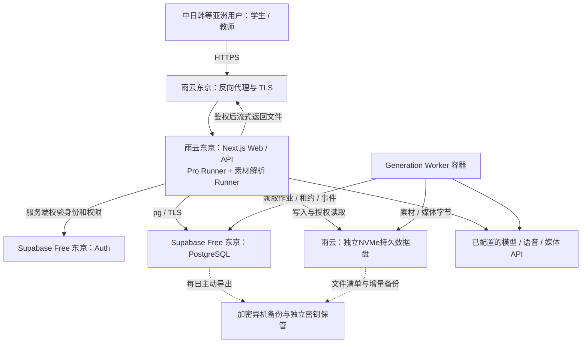

# 智域首发部署与代码改造执行方案

初稿日期：2026-09-07。修订日期：2026-09-08。用途：交给新对话中的 AI，按本文实施代码改造、配置云服务，并在真实线上环境完成试用验收。

**当前执行基线（2026-09-08低成本修订）：先邀请约5名同学封闭试用；雨云日本东京服务器运行应用、后台任务并保存持久文件；托管 Supabase Free 东京项目承载 PostgreSQL 和 Auth。首发不购买 Supabase Pro，不在应用服务器另建 PostgreSQL、完整 Supabase 或独立对象存储服务。** 图文与语音为主，视频少量；以后人数未知，按真实负载扩容。应用仍面向中国、日本、韩国等亚洲国家和地区的学生与教师，使用真实域名与 HTTPS 验证。试用起止时间、采购状态以控制台记录为准。

本轮仅更新实施方案，不代表已购买/扩容服务器、创建云项目、注册域名、签发证书、完成代码改造或通过线上验收。用户确认基础设施目标350元/月、必要时上限500元/月（不含模型API），首发尽量低于目标；接受每日备份、最多丢失约一天更新、目标一天内恢复。本文据此选择 Free + 本机文件，并在第10节规定升级条件。最新决策见 [ADR-0016](../docs/adr/0016-free-supabase-with-local-files-for-small-trial.md)，取代 ADR-0015 中 Pro 和全部文件托管的选择；东京地区与既有隐私、功能边界保留。历史 ADR 不改写为新决定。

## 1. 最终目标与边界

**部署结构：一台持续运行的 Linux 云服务器承载 Next.js Web/API、Pro 智能体、素材解析和私有文件；独立 Generation Worker 容器负责持久化整课作业，与 Web 共享持久数据卷。Supabase Free 承载 PostgreSQL 和 Auth，文件字节不进入其数据库或 Storage。首发不使用 Vercel 托管。**

- 应用服务器：雨云日本东京，按用户展示的“极速三网一区”节点试用，实际机房/线路名称在开通时核对；Supabase Free 配套选东京 `ap-northeast-1`，可用性以创建页为准。不同厂商同地区不等于同一私有网络，数据库仍经 TLS 连接。
- 机器基线：以已讨论的 4 vCPU / 8 GB RAM、x86-64 Linux 套餐试用；截图标称上传 20 M / 下载 30 M、不限主机流量。供应商标注的约 60 ms 是线路参考值，不能当成实测、API 总耗时或服务保证。
- 磁盘：保留套餐30 GB系统盘；邀请同学前，优先另挂20 GB NVMe持久数据盘（用户报价约8元/月，最小容量/具体节点支持待购买页核验）。系统与镜像、临时解析和业务文件分配见第10节。不一次购买100 GB或按未知人数预留全部配额。未挂独立盘时只做运维/合成数据检查，不把用户文件写入容器层。
- 操作系统建议 Ubuntu 24.04 LTS，以雨云实际可用的 Linux 镜像为准；使用 Docker/Compose。保留4核8GB用于解析与Web/Worker的峰值余量；磁盘可扩容不代表CPU、内存、数据库或带宽无限。
- 用户：先约5名同学体验，不固定最终人数；学生与教师使用相同个人账号权限，本期没有班级/教师后台。首发按图文、语音为主和少量视频实测，扩大邀请前重新检查容量与排队。
- 登录：邮箱+密码，验证邮箱，只有受邀账号可以使用私有功能及平台 API。真实支付后续上线，内测用管理员发放的测试积分。
- 同步：同一账号跨设备可见课程、对话、学习记录和持久素材；本地浏览器仅作缓存和设备偏好存储。
- 隐私：默认私有；只有用户明确发布的课程可以经链接浏览。原材料、私聊、学习记录、模型配置不随课程公开。读者的 AI 操作使用读者自己的积分/API。
- BYOK：自带 API 的调用不扣模型积分；使用平台提供的文字、图片、语音、视频、解析等付费调用，分别按实际平台用量扣积分。BYOK 仍受共享资源配额限制。
- 配额：每用户同时1个重任务；全站从1个起步，完成两任务并行验收后可调至2个。单文件50 MB，每人持久文件1 GB，全站初始逻辑文件总量10 GB；另设实际磁盘余量保护，去重不改变用户计费口径。每人最多5个排队任务、全站初始20个；超限明确拒绝，浏览学习不占重任务槽。以上上限需统一实现，不能仅靠单个Worker配置。
- 初始数据：线上空库；不上传、覆盖、认领或删除本地旧数据，保留本地所有卷、文件及历史。
- 保留现有普通生成、Pro、课堂、编辑、PBL、测验、白板、讨论、素材解析、语音、图片/视频生成及其他导入导出能力。**仅暂缓 MP4 导出服务和真实支付**，不删除对应现有实现。
- 不在这台 CPU 云服务器部署 Ollama、ComfyUI、VoxCPM 等 GPU 推理栈；保留其远程服务适配能力，已配置且可用时才能开放。
- 恢复目标：每日备份，内测最多丢失约一天更新，目标一天内恢复；必须用演练验证。数据库、文件对象、加密密钥分别可恢复。

### 架构图



雨云主机不运行 PostgreSQL 或自托管 Supabase 容器；业务数据库由服务端 `pg` 访问，数据库密码不交给浏览器。客户端只知道稳定资产ID或应用下载地址，不知道服务器绝对路径。更换或结束试用主机时必须搬迁持久文件和密钥，并检查数据库引用；Supabase账号和业务数据库可保持不动。

## 2. 为什么选择这个方案

应用与数据库适合分开部署：当前已经使用 `DATABASE_URL` 和 PostgreSQL 存储抽象，SQL/JSONB 与同机磁盘路径没有绑定。托管数据库减少数据库运维工作；代价是需要处理 TLS、连接数和跨地域延迟。

当前完整应用并非单纯网页：`instrumentation.ts` 启动常驻 Agent、素材解析、LISTEN/NOTIFY 与资产清理；`workers/generation/main.ts` 是另一条独立后台链路。常驻服务器更贴合这些现有实现。使用 Vercel 仍然可行，但需要额外后台环境、进程拆分和文件/上传适配，不是本项目当前最快的首发路径。

Supabase 不要求把现有 SQL 改为 ORM，也不要求所有业务通过其 Data API。首发继续使用 `pg`，Auth用于身份，本机文件接口承载字节。现有 `LocalMaterialByteStore` 与课堂媒体流式读取可复用，但注册资产当前默认写 PostgreSQL BYTEA，需要新增明确的本地资产后端。暂不新增 Redis、Kubernetes、MinIO或完整 Supabase 套件，避免仅为几位体验者增加服务和运维面。

本方案针对“约5人、低固定成本、接受一天级恢复目标”的试用阶段，是成本和维护复杂度之间的选择，不承诺任何负载下都最优。Free减去Pro固定订阅费，本机文件避免1 GB云文件额度与媒体出网限制；代价是文件恢复由项目负责、下载占用雨云上行，云数据库仍有Free限制。分别测量用户到应用、应用到数据库、用户到Auth和应用到模型的链路。

### Free 的适用边界

- 官方当前列出Free数据库500 MB、文件1 GB、未缓存出网5 GB/月和缓存出网5 GB/月；两种出网额度独立，不能合并成10 GB任意流量。Free没有可依赖的托管每日恢复点，低活跃约7天可能暂停；再次测试前核验项目状态，从控制台恢复。不要以定时空请求作为不暂停承诺。[定价](https://supabase.com/pricing)、[可用性](https://supabase.com/docs/guides/deployment/going-into-prod)
- 首发不使用Supabase Storage作为主文件或本机文件备份，因此1 GB额度不会限制每人1 GB的本机配额；500 MB仍需容纳业务、Auth及索引等实际占用。先执行完整迁移并记录空库占用，不能凭5人判断一定足够。
- pg/session pooler返回的数据、Auth和数据库备份导出也会产生云端出网。SSE事件重放采用游标增量读取；列表分页、避免重复传输整课JSON，不能把数据库变成媒体中转站。[出网计量](https://supabase.com/docs/guides/platform/manage-your-usage/egress)
- 自定义SMTP在Free也需要配置。默认邮件只面向项目组织成员，不能让同学加入Supabase管理团队来绕过限制，也不能取消邮箱验证。可先用邮件服务免费额度。[SMTP](https://supabase.com/docs/guides/auth/auth-smtp)
- 不为了省数据库容量删除用户课程、聊天、学习记录、积分账本或未完成任务。先检查不必要的重复数据与可安全归档事件，再按第10节决定升级；付费Pro不是当前试用的前置条件。

## 3. 代码现状与数据流

这是基于 OpenMAIC 的“智域”AI 教学 Web 应用：用户输入学习主题或上传材料，生成包含讲解、课件、测验、互动与项目式学习内容的课程；学习时可与 AI 教师/同学讨论、使用语音和白板，随后编辑或导出课程。Pro 工作台进一步通过持续对话和工具调用完成素材处理、课程生成与修改。因此，数据库既保存课程，也承载对话、学习状态、后台任务和模型配置；文件存储还需要保存上传材料及生成媒体。

调研基线：`main`，HEAD `4d5ad10`，但存在大量用户已有修改和未跟踪文件。**本文依据调研时的工作区，不保证仅部署该提交就包含全部功能。** 执行 AI 首先检查差异，明确发布快照，不能 reset/clean 或覆盖其他工作。

| 内容 | 当前代码证据 | 结论 |
| --- | --- | --- |
| 技术栈 | `package.json`、`.nvmrc` | Next.js 16.1.2、React 19.2.3、TypeScript、pnpm 10.28.0、Node 22 基线 |
| UI / 本地状态 | Zustand、Tailwind 4、Radix/shadcn 相关组件、Dexie | 部分数据仍仅存浏览器，不能以“配了数据库”当作跨设备同步完成 |
| AI | AI SDK 6、Pi agent、多供应商适配、LangGraph 相关依赖 | 多条调用链必须分别覆盖身份、积分和用量归属 |
| 核心包 | `packages/@openmaic/{dsl,generation,storage,importer,renderer,editor}` | 复用现有包和存储抽象 |
| PostgreSQL | `packages/@openmaic/storage/src`、`lib/persistence` | 手写 SQL/JSONB；存在部分懒建表逻辑 |
| 文件 | `materials/bytes.ts`、`classroom-*.ts`、资产 S3 后端 | 多条字节路径并存，需要统一 |
| MP4 | `render-service/` | 独立 Chromium+FFmpeg 渲染，本期关闭；图片/视频生成 API 仍保留 |

### 现有表和目标归属

| 数据 | 现有表/位置 | 首发目标 |
| --- | --- | --- |
| 课程、场景、大纲、文件夹 | `document_stages/scenes/outlines/folders`、`stage_meta` | PostgreSQL，按账号授权 |
| 内容修订通知 | `document_stage_revision`、`document_scene_revision`、触发器 | PostgreSQL，保留修订与通知语义 |
| 学习运行记录 | `runtime_sessions`、`runtime_records` | learner_key 从正式账号派生，保存聊天、测验、PBL、白板等已实现记录 |
| Pro 对话与恢复状态 | `agent_sessions`、entries/events、owner events、session URLs | PostgreSQL，按用户隔离 |
| 素材元数据/解析状态/技能 | `agent_session_materials`、`owner_material`、`agent_user_skill` | PostgreSQL；源文件和派生文本在雨云持久盘，必要检索字段入库 |
| 资产登记 | `asset_entries`、`asset_blobs` | 云数据库保留哈希/元数据/引用；字节在雨云持久盘，禁用生产BYTEA后端 |
| 后台课程作业 | `generation_*` 系列表 | PostgreSQL 队列、租约、步骤、事件、限流槽、Worker 心跳 |
| 模型与媒体配置 | `pro_model_connections/revisions`、`media_config_snapshots` | 按账号加密持久化，生产密钥独立保存 |
| 现有本地媒体/素材/用量 | `data/classrooms`、MaterialByteStore、`data/usage` | 课程JSON归数据库；媒体/素材统一受控文件层；用量改结构化数据库记录 |
| 品牌Logo、字体、内置图标 | `public/zhiyu-mark.svg`、`public/vendor`等 | 随应用镜像发布，无需数据库或云Storage |
| 新增账号业务与积分 | 目前没有完整实现 | 增加邀请/账号状态、积分账本、调用结算、配额记录 |
| 播放位置/快照/偏好等 | `lib/utils/database.ts`、`lib/store` | 学习连续性所需状态同步；撤销栈、临时录音和设备布局可留本地 |

根目录 `CONTEXT.md` 和旧 ADR 含未来学习评估规划。Lesson、学习检查、学习报告等旧规划不能被当成本期已实现功能或借部署扩大实现范围。

### 用户流程

1. 用户受邀注册、验证邮箱并登录；服务端取得可信 user ID，建立用户业务资料与零余额积分账户。
2. 主题/材料进入普通生成或 Pro 对话；上传文件保存雨云私有持久目录，元数据与归属入库，解析可后台执行。
3. 服务端决定每次调用的供应商、模型、密钥来源、计费归属；检查积分及配额后执行。普通逐场景生成、Pro 工具和持久化整课 Worker 复用同一授权/计量规则。
4. 场景内容、教学动作、大纲和事件入库，音视频入同一持久文件层，客户端显示进度并可断线重连。
5. 学习和编辑使用账号所属数据；换设备重新登录仍能读取。公开课程的访问只开放课程及其必要展示资产。
6. 内测管理员发放测试积分，用户查看余额/明细；充值支付入口本期不开放。

## 4. 实施任务：按依赖顺序执行

任务完成后把实际文件、迁移版本、验证证据写到 `optimization_docs/zhiyu-deployment-result.md`。以下新文件和变量是**要实施的方案名称**，不是声称仓库已经存在。

### T0 — 发布基线与隔离开发环境

- 查看 `git status`、现有 AGENTS、文档及未提交差异；基于用户认可的当前工作区建立可追溯发布快照。用户要求的近期模型/媒体修改必须包含在内。
- 本地单元测试、迁移重置和破坏性故障测试使用隔离数据库/文件目录，不借用旧本地数据卷、不接线上用户数据；独立Supabase开发项目是可选项，不要求购买第二套云环境。第8节的受控端到端测试使用真实线上服务及专用测试账号/数据，两者不能混淆。
- 锁定 Node 22、pnpm 与 lockfile。保留 workspace postinstall 构建顺序及 `public/vendor` 导入器同步检查。
- 不修改已有历史 ADR 的原始内容来伪装已实现；本方案优先于调研稿中的早期候选路线。

### T1 — 数据库连接、完整迁移和运行角色

修改 `lib/persistence/server-provider.ts`、`lib/server/generation-jobs/runtime.ts`、`workers/generation/migrate.ts`、各 Agent/素材/技能/模型 Store 的初始化逻辑，新增统一数据库配置模块和应用部署迁移入口。

- 推荐业务表位于独立 `app` schema，不加入 Supabase Data API 暴露列表；保持现有表名，统一连接 search_path，逐条验证触发器与 `to_regclass` 等名称解析。迁移角色与所有运行连接必须使用同一 schema 配置。
- 业务访问继续由可信服务端处理。前端仅使用 Auth 和应用 API，不授予 `anon`/`authenticated` 对业务表的直接访问。无使用需求时关闭业务 Data API 暴露；这不等于关闭 Auth/Storage。
- 建立独立 runtime 登录角色，具有业务 DML、必要序列/函数权限，没有建表、建角色或管理 Auth 数据的权限；迁移凭据只给一次性迁移任务。不要把 postgres 超级管理连接长期放在应用容器。
- 私有 schema 的首期隔离边界是应用身份授权和 SQL 角色权限；不能假装 `pg` 会自动注入 Supabase JWT。若采用额外 RLS，必须明确每个请求/Worker 的事务身份和策略，并用越权测试验证。任何仍暴露给 Data API 的表必须配置 RLS 与最小授权。
- 将基础 runtime/document/asset/stage_meta/owner_material、Agent 会话/素材/技能、模型连接、媒体快照、generation、新账号与积分表统一纳入版本化迁移；不能只运行现有 generation CLI 就宣布全部初始化完成。
- 生产关闭懒建表；新增 `APP_SCHEMA_AUTO_MIGRATE=0`，所有相关 Store 改为检查兼容版本并报可识别错误。开发模式可保留显式的便捷初始化。
- 小规模首发，审计并收敛各模块连接池，起始总预算建议Web查询3、Worker查询2、LISTEN合计2、维护/备份1，总共8；LISTEN实际需要更多时重新分配并验证。计入所有Runner/Collector、重启新旧进程重叠，预留平台管理连接；核对Free实际连接/内存限制，不能沿用每模块默认10连接。8是应用预算而非声称平台硬上限。
- 完整迁移后记录数据库总量及最大表/索引，再用一条有图文语音的完整课程测增量。启动不能把课程图片、音频、Base64、重复工具大响应写入BYTEA/JSONB；已存在的有效用户内容按既有语义保留，禁止为满足Free静默截断。
- 统一启用 TLS 和证书验证；不得用 `rejectUnauthorized:false` 作为默认配置。将 Supabase 提供的 CA、连接方式与实际容器的验证结果记录下来。

### T2 — Supabase Auth、邀请和统一身份

新增 `lib/supabase/{client,server}.ts`、服务端身份解析模块及登录/注册/验证回调/忘记密码页面；锁定实施时核验过的 `@supabase/supabase-js` 和 `@supabase/ssr` 版本。

- 首先通过 Supabase 验证 JWT；使用验证后的 `sub`/用户 ID。敏感变更、账号禁用等结合实时用户状态和应用账号状态校验，不信任请求传来的 ownerId、learnerKey、用户邮箱或 `user_metadata` 权限字段。
- 统一修改 `lib/persistence/server-auth.ts`、`bootstrap.ts`、`lib/server/agent-runtime/{owner,with-owner}.ts`、`lib/server/generation-jobs/auth.ts`。所有私有 API 用正式身份；生产移除共享 development token 和任意客户端 learner key 的认证能力。
- 当前正式账号 ID 采用 Supabase user ID 字符串作为现有 TEXT owner_id/learner_key 的规范值；新 profiles 表保留 UUID user_id。不要仅靠 `!ownerId.startsWith('anon:')` 判断已登录。
- 邀请表记录规范化邮箱、状态、到期/使用信息。用户未受邀或未验证邮箱不能调用任何付费/私有业务 API；直接调用 Supabase 注册接口也不能绕过业务准入。推荐关闭任意自助注册，由受控管理员流程发邀请，使用 Supabase 支持的邀请完成/设置密码链路，并验证实际流程。
- 最小管理员能力使用受保护 CLI：添加/撤销邀请、禁用账号、发放测试积分、查询异常结算；不用新建复杂管理平台。初始管理员通过服务器配置/受控迁移设置，不接受用户自填管理员元数据。
- 整合现有 `middleware.ts` 的功能门控及安全响应头；采用 Next.js 当前官方代理/会话刷新方式时，避免保留两套互相覆盖的 middleware/proxy。每个业务 Route Handler 仍必须自行鉴权。
- 认证和用户数据响应禁止跨用户缓存；公开课程与私人视图分别定义缓存规则。ACCESS_CODE 可作为额外测试站点门禁，但不能替代正式账号，不能阻断必要 Auth 回调或让公开课程行为与方案冲突。
- 用户登出/切换账号时清除账号缓存、终止 SSE、重建存储状态或整页重载。当前 runtime/bootstrap 会缓存 learner identity，必须修复 A 退出后 B 沿用 A 分区的问题。

### T3 — 默认私有、发布读取与跨设备同步

修改 `lib/persistence/{document-access,owner-bound-document-store,stage-meta,legacy-readable-assets}.ts`、`lib/server/stage-access.ts`、相关 stage/material/asset/runtime/API，以及 `lib/utils/database.ts`、`lib/runtime`、`lib/document-store`、客户端 session/store。

- 用统一的 `canReadCourse / canWriteCourse / canReadAsset` 规则：所有者可读写；其他人仅可读已发布且未删除课程；素材/会话/密钥/运行记录永远按私有所有权判断。
- 现有部分课程 read 路径接近“知道 ID 即可读”，必须逐条收紧；不能只新增登录页、修 publish 接口就完成隔离。
- 匿名浏览者可查看已发布课程及其展示媒体；保存学习记录、AI 讨论、复制/编辑需登录并符合邀请准入。查看公开课程不能获得作者原材料列表、会话或模型引用。
- 发布资产授权采用“资产被已发布课程引用”的服务端事实，不公开整个数据目录。首发每次应用媒体请求（含Range）重新检查权限，撤回后停止新读取；将来若启用S3短时签名，撤回立即停止签发新地址，并明确已有链接在有效期内仍可能可读。
- 课程、Pro 对话、课堂聊天/PBL/测验/白板记录及持久播放进度以服务端为准；审计仍只写 IndexedDB 的学习连续性状态，并补入对应 RuntimeStore。设备布局、未提交草稿/撤销栈等可保留本地，但不要承诺同步没有实现的数据。
- 同账号多设备修改课程必须保留修订号并检测冲突；不能静默覆盖较新版本。离线/断网显示未保存状态，恢复网络后按明确的重试规则处理。
- 由于线上空库，不迁移匿名数据；不得为了方便将本地所有内容自动归属首个注册用户。

### T4 — 云端元数据与本机持久文件分离

复用 `AssetByteStore` 和 `MaterialByteStore`，新增显式后端选择与本地资产实现；保留既有S3接口用于未来迁移，本期不部署S3服务。修改：

`lib/persistence/asset-byte-store.ts`、`packages/@openmaic/storage/src/asset`、`lib/server/materials/bytes.ts`、`lib/server/agent-runtime/session-materials.ts`、`classroom-storage.ts`、`classroom-media-bytes.ts`、`classroom-media-generation.ts`、Agent图片/视频/语音路径、classroom-media读取接口，以及所有直接`fs`持久写读路径。

- **当前不配置 `ASSET_S3_BUCKET` 会选择 `PgAssetByteStore`，不会自动切到文件夹。** 必须新增 `PERSISTENT_FILE_BACKEND=local` 与统一数据根配置，并覆盖Web、Worker及离线Collector。生产后端无效或挂载缺失时失败关闭，不能悄悄写回BYTEA、容器层或新建另一份数据目录。
- 宿主机数据盘挂载 `/srv/zhiyu-data`，绑定到Web/Worker相同的 `/app/data`；以子目录 `assets`、`materials`、`media` 保存不可变文件，以可验证随机对象key/内容哈希分层，保留归属和引用。文件根通过统一配置解析，不依赖工作目录。课程正文/任务状态JSON逐条归入数据库，不能因采用本地文件而留下一套未授权的课程数据库。
- 新本地资产后端声明文件写入位于注册数据库事务之外，沿用资产登记/引用计数语义。临时文件在目标文件系统内创建，流式写入、核对长度/哈希、同步后原子完成；处理同哈希并发与崩溃重试，不能覆盖半成品或删除别人的有效对象。数据库只在文件成功完成后标记可读；文件落地后SQL失败留下的孤儿由对账回收。
- 文件系统与SQL没有跨系统原子事务。使用写入意图/完成状态、容量预留和幂等key；返回成功前确认两侧完成。应用启动或巡检发现元数据有文件但字节缺失，报告需恢复，不返回空内容、不自动覆盖。保留旧引用解析，课程保存稳定资产ID/object key，不保存绝对磁盘路径或临时签名URL。
- 私有素材不放 `public/`，代理不直接暴露数据根。所有读取、Range请求、写入、删除先走应用身份及课程归属/发布权限检查；路径必须校验真实根和符号链接边界，不接受用户提供任意路径。品牌Logo等构建静态资源继续随镜像发布。
- 首发经应用同源API流式上传/下载，支持HEAD、Range/206/416、播放拖动、客户端取消和背压；复用已有课堂媒体Range实现并补鉴权。不要每次把整段音视频读入内存，不让缓存跨用户复用私有响应。公开课程只授权关联展示资产；撤回后新请求立即重新判断权限，不承诺追回用户已下载的字节。
- 文件响应核验MIME并发送`nosniff`，无法安全内联的上传文件强制下载；用户上传HTML/SVG不能直接以应用同源脚本执行。课程生成的互动HTML沿用受隔离的渲染路径，不能为统一文件下载破坏现有沙箱边界。
- 用户级配额包含源文件、派生物和生成媒体，按逻辑字节计；同时记录物理占用、未完成写入和等待回收文件。上传/生成前在数据库事务中预留用户与全站容量，文件流按实收字节限制，成功结算、失败释放。50 MB/1 GB/10 GB明确为50,000,000/1,000,000,000/10,000,000,000字节；UI一致。上游生成超过上限的媒体明确失败并记录费用结果，不截断为成功。
- 额外检查数据盘剩余空间和临时盘余量，防止预留与实际并发写入之间超额；实现时为派生物和解析临时空间建立保守上界。解压限制展开总量/文件数/路径，不能只限制压缩文件大小。低空间时拒绝新重任务，仍允许登录、已有内容读取及安全清理。
- 页面、导出、PPTX导入、素材解析、TTS和Worker均通过同一文件接口。清理遵守至少48小时宽限、数据库引用检查和备份完成标记；仍有引用、未备份、归属不明的文件不删。同步维护用户逻辑额度和真实物理占用；配额释放不等于磁盘立即释放。
- 将用量JSONL改成数据库审计记录；调试日志输出stdout、脱敏轮转。临时文件与可重建缓存可定期清理，用户文件无自动过期删除。只有已完成且可由保留快照恢复的任务传输事件，才可在明确保留窗口后归档并验证SSE重连；课程/对话/账本不套用该清理策略。
- 将后端位置封装在文件层，首发所有持久字节统一local。未来迁S3需复制校验、维护窗口、切换位置记录并保留可回滚源；不能只设置bucket或同时双写就宣布迁移成功。

### T5 — 测试积分、调用归属与重任务准入

新增 `lib/server/billing/` 和配套迁移/API/轻量余额界面；复用 PostgreSQL 的事务与唯一约束。建议表：`credit_accounts`、不可变 `credit_ledger`、`api_calls`、`credit_reservations`、`model_tariffs`、`task_admissions`、`storage_reservations`。具体字段由实现补齐，以下行为不可省略。

- 账户余额与积分账目使用整数最小单位或 PostgreSQL 精确数值，不能用浮点数存钱/余额。所有发放、预占、结算、释放、补偿均有唯一幂等键与事务。
- 新账号默认零余额；测试积分发放额度由管理员填写，不能自动给予没有上限的免费 API。价目表按 provider/model/计量单位/币种/版本记录，换汇参数显式配置；未定价的平台调用禁止启动，不默认为零价。
- 为每个上游调用记录 actor user、root task、provider/model、platform/byok、配置版本、供应商 request ID、计量来源及状态。文字 token、图片张数、TTS 字符/时长、ASR/视频时长、付费解析分别计量；遵循供应商实际计费单位。
- 服务端最终解析到的密钥来源决定 funding，不能信任客户端声明 BYOK。BYOK 无效时不默默换平台密钥；只有用户已选择的平台路径才可预占并执行。
- 修改并验证 `lib/ai/llm.ts`、`lib/agent/runtime/stream-fn.ts`、Pro driver/generation calls、generation pipeline 及图片/视频/TTS/ASR/解析调用路径。原来的 best-effort 用量日志不是可靠扣费入口。
- 工程结算规则：请求/任务创建时有界预占，逐真实调用保存计量并幂等结算；未执行部分取消/失败后释放。成功调用的费用有据可查；未知上游结果进入待核对状态，不能重放即重复扣费。人工纠错写补偿记录，不篡改历史。
- 多步课程生成只按各子调用计一次，不能再按父任务重复扣。重试有 attempt identity，供应商支持幂等键时传递；不承诺跨外部 API 与本地数据库的天然 exactly-once。
- root task 准入涵盖普通整课、Pro 长轮次、独立导入解析和媒体生成。子工具继承父任务准入，不能再次占槽导致两个父任务都等自己的子任务而死锁。
- 全站重任务上限必须跨Agent、Generation Worker、解析与入口统一协调；从1起步，通过组合负载验收再升2，不能每个Runner各开2。任务等待需要可见队列状态、取消与超时，不能承诺固定等待分钟数。短课堂问答按独立调用限流，避免课程排队阻断阅读。
- Worker 崩溃用租约/心跳恢复槽位；配额、积分、文件预留的失效回收都需要可审计任务。公开读者的 AI 费用不得绑定课程作者。
- 本期没有支付网关、真实充值订单或支付回调。余额/明细显示为测试积分，真实购买入口关闭，保留以后扩展账目来源的接口。

### T6 — 容器、功能开关与运行维护

- 新增独立 `docker-compose.production.yml`，不要直接把依赖原本地 external volumes 的 persistence Compose 当云部署文件。去掉本地 postgres 服务与依赖，使用外部 DATABASE_URL。
- Web 与 generation-worker 使用同一源码发布版本、相同供应商与关键密钥配置。Web 内继续运行 Agent/素材 Runner；本期无需额外抽离成一个新的微服务。
- Web与Worker使用相同非root UID/GID、相同文件后端配置及共享持久卷。先按磁盘UUID挂载并核对预置卷标记，再启动业务；Compose不得在挂载缺失时自动创建替代目录。文件盘不能挂在容器可写层或`tmpfs`，更新镜像不得删除卷。
- 临时处理目录与持久目录分开；临时文件也需在多进程之间正确传递，使用有界任务目录及清理状态。系统盘空闲需覆盖镜像更新和两个解析任务峰值。构建尽量在本地/CI执行，日志设置轮转，不在4核8GB运行全套监控数据库；先用系统/容器指标、结构化日志和轻量告警。
- 主应用和可能执行媒体提取的 Worker 镜像补齐 `ffmpeg`/`ffprobe`。虽然 MP4 导出关闭，音频裁切/音视频素材解析仍需要它们；保留现有 canvas/sharp 运行库。
- 检查 Worker 镜像包含所需 prompts、templates、snippets、skills、workspace 产物和独立导入脚本；不能只因为容器能启动就认为资源完整。
- 用 Caddy 或等效反向代理提供域名/TLS、SSE 无缓冲及合理长连接；应用 3000 端口不直接开放公网。公网只开放 80/443，SSH 限制来源并用密钥；数据库无需开放本机 5432。
- 请求大小、上传超时和真实文件上限一致，避免代理允许上传而应用无界读入内存。4 核 8 GB 试用主机的并发、内存峰值、磁盘余量和解析时长通过实测验证，发布构建尽量在本地/CI完成再传镜像。
- 新增版本化的 Caddyfile（或等效代理配置）及证书状态检查，纳入生产 Compose；证书状态数据持久保存。域名/HTTPS 与业务容器独立验证，具体流程见第 8 节。
- 保持 `NEXT_PUBLIC_ENABLE_VIDEO_EXPORT=true` 以保留现有视频工程 ZIP 和 SRT 字幕导出；清空 `RENDER_SERVICE_URL`，不启动 video-export profile。现有 `video-export-dialog.tsx` 根据 capability 区分本地工程导出与服务器 MP4：验证 capability 为 false、MP4 提交端点明确禁用，不能关闭整个菜单而误删其他导出。必要时细分界面提示，保留其他导入导出。
- 生产停机前停止接新任务并排空/停放租约，备份后执行兼容迁移；进程有健康检查、自动重启和日志轮转。保留 SSE 断线续接与 PostgreSQL fallback polling。

## 5. Supabase 创建与配置步骤

1. 先检查已有项目和组织计划；选择仍有Free项目名额的环境创建独立线上试用项目，例如 `zhiyu-trial`，明确选择东京 `ap-northeast-1`。核验实际计费归属，不能在付费组织新建项目后假设自动免费，也不为释放名额删除旧项目。区域/Free名额不可用时列出可行替代，不静默付费。安全保存数据库管理员密码；单元测试或重置schema不能接试用数据。
2. 记录project ref、URL、publishable key、Free计划、PostgreSQL主版本、连接方式、CA、计费周期和配额基线。实际连接值填入服务器secret，不写Git；首发不需要Storage S3凭据。若已有其他地区/付费项目或数据，保留并先检查，不自动降级、迁移或删除。
3. 创建 `app` 业务 schema、迁移与 runtime 角色，关闭非必要业务 Data API 暴露；通过 T1 迁移创建完整结构并核验版本。不要修改 Supabase 管理的 Auth/Storage 内部表结构。
4. 常驻服务器优先直连；如其 IPv6 不可用且未购买 IPv4 add-on，用 Connect 面板的 **session pooler**。当前 LISTEN 需要 session 语义，不能把事务池 6543 地址直接替换给全部代码。
5. 连接地址从控制台复制。自定义角色的连接用户名按 Supabase 实际要求填写；密码 URL 编码，验证证书、连通性与 LISTEN 自检。迁移使用独立管理连接，runtime 角色试运行 DDL 必须失败。
6. Auth 开启邮箱验证，配置最终 `https://<APP_DOMAIN>` 为 Site URL，精确添加实际认证回调/重置密码地址；生产不用通配到任意第三方回调。邀请流程与密码设置按 T2 实施。
7. 配置自定义 SMTP。建议 Resend 作为初始候选，验证自有域名的 SPF/DKIM/DMARC、发件地址和投递；Supabase 默认 SMTP 不能覆盖这批普通受邀用户。
8. 首发不创建业务Storage buckets，文件统一在雨云私有卷。核验资产字节后端确为local、`asset_blobs`没有文件BYTEA增长、素材/媒体无隐式云上传；数据库保留正常元数据。
9. 按第9节部署主动备份与异机复制、失败通知，验证完整恢复；不能把Free控制台当作Pro每日备份。记录数据库容量、最大表/索引、云出网、连接数、备份流量和本地盘用量。Free暂停或配额限制显示维护状态；恢复后自检迁移版本、文件引用和Worker租约，再接新任务。
10. 首次部署验证Auth用户、业务profile、积分账户的关系；A/B两用户隔离、鉴权媒体与发布撤回；生产关掉开发token后旧请求确实失败。

## 6. 环境变量与填写位置

生产 secret 文件建议服务器 `/opt/zhiyu/secrets/app.env`，权限仅管理员/部署进程可读；Compose 按服务注入。`NEXT_PUBLIC_*` 在构建时写入前端，切换需重建。示例只含变量名和占位值，不含密钥。

| 变量 | 状态 / 用途 | 配置位置 |
| --- | --- | --- |
| `DATABASE_URL` | 已有；runtime 角色、session/直连、TLS | Web、Worker |
| `GENERATION_MIGRATION_DATABASE_URL` | 已有；专用迁移凭据 | 仅迁移任务 |
| `APP_DB_SCHEMA=app` | 拟新增，所有 SQL 连接一致 | 所有 DB 进程 |
| `APP_SCHEMA_AUTO_MIGRATE=0` | 拟新增，生产禁懒 DDL | Web、Worker |
| `APP_ORIGIN=https://<APP_DOMAIN>` | 拟新增，服务器规范入口 | Web、Worker |
| `NEXT_PUBLIC_SUPABASE_URL` | 拟新增，项目 URL | 构建与 Web |
| `NEXT_PUBLIC_SUPABASE_PUBLISHABLE_KEY` | 拟新增，公开客户端 key | 构建与 Web |
| `SUPABASE_SECRET_KEY` | 拟新增；仅确需 Auth 管理邀请时使用，按 SDK 核验 | 受控管理任务，最小暴露 |
| `NEXT_PUBLIC_PERSISTENCE=1` | 已有；云存储客户端开关 | 构建 |
| `NEXT_PUBLIC_PERSISTENCE_TOKEN` / `PERSISTENCE_DEV_TOKEN` | 生产废弃，T2 替换后不配置 | 不放生产 |
| `NEXT_PUBLIC_PRO_WORKBENCH_ENABLED=true` | 已有 | 构建 |
| `OPENMAIC_AGENT_RUNTIME_ENABLED=true` | 已有 | Web |
| `PRO_MODEL_ENCRYPTION_KEY` | 已有；32 字节随机值的 64 位十六进制 | 仅 Web，独立备份；禁止下发 Worker |
| `MEDIA_CONFIG_ENCRYPTION_KEY` | 已有；可配置独立加密密钥 | Web、Worker，独立备份 |
| `GENERATION_MODEL_ENCRYPTION_KEY` | 新增；32 字节随机值的 64 位十六进制 | Web、Worker，独立备份；与 Pro 模型密钥分离 |
| `GENERATION_SESSION_SECRET` | 已有；兼容签名链路，保持稳定 | Web、Worker |
| `GENERATION_ALLOWED_ORIGINS` | 已有；只允许实际应用来源 | Web、Worker |
| `GENERATION_BACKGROUND_ENABLED` / `GENERATION_ACCEPTING_JOBS` | 已有；迁移和故障测试后启用 | Web、Worker |
| `GENERATION_TRUST_LEGACY_OWNER=0` | 已有；线上无旧身份迁移 | Web、Worker |
| `GENERATION_WORKER_CONCURRENCY=1` | 已有；还须受共享 root-task 准入限制 | Worker |
| `OPENMAIC_AGENT_RUNTIME_MAX_CONCURRENT=1` | 已有；不是全站总限流的替代，升2前验收 | Web |
| `PERSISTENT_FILE_BACKEND=local` | 拟新增；显式选择资产/素材/媒体统一本地后端 | Web、Worker、Collector |
| `PERSISTENT_DATA_ROOT=/app/data` | 拟新增；绑定宿主机 `/srv/zhiyu-data`，含卷身份检查 | 所有文件读写/清理进程 |
| `PERSISTENT_TEMP_ROOT=/app/tmp` | 拟新增；独立、有界临时目录，与持久文件分开 | Web、Worker |
| `APP_HEAVY_TASK_LIMIT=1` | 拟新增；跨所有入口的全站准入，验收后可升2 | Web、Worker |
| `GENERATION_MAX_QUEUED_JOBS_PER_OWNER=5` / `GENERATION_MAX_QUEUED_JOBS=20` | 已有；T5须将同等限制扩展到其他重任务入口 | Web、Worker |
| `UPLOAD_MAX_BYTES=50000000` / `USER_FILE_QUOTA_BYTES=1000000000` / `SITE_FILE_QUOTA_BYTES=10000000000` | 拟新增，单文件/每人/全站逻辑额度 | Web、Worker |
| `ASSET_S3_BUCKET` / `ASSET_BYTE_EGRESS` | 已有，首发不配置bucket或redirect；**须先实现local选择，空bucket当前仍会回退BYTEA** | 留作未来S3迁移 |
| `STORAGE_S3_*` / `MATERIAL_S3_BUCKET` | 旧方案拟新增，本期不要求实现或配置；未来S3配置不得覆盖模型AWS凭据 | 本期不用 |
| `ASSET_COLLECTION_ENABLED=true` | 已有；仅在对象层和备份保护验证后启用 | Web/指定维护进程 |
| `ASSET_COLLECTION_GRACE_MS=172800000` | 已有；建议48小时，覆盖每日备份窗口 | 所有资产读写/清理进程 |
| `NEXT_PUBLIC_ENABLE_VIDEO_EXPORT=true` | 已有；保留视频工程 ZIP/SRT，MP4 由未配置的渲染服务关闭 | 构建 |
| `RENDER_SERVICE_URL` | 首发不配置 | 不启动 renderer |
| `DEFAULT_MODEL` / `MODEL_ROUTES` / 各供应商变量 | 已有；具体模型和价目表填写后启用 | Web、Worker |

其他已存在的编辑器/PPTX/职业模式/Pi 等开关按用户实际发布快照保留，不能只复制上表造成静默功能缩水。为新增的任务、文件、积分上限添加集中配置及校验，不分散硬编码。

## 7. 供应商配置清单

文字优先考虑用户明确提到的 DeepSeek、Qwen，保留其他既有供应商。实际模型 ID、endpoint、凭据、可用区域和价格都在实施阶段从服务商控制台/官方文档核验，不能照抄目录中的历史模型名就宣布可用。

| 类别 | 代码中已有的典型选项 / 入口 |
| --- | --- |
| 文字与模型路由 | `lib/ai/providers.ts`、`lib/server/resolve-model.ts`、`model-routes.ts`；DeepSeek、Qwen 等多供应商 |
| 图像 | `lib/media/image-providers.ts`：Seedream、Qwen Image、OpenAI Image、Nano Banana、MiniMax、Grok、ComfyUI、Lemonade；另有自定义协议 |
| 视频生成 | `lib/media/video-providers.ts`：Seedance、Kling、Veo、MiniMax/Hailuo、Grok、HappyHorse；另有自定义协议。这不等于 MP4 课堂导出 |
| TTS | `lib/audio/types.ts`、`tts-providers.ts`：Qwen、GLM、Doubao、MiniMax、Azure、OpenAI、ElevenLabs、VoxCPM、Lemonade、浏览器语音及自定义配置 |
| ASR | `asr-providers.ts`：Qwen、Azure、OpenAI Whisper、FunASR、Lemonade、浏览器语音及自定义配置 |
| 文档/媒体解析 | `lib/document/extractors/manifest.ts`：plain-text、unpdf、MinerU、MinerU Cloud、阿里 DocMind、local-ffmpeg |

平台密钥和用户 BYOK 按调用最终来源隔离；DeepSeek/Qwen 不等于自动获得所有图像、TTS 或视频服务。所有已配置的模态至少完成一次实际请求验收。目录保留未配置供应商，但不能给用户展示为已可用。

## 8. 云主机、域名、发布与验收

用户计划下一次开始雨云试用、处理域名和 SSL/TLS，并直接在真实线上环境测试。以下是执行顺序，不是对“某一天一定完成所有改造”的承诺。基础设施准备与不依赖云资源的代码工作可以并行；本地构建和必要检查完成后，真实域名、真实 Supabase 及实际供应商上的受控验收是主要部署验证方式。

### 8.1 试用启动与环境登记

1. 在雨云核验日本东京4核8GB实例的实际购买/试用状态，记录机房/线路、30 GB系统盘、附加20 GB NVMe数据盘的支持情况/实际容量、公网IP、带宽、到期时刻和续费价。20 GB不可选时按第10节核算最小可行规格，不自动上调到100 GB。扩容/续费前核对订单及退订条款，试用不等于已确认半年购买。
2. 设置 SSH 密钥、Linux 更新与 Docker/Compose，创建 `/opt/zhiyu` 和受保护 secret 文件，业务容器以非 root 运行。只让代理对外提供 80/443，SSH 限定来源；Web 3000、数据库管理与内部调试端口不直接公开。
3. 创建/核验东京Supabase Free，按第5节配置。验证DNS、TLS、session/直连PostgreSQL、LISTEN/NOTIFY、Auth和计划启用的模型API；核验数据盘挂载标记、Web/Worker共享读写及异机备份通道。只使用有限测试数据，不打印密钥。
4. 将真实环境连接值与本地测试值分开。在线上用专用测试账号和课程标记做受控验证；不复制本地旧数据，不对线上执行测试框架的清库脚本。试用数据是否保留转内测，在测试记录中明确，不自动删除。

### 8.2 域名与 SSL/TLS

1. 注册用户选定的可用域名，建议入口 `app.<DOMAIN>`，明确本文 `<APP_DOMAIN>` 指这一完整主机名。若用户已有新域名，直接使用并记录 DNS 管理位置；不凭建议名称直接下单。域名不必与雨云在同一平台购买。
2. 将应用主机名的 A 记录指向试用服务器公网 IPv4；只有 IPv6 已配置且验证可达时才发布 AAAA。核对权威 DNS 和客户端解析结果；试用更换 IP 时同步更新记录并重验。
3. 推荐 Caddy 通过 ACME 申请并自动续期公开受信任证书，无须仅为内测购买商业证书。验证域名、80/443 可达及代理端口占用；持久挂载 Caddy 数据目录，避免容器更新丢失证书状态。若选择其他代理/证书方案，也必须具备自动续期与到期告警。[Caddy 自动 HTTPS](https://caddyserver.com/docs/automatic-https)
4. 验证 HTTP 转 HTTPS、证书主机名/有效期/完整链、手机与电脑浏览器信任、容器重启后 HTTPS 正常；检查不存在混合内容。配置 SSE 实时转发与合理超时，不能让反向代理把流式响应积攒后一次返回。
5. 统一设置 `APP_ORIGIN`、`GENERATION_ALLOWED_ORIGINS`、Supabase Auth Site URL、真实邀请/验证/密码重置回调和需要的跨域来源；前端构建变量变更后重新构建。Supabase 服务继续使用其项目 HTTPS 地址，不把应用域名错误指到 Supabase，也不要求另买 Supabase 自定义域名附加服务。
6. 自定义 SMTP 配置发件域名、SPF/DKIM/DMARC，并验证目标用户邮箱的实际投递。应用 HTTPS 成功不代表验证邮件已可用。

### 8.3 真实线上功能测试

1. 按 T0–T6 完成各功能上线前所需改造、相关测试和生产镜像构建；先发布已可验证的部分，其余在结果中标记“未实现/未测试”。若身份隔离尚未完成，只允许受限的运维探测，不开放未鉴权的业务入口或平台模型密钥。域名证书配置可以先行，不需要等待所有业务改造才做网络测试。
2. Web/Worker使用同一版本镜像和配置，先执行一次性完整迁移、核验Free容量及持久卷；失败不接新任务，不回退到其他数据库或文件目录。启动Web、代理和Worker，核对心跳、版本、模板、健康检查与通知通道。
3. 以至少两个受邀账号、两台设备验证登录、邮箱验证、权限、同步和发布流程；使用代表性 PDF/PPTX、图片、音频/视频文件，验证解析、生成媒体和各类保留的导出实际可用。
4. 使用有上限的测试积分与真实供应商，分别验证平台调用、BYOK 调用和混合调用。记录每次测试的调用费用，达到预算即停止新增付费请求；真实支付仍然关闭，不能把真实 API 测试理解为开放充值。
5. 受控启用 `GENERATION_BACKGROUND_ENABLED=1` 和 `GENERATION_ACCEPTING_JOBS=1`，逐步测试普通生成、Pro、持久化整课任务、取消/重连和恢复；先验证每人1/全站1及有界排队，再用两个重任务加约5个浏览/语音会话验证全站2。记录CPU、内存、Free数据库查询/出网、I/O、带宽和排队时间；未通过则保持1，不按邀请人数推断并发能力。
6. 重启/恢复演练安排在测试窗口；破坏性恢复使用隔离环境。完成验收后邀请约5名同学体验，至少覆盖一次集中使用与晚高峰，观察7天（有真实活动的试用期）后复盘。扩大邀请和提高配额按第10节指标，不将5人通过当作50人或整班可用的证据。

### 8.4 网络实测与试用结论

- 分别测量“用户 → 应用HTTPS及私有媒体”“雨云 → Supabase PostgreSQL”“用户 → Supabase Auth”和“雨云 → 模型供应商”，不要将其中一条链路的约60 ms套到其他链路。
- 中国大陆尽量覆盖电信/联通/移动及实际测试者地区，补充日本、韩国真实网络样本；缺少某地区样本就标记未验证，不用国内单点结果代表整个亚洲。首轮覆盖平峰和至少一个晚高峰。
- 用实际页面、登录、素材上传、鉴权下载、播放、Pro流式输出和课程保存验证。记录样本数量、成功/失败数、超时/断流、耗时分布（如p50/p95）、数据库查询往返和带宽；模型首字/完整生成耗时与纯网络指标分开。
- 试用通过的必要条件：关键流程可重复完成；无未解决的越权、丢失数据、重复扣费、队列死锁、OOM/磁盘耗尽；SSE 断线可恢复；证书与邮件正常；备份恢复有证据。明显影响使用的稳定性问题需复现、定位并修复后再扩大邀请，不因首页 200 或单次测速正常直接判定通过。
- 所有证据写入 `optimization_docs/zhiyu-deployment-result.md`，包含实测地区/运营商/时间、配置、发布版本、费用、未覆盖项和下一步。试用结束前决定续用/扩容/更换节点；退订前导出并校验全部持久文件、部署配置和密钥，验证云数据库引用可在新主机解析，不能只确认托管数据仍在。

### 实施后应提供的命令入口

下面前四个命令在当前项目存在；部署脚本/Compose 是 T1/T6 的新增交付物，**先实现和检查，再运行**。Supabase CLI 版本/命令用 `--help` 确认。

```text
pnpm install --frozen-lockfile
pnpm build:worker
pnpm build
pnpm generation:migrate

docker compose -f docker-compose.production.yml config --quiet
docker compose -f docker-compose.production.yml run --rm migrate
docker compose -f docker-compose.production.yml up -d web generation-worker
```

不要把整份 `docker compose config`、容器 inspect 环境或连接字符串打印进共享日志。新增 Compose 的服务名称以实现文件为准，保持本说明与实现同步。

### 必须通过的验收

| 类别 | 完成证据 |
| --- | --- |
| 构建 | 干净安装、workspace 包构建、Next 生产构建、Worker 构建通过；Docker 内资源完整 |
| 域名与 HTTPS | 真实域名正确解析、HTTP 跳转 HTTPS、证书链/主机名/有效期正确、自动续期配置及持久状态存在、无混合内容 |
| 网络与容量 | 第8.4节各链路/目标地区的样本与失败记录齐全，未覆盖项明确；并发试验无 OOM/磁盘耗尽，流式响应与文件播放可用 |
| 身份 | 未受邀/未验证不能用私有业务；登录/退出/重置密码/邀请完成正常；切换账号无缓存串号 |
| 权限 | A 不能读写 B 的私有课程、素材、会话、媒体和学习记录；伪造 owner/learner header 无效 |
| 发布 | 公开链接可读；作者素材和密钥不泄露；撤回停止新授权；读者 AI 使用读者账目 |
| 同步 | 两个浏览器/设备登录同账号能读同课程/对话/学习进度；课程冲突不静默覆盖 |
| 文件 | 原素材、解析文本、图片、语音、视频实际入独立持久卷；无BYTEA/容器层误写；两容器可读，重启/更新镜像不丢；挂载缺失拒绝启动；Range播放及配额/磁盘保护通过 |
| 生成 | 普通生成/Pro/PBL/编辑/解析/音视频各核心路径通过；长任务脱离页面继续，重连可恢复进度 |
| 账本 | 发放幂等、并发无超扣、BYOK与平台混合计费正确、重复回调/重试不重复结算、未知结果可核对 |
| 排队 | 跨所有入口按每人1/全站配置值执行；首发1、升2前组合验收；队列有界、父子任务不死锁，崩溃后租约/积分/容量可回收 |
| 依赖 | 容器内 ffmpeg/ffprobe 可执行，PPTX/文档依赖完整；本地 GPU 适配未被误报为云端可用 |
| 数据库 | 生产懒 DDL 禁用、运行角色无法管理 schema、证书验证成功、LISTEN 自检与断线补偿正常 |
| Free边界 | 完整迁移和真实课程后的容量/出网有记录；DB不可达或暂停显示维护；恢复后任务不重复扣费；备份和出网阈值告警可用 |
| 暂缓功能 | MP4 和真实支付入口/API状态正确关闭，其他导出/视频生成保留 |
| 恢复 | 独立恢复环境找回数据库、对象及密钥；至少一条真实课程带媒体可打开，记录实际耗时 |

按变更运行现有相关 Vitest/Playwright 测试并新增覆盖上述真实行为的测试，不需要为文档本身新增实现镜像式测试。构建成功和首页200都不能替代这些验收。

## 9. 备份、失败处理与回滚

- **Free不提供本方案可依赖的托管每日备份。** 由项目主动调度每日备份并异机保存，目标RPO不超过约24小时、RTO一天内；这是演练目标，不是平台SLA。备份过期/失败立即告警并重试，未恢复前暂停扩大试用及新重任务，不声称仍满足恢复目标。[官方备份说明](https://supabase.com/docs/guides/platform/backups)
- 默认采用独立对象存储账户中的加密备份仓库（如restic受支持后端），每日数据库逻辑导出、用户/Auth恢复所需资料、文件清单和文件增量一并入库，保留至少7个每日恢复点。后端名称、地区、真实报价、凭据和通知渠道由执行时填写；完成首次恢复演练是邀请同学前的必要条件。云主机同盘/同机备份只能作暂存，不能是唯一副本。
- 数据库采用实施时经`--help`核验的Supabase CLI/兼容pg_dump及官方恢复流程。明确导出包含哪些schema、数据、角色及迁移历史；**不能假设默认命令完整包含Auth**。保持原user ID与业务owner关联，验证恢复用户可登录或走受控密码重置；仅保存邮箱名单不算账号备份。项目URL、SMTP、回调、签名配置及角色密码等单独保管，不能指望SQL自动恢复全部平台配置。[CLI备份恢复](https://supabase.com/docs/guides/platform/migrating-within-supabase/backup-restore)
- 管理/备份凭据仅供独立定时任务，Web/Worker不持有；导出包含敏感用户数据，加密后离机，日志不含连接串或内容。加密密钥放独立密码管理器/离线恢复包；轮换保留key version或受控重加密。恢复时项目密钥或URL变化必须更新服务端和前端构建，不能继续信任旧配置。
- 一致性默认流程：暂停新写入与文件GC，让进行中的写入/任务完成或安全停放；取得数据库一致性导出、同恢复点文件清单，再允许业务恢复；复制清单中不可变文件时继续禁止这些文件被GC，直到备份提交成功。校验清单、哈希、数量及数据库引用。备份失败不标记成功，不删除尚未入备份的对象。用户可以继续读取；控制写暂停窗口并记录实际耗时。
- 雨云的“开启备份0.1元/GB/月”仅作为可选快照/恢复加速项。先核实按配置容量还是实际备份量计费、数据是否离机、保留份数、恢复粒度、退订后的保留及删除隔离。未核验不能替代独立备份；数据盘快照也不会自动备份Supabase数据库。普通文件同步/镜像删除不能代替保留历史恢复点的备份。
- 数据库逻辑导出产生云出网；即使传到服务器后才压缩，也不会减少已经发生的数据库传输。每日记录备份传输量及组织总出网，按剩余计费天数预测。若与Free 5 GB预算冲突，优先评估Pro/备份路径优化，不能静默降低每日恢复目标或漏备份用户数据。
- 演练使用隔离数据库/目录，验证至少一个账号、真实带语音课程、私有素材、学习记录、模型配置解密、积分账本和Worker恢复。不得为演练删除原卷/原项目。实际恢复时间超过一天或账号/媒体不可恢复时，报告未通过并修复。
- 部署前暂停新重任务、等待/停放现有任务，运行向后兼容迁移，再切换镜像。失败优先回滚应用镜像，保留数据与已完成任务；不自动 drop 新表或执行破坏性 down migration。
- 数据库恢复前明确维护窗口和恢复点，并处理恢复后任务/积分与供应商真实调用的差异：先暂停自动续跑和自动扣费，核对后再恢复接单，避免恢复旧快照造成重复 API 调用。
- 故障分类至少包含：Free项目暂停/受限、DB不可达、文件盘未挂载/损坏/空间不足、备份过期、邮件不投递、模型限流、Worker心跳丢失、积分待核对、配额满。展示可重试/排队/维护状态，不吞错成“生成成功”。数据盘丢失时从备份恢复，云数据库中有记录不能被当作文件仍存在。

## 10. 费用与采购输入

用户确认基础设施目标350元/月、必要时上限500元/月，不含模型API；当前约5人试用优先降低固定支出。目标不是必须花满，预算不是自动采购授权。实际订单按主机、税费、汇率、域名、邮件、磁盘、备份与超量合计；模型试用另设有界预算。

### 10.1 首发采购与成本模型

| 项目 | 调研参考 | 使用方式 |
| --- | --- | --- |
| Supabase Free | 0美元/月 | Auth与业务数据库；不把媒体字节放入500 MB数据库或1 GB Storage |
| 雨云日本试用主机 | 用户截图：4核8GB、30GB、上传20M/下载30M、主机流量不限；半年优惠价651元 | 先试用，651÷6=108.5元/月仅是截图优惠折算，不是续费承诺；实际订单含独立IP与否、试用期限及改配条款核验后记录 |
| 雨云NVMe数据盘 | 用户提供0.4元/GB/月，最高250 GB | 首选新增20 GB约8元/月；最小容量、上限按单盘还是实例、东京节点支持待核实 |
| 雨云机械盘 | 用户提供0.1元/GB/月，最高1000 GB | 首发不必买；较大冷文件/归档才考虑，不能把数据库随机I/O、解析临时文件默认移到机械盘 |
| 雨云备份选项 | 用户提供0.1元/GB/月 | 可选加速恢复；若按20 GB配置容量计，约2元/月；实际计费与保留/离机条件待核实 |
| 邮件 | Resend Free 调研时3000封/月、100封/日 | 域名验证后做真实投递，触及限额再升级 |
| 域名/独立备份/额外流量 | 执行前询价 | 独立备份不可省；先为备份预留10–30元/月预算空间，此为预算预留而非供应商报价。域名按实际年费摊销，主机无限流量不覆盖Supabase出网 |
| 应用 SSL/TLS 证书 | 推荐 Caddy 自动申请与续期的 ACME 证书 | 通常无须单独购买商业证书，域名/主机及可选附加服务另计 |
| Vercel | 首发0元，不部署 | 若后续选择，商业用途按Pro等适用套餐核算 |

若沿用截图主机优惠折算108.5元/月，加20 GB NVMe 8元/月，**基础为116.5元/月**；加上可选20 GB盘备份约118.5元/月，再加独立备份、域名、邮件、额外流量和税费。主机折算不代表月付价或续费价；不据此自动购买半年。Free与Pro的固定订阅差额是25美元/月起，实际人民币节省按支付汇率/税费及新增运维费用核算。

按用户磁盘报价，单新增100 GB NVMe为40元/月、机械盘10元/月；若对应备份按100 GB计再加10元。**机械盘便宜不代表在本阶段更划算**：20 GB NVMe已仅8元/月，混合多盘增加布局和恢复复杂度，省下的几元不值得首发引入冷热分层。本地盘扩缩不等于文件系统可在线无损缩容；扩容先备份并核验分区/文件系统，缩容默认新小盘复制校验后切换，不能直接缩小承载有效数据的卷。

### 10.2 磁盘布局与资源余量

| 位置 | 初始用途与边界 |
| --- | --- |
| 套餐30 GB系统盘 | OS、Docker镜像、受限日志、临时解析；镜像更新和恢复暂存需另计空间，至少保留约8 GB空闲并以实际临时峰值校验，不够时先扩系统盘 |
| 新增20 GB NVMe数据盘 | `/srv/zhiyu-data`；仅长期用户文件，初始全站逻辑额度10 GB，留下未完成写入、待GC、文件系统开销与余量 |
| 独立异机备份仓库 | 数据库导出、不可变文件增量、版本和配置清单；7个恢复点的占用按变更率计算，不等于恰好7倍当前文件量，也不保证只占一倍 |
| 浏览器 | 可重建账号缓存和设备偏好；不作为唯一持久数据来源 |

初始5人每人1 GB并非预先占满5 GB；总占用随实际上传/生成增长。扩大用户数前核验全站额度，达到额度就排队/拒绝新写入或评估扩容，不超售成“人人随时都能用满”。UI明确个人和站点暂时不可写的原因。磁盘容量告警默认70%，到80%启动扩容评估；达到85%或数据盘可用不足3 GB（任一条件）暂停新文件写入/重任务，并额外校验本次任务预估临时峰值。系统盘空闲不足8 GB时暂停新解析/镜像更新，先清可重建缓存或扩容，不删用户文件。

4核8GB首发保留至少约2 GB运行余量作为工程起点；实际容器限制按单任务峰值设定，所有Web、Worker、解析、系统和页缓存一起计入。全站重任务1起步，完成2任务组合实测且不发生OOM、交换抖动、查询阻塞或媒体卡顿才升2。后台空闲采用已有通知加有界退避轮询，避免高频查询Free数据库；不靠把CPU/内存长期跑满衡量资源利用。

若套餐上行“20 M”经核验确为20 Mbps，理论总发送能力仅约2.5 MB/s，实际更低且由API、媒体和备份共享。5人各播放128 kbps语音约0.64 Mbps（不含额外开销）；5路各4 Mbps视频已用尽20 Mbps。以上是算例，不是实测保证。备份避开体验高峰并限速，限速仍须满足每日完成窗口；视频少量并限制并发。增加磁盘不能解决网络带宽瓶颈。

### 10.3 按指标升级，保留单一主数据源

以下为工程预警值，不是平台新配额。每天记录当前值、最近7天增长及预计到限时间；实际Free配额以控制台为准，组织级共享额度需计入其他项目。

| 触发条件 | 行动 |
| --- | --- |
| 数据库达到约350 MB（70%）或预计14天内接近500 MB | 查大表/索引、重复快照/工具大响应和备份增长；无损优化，提出Pro成本方案；约400 MB或预计7天内到限时暂停扩大试用，避免等到只读/拒写才处理 |
| 云未缓存或缓存出网各达到额度70%，或按当前速率本周期会超额 | 单独定位查询、重连、Auth和备份；计算剩余天数所需预算，不能拿缓存额度抵扣数据库出网。必要时升级Pro或暂停扩大试用，不能停备份换取免费 |
| 每日备份传输预测使5 GB不够 | 将此作为提前升级信号；例如平均导出传输100 MB/天约3 GB/30天，尚未包含正常查询。先测传输而非只看压缩后的备份文件大小 |
| Free低活跃暂停影响按约定体验、需要长期可用或维护恢复成本明显增加 | 从控制台恢复并告知体验者；建议升级Pro免除闲置暂停。Pro也不是零故障保证，不以伪造活动作为可用性设计 |
| 本地数据盘70%/80%、预计14天内用满，或站点额度将用尽 | 先看引用/待GC/备份，不删有效用户数据；按实际增量扩至40或60 GB等最小合适容量，同步更新配额、备份预算并验证文件系统 |
| 上行持续高于约70%且播放/API体验变差 | 查缓存、Range和不必要重复下载；评估对象存储/CDN直传或更高带宽，不用扩盘/加重任务槽代替网络处理 |
| 查询延迟/Free内存或连接限制阻碍核心流程 | 先修查询与池数量，再比较Pro计算规格；仅付套餐费不等于所有数据库负载自动解决 |
| CPU/内存、解析I/O、队列等待成为主要瓶颈 | 保持浏览资源余量，按实测提高资源/分离Worker；队列给出状态和取消。未知人数不触发预买第二台服务器 |

达到阈值输出含费用的具体调整建议，付费变更按用户预算与实际订单处理，不自动升级/购买；处理期间仍明确显示保存失败、排队或维护。不得以阈值为由静默删用户数据。

**后续若升级Pro**：优先原项目升级并验证URL/角色/连接/配额，避免无必要迁库。Pro当前25美元/月起，含首个Micro计算额度、8 GB数据库磁盘、100 GB文件和各250 GB缓存/未缓存出网；按升级当时价格复核。届时重新比较利用已付费Storage与保留本机文件的总成本及网络表现；不要一边支付托管额度一边盲目堆本地盘。若迁文件到S3，先实现配置与素材S3后端，分批复制、验哈希/数量、切换读取、验证权限/回滚，再延迟删除源文件；现有课堂URL保持稳定。Supabase S3服务端密钥绕过RLS，只给服务端，继续逐次应用鉴权。

**本机PostgreSQL + 云端Auth作为后备比较项**，不属于首发：它会增加云/本机身份生命周期一致性、WAL/数据库备份、资源争用和运维负担。只有持续测量表明经济性/延迟收益值得时再独立设计和恢复演练。自托管完整Supabase不因“可以扩盘”而成为必要项。

## 11. Vercel 命名、未来连接与配置方案

**首发无须连接/创建 Vercel 项目，也无须为了本项目订阅 Vercel Pro。** 用户已注册的账号可以保留。

- Team Name 建议：`ZHIYU Lab`；Team URL slug：`zhiyu-lab`，占用则尝试 `zhiyu-learning-lab`。未验证可用性，不代表已创建。
- 项目名可独立用 `zhiyu`；团队管理 URL 和网站域名是不同字段。
- 将来明确需要 Vercel 时：连接发布代码所在 Git 仓库，Root Directory 为仓库根目录，Framework=Next.js，Node22，安装 `pnpm install --frozen-lockfile`，构建 `pnpm build`，沿用 pnpm workspace。
- 前置改造：让 Web/API 不再启动常驻 Runner/Collector；独立后台保留在云主机，通知/SSE和客户端重连适配函数生命周期；禁止关键本地文件依赖；超过平台上限的上传改授权直传或独立上传网关。
- Vercel Web 数据库用适合短连接的 pooler并控制实例总连接数；后台 LISTEN仍用session/直连。不要把二者无差别共用同一个事务池地址。
- Vercel Functions region 尽量选东京 `hnd1` 对齐当前 Supabase；届时按平台实际区域配置复核。将 Auth 回调、CORS、允许 Origin、部署环境密钥正确分开。Preview 不连接生产用户数据或运行生产后台任务。
- `next.config.ts` 已在 VERCEL 环境下关闭 standalone；保留已有 tracing。复核逐路由 maxDuration、构建资源/函数体积及 payload 限制，不能只修改 `vercel.json` 就上线。
- 提前给用户可审阅的 Preview 验收结果，再把独立应用域名切换过去；未通过鉴权、媒体、上传、重连和长任务验收，不切生产流量。

### 后续启用 MP4

保留 `render-service` 代码，独立配置资源和网络隔离；当前代码的 low-memory profile至少4GiB、standard至少8GiB，不能把本期8GB主机全部内存视为渲染可用预算。恢复 MP4 仍须单独评估资源、上传大ZIP、排队/取消/下载授权和备份，再开放服务器渲染能力。恢复 MP4 不要求把其他模型供应商改成 OpenAI。

### 后续迁香港/更换主机

本次先试用雨云日本东京。以后更换实例、厂商或迁香港时，先在新主机挂载数据盘、复制相同版本镜像与配置，验证东京Supabase及供应商连通性；预复制不可变文件，暂停所有业务写入/排空或停放Worker，完成增量同步与哈希/引用校验，再切DNS并验证HTTPS/媒体/权限后恢复接单。云数据库/Auth可保持东京，本机文件必须搬迁；维护结束只允许一个主写入位置，旧主机保留可回滚副本但不继续接单。若迁数据库则另作迁移项目，不顺手替换DATABASE_URL并删除旧库。

## 12. 新对话 AI 的启动指令

可直接复制下面内容：

> 请阅读 `optimization_docs/zhiyu-deployment-execution-plan-2026-09-07.md`（2026-09-08 Free与本机文件修订）、根目录CONTEXT.md、ADR-0016及适用AGENTS.md。按约5名同学封闭试用实施：雨云东京4核8GB运行Next.js Web/API、Pro和素材解析，独立Generation Worker；Supabase Free东京项目承载Auth与结构化业务数据，雨云私有持久盘保存所有用户文件。优先30 GB系统盘加20 GB NVMe数据盘，规格/计费以实际页面为准；不购买Pro、不自建PostgreSQL/完整Supabase/MinIO。图文语音为主、视频少量，全站重任务1起步、验收后可升2，人数以后按实际增长；预算目标350元/月、必要时上限500元/月，不含模型API。保留正式邀请账号、默认私有/明确发布、跨设备同步、测试积分/BYOK和统一配额；暂缓MP4、真实支付、Vercel。保护已有修改与本地旧数据，云端空库。按T0–T6完成必要改造；尤其空S3 bucket当前会写BYTEA，必须实现显式local后端、Web/Worker共享卷、挂载校验、鉴权流式媒体、原子文件完成与SQL对账。Free容量/暂停/出网告警、自定义SMTP、每日数据库主动导出和文件异机备份、账号及媒体恢复演练都是首次邀请前的条件；备份流量纳入5 GB出网预算。保留真实域名/HTTPS、网络和容量验收，不以首页200或供应商60ms替代。按第10节指标提出扩容/Pro建议，不自动付费或删除有效数据。实际主机状态、域名、云登录、项目ref、备份目的地/凭据、供应商和付费测试预算在实施时填写；缺少外部输入先完成不受阻工作。每项提交实现与验证证据，在optimization_docs/zhiyu-deployment-result.md记录版本、证书、网络/资源、费用、Free配额、备份恢复耗时及未完成项。本文是待实施计划，不声称现有代码已支持全部新配置。

### 执行时需要填写的参数

- 雨云账号、日本东京节点/线路、购买或试用状态/期限、4核8GB实际系统盘与附加盘、上行带宽单位、IP、SSH公钥、成交/续费价、扩盘最小粒度与备份计费/恢复规则。
- 域名及DNS管理平台、应用完整Origin、认证回调URL、发件域名与SMTP配置。
- Supabase东京Free项目ref、组织计划/剩余名额、URL、publishable key、角色连接/CA、容量/出网周期基线；本期无需主文件bucket/S3配置。
- 服务器持久secret与独立恢复保管方式；独立备份目的地、加密配置与告警地址。
- 平台启用的模型/媒体/解析供应商、实际模型ID、计量价格、汇率参数与预算。
- 第一批邀请邮箱、初始管理员ID和测试积分发放额度。
- 中国/日本/韩国等目标网络的测试者、运营商与测试窗口，真实API测试预算、试用通过后的主机保留方式。

这些是实施输入，不重新开放已确认的架构选择；如果真实价格/区域可用性与方案明显冲突，列出证据和最小调整方案，不自行降低隐私要求或删除功能。

## 13. 依据与验证范围

本轮完成：现有文件/数据库/后台与部署代码的静态核对、Free限制和官方备份/出网/SMTP资料核对、grill-me需求问答，以及约5人低成本试用的文档修订。未进行业务实现、云资源创建/降级/购买、扩盘、域名注册、证书签发、实际模型调用、数据库迁移或线上验收。所有新后端、环境变量、备份/配额/监控阈值均为待实现与实测的工程设计。

主要本地证据见第3–4节；背景调研保存在 `optimization_docs/deployment-discovery-2026-09-07.md`。最终方案优先于该调研稿中的历史问题与候选建议。

- [Supabase PostgreSQL 连接方式](https://supabase.com/docs/guides/database/connecting-to-postgres)、[地区](https://supabase.com/docs/guides/platform/regions)。
- [Supabase SSR 身份验证](https://supabase.com/docs/guides/auth/server-side/creating-a-client?queryGroups=framework&framework=nextjs)、[SMTP](https://supabase.com/docs/guides/auth/auth-smtp)、[Data API防护](https://supabase.com/docs/guides/api/securing-your-api)。
- [Supabase S3认证](https://supabase.com/docs/guides/storage/s3/authentication)、[S3兼容范围](https://supabase.com/docs/guides/storage/s3/compatibility)。
- [Supabase定价](https://supabase.com/pricing)、[数据库备份](https://supabase.com/docs/guides/platform/backups)、[跨项目备份恢复](https://supabase.com/docs/guides/platform/migrating-within-supabase/backup-restore)。
- [Supabase Free可用性/暂停](https://supabase.com/docs/guides/deployment/going-into-prod)、[出网计量（含Pooler及备份）](https://supabase.com/docs/guides/platform/manage-your-usage/egress)。
- [Vercel函数限制](https://vercel.com/docs/functions/limitations)、[地区](https://vercel.com/docs/regions)、[定价](https://vercel.com/pricing)、[Hobby用途](https://vercel.com/docs/plans/hobby)、[团队](https://vercel.com/docs/accounts)。
- [雨云产品说明](https://www.rainyun.com/docs/products/rcs/overview)、[日本线路公告](https://forum.rainyun.com/t/topic/12782)。主机651元/半年来自用户截图；NVMe 0.4元/GB/月（最高250 GB）、机械盘0.1元/GB/月（最高1000 GB）、备份0.1元/GB/月及支持多盘/弹性增减来自用户本轮提供信息。本轮公开资料未独立核实所选东京实例的这些具体条款，采购/试用/退订以控制台订单与官方说明为准，不把弹性缩容视为文件系统可直接无损缩小。
- [Caddy自动HTTPS](https://caddyserver.com/docs/automatic-https)、[Resend定价](https://resend.com/pricing)、[restic备份仓库](https://restic.readthedocs.io/en/stable/030_preparing_a_new_repo.html)。

基础资料核对日为2026-09-07，东京、HTTPS与Free定价/备份/出网/邮件限制在2026-09-08补充核对。采购或配置时重新核实套餐、地区、SDK和CLI，不依赖历史价或未填占位值。Free是否足够、20 GB数据盘和全站2任务是否适用由实测确认，不以文档推荐代替证据。
